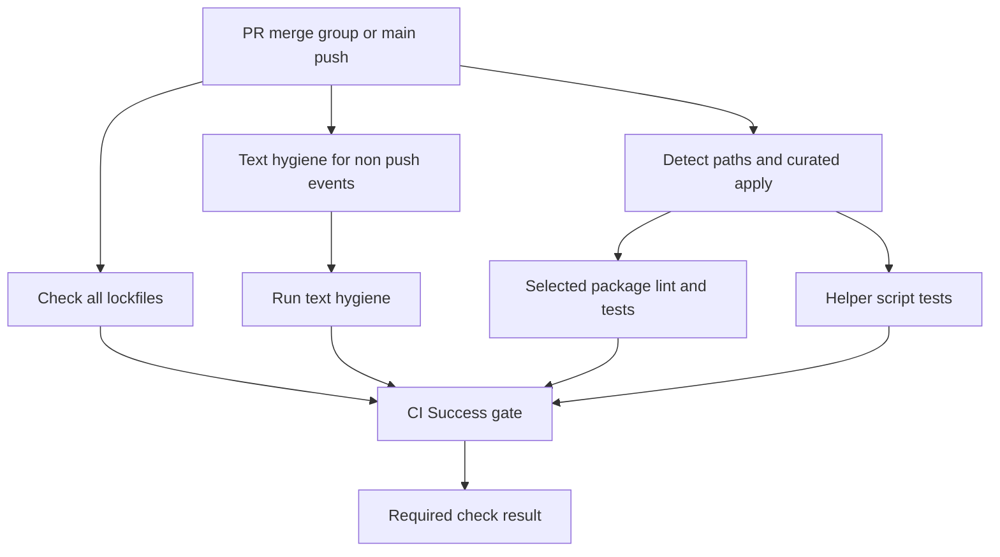

# CI Gates and Labels

`🔧 CI` is the merge-facing workflow. It runs for pull requests, `main` pushes, and merge-group events; it has read-only default permissions, including `pull-requests: read` so called test workers can obtain fresh PR labels. Reusable workflows and local actions hold shared setup, while this workflow owns job selection and the single branch-protection-facing result, `✅ CI Success`. See [Development](development.md), the [Testing Guide](../testing/testing-guide.md), and [GitHub Action integration](../integrations/github-action.md).

## CI topology and required result

The unconditional `check-lockfiles` reusable job starts independently. On non-push events, `text-hygiene` is a separate five-minute job; it checks out full history without credentials, supplies the PR or merge-group base/head range to `make -C libs hygiene`, and annotates each changed hunk if fixing hooks leave a diff. A push intentionally skips this job. `changes` separately determines package work. On a PR or merge group, `dorny/paths-filter` selects affected package lint/test jobs; a push runs every package job. Package filters include CI infrastructure and editable SDK dependencies, while `talon-src` tracks only `libs/talon/**` for waiver eligibility.



*The final gate waits on lockfiles, text hygiene, selected package work, and helper tests; skipped selected jobs are not treated as failures.*

Specialized work includes three stable `libs/code` test shards, a Deepagents Windows leg, a QuickJS prompt smoke test for SDK-only changes, and deterministic DRBench dataset generation for eval changes. The advisory Talon-comment job is deliberately not a gate dependency.

### Gate evaluation

`ci_success` uses `if: always()`. It first rejects any `check-lockfiles` result other than `success`. It also requires text hygiene to succeed except for its expected `skipped` result on a push. A curated-release inheritance decision is considered only after those two controls pass. For ordinary runs, the job rebuilds a named result map from `toJSON(needs)`, excluding `changes` and skipped jobs, and passes it to `ci_gate.py`; the script returns `waived`, `failed`, and `cancelled` lists, while the workflow decides the exit status.

The gate script is sparse-checked out from `github.base_ref || github.sha` with credentials disabled. Thus a PR cannot modify the program that judges its own results; a PR copy is used only if the trusted base lacks the script during its bootstrap rollout. The sole waiver is a `failure` of `lint-talon` or `test-talon` on a `pull_request` whose narrow `talon-src` output is not `true`. It does not waive cancellations or other jobs, and merge-group runs remain strict. Push cancellations are tolerated because concurrency preemption is expected to be superseded by the newer `main` run. When the Talon waiver applies, a separate PR-comment job records the required follow-up without participating in `ci_success`.

## Lockfiles and text hygiene

`check_lockfiles.yml` is called unconditionally and is credential-less/read-only. It configures Python 3.14 and the local `uv_setup` action with caching disabled, then calls `check_lockfiles_pre_commit.py` without paths. That invocation checks every discovered package lockfile, independent of package path selection. The checker can also be used with explicit changed paths: it limits validation to owning packages, expands changed manifests through transitive local `[tool.uv.sources]` consumers, and prints an exact `uv lock --directory ... --python ...` repair command for a stale lock.

Text hygiene is no longer a side effect of the lockfile reusable workflow. It is a first-class CI job with its own named failure and diff annotations, but remains an explicit gate dependency. Run the equivalent local checks before pushing:

```bash
make -C libs hygiene
make -C libs lock-check
```

Do not path-filter, advisory-route, or otherwise bypass either control: lockfile validation is required on every CI event; hygiene is required whenever it is scheduled.

## Curated release-note applies and inherited results

A package job skip is allowed only for a tightly identified release-bot apply: an in-repository PR by `RELEASE_BOT_LOGIN` on the release-please component branch whose single-parent commit has the expected bot identity, subject, and exactly one modified managed changelog. The detector and release configuration come from a credential-less trusted base checkout. The workflow then queries the parent commit for exactly one latest `✅ CI Success` check and recognizes the optimization only for a conclusive `success` or `failure`; lookup errors, malformed data, and all other conclusions run normal package jobs.

For a recognized apply, the package jobs and helper-script test job are skipped. `✅ CI Success` passes only if the inherited parent conclusion is `success`; a failed parent remains a failed gate. On inherited failure, a best-effort, `continue-on-error` diagnostic step uses read-only check APIs to identify failed sibling checks, adds sanitized links and rerun instructions to the summary, and never changes the gate result. The run that rereads a repaired parent must be **Re-run all jobs**, since rerunning failed jobs retains the original `changes` output. Release-bot applies are also excluded from normal in-progress cancellation so a newer bot update cannot cancel a run still reading its parent result.

## Label-controlled test exceptions

The reusable `_test.yml` worker validates JSON matrix inputs before expanding a non-fail-fast matrix, configures the local `uv_setup` composite action, synchronizes the test group, executes platform-specific tests, and requires a clean working tree. `uv_setup` pins setup-uv and uv, supports cache control and working-directory dependency globs, and enables cache pruning.

Warnings are errors by default. For PR runs only, `_test.yml` reads the live labels API once with `per_page=100`; an API error visibly fails closed. Only exact `ci:allow-warnings` adds `-W default` to POSIX and Windows test commands. Push and merge-group runs have no label context and retain strict warning behavior.

The Deepagents Linux ripgrep path has a separate, deliberately narrow exception. Ordinary non-release PRs tolerate only a two-minute install timeout when `rg` is unavailable. Release-sensitive PRs, pushes, and merge-group runs use an unbounded strict install. A release PR may tolerate a strict-install failure only with the exact live `ci:skip-ripgrep` label; failures to read labels enforce the check. A bypass without usable `rg` records a short-lived marker artifact so downstream reporting can state that rg-gated coverage was skipped. Release preflight similarly accepts an install failure only when dispatch input `dangerous-skip-ripgrep-check` is exactly `true` and records the lost coverage.

## PR labels, trailer lint, and release fan-out

`pr_labeler.yml` uses `pull_request_target` and must never check out PR-head code. It serializes mutations per PR, checks out trusted base automation, and applies size, file, branch, title/type, package, integration, and contributor labels. Its write permissions are limited to pull requests and issues; the short-lived App token is used for opened-PR membership/tier work and label events that must trigger downstream automation.

`🏷️ PR trailer lint` is a separate pull-request workflow, serialized per PR without cancelling in-progress runs. It scans the prospective squash message and every PR commit for the narrowly matched banned `Co-authored-by` trailer. It compares the listed commits with the event/current count, retries a branch-change race, and fails closed if GitHub cannot provide a complete scan. It sets failure before attempting its sticky-comment write, so a fork-token, rate-limit, or API write failure cannot turn a violation into a passing check; the fallback is the job summary. A clean recheck updates a prior sticky warning instead of deleting it.

`release_please_scope_check.yml` is a pre-merge fan-out guard. It runs on PR updates and label changes, executes its detector and release configuration from the trusted base SHA, and obtains the changed-file list through the API. It fails closed if the API list does not match `changed_files`, the detector/configuration cannot establish a safe result, or detector JSON is invalid. It identifies bump-worthy PRs with either non-lockfile edits in multiple managed components or lockfile-only edits in a managed component. `ci:allow-lockfile-release` is an explicit acknowledgement: it re-runs the check, passes it, and leaves an explanatory sticky note, but does not stop the per-component release PR fan-out. Forks retain read-only handling and use the summary if a sticky comment cannot be written.

## Focused verification

Run the executable contracts after changing topology, gates, or these exceptions:

```bash
python -m pytest .github/scripts/tests/checks/test_ci_gate.py
python -m pytest .github/scripts/tests/checks/test_check_lockfiles_pre_commit.py
python -m pytest .github/scripts/tests/release/test_check_lockfile_release_scope.py
python -m pytest .github/scripts/tests/workflows/test_ci_workflow.py
python -m pytest .github/scripts/tests/workflows/test_inherited_ci_diagnostics.py
```

The workflow tests execute the shell gate and ripgrep control paths as well as inspecting YAML topology. The inherited-diagnostics tests execute the diagnostic script with mocked checks to ensure trusted links, sanitization, best-effort reporting, and unchanged failure semantics. Treat failures here as gate/control regressions rather than formatting issues.
