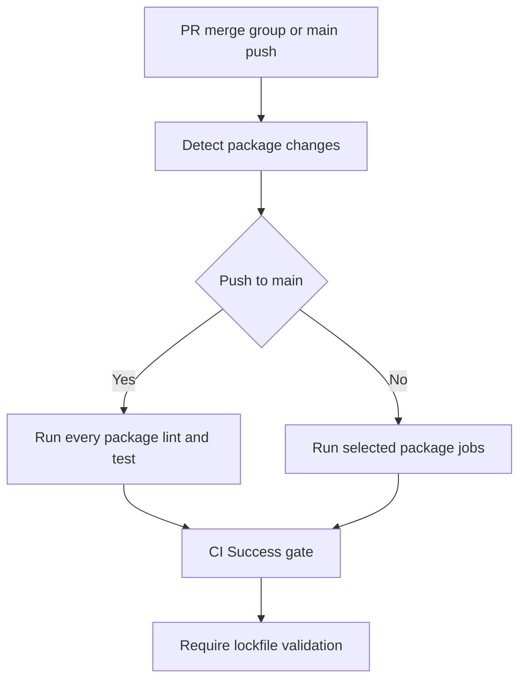
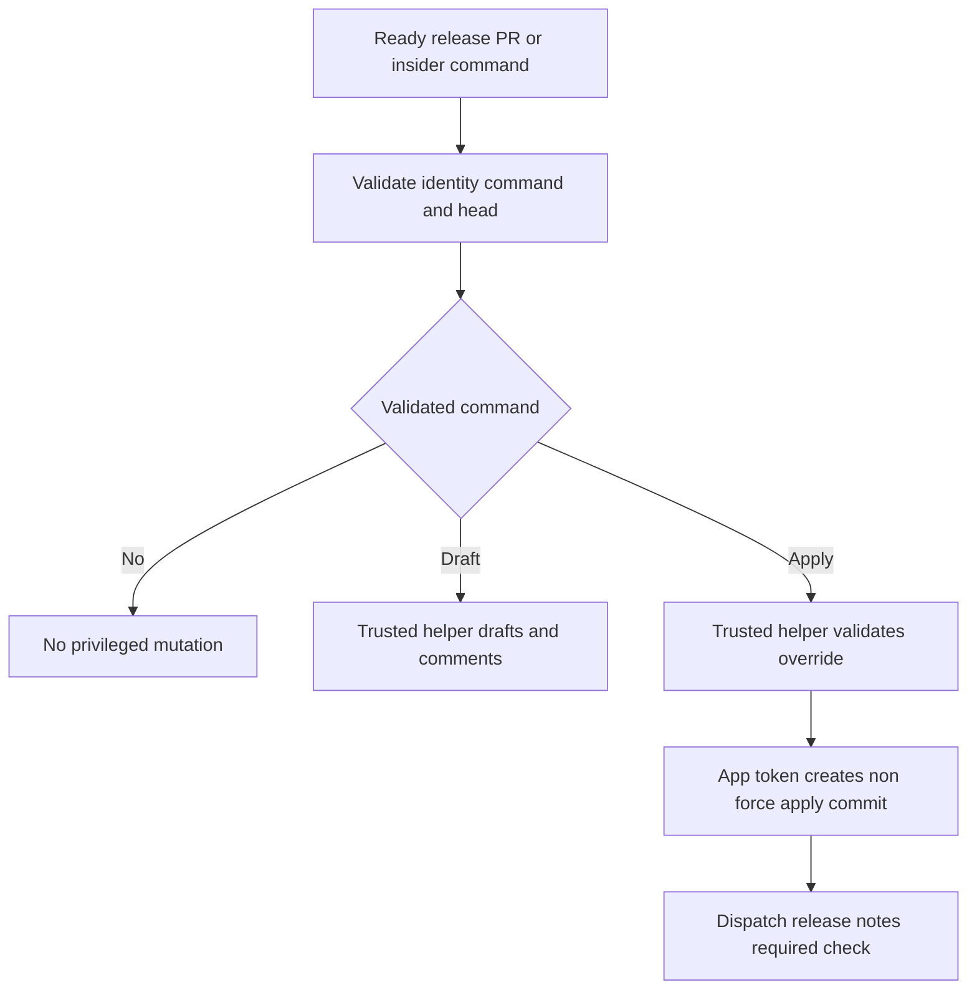

# CI, Labels, and Workflow Security

This is the operational source of truth for CI and workflow trust boundaries. In `.github`, event-facing files are entry workflows and `_*.yml` files are `workflow_call` components; add shared setup to a reusable workflow or a composite action rather than duplicating it. See [Development](development.md), the [Testing Guide](../testing/testing-guide.md), [Run Evals](../workflows/run-evals.md), and the [source map](../architecture/source-map.md).

## CI selection and the reusable test worker

`ci.yml` runs on pull requests, `main` pushes, and merge-group events. Its change detector maps paths to package jobs: PR and merge-group runs call lint and `_test.yml` only for affected packages, whereas a push runs every package job. Filters deliberately include CI/action paths, and packages that editable-install `libs/deepagents` also select on SDK changes. `libs/code` is sharded three ways; the deepagents matrix also has a Windows leg. A dedicated quickjs smoke job covers vendored prompt snapshots when the SDK changes but quickjs itself does not.



*Package selection reduces PR work, while the final gate preserves a single branch-protection result.*

`_test.yml` accepts a working directory, a JSON array of quoted Python versions, optional OS configurations, and optional shard strings. Each matrix leg validates the input JSON before checkout; the non-fail-fast matrix then uses the local `uv_setup` action, runs `uv sync --group test`, executes `make test` off Windows or direct pytest on Windows, and asserts that the worktree is clean. The reusable workflow has only `contents: read` and `pull-requests: read`; a caller may narrow this token but cannot use the callee to widen it.

`uv_setup` pins `astral-sh/setup-uv` and uv `0.13.6`, sets the requested Python version, enables cache by default, prunes that cache, and scopes dependency invalidation to project manifests, locks, and requirements files under its working-directory input. Release preflight jobs intentionally turn this cache off so a stale environment cannot mask an undeclared dependency.

### Maintainer label exceptions

Warnings are errors unless `_test.yml` sees the exact `ci:allow-warnings` label. On a pull-request run it reads the live labels endpoint once with `per_page=100`, rather than trusting the replayed event payload. API failure writes an empty flag and emits an error, so the exception fails closed; only the exact label supplies `-W default` to both POSIX and Windows commands. Push and merge-group runs have no PR label context and retain warnings-as-errors.

The Deepagents Linux ripgrep path has a similarly narrow distinction: ordinary PRs soften only a two-minute timeout when no usable `rg` remains, while release-sensitive PRs, pushes, and merge-group runs are strict. A release PR may use live `ci:skip-ripgrep` only after a successful label lookup; a bypassed failure records a marker artifact and does not assert coverage. The release preflight follows the same principle: only exact `dangerous-skip-ripgrep-check=true` can continue after an install failure, and it records the resulting loss of artifact-test coverage.

## The CI Success decision boundary

`✅ CI Success` always evaluates its dependencies and always requires lockfile validation. Its decision code is sparse-checked out from the trusted base ref with credentials disabled, rather than executed from the PR merge checkout; this prevents a PR from changing the program that judges its own results. The bootstrap fallback to a PR copy exists only until the base branch contains the gate script.

On a pull request that did not change `libs/talon`, failed (not cancelled) Talon lint/test jobs may be waived; push and merge-group runs remain strict. The non-gating advisory job documents a waiver with a sticky PR comment. For a release-bot changelog-only curated-notes commit, CI can inherit a *conclusive successful* parent CI result; a failure or indeterminate parent keeps the gate failing. Do not add advisory jobs to the gate's `needs` list or move trusted gate logic to PR-controlled code.

## PR labeling and release-scope labels

`pr_labeler.yml` is a `pull_request_target` workflow and therefore must never check out PR head code. It checks out the base workflow code, serializes per-PR mutations, and applies size, file/branch/title-derived type, package, integration, and contributor labels through shared labeling helpers. On opened PRs it obtains a short-lived GitHub App token to determine private organization membership and apply external contributor/tier labels; this also permits downstream label-triggered automation. The job-level write scopes are limited to PR and issue labels, and classifier/provider secrets are injected only into the label-application step.

`release_please_scope_check.yml` is a separate PR gate for bump-worthy fan-out. It runs the detector and release configuration from the trusted base SHA, gets the changed-file list through the API, and fails closed if that list is incomplete or detector output is absent or malformed. The exact `ci:allow-lockfile-release` label acknowledges an intentional multi-component or lockfile-only fan-out; it does not prevent release-please from creating the corresponding release PRs. Branch protection and review of workflow edits remain necessary because `pull_request` workflow definitions originate from the PR head.

## Release and curated-note mutation boundaries

`release.yml` is dispatch-only, not reusable, because PyPI Trusted Publishing requires that route. Its read-only build job resolves a supported package and immutable release SHA, validates normal-release ancestry on `main` and the package version at that SHA, derives the Python matrix, builds there, and records distribution checksums. Pre-release checks are read-only, cache-free matrix jobs that test the built distribution. Jobs that publish use only the distribution artifact and `id-token: write`; they verify the build-job checksums before publishing. Keep build/test code and publishing credentials in separate jobs.

`release_notes.yml` is the privileged boundary for curated release PR notes. It accepts only a ready-for-review PR event or an insider `@release-bot` comment, then validates trigger, release identity, permission, and expected head before draft/apply work. Automation helpers are always checked out from credential-less `main`; release-PR content is retrieved as untrusted API data at the validated SHA and is never checked out or executed in an App-token job. The drafting subprocess receives only its selected model key plus file paths, not the parent environment.



*Only validated paths receive the short-lived App token; untrusted release-PR text never becomes executable workflow input.*

Draft and apply jobs are gated by validation, run in `release-bot`, and obtain short-lived App tokens with explicit contents, issues, and pull-request scopes. Apply uses Git Data API mutations without rewriting history and explicitly dispatches `release_notes_check.yml`, because an App-token update does not emit the normal PR event that refreshes the required check.

## Harbor and unified evaluations

`_harbor_run.yml` supports a caller-provided flat matrix or expands one dataset into shards. Preparation chooses the matrix, derives its effective parallel pool, and constructs an aggregate matrix; Harbor leaves run non-fail-fast. Per-leaf runner labels permit category-specific architecture while the caller-facing unified workflow restricts its runner choice to known labels.

Credential validation happens before a Harbor leaf executes: it selects a provider key from the model prefix, requires LangSmith and category-specific credentials, rejects unknown sandbox/provider values, and validates OpenRouter judge syntax. Keep secrets at this consuming step. The secret-bearing leaf has read-only GitHub access; only the aggregate job gets `actions: write` to download and clean up scoped shard artifacts. Aggregation runs after non-cancelled Harbor work, processes available shards even after a leaf failure, and is `continue-on-error` so post-run analysis does not convert already-paid evaluation results into a failed evaluation workflow.

`unified_evals.yml` prepares a per-model, multi-category flat matrix and calls Harbor once per prepared model/branch row. It bounds model concurrency in addition to Harbor shard concurrency. LangSmith cost collection is best effort in the `evals` environment and is the only job receiving `LANGSMITH_API_KEY`; the write-capable cross-model combine job receives result artifacts but not that key. Its publishing work is serialized because all refs share an output branch.

## Verification when changing these controls

Run the workflow contract tests when editing this area:

```bash
python -m pytest .github/scripts/tests/workflows/test_ci_workflow.py
python -m pytest .github/scripts/tests/release/test_release_notes.py
```

The CI tests execute ripgrep and label-resolution shell paths against stubs, check package and gate topology, and lock down trusted-base behavior. The release-note tests run the Node helper tests and statically assert trigger restrictions, trusted checkout, token scope, child-process environment, and required-check refresh behavior. Treat a failing contract test as a security-control regression, not merely a YAML formatting issue.
