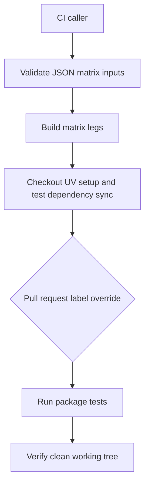
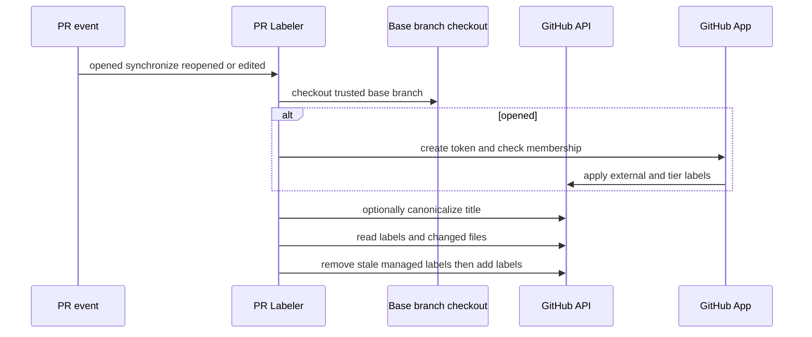

# CI and Pull-Request Labeling Operations

The repository treats CI execution and PR metadata as separate but connected operational systems. The reusable test workflow gives package callers a validated matrix and a consistent test environment. `pr_labeler.yml` owns mutations to PR labels in one sequential workflow so size, title, changed-path, provenance, and contributor classification do not race each other. The label taxonomy and the configuration are the operational contract; do not copy mappings or thresholds into a workflow.

For package-local developer commands, see [Development](development.md); for focused product tests, see the [Testing Guide](../testing/testing-guide.md). The authoritative taxonomy is [`.github/LABELS.md`](../../.github/LABELS.md).

## Reusable unit-test workflow

`.github/workflows/_test.yml` is a reusable `workflow_call` workflow, not an event entrypoint. A caller supplies a required `working-directory` and JSON array of quoted `python-versions`; it may override the primary runner OS and add explicit `{python-version, os}` matrix legs. A short validation job rejects malformed JSON and non-string version or leg fields before matrix expansion. The build job waits for that validation, runs every requested primary-version/OS pair plus extras, and has `fail-fast: false`, so one bad leg does not cancel diagnostic results from the others.

Each build leg has a 20-minute limit, checks out the selected ref, invokes the local `./.github/actions/uv_setup` action with a working-directory-specific cache suffix, and runs `uv sync --group test` under `UV_NO_SYNC=true` and `UV_FROZEN=true`. The workflow conditionally installs Node 24 for `libs/talon`; it runs the package `make test` route on non-Windows runners and a direct `uv run --group test pytest -n auto -vvv tests/unit_tests/` route on Windows because the Makefile's sandbox path needs POSIX `sh`. The final clean-tree check catches tests or generators that modify tracked files.

### Live-label test escape hatch

The reusable workflow grants only `contents: read` and `pull-requests: read`. On a `pull_request`, it reads current labels from the GitHub API instead of the webhook payload: a rerun retains the original payload and could otherwise miss a recently applied maintainer override. A failed label lookup is announced and **fails closed**—the override remains disabled.

`ci:allow-warnings` supplies `-W default`, which takes precedence over pytest INI warning filters for that PR run. Push and merge-queue runs lack PR label context and always enforce the normal warning policy. The `ci:skip-ripgrep` override is narrower: it is consulted only for Linux `libs/deepagents` release-sensitive PR runs. Those runs normally require successful `apt` installation of ripgrep and set `DEEPAGENTS_RIPGREP_EXPECTED=1`; the override tolerates a failed install, records a one-day marker artifact when no usable `rg` exists, and allows the affected ripgrep-gated tests to skip. In contrast, normal PR installs have a two-minute bound: timeout statuses are recovered with bounded `dpkg --configure -a`, then either proceed if `rg` is usable or emit the same marker artifact. Non-timeout installation failures remain failures.



*The reusable workflow validates inputs before fan-out and uses live PR labels only for narrowly scoped test-policy overrides.*

## PR labeler: trust boundary and lifecycle

The `PR Labeler` listens to `pull_request_target` actions `opened`, `synchronize`, `reopened`, and `edited`. This event has repository authority, so its central security invariant is that it checks out the base branch—not PR-head code—before loading `pr-labeler.js` and its JSON configuration. Never change that checkout to an untrusted head ref or execute PR-provided scripts in this job.

The labeling job runs in the `labeling` environment with only contents read plus pull-request and issue write permissions. On `opened`, it generates a GitHub App token and verifies it before asking the private organization-membership endpoint whether the author is external. Bots and active members are internal; a 404 is external; any other membership error fails rather than treating an unknown author as external. The App token is also used for the external label and tier step because labels written with the default `GITHUB_TOKEN` do not trigger downstream label-event workflows.

Before ordinary label application, non-release Conventional Commit scopes are canonicalized using `scopeAliases`: for example, `deepagents-code` becomes `code`. Release titles are deliberately excluded because their scopes are canonical release records. If the title update API call fails, the run warns and still labels the original title; if it succeeds, the corrected title is passed through a step output because the event payload remains stale.



*PR-head content remains data; the privileged workflow loads its executable labeling logic only from the base branch.*

## Classification is configuration-driven

`.github/scripts/labeling/pr-labeler-config.json` is the shared source of truth for label colors and descriptions, size thresholds, ignored files and paths, title scope mappings and aliases, branch/path/topic rules, Conventional Commit type mappings, release marker, and contributor threshold. `pr-labeler.js` refuses a configuration missing any required group. `ensureLabel` creates a missing label with its prefix color and configured description; a concurrent creator producing HTTP 422 is accepted as an already-created label. New automatic labels therefore need both an applicable rule and a description.

### Size, title, paths, and branches

On every event except `edited` (where the file set is unchanged), the workflow paginates PR files. Size is additions plus deletions excluding any basename `uv.lock` and every `docs/` path. Thresholds are exclusive upper bounds: `size: XS` below 50, `S` below 200, `M` below 500, `L` below 1000, and catch-all `XL`. The calculated size replaces other size labels; it is the principal automatically reconciled file-derived classification.

The title parser recognizes `type(scope): subject` and a `!` immediately before the colon. It maps recognized types—including `release` to `auto:release-pr`—and comma-separated scopes to configured `type:*`, `package:*`, or `integration:*` labels. A recognized title edit removes only stale managed type/breaking/release labels; an unrecognized title preserves the previous title classification. Scope and changed-path labels are additive, so title changes do not remove package or integration evidence. Branch rules add `org:open-swe` for an `open-swe/` head branch.

Path rules identify package and integration ownership by configured prefix and normally ignore lockfile-only changes. Topic path rules are intentionally more specific: they classify modules such as a middleware subagent implementation or an MCP module, rather than inferring a topic from an entire package. The labeler ensures every label to be added exists before submitting its batch, avoiding GitHub's all-or-nothing 422 failure when one label is missing; removals tolerate an already-absent 404.

### Topics and human authority

PR topic labels begin with changed-module rules, not PR prose. Existing topics are additive, and a human removal has special meaning. The labeler reads the complete issue-event history: a user `unlabeled` event suppresses that topic, while a later human `labeled` event clears the suppression. Bot or unattributed events do not establish the override.

Only a later `synchronize` event can reconsider a human removal. It compares the event's `before` SHA to the PR head and declines to re-add if history is not simply ahead, the comparison has no patches or has 300 or more files, the changed files do not match a removed topic, candidate descriptions are missing, or contextual input exceeds 20,000 characters. Otherwise the topic classifier receives the removed-topic history, latest relevant patches, and bounded title/body context; it is explicitly instructed to require a substantive new topic-specific change and to treat embedded text as untrusted. Classifier errors warn and preserve the removal, so topic reapplication is conservative without blocking size, package, or type labels.

The default classifier uses the Groq OpenAI-compatible endpoint with `openai/gpt-oss-20b`, temperature zero, JSON output, and a 15-second abort timeout; `TOPIC_CLASSIFIER_PROVIDER=semif` selects the alternative provider. Results are deduplicated, filtered to allowed labels, and capped at three. The issue labeler uses the cached `.github/topic-labels.json` manifest and model classification on issue opening; PR topic classification is path-driven except for the removal-reconsideration case.

### Provenance and contributor tier

On opening, internally classified authors receive `org:internal`. External authors receive `org:external` and, after a search for their merged PRs in this repository, `auto:new-contributor` at zero merges or `auto:trusted-contributor` at the configured threshold of five or more. A malformed search query (HTTP 422) means the tier is skipped rather than inferred. These labels are opening-time provenance, not a periodic reconciliation of all PRs.

## Ordering, cancellation, and repair

All main label calculations first accumulate `toAdd` and `toRemove`. The workflow ensures additions, removes stale labels that are not also being added, then adds the remaining batch. It handles the title canonicalization output before title matching, and it performs external tiering and external-label delivery after the standard mutation step. This ordering keeps a corrected title and its resulting labels coherent within one run.

Concurrency is per workflow, PR number, and phase. `opened` has its own group and is never cancelled; all non-open updates share an `update` group and cancel an in-progress predecessor. Thus a rapid series of synchronize/edit/reopen updates converges on the newest run without allowing an update cancellation to discard the one-time provenance work on opening. Consolidating the formerly separate label workflows is intentional: do not add another PR-label mutation workflow, because independent writers can race on the same label set.

For existing open PRs, manually dispatch `pr_labeler_backfill.yml` with a positive `max_items` value. It reuses the shared helper and processes up to that many PRs, pre-creates size/tier labels, caches contributor lookup per author, and continues after individual failures while marking the job failed at the end if any occurred. It reconciles stale sizes and title labels; when contributor-tier lookup is unknown, it deliberately leaves tier labels untouched rather than turning uncertainty into a removal.

## Safe changes and focused tests

When extending taxonomy, update the config rather than embedding thresholds, scope aliases, colors, or labels in `pr_labeler.yml`. Add a description for every potentially created label, a prefix color for each automatic taxonomy family, and focused rules only when an automatic match is truly deterministic. Preserve release-title scope exemption and update the tests when crossing a workflow/helper boundary.

The Node contract suite in `.github/scripts/tests/labeling/pr-labeler.test.js`, run through `test_pr_labeler.py`, covers canonical scope rewrites, release-title preservation, config reachability and descriptions, tier thresholds and workflow/config drift, title stale-label semantics, path-based topic selection, human topic removals and conservative reapplication, label creation/colors, and workflow-script behavior. Run the focused wrapper from the repository root:

```bash
python .github/scripts/tests/labeling/test_pr_labeler.py
```

Changes to `_test.yml` should additionally be exercised by its callers through CI: its reusable interface is consumed by `ci.yml`, whose PR, push-to-main, and merge-group executions pass the read permission needed for live override lookup.
