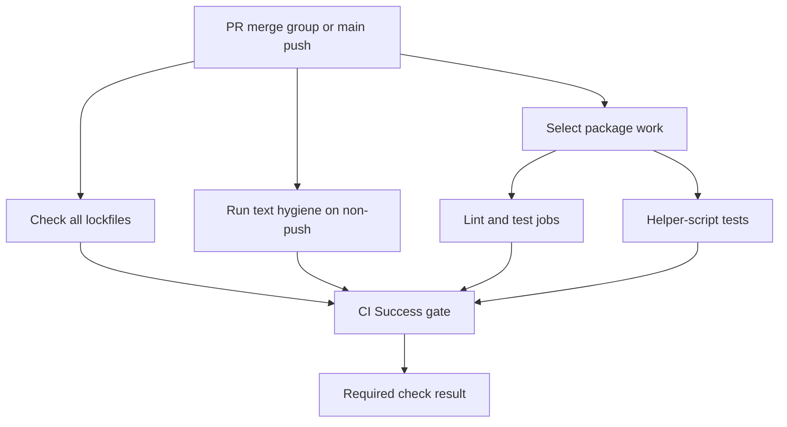
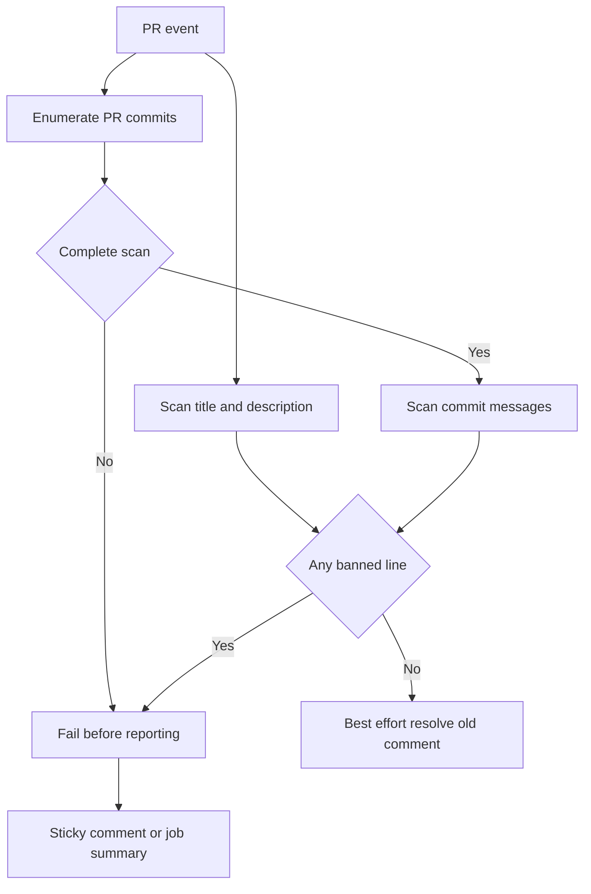

# CI Gates and Labels

CI is split between the merge-facing `🔧 CI` workflow and independent PR controls. `ci.yml` owns the branch-protection-facing `✅ CI Success` result; scope, release-fan-out, trailer, Markdown, README, and dependency-freshness workflows have their own status and must be configured as required checks if they are to block a merge. Manual Harbor and unified evaluation workflows are operational experiments, not merge gates. See [Development](development.md), [Run evaluations](../workflows/run-evals.md), and [the source map](../architecture/source-map.md).

## Merge CI and the shared gate

`check-lockfiles` is unconditional. On non-push events `text-hygiene` runs separately for the PR or merge-group range, while path filtering selects package lint and test work for pull requests and merge groups; a push to `main` runs all package jobs. The filters include CI infrastructure and editable SDK dependencies. `talon-src` deliberately records only `libs/talon/**`, which is narrower than the Talon test filter and is used to decide whether a failed Talon job can be waived.



*Merge CI always includes lockfile validation; hygiene participates when it is scheduled, and selected work may be skipped without itself failing the gate.*

`ci_success` runs with `if: always()`. It requires a successful lockfile result and successful hygiene except for hygiene's expected push-time `skipped` result. For ordinary runs it converts named `needs` results into a map and evaluates it with trusted base-ref gate logic. Only failed `lint-talon` or `test-talon` may be waived, only for a pull request that does not modify `libs/talon/**`; cancellation and every other failure remain blocking. Merge groups remain strict, whereas push cancellations are tolerated because a concurrency-preempted `main` run is expected to be replaced. The non-gating Talon advisory records waived failures and follow-up.

The gate script is sparse-checked out from `github.base_ref || github.sha` without credentials. Consequently, a PR ordinarily cannot alter the logic that judges its own results; a PR copy is used only for the bootstrap fallback when the base lacks the script.

### Lockfiles, hygiene, and reusable tests

`check_lockfiles.yml` performs a credential-less checkout and invokes the checker without explicit paths, so every discovered package lockfile is evaluated regardless of path selection. For explicit paths, the checker identifies owning package directories and expands through local `[tool.uv.sources]` consumers; a failed `uv lock --check` reports the package-specific relock command.

```bash
make -C libs hygiene
make -C libs lock-check
```

Do not path-filter, advisory-route, or label-bypass those controls. Lockfile validation is required for every CI event; hygiene is required whenever scheduled.

The reusable `_test.yml` validates JSON matrix inputs before a non-fail-fast matrix, checks out code, configures the local `uv_setup` action, synchronizes the test group, runs platform-specific unit tests, and verifies that the worktree remains clean. PR runs read maintainer bypass labels from the live GitHub API and fail closed if that lookup fails. `ci:allow-warnings` changes warning handling to `-W default`; the narrowly scoped `ci:skip-ripgrep` release exception can tolerate a ripgrep install failure and records an artifact, without relaxing push or merge-group enforcement.

### Curated release-note applies

Normal package work may be skipped only for a tightly recognized release-bot curated-notes apply. The detector uses a credential-less checkout of trusted-base logic and configuration, validates bot/branch/commit/changelog conditions, and looks up exactly one latest parent `✅ CI Success` conclusion. Lookup errors, malformed data, and conclusions other than conclusive success or failure run normal work.

For a recognized apply, package and helper jobs are skipped. The final gate inherits success only from a successful parent and preserves an inherited failure. A read-only best-effort diagnostic can report sanitized parent-suite failures but cannot change the result. After repair, use **Re-run all jobs**: rerunning only failed jobs retains the prior `changes` output.

## Labels are acknowledgements, not hidden permissions

The label taxonomy defines `ci:*` labels as a human acknowledgement or override read by a named gate; the labeler does not normally apply them. A label bypass does not erase the associated release or quality consequence.

| Label | Acknowledges | Remaining consequence |
| --- | --- | --- |
| `ci:allow-scope-mismatch` | Intentional mismatch between title package scope and changed package directories | Release-please can still create a release PR per touched managed component. |
| `ci:allow-lockfile-release` | Intentional multi-component release fan-out; its name predates lockfile exclusion | Each affected component can still receive a release PR. |
| `ci:allow-warnings` | PR-only warning-as-error relaxation in reusable tests | Push and merge-group enforcement remains strict. |
| `ci:skip-ripgrep` | Strict ripgrep-install failure for a release PR | The skipped rg-gated coverage is recorded rather than silently passed. |
| `ci:ack-release-deps` | Review of stale dependency-minimum advice on a release PR | It does not relax built-wheel metadata validation or PyPI installation. |

Other labels and their readers are catalogued in [`.github/LABELS.md`](https://github.com/langchain-ai/deepagents/blob/main/.github/LABELS.md). A workflow that only reads a label assumes the repository has created it.

## PR metadata and release fan-out gates

### Title scope and changed packages

`🔍 PR scope file check` compares Conventional Commit package scopes in the PR title with package directories obtained from the API file list. Its detector derives scope aliases and package identity from labeler configuration, ignores lockfile churn, and limits its release-shaped exception to a completely allowlisted set of release artifacts. A title without a declared package scope produces no mismatch; a declared scope must cover every relevant changed package.

The workflow checks out detector/configuration from the PR base SHA without credentials, but takes the title and changed-file facts from the PR. It paginates `pulls.listFiles` and compares its collected count with `changed_files`; an absent or incomplete list, malformed detector/configuration output, or malformed offender data fails closed. `ci:allow-scope-mismatch` is a deliberate passing acknowledgement and receives a sticky warning about release fan-out.

### Release-please fan-out

`🔍 Release-please scope check` is the related pre-merge control. Its trusted-base detector reads managed component paths, component names, `exclude-paths`, and visible changelog types. It treats a breaking marker or a visible changelog type as bump-worthy, honors excluded files such as `tests/` and `uv.lock`, and reports release-relevant edits to two or more managed components. The workflow consumes API-derived changed files, fails closed when it cannot establish a safe result, and blocks fan-out unless `ci:allow-lockfile-release` acknowledges it.

`⚠️ Release fan-out bypass warning` is intentionally advisory: it serializes PR updates, reads live labels to survive label-event races, and maintains a sticky warning while either fan-out acknowledgement is present. After merge, `🔍 Release-please fan-out watch` is another advisory safety net. It uses full tagged `main` history to compare each managed component with its manifest-derived release tag, reports only matching open release-please branches, and temporarily skips a component whose release tag has not yet been published.

## Banned-trailer pre-merge check

`🏷️ PR trailer lint` runs for opened, edited, synchronized, and reopened pull requests, with a per-PR queued concurrency group so a later event cannot race the sticky-comment update. It uses a deliberately narrow pattern shared with the `main` repository ruleset: the `Co-authored-by: ... <noreply@anthropic.com>` trailer and the `Generated with [Claude Code]` footer. It does **not** apply a broad case-insensitive match, because that would diverge from the ruleset it is intended to predict.

The check scans two distinct merge surfaces:

1. The prospective squash message, formed from PR title, PR number, and normalized description. A match blocks squash merging to `main`.
2. Every individual PR commit message. This protects merge-commit and rebase-style paths even though a squash merge drops individual messages.

GitHub's PR commit-list endpoint cannot reliably certify more than 250 commits. The workflow therefore caps at 250, compares listed commits with the PR's declared count, and fails closed if it is capped, if listing errors, or if a force-push race remains after three retries with refreshed PR metadata. It records failure *before* attempting the sticky comment; a comment write failure (for example, a restricted fork token or rate limit) falls back to the job summary and cannot turn a red finding green. A later clean scan best-effort marks the existing sticky warning resolved.



*Trailer lint certifies both the squash message and commit history; incomplete history is a failure rather than a clean result.*

## Release dependency checks

`📦 Check Dependency Freshness` is a PR workflow for titles beginning `release(`. It is cancelled and replaced on a newer run for the same workflow/ref. Non-release PRs explicitly report a clean, non-indeterminate result. For a release PR it resolves the release-please component, checks out the code with full history, and runs two different safeguards before building and installing the artifact.

1. **Manifest freshness is advisory.** `check_dep_freshness.py` examines changed release-package `pyproject.toml` files between the PR base and head. It considers bounded runtime and optional dependencies with concrete minimums, excluding direct URLs, self references, and dependencies backed exclusively by local path/workspace `uv` sources. It queries canonical PyPI projects concurrently, ignores fully yanked releases, and by default considers a pre-release only when the declared minimum itself is a pre-release. A newer version produces annotations, a summary, and a sticky PR report with whether it fits the current upper bound; `ci:ack-release-deps` records review rather than changing resolver behavior.
2. **The built wheel is load-bearing.** The workflow builds exactly one wheel using the target interpreter, reads its wheel metadata, and validates applicable requirements against live PyPI metadata. A direct-URL requirement, unavailable PyPI metadata, no compatible published version, incompatible Python coverage, or unpublished/lagging metadata for a repository-managed sibling fails the check. A third-party bound that only omits future, unreleased CPython minors is a warning; gaps at actual supported installation targets remain failures. The workflow then creates a target-Python virtual environment and installs the wheel with dependency resolution restricted to `https://pypi.org/simple`.

Freshness findings do not fail the main check. The comment manager maintains a bot-owned `<!-- dep-freshness-check -->` comment: it creates or updates the report when stale bounds are found, deletes it once clean or acknowledged, preserves a prior report when PyPI results are indeterminate, and leaves it untouched when the check crashed before producing outputs. Comment permissions are confined to this advisory job and a 403 degrades to a warning.

## Manual Harbor and unified evaluations

### Harbor single-model dispatch

`📊 Evals - Harbor` is manually dispatched and accepts exactly one resolved `provider:model`. The `models_override` input takes precedence over the dropdown but still must resolve to one model. It selects a registry dataset, arbitrary override, or local dataset path; chooses Docker or LangSmith sandboxing; and invokes `_harbor_run.yml` after preparation. The prep job validates the single model, `n_shards <= 200`, and per-shard concurrency `<= 4`, then derives a shard pool bounded so the pool times concurrency does not exceed 40 sandbox slots. Category is derived as context for a local path, conversation for tau3, and autonomous otherwise.

The leaf workflow owns matrix expansion, shards selected work after task selection, and aggregates artifacts by category. LangSmith snapshot prewarming is best effort and only applies to eligible single registry-dataset LangSmith runs; shard execution proceeds even if it fails. Before expensive work, a leaf checks the sandbox type, model-provider credential, LangSmith tracking key, OpenAI verifier key, and category-specific keys such as Tavily for research. It rejects unknown sandbox/provider values and unsupported native-agent/provider or branch-overlay combinations. A Harbor package override is a newline-separated set of PEP 508 specs installed together with `--reinstall --refresh`; treat it as trusted input and prefer immutable source revisions.

### Unified multi-model experiments

`📊 Evals - Unified` is also manually dispatched. Prep parses models, categories, harnesses, optional comparison branches, profile, and task filters into a flat per-model/category/shard matrix. For `full`, it enumerates live tasks using the same category map and local-dataset preparation as execution; `lite` uses its frozen subset. Unknown categories, no categories, unknown task selections, invalid native-agent/provider combinations, or native-agent branch comparisons fail during preparation rather than after spend starts. It resolves each comparison branch to a 40-character remote SHA, bounds per-model task concurrency at 40, aggregate runners at 80, the outer GitHub matrix at its configured cap, and post-pack jobs at 400. The eval job calls `_harbor_run.yml` once per model configuration with a non-fail-fast matrix and the derived runner budget.

A branch comparison deliberately keeps datasets, verifiers, scoring, and the Harbor harness at the workflow revision; only the agent libraries are overlaid from a validated resolved branch SHA. This makes compared-agent differences interpretable without allowing an older branch to replace evaluation infrastructure.

The downstream `usage` job is best effort and is the only analysis job given `LANGSMITH_API_KEY`; it reads usage and uploads an artifact. `combine` is also best effort after evals: it downloads leaf and usage artifacts with diagnostics, creates results/comparisons, uploads them, and serializes optional chart publication to `eval-assets`. Only that publishing job receives `contents: write`; a missing artifact or chart failure produces incomplete diagnostics rather than changing the result of paid evaluation work.

## Package-release dispatch controls

`🚀 Package Release` is a `workflow_dispatch` workflow rather than reusable, because PyPI Trusted Publishing is not supported for reusable workflows. It builds a selected package, runs pre-release checks, publishes to TestPyPI, publishes to PyPI, and then creates the GitHub release. Normal releases require an explicit 40-character release SHA reachable from `main` whose package `pyproject.toml` version equals the supplied version. `dangerous-nonmain-release` is the explicit exception: it permits a branch-contained SHA (or dispatch SHA fallback) and skips that normal version/main reachability validation.

Build runs with read-only permissions and records distribution checksums. TestPyPI and PyPI publishing jobs download the artifact and independently compare those checksums before using an `id-token: write` trusted-publishing permission; they do not check out source. Pre-release artifact tests use the resolved release SHA, a Python matrix derived from that package manifest, no dependency cache, and a locally built wheel. `dangerous-skip-sdk-pin-check` is limited to the Code SDK-pin comparison, while `dangerous-skip-ripgrep-check` allows an otherwise failed ripgrep install only after recording whether rg-gated artifact coverage was lost.

Release notes are explicitly fail-open: a notes-job failure does not prevent an already validated PyPI publication and GitHub tag, but `mark-release` exposes the empty-body condition and recovery command. After tagging, the workflow transitions the associated pending release PR to `auto:release-tagged`, using API association first and exact-title/label fallback only when necessary. Failure to update a normal release PR label fails that final step and gives a manual recovery summary. A successful `deepagents` publish best-effort dispatches the Code SDK pin-bump workflow; this post-publish convenience cannot make the release fail.

## Focused verification

Run executable contracts after modifying these controls:

```bash
python -m pytest .github/scripts/tests/checks/test_ci_gate.py
python -m pytest .github/scripts/tests/checks/test_check_lockfiles_pre_commit.py
python -m pytest .github/scripts/tests/labeling/test_check_pr_scope_files.py
python -m pytest .github/scripts/tests/release/test_check_lockfile_release_scope.py
python -m pytest .github/scripts/tests/release/test_check_dep_freshness.py
python -m pytest .github/scripts/tests/release/test_check_wheel_dep_freshness.py
python -m pytest .github/scripts/tests/release/test_check_open_release_fanout.py
python -m pytest .github/scripts/tests/evals/test_validate_harbor_limits.py
python -m pytest .github/scripts/tests/workflows/test_ci_workflow.py
python -m pytest .github/scripts/tests/workflows/test_inherited_ci_diagnostics.py
```

The focused freshness tests cover prerelease policy, yanked/malformed PyPI data, local-source exclusions, advisory outputs, sticky-comment preservation, built-wheel metadata, markers and extras, sibling Python metadata, and install-flag parity with `release.yml`. The Harbor limits tests protect the dispatch resource invariants; workflow definitions remain authoritative for credential and publication boundaries.
