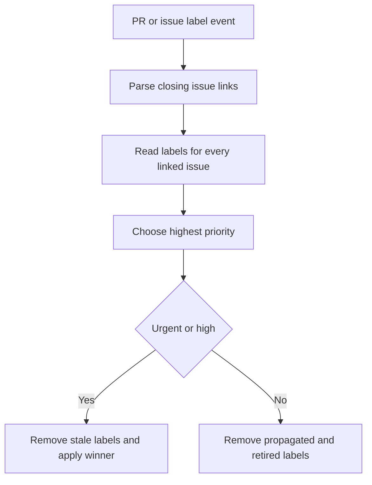

# CI, Labels, and Workflow Security

This page describes the operational boundaries around CI overrides, release publishing, evaluation dispatch, and label synchronization. It complements [Development](development.md), the [Testing Guide](../testing/testing-guide.md), [Run Evals](../workflows/run-evals.md), and the [source map](../architecture/source-map.md). The `.github` convention is important when changing this machinery: event entrypoints have ordinary names, while `_*.yml` files are reusable `workflow_call` components. Keep shared setup in the existing reusable workflow or composite action rather than copying it into a new entrypoint.

## Labels: ownership and propagation

Labels are control-plane data, not a substitute for a successful check. The taxonomy assigns `ci:*` to maintainer acknowledgement or narrowly defined gate overrides; the PR labeler does not write them. In contrast, `priority:*` is synchronized by `sync_priority_labels.yml`: it recognizes `Closes`, `Fixes`, and `Resolves` links in PR bodies, recomputes the highest priority across all linked issues, and makes `priority:urgent` outrank `priority:high` and `priority:backlog`. Only urgent and high propagate to a PR. The workflow removes `priority:backlog` and retired `p0`–`p4` labels instead of mapping them, so a PR has no propagated priority when no eligible linked issue remains.

The synchronizer is a privileged metadata-only boundary. Its PR path uses `pull_request_target`, never checks out PR code, and has write permissions only at the jobs that mutate issue/PR labels. It serializes PR events per PR, issue events per issue, and manual work globally; concurrent issue updates can still meet on a PR, but each run derives the complete desired state and therefore converges by last writer. A `workflow_dispatch` backfill requires a positive `max_items` and processes open PRs independently.



*Priority synchronization recomputes a PR's state from its linked issues rather than incrementally copying the triggering event.*

### Live CI exceptions

`_test.yml` is a reusable unit-test worker. It validates JSON matrix inputs before expanding a non-fail-fast matrix, then checks out code, uses the local `uv_setup` action, synchronizes the test group, executes platform-appropriate tests, and verifies a clean tree. Its permissions are only `contents: read` and `pull-requests: read`; callers cannot use a called workflow to increase that token.

The warnings exception is intentionally live: only pull-request runs query the GitHub API, in one `per_page=100` request with exact matching. On an API error, the workflow announces the failure and produces the enforcing empty flag. `ci:allow-warnings` yields `-W default`, which takes precedence over package warning filters but does not defeat per-test warning marks. Push and merge-group runs have no PR label context and retain enforcement.

The reusable `_test.yml` workflow validates required JSON matrix inputs before expanding a non-fail-fast build matrix, then checks out code, uses the local uv setup action, synchronizes the test group, runs platform-specific unit-test commands, and verifies a clean working tree.

`_test.yml` reads maintainer bypass labels from the live GitHub API only for pull-request runs and fails closed if that lookup fails; `ci:allow-warnings` adds `-W default`, while the narrowly scoped release ripgrep bypass can tolerate an install failure and record an artifact without weakening push or merge-group enforcement.

### Ripgrep coverage is explicit

The ripgrep installer uses a pinned ripgrep 14.1.0 Linux x86_64 musl archive, verifies its SHA-256 before installing `rg`, and exits nonzero for unsupported architecture or installation failures so workflow callers retain policy control.

Ordinary Linux Deepagents PR legs bound installation to two minutes. A timeout with no usable `rg` produces a one-day marker artifact naming the affected package/OS/Python leg; other installer errors remain failures. Release-sensitive PRs, pushes, and merge-group legs use the strict installation path. On a release-sensitive PR alone, a live `ci:skip-ripgrep` label can permit an installation failure only after a usable-binary probe fails. Successful or otherwise usable `rg` sets `DEEPAGENTS_RIPGREP_EXPECTED=1`, so gated tests fail if the binary later disappears rather than silently skipping.

The ripgrep warning workflow distinguishes a bypassed release-PR install failure from an ordinary PR timeout by PR kind, while a failed live-label read only leaves release dispatch propagation unconfirmed; marker artifacts identify legs that lost ripgrep coverage rather than proving that coverage passed.

`ripgrep_timeout_comment.yml` consumes completed PR CI runs without checking out PR code, uses artifact names and a head-SHA stale-run guard to manage a bot-owned sticky warning, and treats an unresolvable PR as a logged race rather than a failing comment job. It runs in the base context specifically to write comments for fork PRs, reads artifact names rather than their contents, and only updates/deletes a comment owned by `github-actions[bot]` with its marker. This is non-gating reporting: re-run CI after removing the label to restore coverage.

## Harbor and unified evaluations

`harbor.yml` is a manual single-model dispatch surface. Its prep job resolves one model, validates resource limits, derives a category from dataset inputs, and calls `_harbor_run.yml` with inherited secrets. The reusable worker accepts either the normal single-dataset inputs or an already expanded `flat_matrix`: prep passes a flat matrix through unchanged, otherwise `shard_matrix.py` expands the single model into capped shards. It derives an effective pool from positive `max_parallel` or `shard_parallel`; the Harbor matrix is non-fail-fast.

The secret-bearing Harbor leaf runs in the `evals` environment but has only `contents: read` and `actions: read`. It conditionally exposes a model-provider key based on the model prefix, gives OpenRouter to an OpenRouter model or judge, requires OpenAI for verifier paths, and requires Tavily for the `research` category. Before installing dependencies and running Harbor, it rejects an unknown provider or sandbox and reports every missing required credential. An override is installed as newline-separated package specs passed as individual arguments; operationally it must use a trusted source, preferably an immutable commit SHA, and never embed credentials.

The aggregate job, not the credential-bearing leaf, receives `actions: write` to download and delete shard artifacts. It runs after non-cancelled Harbor work even when some shards failed, is `continue-on-error`, and aggregates each category separately. Artifact names include sanitized and hashed branch, agent, category, model/category, and job-index components; aggregation reconstructs the same components so it selects only its own shards and can report incomplete results rather than mixing configurations.

`unified_evals.yml` builds a per-model flat matrix from selected models, categories, branches, profile, and task filters, then calls the same reusable worker once per model. It bounds model-level parallelism as well as the leaf pool, preserves comparison source choices in the matrix, and does not cancel another dispatch on the same ref. Full-profile preparation enumerates live category tasks, while the lite profile uses its frozen selection.

The workflow separates expensive evaluation, cost collection, and publication: `usage` is best-effort, runs in `evals`, and alone receives `LANGSMITH_API_KEY` to query precomputed experiment names and upload a usage artifact. `combine` is also best-effort and has `contents: write` plus artifact-read capability to publish combined results, but deliberately does not receive that LangSmith key. Publication is serialized across refs through `eval-assets-publication`.

## Release automation and guards

`release-please.yml` runs on `main` pushes. Its first job rejects empty commits because release-please scopes changes by file paths; it permits a constrained `hotfix(repo):` two-parent history-repair exception only after checking every merged second-parent commit has changed files, and rejects octopus merges. It detects a release only when the commit subject yields a nonempty version and its changed changelog path matches a known package. A release-looking subject whose version cannot be extracted, or a release matching no package, fails loudly rather than leaving a green no-op.

For detected packages, `trigger-releases` has the narrowly sufficient `actions: write`, `issues: read`, and `pull-requests: write` permissions. It dispatches independent `release.yml` runs with package, version, and immutable release SHA; it continues attempting sibling packages but fails at the end with the complete failed set. It resolves the merged release PR and reads labels live. Failure to resolve the PR or labels is fail-closed: no dangerous dispatch input is set. `ci:dcode-skip-sdk-pin` applies only to `deepagents-code`; `ci:skip-ripgrep` applies to each package because every release shares the strict ripgrep check. Run URL correlation and the PR comment are best effort and never redefine dispatch success.

`release.yml` is intentionally `workflow_dispatch` rather than reusable because PyPI Trusted Publishing does not support the reusable-workflow route. The read-only build job maps the requested package, resolves and validates a commit SHA, requires normal releases to be reachable from `main` and to declare the requested version at that SHA, builds from that SHA, and publishes its resolved supported-Python matrix. Its summary looks up associated merged PRs as observability only: it chooses the lowest-numbered merged PR and warns, without blocking publishing, on lookup or parse failures.

Pre-release checks fan out over that build-produced matrix with cache disabled, test the locally built distribution, and have read-only GitHub permissions. The release environment currently has a disabled integration-test step; its package-conditional credential wiring is retained as a future contract rather than granting those keys to the active job. The `deepagents-code` SDK-pin check rejects an older SDK pin unless the explicit dangerous input is supplied.

Release artifact tests run the same strict ripgrep policy before `make test`. A failed install fails unless `dangerous-skip-ripgrep-check` is exactly true; even then, a usable existing binary retains coverage. Only a failed install with no usable binary degrades the run, lets gated tests skip, and writes a "Published without ripgrep coverage" summary. Thus a dispatch bypass is an auditable risk acknowledgement, not proof that the check passed.

## Credential placement and verification

Place provider credentials at the consuming runtime step and package/category condition, not at workflow or job scope. The `evals` environment supplies the Harbor/unified provider set; its LangSmith key is currently also passed to the evaluated Harbor agent for tracing, so Harbor tasks must be trusted until a dedicated trace-ingestion key exists. The `labeling` environment holds classification credentials; the dedicated OpenWiki app token is created only after OpenWiki execution and is scoped to its repository for write operations. GitHub App workflows use the repository variable for the client ID and the private-key secret for token creation.

Workflow contract tests execute ripgrep install and bypass branches with stubbed commands, enforce release-predicate and reporting alignment, and separately verify that CI matrices follow package `requires-python` policy and that credentials remain scoped to their intended workflow or step.

In particular, `test_workflow_secret_scoping.py` asserts exact package-scoped integration environments, disabled release wiring, App credential references, OpenWiki token timing and scope, and step-only topic-classifier injection. `test_release_python_matrix.py` compares each CI reusable-test declaration to its `requires-python`, verifies release fan-out consumes the resolved output, and rejects invalid or empty version ranges. `test_release_target_summary.py` executes the release SHA-resolution shell step in a temporary repository with a stubbed `gh`, covering merged-PR selection, API/JSON failure tolerance, and dangerous-ref ancestry. The eval suite verifies flat-matrix/pool wiring, Harbor leaf read-only permissions versus aggregate artifact-write permissions, and that the publisher never receives `LANGSMITH_API_KEY`.

Useful focused checks:

```bash
python -m pytest .github/scripts/tests/workflows/test_ci_workflow.py
python -m pytest .github/scripts/tests/workflows/test_release_python_matrix.py
python -m pytest .github/scripts/tests/workflows/test_workflow_secret_scoping.py
python -m pytest .github/scripts/tests/release/test_release_target_summary.py
python -m pytest .github/scripts/tests/evals/test_unified_workflow.py
```
