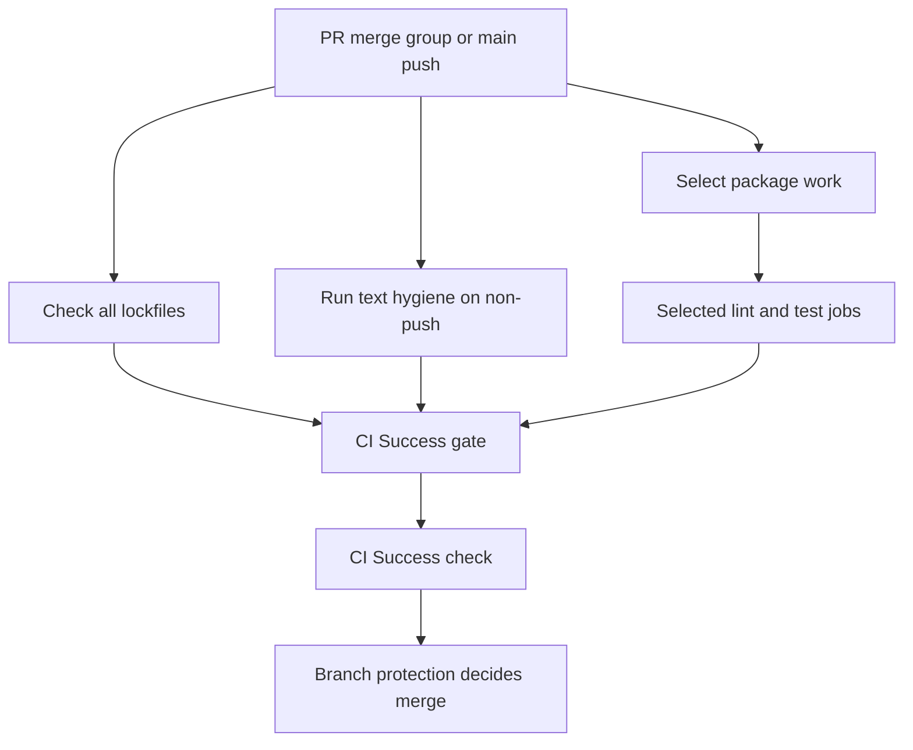
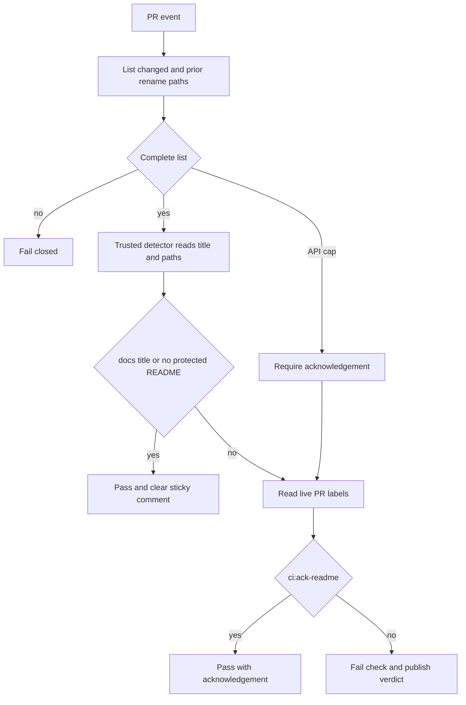
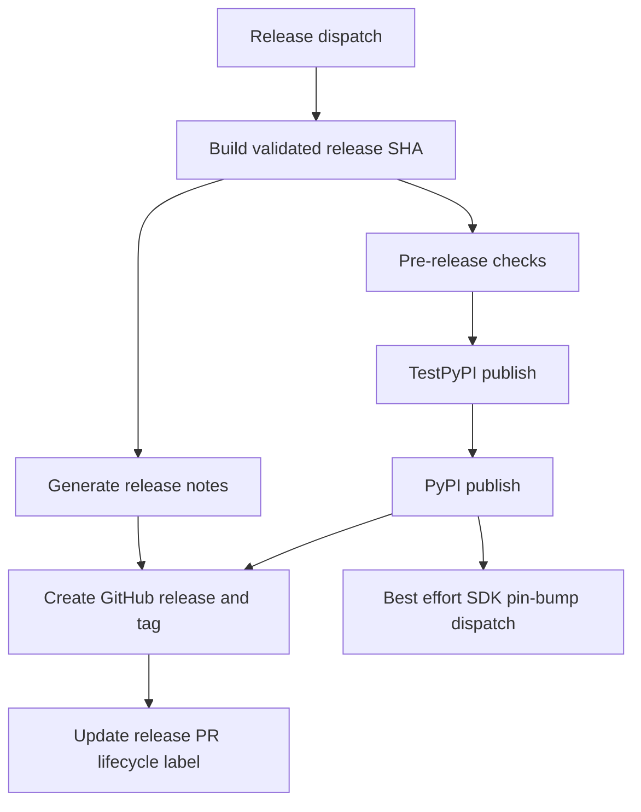

# CI Gates and Labels

`🔧 CI` owns the aggregate `✅ CI Success` check. Separate PR workflows enforce scope, release-fan-out, trailer, Markdown, README, and dependency policies; they block only when branch protection requires their individual check. Labels are recorded human acknowledgements read by specific workflows, not authorization controls. Likewise, an `environment:` selection is deployment configuration—not proof that secrets, reviewers, branch policy, or an external trusted publisher are configured. See [Development](development.md), [Security](security.md), [Testing guide](../testing/testing-guide.md), and [the source map](../architecture/source-map.md).

## Merge CI and its aggregate gate

`ci.yml` runs for pull requests, merge groups, and pushes to `main`. It always calls the reusable lockfile check. On non-push events it separately runs text hygiene over the PR or merge-group range; package lint/test work is path-selected for PRs and merge groups, but every package job runs on `main`. The filters deliberately include CI infrastructure and editable-SDK dependencies.



*The workflow emits the aggregate check; repository branch-protection configuration determines whether it is a merge requirement.*

`ci_success` runs even after dependencies finish unsuccessfully. Its inline validator treats `changes`, lockfiles, and the path-selected job set as an explicit contract: an unknown selection value, missing result, unexpected result, or a skipped job that was expected to run fails the gate. Lockfiles must succeed; hygiene must succeed when scheduled (its push-time `skipped` result is expected). `check-release-options` may be skipped only for a PR that did not change release-script inputs. This is deliberately fail-closed rather than an aggregate that merely asks whether every reported job is green.

The sole job-failure waiver is `lint-talon` or `test-talon` on a pull request whose `talon-src` filter is exactly `false`—that filter contains only `libs/talon/**`. The separate advisory job keeps such a waived failure visible in a sticky PR comment and calls for a separate `fix(talon): ...` PR; it is not an input to `✅ CI Success`. All other failures block, including Talon cancellations. Merge groups remain strict. A cancelled job is tolerated only for a push whose branch-head API lookup proves that `main` advanced beyond this run; lookup failure, a timeout, a manual cancellation, or a still-current SHA blocks.

A curated release-bot changelog-only apply is a narrow exception to normal package work. The detector and release configuration are sparse-checked out from the trusted PR base ref, and it recognizes only the expected same-repository bot branch, commit identity, one-parent commit, and one modified managed changelog. CI skips ordinary package jobs only when the parent has exactly one conclusive `✅ CI Success` check. A successful parent can produce a passing inherited gate; an inherited failure remains failed. Read-only diagnostics cannot alter that result: they show sanitized, repository-local parent run/job links where available and explain the retry sequence. After fixing the parent, re-run its failed jobs and wait for `✅ CI Success`, then re-run **all** jobs on the apply commit; re-running only failed head jobs reuses the old detection output.

### Lockfiles, reusable tests, and limited acknowledgements

The lockfile workflow performs a credential-less checkout and checks every discovered package when called without explicit paths. For explicit paths, its checker finds owning package directories, follows local `[tool.uv.sources]` consumers, and reports the package-specific `uv lock --check` remediation. Do not make lockfile validation advisory or path-bypass it.

```bash
make -C libs hygiene
make -C libs lock-check
```

The reusable `_test.yml` validates JSON matrix inputs before expanding a non-fail-fast matrix, configures the local `uv_setup` action, synchronizes the test group, runs platform-specific tests, and verifies a clean worktree. It reads bypass labels from the live GitHub API only for PR runs and fails closed by retaining strict behavior if the lookup fails. `ci:allow-warnings` supplies `-W default`; `ci:skip-ripgrep` is restricted to release-sensitive PR runs, where it can tolerate a failed ripgrep install and record the lost coverage rather than silently claiming it passed. Neither affects push or merge-group enforcement.

## Labels acknowledge consequences

The `ci:*` taxonomy is a maintainer-facing acknowledgement/override contract. Most labels must already exist in the repository because readers do not create them. Applying one changes a named check's result; it does not grant credentials, weaken other checks, or eliminate the release consequence.

| Label | Acknowledges | Result and remaining consequence |
| --- | --- | --- |
| `ci:allow-scope-mismatch` | A PR title scope does not cover changed package directories | The scope check passes with a sticky explanation; release-please may still create a release PR for each touched component. |
| `ci:allow-lockfile-release` | Intentional multi-component fan-out | The fan-out check passes with an informational note; its historical name predates `uv.lock` exclusion, and each component can still receive a release PR. |
| `ci:allow-warnings` | Warnings-as-errors on a PR test run | `_test.yml` runs pytest with `-W default`; merge-group and push runs stay strict. |
| `ci:skip-ripgrep` | A release-PR ripgrep installation failure | The missing rg-gated coverage is recorded; normal push and merge-group checks remain strict. |
| `ci:ack-release-deps` | Review of stale dependency advice on a release PR | It does not relax built-wheel metadata validation or PyPI-only installation. |
| `ci:ack-readme` | Intentional landing-page README edit in a non-`docs` PR, or an uninspectably large PR | The separate Project README check passes, but branch protection must require that check if it is to block merging. |

### Project README acknowledgement check

`📄 Project README check` is intentionally separate from `ci.yml` and therefore from `✅ CI Success`. It listens for PR open/synchronize/reopen plus `edited`, `labeled`, and `unlabeled` events, so retitling to `docs:` or toggling `ci:ack-readme` immediately recalculates the cheap check without restarting the large CI matrix. To make it merge-blocking, configure its status check as required in branch protection.



*The README check uses a trusted detector and complete changed-file evidence; only its explicit acknowledgement bypasses a known README edit or the API's known listing limit.*

The detector protects the root `README.md` and the landing-page `README.md` for every distributed package. It extracts only an anchored lowercase Conventional Commit type from the PR title: `docs:` (including a valid breaking-change `!`) is the sole title exemption; malformed or other titles are not exempt. The changed-path collector includes `previous_filename`, so renaming a protected README away is still an edit. Its test derives the protected list from package manifests, preventing a new package's landing page from silently falling outside the gate.

Both the Python detector and JavaScript enforcement module are sparse-checked out from the current base-branch tip with credentials disabled; the base-tip choice lets label/edit reruns use policy that has landed on the base rather than a stale payload SHA. A temporary bootstrap fallback can run the PR copy only when base sources are absent, and missing both copies fails closed. The workflow still runs under `pull_request`, so branch protection and review of workflow edits remain part of the trust boundary.

The collector paginates the GitHub file API and rejects unexplained short lists or a missing `changed_files` total. The API's documented 3,000-file ceiling is handled differently: the list is marked unknowable and requires `ci:ack-readme`, rather than becoming a permanently unmergeable check. For a known README edit or a truncated list, enforcement reads live, paginated labels and fails closed if that lookup or the detector result is invalid. It sets the failure before attempting notification, so comment failure cannot make the check pass. Same-repository PRs get a sticky comment that is updated or removed as the result changes; fork PRs still block but use the job summary because their token is read-only.

### Scope and fan-out controls

`🔍 PR scope file check` compares title scopes with package identities derived from the base revision's labeler configuration and an API-derived changed-file list. It ignores lockfile churn and allows `release(...)` only for a fully allowlisted set of release artifacts. It fails closed on incomplete file enumeration, invalid detector output, or configuration errors. The detector/configuration checkout is from the base SHA without persisted credentials; PR title and changed-file facts are inputs. This prevents a PR from editing the detector or config to self-bypass, but does not by itself make the workflow unchangeable: branch protection and review of workflow edits remain necessary.

`🔍 Release-please scope check` uses the same pattern for release fan-out. Its trusted-base detector reads managed component paths, excluded paths, and bump-worthy types from release-please configuration. A bump-worthy PR that changes release-relevant files in two or more components blocks unless `ci:allow-lockfile-release` acknowledges it. Excluded paths such as `tests/` and `uv.lock` do not count. The companion bypass-warning workflow and the post-merge fan-out watch are advisory safety nets, not merge gates.

## Release dispatch and publication boundary

`🚀 Package Release` is dispatch-only rather than reusable because PyPI Trusted Publishing does not support the reusable-workflow path. It is normally triggered by release automation after a release PR merge, but can also be manually dispatched. The normal path requires an explicit resolvable release SHA reachable from `main` and verifies that the selected package's `pyproject.toml` version equals the supplied version. `dangerous-nonmain-release` is the explicit backport/hotfix exception: it can use the dispatch SHA when no SHA is supplied and skips the normal main/version equality checks, while still requiring the target to be reachable from the dispatched commit.



*Artifacts flow from a read-only build job through checksum verification into the minimal OIDC publishing jobs; notes are intentionally fail-open.*

The build job has read-only repository permissions, checks out the validated SHA without persisted credentials, records distribution checksums, and uploads `dist`. The TestPyPI and PyPI jobs download that artifact, compare its checksums with the build output, and have only `id-token: write`; they neither check out source nor receive broad repository permissions. Both select `environment: release`, but this is not itself an authorization guarantee: GitHub environment protection and each package's external PyPI/TestPyPI trusted-publisher registration must be configured separately. The focused secret-scoping test enforces the YAML invariants that these two jobs use exactly that environment and permission set.

Pre-release checks run from the resolved SHA with no dependency cache. `dangerous-skip-sdk-pin-check` only bypasses the Code SDK-pin comparison. `dangerous-skip-ripgrep-check` still attempts installation and makes a degraded result explicit when rg-gated artifact tests could not run. The disabled release integration-test step retains package-conditional credential wiring as a future contract, but it currently runs with `if: false`; the release environment intentionally has no provider credentials for it.

After successful PyPI publication, `mark-release` creates the GitHub tag/release with the validated SHA and transitions a pending release PR to `auto:release-tagged`. It first looks up the PR associated with the commit, then uses an exact title plus pending-label fallback; a normal release fails the final job if that lifecycle update cannot be completed. A successful `deepagents` publish may dispatch the Code SDK pin-bump using a GitHub App token with `actions: write`; that post-publish convenience is best effort and cannot make the release fail.

## Release notes and recovery

The `release-notes` job checks out full history and tags at the release SHA, but checks out `build_release_notes.py` from the workflow revision into `_workflow`. It passes the already resolved package, version, working directory, SHA, and prerelease state to the helper, keeping the release body and GitHub prerelease flag consistent while allowing the helper to be fixed independently of an older release commit.

The helper is dependency-free Python for local recovery. It resolves a predecessor reachable from the release SHA: stable releases prefer the previous patch then the newest reachable stable tag; prereleases prefer an earlier same-base prerelease, then the base tag, then a stable tag. It reads the changelog at the release SHA, renders a package-scoped and bounded git log, and uses bounded GitHub CLI lookups to credit contributors while warning when attribution is incomplete. Run it from a full clone with tags when reconstructing a body:

```bash
python .github/scripts/release/build_release_notes.py \
  --package "${PKG_NAME}" --version "${VERSION}" \
  --sha "${RELEASE_SHA}" --repo "${REPOSITORY}" \
  --actor "${ACTOR}" --base-branch "${BASE_BRANCH}" \
  --out /tmp/release-body.md

gh release edit "${PKG_NAME}==${VERSION}" --repo "${REPOSITORY}" \
  --notes-file /tmp/release-body.md
```

Release notes deliberately fail open: a notes failure does not prevent a successful pre-release check and PyPI publication from creating the GitHub release, but the result is an empty release body and `mark-release` writes a recovery command to the job summary. Do not add the notes result as a prerequisite to publishing.

## Focused verification

Run the narrow tests after changing this area:

```bash
python -m pytest .github/scripts/tests/checks/test_check_project_readmes.py
node --test .github/scripts/tests/checks/readme-gate.test.js
python -m pytest .github/scripts/tests/workflows/test_project_readme_check.py
python -m pytest .github/scripts/tests/workflows/test_ci_workflow.py
python -m pytest .github/scripts/tests/workflows/test_inherited_ci_diagnostics.py
python -m pytest .github/scripts/tests/checks/test_check_lockfiles_pre_commit.py
python -m pytest .github/scripts/tests/labeling/test_check_pr_scope_files.py
python -m pytest .github/scripts/tests/release/test_check_lockfile_release_scope.py
python -m pytest .github/scripts/tests/release/test_build_release_notes.py
python -m pytest .github/scripts/tests/workflows/test_workflow_secret_scoping.py
```

The CI workflow tests execute the aggregate validator against missing, skipped, failed, cancelled, and invalid results, including the narrow Talon and superseded-push cases. The inherited-CI tests pin both the unchanged failed-parent verdict and safe diagnostic rendering. README tests cover title parsing, protected-set drift, base-source resolution, changed-file completeness, acknowledgements, and fork-safe reporting. The release-note tests construct histories to exercise predecessor selection, changelog extraction, bounded logs, and incomplete attribution diagnostics; secret-scoping tests ensure publishing jobs retain their minimal OIDC permission and selected environment.
