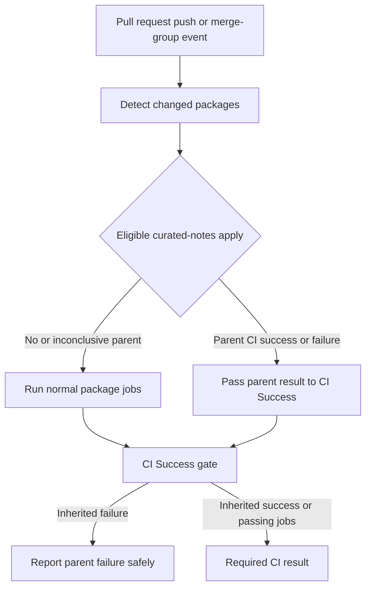
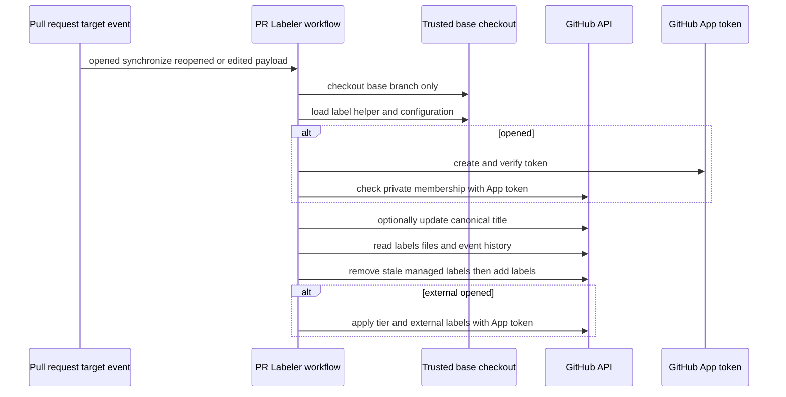

# CI and Pull-Request Labeling

CI execution and pull-request metadata are related but separate operational systems. `ci.yml` selects package work and produces the required `✅ CI Success` result; `_test.yml` provides a validated reusable test matrix. `pr_labeler.yml` is the single sequential writer for PR size, title, path, provenance, and contributor labels, avoiding competing label mutations. The label taxonomy in [`.github/LABELS.md`](../../.github/LABELS.md) and the labeler configuration are the operational contract; do not duplicate mappings or thresholds in workflows.

For local commands, see [Development](development.md); for test guidance, see the [Testing Guide](../testing/testing-guide.md). The `.github` structure distinguishes event entry workflows from reusable `_*.yml` workflows and places workflow contracts under `.github/scripts/tests/workflows/`.

## Main CI: selection, inherited results, and gate

`ci.yml` runs for pull requests, pushes to `main`, and merge-group events. It grants `checks: read`, `contents: read`, and `pull-requests: read`; the latter is passed through to the reusable test workflow, whose token can narrow but cannot widen the caller's permissions. The change-detection job feeds package-specific lint/test jobs, while pushes run package jobs unconditionally. The final `✅ CI Success` job runs regardless of predecessors and is the decision point for the lockfile result and non-skipped job results.

### Curated-notes apply optimization

A narrowly constrained release-bot PR can be recognized as a changelog-only curated-notes apply. For that determination, `changes` checks out the detector and release configuration from the trusted base ref, rather than treating PR changes as policy. When the detector says the commit is eligible, CI looks up the parent commit's `✅ CI Success` check. It skips ordinary package jobs **only** when that parent result is conclusively `success` or `failure`; an absent, malformed, unavailable, cancelled, or otherwise inconclusive result falls back to the normal package jobs.

The decision and parent metadata travel through `changes` outputs to `ci_success`. A successful parent permits the curated apply; a failed parent makes the new `✅ CI Success` result fail. Consequently, skipped package jobs never turn a failed parent into a passing head.

When that inherited failure occurs, a non-gating diagnostic step reports the parent commit, the parent CI run/check when safely available, and currently unsuccessful sibling checks. It accepts only same-repository Actions job URLs and escapes check names before rendering them, so API metadata cannot inject markup or untrusted links. Failure to retrieve diagnostic details merely preserves the inherited failure message: `continue-on-error` means diagnostics cannot replace the shell gate. The recovery sequence is deliberate: fix or rerun the parent CI first, then **re-run all jobs** on the curated head so change detection is re-evaluated; re-running only failed head jobs reuses the old output.



*The curated-notes path inherits a conclusive parent result; its diagnostic explains a failure but never changes the gate decision.*

### Reusable unit-test workflow

`.github/workflows/_test.yml` is a `workflow_call` workflow, not an event entrypoint. Callers provide a required `working-directory`, a JSON array of quoted `python-versions`, and optionally a primary OS plus explicit `{python-version, os}` legs. A validation job rejects malformed JSON and non-string fields before expansion. The build waits for validation, combines primary and extra legs with `fail-fast: false`, then checks out code, invokes the local `./.github/actions/uv_setup` action, synchronizes `--group test` dependencies, runs platform-specific tests, and verifies a clean tree.

Every build has a 20-minute limit. Talon additionally installs Node 24. Non-Windows legs use `make test`; Windows calls `uv run --group test pytest -n auto -vvv tests/unit_tests/` because the Makefile sandbox route requires POSIX `sh`.

### Live-label test overrides

The reusable workflow has only `contents: read` and `pull-requests: read`. On pull-request runs it queries the live labels API rather than using the webhook payload, since a rerun retains the original payload. A lookup failure is loud and fails closed: no bypass is enabled.

`ci:allow-warnings` adds `-W default`, which overrides pytest INI warning filters for that run. Push and merge-group runs have no PR-label context and retain normal warning enforcement. `ci:skip-ripgrep` is still narrower: only Linux `libs/deepagents` release-sensitive PR legs consult it. Such legs normally require ripgrep installation and set `DEEPAGENTS_RIPGREP_EXPECTED=1`; the label can tolerate an installation failure, record a one-day marker artifact when `rg` remains unavailable, and allow ripgrep-gated tests to skip. The non-release PR installer instead has a two-minute bound, performs bounded `dpkg --configure -a` recovery after a timeout, then proceeds only if `rg` is usable or records the same marker; non-timeout installation failures fail.

## PR labeler: privileged boundary and lifecycle

`PR Labeler` receives `pull_request_target` actions `opened`, `synchronize`, `reopened`, and `edited`. This is a privileged event, so its essential invariant is that `actions/checkout` obtains the base branch before `actions/github-script` loads `pr-labeler.js` and its configuration. PR-head code is never checked out or executed by this workflow; the PR title, body, paths, and event fields are data passed to trusted base-branch logic.

The `label` job uses the `labeling` environment with `contents: read`, `pull-requests: write`, and `issues: write`. Opening-time provenance additionally creates and verifies a GitHub App token. The private membership request treats bots and active members as internal, a 404 as external, and any other error as fatal. The App token applies external and contributor-tier labels because events made with the default `GITHUB_TOKEN` do not trigger downstream workflows.



*The privileged workflow executes only trusted base-branch helper code; untrusted PR-head content is API payload data.*

Before normal labeling, the workflow canonicalizes non-release Conventional Commit scope aliases through the API. If the update succeeds, it passes the replacement title through a step output because the event payload title is immutable; if it fails, labeling continues with the original title. `release(...)` titles are intentionally not rewritten.

## Configuration-driven classification

`.github/scripts/labeling/pr-labeler-config.json` owns the classification inputs: size thresholds and exclusions; title types, scope mappings and aliases; release, tier, color, and description metadata; and file, branch, and topic rules. `pr-labeler.js` rejects configurations missing required groups. It also creates missing labels on demand with the longest matching taxonomy-prefix color and configured description; a create-time 422 is tolerated as a concurrent creation.

For non-`edited` events, the workflow paginates changed files. It calculates size from additions plus deletions after excluding any `uv.lock` basename and `docs/` paths, then replaces stale size labels. Configured path rules add package/integration labels, and more-specific topic rules add module topics. Branch rules are additive. Title parsing recognizes `type(scope): subject` and a `!` immediately before the colon, maps known types and comma-separated scopes, and gives release titles the configured release label. A recognized title removes only stale managed type, breaking, or release labels; an unrecognized title preserves previous title classification. Before a batch add, all additions are ensured; removals tolerate 404 and never remove a label also being added.

### Human topic authority

Topic labels begin with deterministic changed-module rules, but a user's removal is meaningful. The helper reads paginated issue events: a user `unlabeled` event suppresses a matching auto topic until a later user `labeled` event clears it; bot or unattributed events do not create that override.

Only a later synchronize event with `before` and head SHAs can reconsider removal. The compared history must be ahead-only, contain fewer than 300 files, and provide topic-relevant patches. Missing label descriptions or contextual input beyond 20,000 characters also preserve removal. The classifier receives removal history, relevant patches, and bounded title/body context and is directed to treat embedded content as untrusted and re-add only for substantive new topic-specific evidence. Classifier/comparison failure warns and preserves the removal without preventing size, path, or title labels.

The default classifier uses Groq's OpenAI-compatible endpoint, `openai/gpt-oss-20b`, temperature zero, JSON output, and a 15-second abort timeout; `TOPIC_CLASSIFIER_PROVIDER=semif` selects the alternative provider. Returned labels are deduplicated, restricted to allowed labels, and capped at three.

### Provenance, tiers, cancellation, and backfill

On opening, internal authors receive `org:internal`. External authors receive `org:external` plus `auto:new-contributor` at zero merged repository PRs or `auto:trusted-contributor` at the configured threshold (five). A 422 from the contributor search skips tier inference rather than guessing. These are opening-time labels, not a continuous reconciliation.

Concurrency is keyed by workflow, PR number, and phase. `opened` has a separate non-cancelled group so provenance work survives rapid updates; synchronize/reopen/edit runs share an update group and cancel a superseded predecessor. Keep PR label mutations in this unified workflow rather than adding competing writers.

For existing PRs, manually dispatch `pr_labeler_backfill.yml` with a positive `max_items`. It uses the helper, pre-creates size/tier labels, caches authors, processes each PR independently, and marks the job failed after the loop if any item failed. When tier lookup is unknown, it leaves tier labels untouched instead of converting uncertainty into removal.

## Safe changes and focused tests

Add or alter automatic taxonomy in the JSON configuration, not in `pr_labeler.yml`. A potentially created label needs a description and a matching prefix color; a new rule needs deterministic evidence. Preserve the release-title exemption, base-branch checkout, and conservative human-topic removal behavior.

The focused Node contract suite is run by a pytest shim and covers alias canonicalization, configuration reachability and taxonomy drift, title reconciliation, label creation/colors, deterministic topic rules, topic removal/reapplication, and workflow/helper behavior:

```bash
python .github/scripts/tests/labeling/test_pr_labeler.py
```

`test_inherited_ci_diagnostics.py` exercises the curated-notes detector/gate contract and the diagnostic script: it verifies inherited success/failure behavior, malformed lookup fallback, safe links and escaped output, and the fact that diagnostics use no write permission and cannot replace the final gate. Run it with:

```bash
python -m pytest .github/scripts/tests/workflows/test_inherited_ci_diagnostics.py
```
