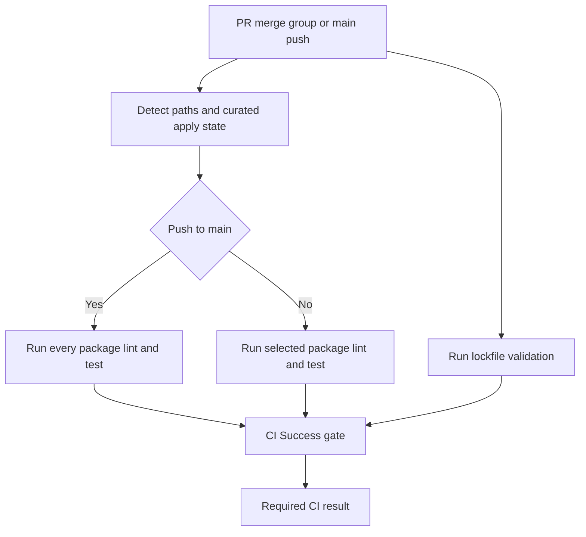
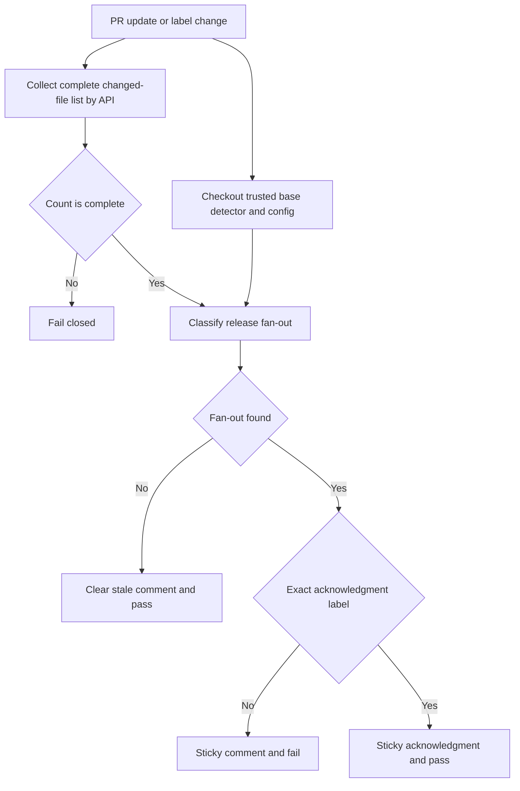
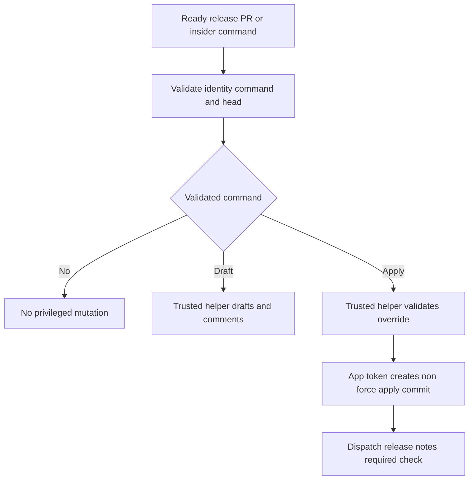

# CI Selection and Labeling

This page describes the operational contracts around the `🔧 CI` workflow: what it runs, which result controls mergeability, and where labels are narrowly allowed to affect behavior. Event-facing files in `.github` are entry workflows and `_*.yml` files are `workflow_call` components; keep shared setup in a reusable workflow or composite action rather than duplicating it. See [Development](development.md), the [Testing Guide](../testing/testing-guide.md), and [GitHub Action integration](../integrations/github-action.md).

## CI selection and the required gate

`ci.yml` runs on pull requests, pushes to `main`, and merge-group events. The `changes` job feeds `dorny/paths-filter` outputs to each lint and test job: pull-request and merge-group runs execute selected package work, while `main` pushes run every package job. Every package filter includes the CI workflow, reusable lint/test workflows, and composite actions, so an infrastructure edit receives package coverage. Filters also include `libs/deepagents/**` for packages that editable-install the SDK; Talon additionally follows `libs/code/**`. `talon-src` is deliberately narrower—only `libs/talon/**`—because it controls the Talon waiver rather than whether Talon work runs.

The workflow has specialized coverage alongside the ordinary package pairings: `libs/code` tests are split into three stable shards, Deepagents has a Windows matrix leg, and an SDK-only change triggers the QuickJS prompt smoke test when the full QuickJS suite is not already selected. Evals changes also select dataset generation, which builds twice and compares the results before building the in-place dataset.



*Lockfile validation and selected package work run before the single aggregate gate; selection changes work performed, not the required result name.*

### Curated release-bot applies

A trusted release-bot PR on a `release-please--branches--main--components--` branch can be recognized as a changelog-only curated-notes apply. The detector and its release configuration are sparse-checked out from the base ref without persisted credentials. It accepts the optimization only when the parent `✅ CI Success` check is conclusively `success` or `failure`; an unavailable or inconclusive parent causes the ordinary package jobs to run. For a recognized apply, package jobs and the helper-test job are skipped, but the final gate passes only when that parent conclusion was `success`; a failed parent is reported as inherited failure. The special concurrency exception prevents a later trusted bot update from cancelling the earlier run while it is still reading that parent result.

## Lockfiles and changed-file hygiene

`check-lockfiles.yml` is a reusable, read-only job that CI invokes unconditionally. It checks out history without credentials, configures Python 3.14 and `uv` with caching disabled, then calls `check_lockfiles_pre_commit.py` without path arguments. That intentionally validates every discovered package lockfile, not merely the packages selected for lint and tests. A lock or hygiene failure fails this shared job and `ci_success` refuses to pass regardless of an inherited curated-apply result.

The checker discovers library, partner, and example package directories from their `Makefile` or `pyproject.toml`. With no paths it runs `uv lock --check` for all of them; when used with explicit paths it limits checks to owning packages. It also propagates invalidation through local `[tool.uv.sources]` path dependencies, so a changed package manifest selects its local consumers. On a stale lock it emits an annotation containing the package-specific `uv lock --directory ... --python ...` repair command.

For non-push CI events the same job also invokes `make -C libs hygiene` against the PR or merge-group base/head range. The `hygiene` target is the local source of truth for the explicit pre-commit hook list, runs only on changed files, and returns failure if any hook fails. Run the matching local commands before pushing:

```bash
make -C libs hygiene
make -C libs lock-check
```

Do not make the reusable lockfile job conditional on a path filter or add it to a bypassable advisory path: it is an explicit dependency of `✅ CI Success`.

## The CI Success decision boundary

`✅ CI Success` uses `if: always()` and consumes the full named `needs` object, excluding `changes` and skipped jobs. It first requires `check-lockfiles` to be `success`; it then handles the curated-apply inheritance case; otherwise it asks `.github/scripts/checks/ci_gate.py` to classify job results. The script returns JSON with `waived`, `failed`, and `cancelled` lists rather than determining the shell step's exit code itself. This keeps the waiver matrix independently unit-testable and makes caller-side enforcement explicit.

The gate script is sparse-checked out from `github.base_ref || github.sha` with persisted credentials disabled. On PRs, this ensures the program judging PR results comes from the trusted base rather than the PR merge checkout. A PR copy is available only as a bootstrap fallback when the base does not yet contain the script; once present on base, that fallback cannot alter the decision.

Only one waiver exists: on a `pull_request` where `talon-src` is not `true`, failures—not cancellations—of `lint-talon` or `test-talon` are advisory. All other failures block. Talon failures block on a Talon-source PR, a merge-group run, and a push; cancellations also block on PR and merge-group runs. Push cancellations are tolerated because concurrency preemption means a newer push will validate the latest `main` state. The separate advisory job is intentionally absent from the gate's `needs`: it maintains a sticky PR comment for waived Talon failures but must never make the required check red or green.

## Reusable test worker and maintainer exceptions

The reusable `_test.yml` workflow validates required JSON matrix inputs before expanding a non-fail-fast build matrix, then checks out code, uses the local uv setup action, synchronizes the test group, runs platform-specific unit-test commands, and verifies a clean working tree. The local `uv_setup` composite action pins setup-uv and uv, supports cache control and working-directory-scoped dependency globs, and enables cache pruning.

Warnings are errors unless `_test.yml` sees the exact `ci:allow-warnings` label. On a pull-request run it reads the live labels endpoint once with `per_page=100`, rather than trusting the replayed event payload. API failure writes an empty flag and emits an error, so the exception fails closed; only the exact label supplies `-W default` to both POSIX and Windows commands. Push and merge-group runs have no PR label context and retain warnings-as-errors.

The Deepagents Linux ripgrep path has a similarly narrow distinction: ordinary PRs soften only a two-minute timeout when no usable `rg` remains, while release-sensitive PRs, pushes, and merge-group runs are strict. A release PR may use live `ci:skip-ripgrep` only after a successful label lookup; a bypassed failure records a marker artifact and does not assert coverage. The release preflight follows the same principle: only exact `dangerous-skip-ripgrep-check=true` can continue after an install failure, and it records the resulting loss of artifact-test coverage.

## PR labeling and release-please scope

`pr_labeler.yml` is a `pull_request_target` workflow and therefore must never check out PR head code. It checks out the base workflow code, serializes per-PR mutations, and applies size, file/branch/title-derived type, package, integration, and contributor labels through shared labeling helpers. On opened PRs it obtains a short-lived GitHub App token to determine private organization membership and apply external contributor/tier labels; this also permits downstream label-triggered automation. The job-level write scopes are limited to PR and issue labels, and classifier/provider secrets are injected only into the label-application step.

`release_please_scope_check.yml` is the pre-merge guard against release-please attributing a bump-worthy PR to each managed path it touches. It runs on PR updates and label changes so the exact `ci:allow-lockfile-release` acknowledgment can re-evaluate the PR. Its trusted-base detector reads the release-please package map and visible changelog sections, receives the PR title and API-collected changed-file list, and reports two cases: real non-lockfile edits in two or more managed components, or a managed component whose only edits are `uv.lock`. The detector deliberately treats visible changelog types and conventional-title `!` as bump-worthy; it reports rather than exits nonzero, leaving the workflow to make the blocking decision.

The workflow validates that the API file list count equals GitHub's reported `changed_files` count before detecting fan-out, because GitHub caps `listFiles` results. A missing count, truncated list, malformed detector output, or unreadable/invalid trusted configuration fails closed. Fork PRs do not receive secrets; if their read-only token cannot maintain the sticky explanatory comment, the job summary still surfaces the finding. A fan-out blocks unless the exact structured label `ci:allow-lockfile-release` is present. That label acknowledges—not prevents—the resulting per-component release PRs, and the workflow leaves a sticky explanation of the consequence.



*The scope workflow distinguishes an intentional acknowledgment from changing release-please's path-based release behavior.*

Because this workflow uses `pull_request`, its YAML still originates from the PR head. The base checkout protects the detector and configuration from self-bypass, but branch protection must make the job required and workflow edits must be reviewed.

## Release and curated-note mutation boundaries

`release.yml` is dispatch-only, not reusable, because PyPI Trusted Publishing requires that route. Its read-only build job resolves a supported package and immutable release SHA, validates normal-release ancestry on `main` and the package version at that SHA, derives the Python matrix, builds there, and records distribution checksums. Pre-release checks are read-only, cache-free matrix jobs that test the built distribution. Jobs that publish use only the distribution artifact and `id-token: write`; they verify the build-job checksums before publishing. Keep build/test code and publishing credentials in separate jobs.

`release_notes.yml` is the privileged boundary for curated release PR notes. It accepts only a ready-for-review PR event or an insider `@release-bot` comment, then validates trigger, release identity, permission, and expected head before draft/apply work. Automation helpers are always checked out from credential-less `main`; release-PR content is retrieved as untrusted API data at the validated SHA and is never checked out or executed in an App-token job. The drafting subprocess receives only its selected model key plus file paths, not the parent environment.



*Only validated paths receive the short-lived App token; untrusted release-PR text never becomes executable workflow input.*

Draft and apply jobs are gated by validation, run in `release-bot`, and obtain short-lived App tokens with explicit contents, issues, and pull-request scopes. Apply uses Git Data API mutations without rewriting history and explicitly dispatches `release_notes_check.yml`, because an App-token update does not emit the normal PR event that refreshes the required check.

## Harbor and unified evaluations

`_harbor_run.yml` supports a caller-provided flat matrix or expands one dataset into shards. Preparation chooses the matrix, derives its effective parallel pool, and constructs an aggregate matrix; Harbor leaves run non-fail-fast. Per-leaf runner labels permit category-specific architecture while the caller-facing unified workflow restricts its runner choice to known labels.

Credential validation happens before a Harbor leaf executes: it selects a provider key from the model prefix, requires LangSmith and category-specific credentials, rejects unknown sandbox/provider values, and validates OpenRouter judge syntax. Keep secrets at this consuming step. The secret-bearing leaf has read-only GitHub access; only the aggregate job gets `actions: write` to download and clean up scoped shard artifacts. Aggregation runs after non-cancelled Harbor work, processes available shards even after a leaf failure, and is `continue-on-error` so post-run analysis does not convert already-paid evaluation results into a failed evaluation workflow.

`unified_evals.yml` prepares a per-model, multi-category flat matrix and calls Harbor once per prepared model/branch row. It bounds model concurrency in addition to Harbor shard concurrency. LangSmith cost collection is best effort in the `evals` environment and is the only job receiving `LANGSMITH_API_KEY`; the write-capable cross-model combine job receives result artifacts but not that key. Its publishing work is serialized because all refs share an output branch.

## Verification when changing these controls

Run focused executable contracts when editing the gate, lockfile, or release-scope controls:

```bash
python -m pytest .github/scripts/tests/checks/test_ci_gate.py
python -m pytest .github/scripts/tests/checks/test_check_lockfiles_pre_commit.py
python -m pytest .github/scripts/tests/release/test_check_lockfile_release_scope.py
python -m pytest .github/scripts/tests/workflows/test_ci_workflow.py
```

The workflow contract test executes the gate shell path and checks its topology, unconditional lockfile dependency, trusted-base checkout, curated-apply inheritance, and ripgrep-label controls. The smaller tests exercise the Talon waiver matrix, lockfile selection/repair diagnostics, and release fan-out classification. Treat a failing contract test as a CI or security-control regression, not merely a YAML formatting issue.
