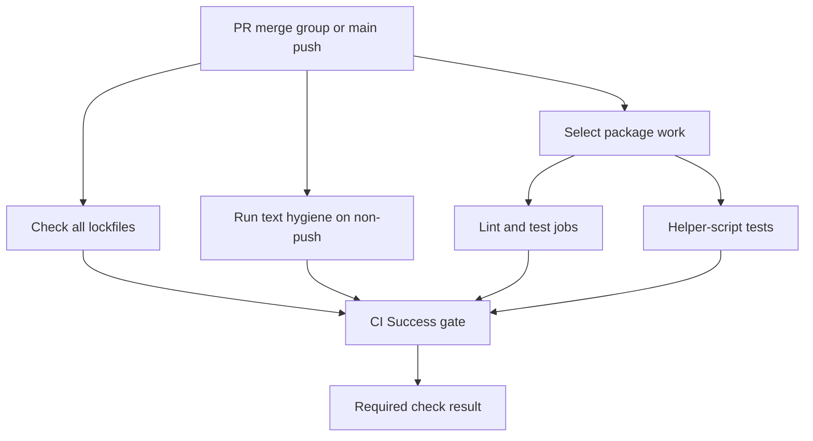
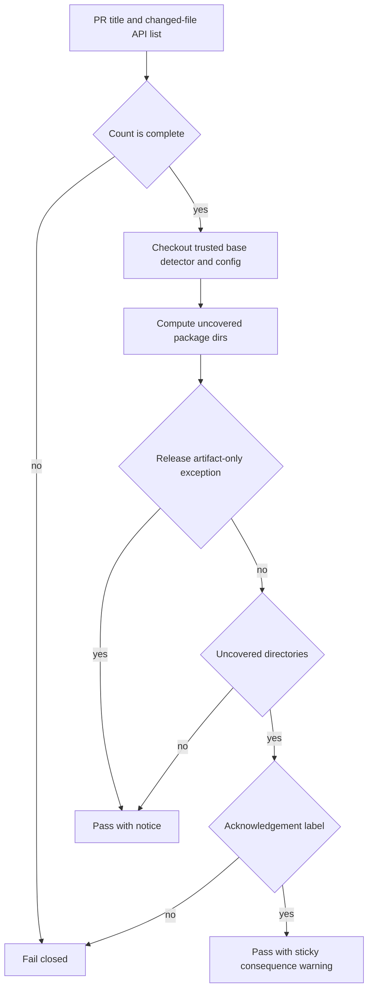

# CI Gates and Labels

`🔧 CI` is the merge-facing workflow. It runs for pull requests, `main` pushes, and merge-group events; reusable workers and local actions centralize setup, while `ci.yml` owns job selection and the branch-protection-facing `✅ CI Success` result. The separate PR controls below—title-scope alignment and release fan-out—must also be configured as required status checks if they are intended to block merges. See [Development](development.md), the [Testing Guide](../testing/testing-guide.md), and [GitHub Action integration](../integrations/github-action.md).

## Merge CI: unconditional controls and final gate

`check-lockfiles` is an unconditional reusable job. On non-push events, `text-hygiene` is a separate five-minute job: it checks out history without persisted credentials, supplies the PR or merge-group base/head range to `make -C libs hygiene`, and annotates changed hunks when fixing hooks leave a diff. A push deliberately skips hygiene. Separately, `changes` uses path filters to select package lint/test work for PRs and merge groups; pushes run every package job. The filters include CI infrastructure and editable SDK dependencies. `talon-src` is narrower than the Talon test filter and records only `libs/talon/**` changes for waiver eligibility.



*The merge CI flow: lockfiles always participate; hygiene participates whenever scheduled; selected jobs may be skipped without becoming gate failures.*

`ci_success` runs with `if: always()`. It first requires a successful lockfile result and successful hygiene except for hygiene's expected push-time `skipped` result. For ordinary runs, it rebuilds a named result map from `toJSON(needs)`, excluding `changes` and skipped jobs, and sends it to `ci_gate.py`. That trusted gate program permits only failed `lint-talon` or `test-talon` jobs to be waived, and only for a `pull_request` that does not touch `libs/talon/**`; it never waives cancellation or another job. Merge-group evaluation remains strict. Push cancellations are tolerated because concurrency preemption is expected to be superseded by a later `main` run. The non-gating Talon advisory job records a waived failure and its required follow-up.

The gate script is sparse-checked out from `github.base_ref || github.sha` with credentials disabled. Thus a PR does not normally execute a copy it changed to judge its own results; a PR copy is used only during the one-time bootstrap fallback when the base lacks the script.

### Lockfiles and local hygiene

`check_lockfiles.yml` uses a credential-less checkout, Python 3.14, and the local `uv_setup` action with caching disabled, then invokes `check_lockfiles_pre_commit.py` without paths. That checks every discovered package lockfile, independent of package path selection. With explicit paths, the checker limits validation to owning package directories, expands changed manifests through transitive local `[tool.uv.sources]` consumers, and reports a package-specific relock command if `uv lock --check` fails.

Run the equivalent checks before pushing:

```bash
make -C libs hygiene
make -C libs lock-check
```

Do not path-filter, advisory-route, or label-bypass these controls: lockfile validation is required on every CI event, and hygiene is required whenever it is scheduled.

### Curated release-note applies

Normal package work may be skipped only for a tightly identified release-bot apply: an in-repository PR by `RELEASE_BOT_LOGIN` on a release-please component branch whose single-parent commit has the expected bot identity, subject, and exactly one managed changelog change. The detector and release configuration come from a credential-less trusted-base checkout. The workflow asks GitHub for exactly one latest parent `✅ CI Success` conclusion and recognizes the optimization only for a conclusive `success` or `failure`; lookup errors, malformed data, and every other conclusion run normal work.

For a recognized apply, package and helper-script jobs are skipped. The final gate passes only for an inherited successful parent; an inherited failure remains a failed gate. A read-only, best-effort diagnostic can report sanitized parent-suite failures but cannot alter that outcome. Use **Re-run all jobs** after repairing the parent: rerunning only failed jobs retains the earlier `changes` output.

## Labels are acknowledgements, not hidden permissions

The label taxonomy treats `ci:*` as a human acknowledgement or override of a named check; the labeler does not apply these labels. `ci:skip-issue-link` and `ci:keep-open` are limited exceptions that automation can write only on a maintainer's instruction. A bypass must be applied deliberately, is read by its gate, and does not remove the underlying operational consequence.

Relevant labels are:

| Label | Acknowledges | Remaining consequence |
| --- | --- | --- |
| `ci:allow-scope-mismatch` | Intentional mismatch between a title's package scope and changed package directories | A bump-worthy merge is still scoped by changed paths and can create a release PR for each touched managed component. |
| `ci:allow-lockfile-release` | Intentional multi-component release fan-out; its legacy name does not mean lockfiles cause a release | Release-please still opens one release PR per affected component. |
| `ci:allow-warnings` | Warning-as-error relaxation in reusable tests | It changes only PR test warning handling; pushes and merge groups remain strict. |
| `ci:skip-ripgrep` | Strict ripgrep-install failure on a release PR | The affected rg-gated coverage is recorded as skipped; it is not silently passed. |

Other `ci:*` labels and their gate ownership are catalogued in [`.github/LABELS.md`](https://github.com/langchain-ai/deepagents/blob/main/.github/LABELS.md). Labels that a workflow only reads must already exist in the repository.

The reusable `_test.yml` worker validates JSON matrix inputs before expanding a non-fail-fast matrix, configures `uv_setup`, synchronizes the test group, executes platform-specific tests, and verifies a clean working tree. On PR runs only, it queries live labels rather than replayed event data and fails closed on lookup failure. Exact `ci:allow-warnings` adds `-W default`. The narrowly scoped release ripgrep exception also uses live labels: only `ci:skip-ripgrep` can accept a strict-install failure for a release PR, and it writes a marker artifact for downstream reporting. Push and merge-group enforcement are not relaxed.

## PR title scope versus changed package paths

`🔍 PR scope file check` compares Conventional Commit package scopes in the PR title with package directories touched by the API file list. Its detector reads `scopeToLabel` and `fileRules` from the labeler configuration, so scope aliases and package-directory identity remain aligned with labeling rather than duplicating a mapping. Only `libs/` prefix rules represent package directories; non-package scopes and paths are ignored. A title with no declared package scope also produces no mismatch. A declared package scope must cover every relevant touched package label.

`uv.lock` is ignored for all titles because relocking a dependent does not change what that package publishes. For a release-shaped `release(<scope>):` title, release-managed artifacts are also ignored for title/path matching: the manifest, configured changelogs and extra files, and `uv.lock` at any path. The artifact exception validates the release configuration even for lockfile-only input and only stands down when **every** changed file is allowlisted. It does not validate that the title component is real, so its security boundary is the complete artifact allowlist, not the author-controlled title. A single source edit re-arms the check, and a fired exception emits a visible notice.



*Scope-file control flow: the trusted base supplies logic and configuration; the PR supplies title and changed-file facts.*

The workflow checks out the detector and config from the PR base SHA with credentials disabled, while title and file names remain PR-controlled inputs. It obtains files through paginated `pulls.listFiles` and compares the collected count to `changed_files`; an absent or incomplete list fails closed. Detector/config errors, absent output, malformed JSON, and malformed offender objects also fail closed. This trust split prevents a PR from editing detector/config files to self-bypass, but does not make an edited `pull_request` workflow inherently trustworthy: branch protection requiring the check and review of workflow edits remain necessary. A brand-new package added in the same PR is intentionally not known to the trusted base mapping, so it is not scope-checked until a later PR.

A real mismatch blocks and gets a sticky explanation. `ci:allow-scope-mismatch` re-runs the workflow on label changes, passes with an informational sticky note, and can be removed to restore the block. Forks do not run PR-head code or receive secrets; if their read-only token cannot write a comment, the workflow uses the job summary while retaining the check result.

## Release-please fan-out controls

`🔍 Release-please scope check` is the pre-merge sibling control. Release-please assigns a commit by the file paths it touches, not the title scope. The detector reads package paths, component names, `exclude-paths`, and visible changelog types from the trusted-base `release-please-config.json`. A title is bump-worthy if it has a breaking `!` marker or a non-hidden changelog type. This is conservative: visible `perf` and `revert` types can be reported even where release-please would not ultimately bump, which is preferable to missing a fan-out.

For a bump-worthy PR, a component counts only when it has a release-relevant file under its managed path. `exclude-paths` are honored exactly, so each package's excluded `tests/` and `uv.lock` do not count; a second package's `pyproject.toml` or source edit does. Two or more such components block the check. The detector writes structured JSON to stdout and leaves the workflow to make the pass/fail decision; unreadable, malformed, empty-package, or no-visible-section configuration fails closed.

The workflow follows the same trusted-base/API-input model and file-list completeness check as the scope-file control. It clears stale sticky comments when clean, blocks detected fan-out, and falls back to a summary when a fork cannot comment. `ci:allow-lockfile-release` is an explicit acknowledgement—not a mechanism to prevent release work: it re-runs the check, passes with a sticky list of components, and release-please still creates each component's release PR.

`⚠️ Release fan-out bypass warning` is advisory and does not decide either gate. It serializes per-PR updates, reads live labels to avoid labeled/unlabeled payload races, and maintains a separate sticky warning while either fan-out acknowledgement is present. It lists all release-relevant components and whether the current title is bump-worthy. Its component listing is only advisory: if the API list is incomplete it warns rather than falsely claiming completeness; the blocking workflows are the fail-closed controls.

After merge, `🔍 Release-please fan-out watch` is an advisory safety net, triggered after a successful release-please run, hourly, or manually. With a full, tagged `main` checkout, it resolves each manifest version to its component release tag and diffs that package from the tag to `HEAD`. It reports a component when no files outside `exclude-paths` remain, then intersects that report with open conventional release-please branches before commenting and failing the advisory job. A missing release tag is treated as the transient unpublished-release window and is warned/skipped; an existing-tag diff failure fails the detector. The watch does not block merges.

## Focused verification

Run the executable contracts after changing these controls:

```bash
python -m pytest .github/scripts/tests/checks/test_ci_gate.py
python -m pytest .github/scripts/tests/checks/test_check_lockfiles_pre_commit.py
python -m pytest .github/scripts/tests/labeling/test_check_pr_scope_files.py
python -m pytest .github/scripts/tests/release/test_check_lockfile_release_scope.py
python -m pytest .github/scripts/tests/release/test_check_open_release_fanout.py
python -m pytest .github/scripts/tests/workflows/test_ci_workflow.py
python -m pytest .github/scripts/tests/workflows/test_inherited_ci_diagnostics.py
```

The scope-file tests cover aliases, exact package boundaries, lockfile and release-artifact exceptions, JSON wire contracts, and fail-closed configuration errors. Fan-out tests cover release exclusions, bump-worthy title parsing, multi-component detection, stdout contracts, release-tag resolution, missing-tag handling, and fatal git failures. Treat a failure as a control regression, not formatting noise.
