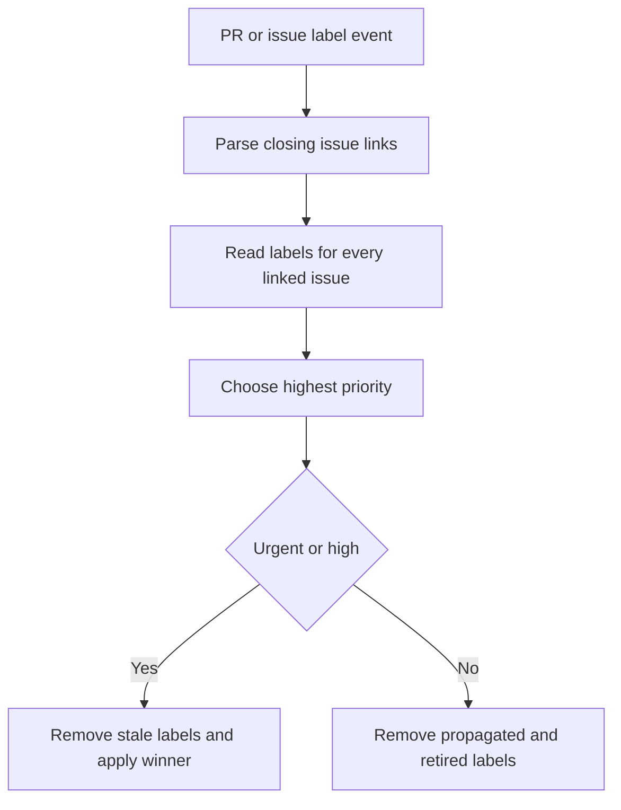
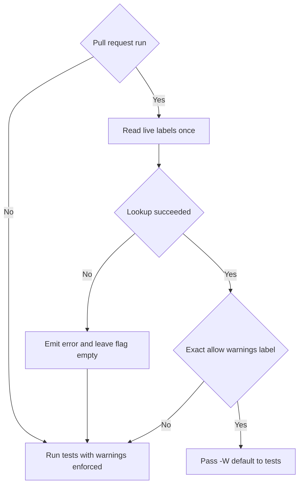
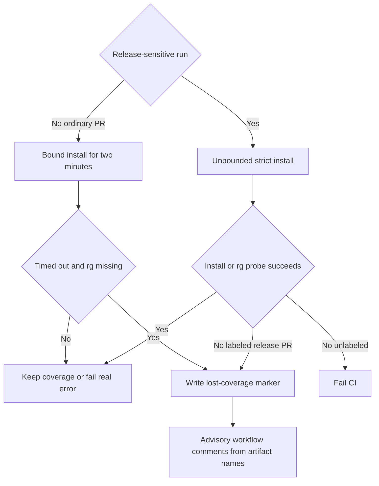

# CI, Labels, and Workflow Security

This page explains the control boundaries around CI overrides, label synchronization, release automation, and evaluation workflows. It complements [Development](development.md), the [Testing Guide](../testing/testing-guide.md), [Run Evals](../workflows/run-evals.md), and the [source map](../architecture/source-map.md). In `.github`, event entrypoints have ordinary names and `_*.yml` files are reusable `workflow_call` components; extend an existing reusable workflow or composite action instead of duplicating checkout and `uv` setup.

## Labels are control-plane data

`ci:*` labels record a maintainer acknowledgement or a narrowly defined override; the PR labeler does not create them. The label taxonomy maps each label to the gate that consumes it. A new `ci:*` gate should therefore use a live API read, have its label created in the repository, and be added to the taxonomy rather than treating a label as an unreviewed configuration value.

`sync_priority_labels.yml` separately derives PR priority from closing links in the PR body. It considers `Closes`, `Fixes`, and `Resolves` links, selects the highest linked-issue priority, and propagates only `priority:urgent` or `priority:high`. It removes `priority:backlog` and retired `p0`–`p4` labels instead of mapping them. Its privileged `pull_request_target` path does not check out PR code; label-writing permissions belong only to mutation jobs. Concurrency is scoped by PR, issue, or manual backfill, and recomputing the complete desired state makes the result converge despite overlapping issue events.



*Priority synchronization recomputes a PR's state from linked issues rather than incrementally copying the triggering event.*

## Reusable test worker and package selection

`ci.yml` runs for pull requests, pushes to `main`, and merge-queue events. It detects changed packages and calls `_test.yml` only for the relevant package on PR and merge-group runs; pushes run every package test job. Each package filter includes its package directory, shared SDK dependencies where applicable, CI workflow files, and local actions, so automation changes get exercised. `deepagents` changes also fan out to packages that editable-install it. The workflow deliberately discovers every `libs/**/pyproject.toml` package in its contract test and requires that set to equal the `_test.yml` callers.

The reusable worker accepts a working directory, quoted JSON Python-version array, optional OS-specific legs, and optional shard strings. It validates those JSON shapes inside every matrix leg before checkout, expands a non-fail-fast matrix, uses the local `uv_setup` action, synchronizes the `test` dependency group, runs `make test` on non-Windows and direct pytest on Windows, and checks that the worktree remains clean. It has only `contents: read` and `pull-requests: read`; callers can narrow but cannot expand a called workflow token.

The final `✅ CI Success` job evaluates all relevant results even when earlier jobs are skipped or fail. Lockfile validation always remains mandatory. One narrowly bounded policy exception applies on a pull request that does **not** touch `libs/talon`: failures, but not cancellations, in Talon jobs may be waived because Talon runs against `libs/code` through an editable dependency. Push and merge-group runs remain strict, and a sticky advisory records a waiver. Crucially, the gate script is sparse-checked out from the trusted base ref, not executed from the untrusted PR merge checkout; a PR cannot modify the decision logic that decides whether its checks passed. A changelog-only commit made by the trusted release bot can inherit a conclusive successful parent CI result, but an inconclusive or failed parent keeps the gate red.

### Live warnings override fails closed

Every package is expected to lead its pytest `filterwarnings` configuration with `error`. `_test.yml` performs a live `gh api` label lookup only for `pull_request` runs. It uses one bounded `per_page=100` request and exact label matching, because a rerun's event payload can be stale and a partial paginated response must not arm an exception. If the read fails, the step emits an error annotation and writes an empty flag: warnings remain errors. If and only if `ci:allow-warnings` is found, the worker passes `-W default` to both POSIX and Windows test commands. Command-line filters outrank package ini filters, while per-test warning marks still apply. Push and merge-group runs have no PR-label context and always enforce the normal policy.



*The warnings exception is fail-closed: inability to establish the live label state preserves the gate.*

## Ripgrep: strict coverage versus advisory reporting

The pinned installer downloads ripgrep 14.1.0 for Linux x86_64 musl, validates its SHA-256, installs `rg`, and returns nonzero for unsupported architecture or any install failure. It deliberately supplies no policy beyond that result; its callers decide whether failure blocks the job.

For the Deepagents Linux leg, `_test.yml` selects exactly one install path:

- **Ordinary PR:** installation is bounded at two minutes. Only timeout statuses 124 or 137 are softened. The worker probes `rg`; if it is usable, coverage is retained and no warning is reported. Other installer errors fail the job. A true timeout with no usable binary writes a one-day `ripgrep-timeout-...` marker artifact and allows the rg-gated tests to skip.
- **Release-sensitive PR, push, or merge group:** installation is unbounded and strict. Release-sensitive PRs are identified by a release-please branch prefix or a `release(` title. Only such a PR can resolve `ci:skip-ripgrep` live; a failed lookup resolves to `false`, so the failure stays blocking. A labeled failed install is tolerated only after an `rg --version` probe also fails. It writes the same marker artifact but does not claim ripgrep coverage.

On any runner where installation succeeded or the probe found a usable binary, the workflow exports `DEEPAGENTS_RIPGREP_EXPECTED=1`. The filesystem tests turn a subsequently missing `rg` into a failure rather than a skip; this protects the real-binary contract, including symlink containment coverage. Thus a marker means coverage was lost, not that a timeout or bypass was harmless.

`ripgrep_timeout_comment.yml` is reporting, not enforcement. It runs after completed PR CI in the base repository so it can comment on fork PRs, but does not check out or execute PR code and reads artifact **names**, not contents. It resolves the open PR, rejects stale head-SHA runs, and only manages a sticky comment that is both marked and owned by `github-actions[bot]`. It describes a release PR artifact as a bypassed strict-install failure and an ordinary PR artifact as a timeout; that distinction depends on PR kind, not a later label read. If its best-effort label read fails, the release-dispatch consequence is described as unconfirmed. An unresolvable PR is logged as a normal race rather than failing the comment job.



*The marker-to-comment path is advisory; strict CI and release checks are the gating paths.*

## Release paths and trusted mutation boundaries

`release-please.yml` detects release commits on `main`, rejects malformed or unmatched detection rather than silently doing nothing, and dispatches package releases. Its dispatch job resolves the merged release PR and reads labels live before passing dangerous inputs; failed PR or label resolution is fail-closed. `ci:dcode-skip-sdk-pin` applies only to `deepagents-code`, while `ci:skip-ripgrep` controls the strict release artifact-test exception for every package. `release.yml` is manually dispatched rather than reusable because PyPI Trusted Publishing requires this route. Its read-only build stage resolves an immutable target, checks normal-release ancestry and package version at that target, and produces the supported-Python matrix used by cache-free, read-only pre-release checks.

The release ripgrep step is also strict by default. Only the exact `dangerous-skip-ripgrep-check=true` dispatch input can soften an install failure; a usable existing `rg` still preserves coverage. Otherwise it records that artifacts were tested without ripgrep coverage before gated tests skip. This is an auditable acknowledgement of reduced coverage, not a successful coverage result.

Curated notes are a separate trusted release-PR mutation boundary. `release_notes.yml` accepts a release PR becoming ready for review or an insider `@release-bot` comment, validates the trigger and maintainer permission, and loads its helper code from a credential-less `main` checkout. Release-PR content is fetched through the API at the validated head SHA as untrusted data: it is never checked out or executed by a write-capable job. The draft and apply jobs run in the `release-bot` environment, receive a short-lived GitHub App token only after validation, and use it for explicitly scoped comment, PR, and non-force Git Data API mutations. The model subprocess receives only its selected provider key and input/output file paths. Applying notes explicitly dispatches `release_notes_check.yml` because an App-token branch update does not emit the ordinary PR event required to refresh the merge gate.

## Harbor and unified evaluations

The reusable Harbor worker supports either a caller-provided flat matrix or single-dataset shard expansion, derives an effective parallel pool, and runs a non-fail-fast Harbor matrix. Its secret-bearing leaf is read-only; the aggregate job alone has `actions: write` for shard artifact download and cleanup, runs after non-cancelled work, and reports available shards without failing the paid evaluation workflow. Credential validation selects provider keys by model/category and rejects unsupported providers, sandboxes, malformed OpenRouter judge slugs, and missing requirements before execution.

`unified_evals.yml` invokes Harbor once per prepared model matrix. Its LangSmith usage query is best effort in the `evals` environment and does not give `LANGSMITH_API_KEY` to the write-capable result-combine job. Keep provider credentials at their consuming runtime step and condition; do not promote them to workflow scope. Credential-scoping tests also lock down GitHub App token references, package-conditional integration secrets, disabled release integration wiring, the dedicated OpenWiki token sequence, and step-only topic-classifier secrets.

## Focused verification

Workflow contract tests execute the ripgrep install and bypass shell branches with stubbed commands, execute live-label resolution against a stubbed `gh`, and assert that the release predicate and advisory reporting predicate stay aligned. Separate tests require every discovered package to be wired into CI, compare CI matrices to `requires-python`, and enforce credential scope. Release-notes tests run the Node helper tests and statically protect trigger, trusted checkout, App-token, and mutation boundaries.

```bash
python -m pytest .github/scripts/tests/workflows/test_ci_workflow.py
python -m pytest .github/scripts/tests/workflows/test_warnings_are_errors.py
python -m pytest .github/scripts/tests/workflows/test_release_python_matrix.py
python -m pytest .github/scripts/tests/workflows/test_workflow_secret_scoping.py
python -m pytest .github/scripts/tests/release/test_release_notes.py
python -m pytest .github/scripts/tests/release/test_release_target_summary.py
python -m pytest .github/scripts/tests/evals/test_unified_workflow.py
```
