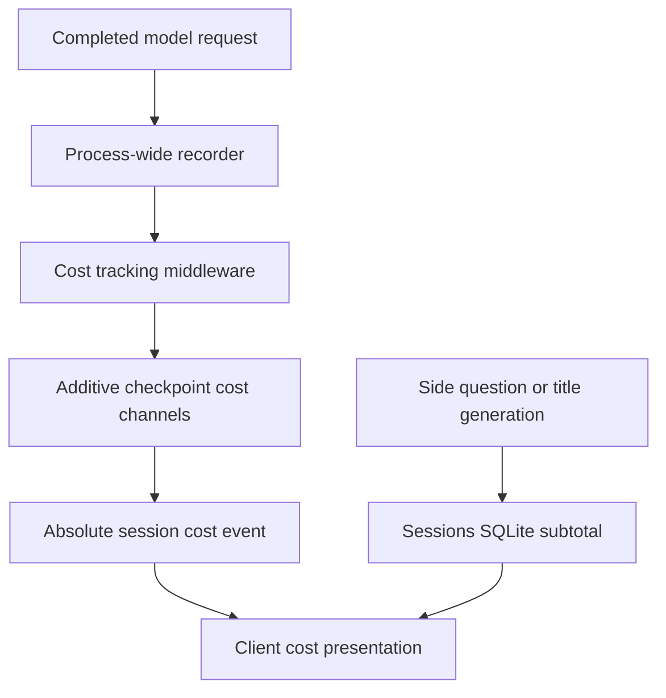
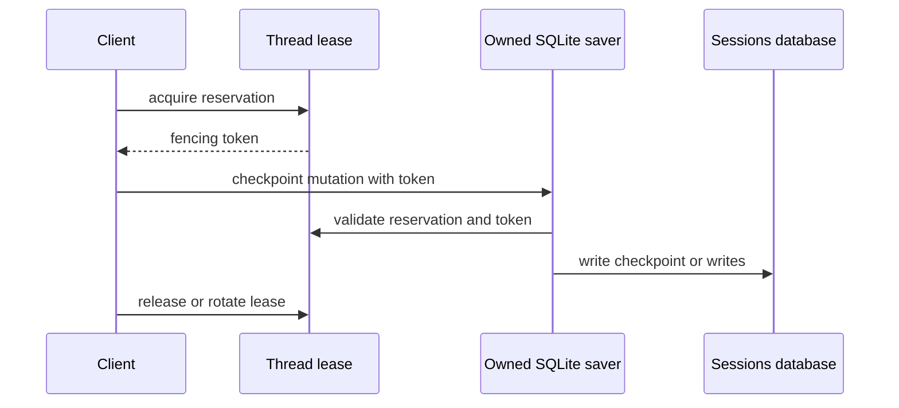
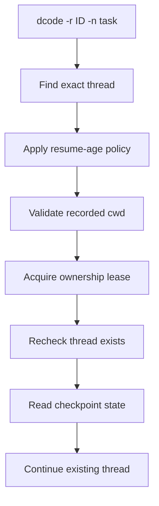
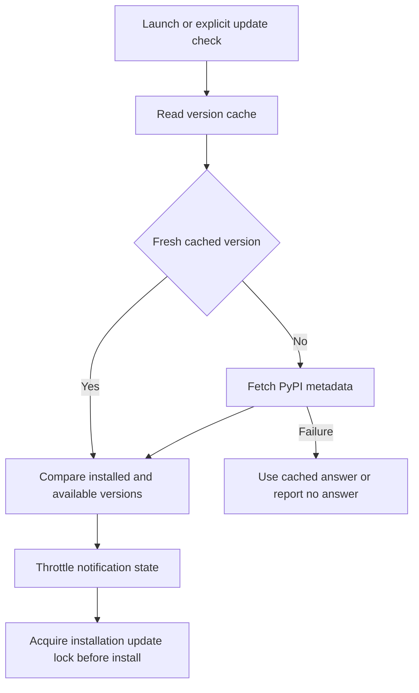

# dcode Costs, Sessions, and Updates

## Operating model

A dcode thread is durable LangGraph checkpoint state in the sessions SQLite database, not a transactional backup or a provider billing record. Keep independent backups when recovery guarantees matter. Model-cost dollars are **estimates**, not invoices, budgets, reservations, or spend limits; reconcile actual charges with the provider.

The graph owns its lifetime cost total in private additive checkpoint channels, `_session_cost_usd` and `_session_cost_breakdown`. `CostTrackingMiddleware` drains completed model records after model work and again after agent completion, so post-final-step work is included. Accounting is deliberately best effort: a tracking failure should not fail a user turn, and drained records are restored where possible. Side questions and generated titles use separate recorders and persist their subtotal in the sessions database because they can finish after the graph has stopped. The client combines graph and side totals only for display.



*Graph-owned lifetime cost and independently persisted side-operation cost converge only in the presentation layer.*

`SessionStats` is separate client-process telemetry, not the durable total. It records provider/model and usage-kind estimates and retracts/replaces an earlier streamed contribution when later chunks provide cumulative usage or a better model identity. This prevents one API request from being counted more than once. The client accepts a nested `model_usage` event only after validating its version, identifiers, usage fields, and active thread.

## Thread ownership and lifecycle

A thread is exclusive while writable. `thread_ownership` uses operating-system-backed file locks plus a per-thread random token. The owned SQLite saver serializes writes and validates both the live reservation and token immediately at the write boundary. A released lease, token rotation, or a newly acquired owner therefore fences out stale writers rather than merely relying on the client to stop.



*The saver enforces ownership when committing, which prevents an old session from writing after ownership changes.*

Deletion follows the same rule: it first acquires the reservation and rejects a thread open elsewhere. It removes checkpoint and write rows, durable names, cached message-count rows, and side-question cost, then best-effort removes offloaded history. The Boolean result says whether checkpoint rows were deleted; archive-cleanup errors are logged but do not alter that result.

### Discovery, names, and inspection

`list_threads()` creates a covering metadata index before grouping checkpoint metadata, and loads names separately. It does not deserialize checkpoint blobs merely to draw a listing. Message counts and initial prompts are checkpoint-derived, loaded only when requested, and cached by latest checkpoint identity; a changed checkpoint invalidates the cached derived value. `/threads` can first paint cached rows, while startup and post-turn background work prewarms only the detail columns currently visible.

The interactive selector scopes to the current working directory by default, with an option to widen to all directories. Its cwd database filter is an exact stored-string match; older threads without cwd metadata do not match it. Agent filtering applies to loaded rows, while scope and sort changes refresh the window. If the process cwd cannot be read, the selector degrades to all directories with a warning rather than crashing.

Thread names must be trimmed, printable, single-line strings of 1–50 characters. `rename_thread()` transactionally writes `dcode_thread_names` and mirrors the value to the latest checkpoint metadata for compatibility. Reads prefer that durable table and fall back to root-checkpoint metadata. `only_if_unnamed` lets concurrent automatic naming preserve an already assigned manual name.

For trusted local state, use the bundled inspector rather than hand-decoding checkpoint blobs:

```bash
python3 "$SKILL_DIR/scripts/inspect_sessions.py" THREAD_ID --mode latest-turn
python3 "$SKILL_DIR/scripts/inspect_sessions.py" --list 20
```

The inspector opens a read-only database, requires `checkpoints` and `writes`, and strictly MsgPack-decodes root-namespace state. It reads materialized messages from the latest checkpoint and falls back to ordered-write replay. It warns about decode and reconstruction defects instead of silently claiming complete history. Its default database is `DEEPAGENTS_SESSIONS_DB`, then `$DEEPAGENTS_HOME/.state/sessions.db`, then `~/.deepagents/.state/sessions.db`; do not use it on untrusted databases or expose sensitive recovered content.

### State-directory migration

At startup, legacy internal state directly under `~/.deepagents/` is migrated into `.state/`, including `sessions.db` and its `-wal`/`-shm` sidecars. This migration is best effort and idempotent: an existing destination is never overwritten, and an I/O failure for one entry is logged while startup and other entries continue. If both legacy and destination files exist, inspect and reconcile them manually rather than assuming either copy is authoritative.

## Resume operations

Interactive `/threads` selects a persisted thread; `/threads -r [THREAD_ID]` can target the previous reset thread, the most recent active-agent thread, or an explicit target. A cross-agent target may require an agent switch. A normal switch reserves the destination before releasing prior ownership only after the outcome is known.

Headless continuation is explicit: `dcode -r THREAD_ID -n "..."` never falls back to creating a new thread. First it verifies that the thread exists (and suggests matching ID prefixes), enforces the configured resume-age policy, and checks that the recorded cwd is still available and matches the invocation cwd. A thread with an absent cwd may proceed, but a relative, missing, or mismatched recorded directory is rejected. The run then reserves the thread and rechecks existence while holding the reservation, closing the deletion race.



*Headless resume fails closed at every selection and ownership gate; it does not create a replacement thread.*

`threads.resume_after` and `threads.max_resume_age` can both set a cutoff; dcode uses the stricter (latest) cutoff. An invalid or missing `updated_at` also blocks a policy-governed resume, because its freshness cannot be verified. The TUI and headless code share this logic so their safety boundary does not drift.

By default headless resume adopts the thread agent and the last successfully persisted model; passing `-a` or `-M` opts out of the respective adoption. The model is read from checkpoint-private `_model_spec` and `_model_params` only after the server has registered the thread. If the saved model no longer resolves, dcode warns and continues with the launch model; workspace-policy conflicts remain fatal. Threads remain bound to their originating directory, agent, approval, shell, sandbox, and MCP settings, and server-side workspace compatibility is authoritative.

`ResumeState` is the per-checkpoint schema used to rehydrate a session without replaying or retokenizing all history. Successful model turns persist context-token count, effective model specification/parameters, and cache activity facts with their model checkpoint. It also holds private goal/rubric state and pending proposals. Model-turn facts are written in graph middleware so they share the response checkpoint; user-owned accepted goal/rubric state is written through client state updates. Treat unknown persisted goal statuses and malformed model specs as unusable rather than actionable values.

On resume, one-shot `rubric` input from an earlier headless run is cleared, while persisted rubric history remains. An unfinished tool call is abandoned rather than executed merely because the thread was resumed: the conversation is repaired with tool responses before the new user message proceeds.

## Pricing and durable cost settlement

Pricing is best effort. Unsupported models, malformed usage, missing/incompatible `genai-prices`, and unavailable rates produce no estimate rather than interrupting model work. A version-one cost breakdown retains total versus priced request counts, reported token usage, cost/token categories, and completeness flags. An unpriceable request can therefore preserve usage while marking its cost categories incomplete.

The primary catalog begins with package data and can refresh once per process. `DEEPAGENTS_CODE_OFFLINE`, `DEEPAGENTS_CODE_PRICES_AUTO_UPDATE=0`, or `update.prices_auto_update = false` disable updater startup. The updater refuses a fetched snapshot with fewer providers than the bundled catalog, retaining the known catalog rather than replacing it with partial coverage.

When primary lookup misses, dcode reads user `prices.json` followed by bundled `bundled_prices.json`, using the provider-array schema. User provider/model entries override colliding bundled entries; deterministic loading is cached for the process, while transient read errors can be retried. Upstream coverage always wins once it has a price. Invalid override data is warned about and ignored, not allowed to fail a turn.

Direct server-owned calls outside ordinary middleware must use `prepare_operation_cost()`. Preparation destructively claims recorder entries. Commit the returned additive update in the same checkpoint write as operation state and call `commit()`; call `rollback()` only after proving that the write did not land. Restoring after a landed write can double charge; abandoning a prepared value permanently loses its claimed spend.

Side-question and title spend is persisted as a separate sessions-database subtotal, not placed back into graph cost channels. A deletion tombstone prevents a late completion or retry from resurrecting spend after thread deletion. The `/btw` route reads checkpoint state only as a pricing fallback, runs its isolated operation through `answer_with_cost`, and exposes the cumulative side subtotal through the thread-cost endpoint. Title generation sends bounded visible human/assistant text to a tool-free model without callbacks, normalizes its output through the thread-name rules, and waits for model initialization if cancellation arrives.

## Client usage statistics

`SessionStats` is process-local display telemetry, not a replacement for the checkpointed session total. It counts completed requests, tokens, cache reads/writes, and priceable estimates globally, per `(provider, model)` and by usage kind (`assistant`, `subagent`, `offload`, or `auto`). A missing price leaves token counts intact and does not add to dollar totals.

Streaming usage is a correction ledger rather than an append-only counter. Chunks for one invocation retract and replace the prior running contribution; a completed message replaces partial chunk data, and a later model identity can re-price the whole request. Stable invocation identity is preferred, with message identity and retry attempt scope as fallbacks. Thus a provider that emits incremental chunks does not appear as multiple requests, while a duplicate completed message cannot double count.

Nested `model_usage` events are only provisional client display input. The consumer checks the event type and schema version, request/thread/scope identifiers, and usage shape before accepting it; an unsupported event loses only the provisional display because the durable server total still arrives separately. Do not use the session-statistics table as a billing system: both it and durable cost use estimates.

## Update checking and installation safety

Update discovery is best effort. `get_latest_version()` uses `latest_version.json` for 24 hours, fetches PyPI with a three-second timeout only when necessary, and returns the cached answer or `None` on malformed cache/data, unavailable `requests`, or network failure. Stable installs consider stable releases unless configured otherwise; an update result distinguishes an up-to-date checked release from an unavailable check. Notification state is separate in `update_state.json` and suppresses a repeat notice for the same version for the same TTL.



*Update discovery degrades to cached or no-result behavior; installation is a separately serialized operation.*

`[update].check`, `DEEPAGENTS_CODE_NO_UPDATE_CHECK`, and managed configuration control checking; checking defaults on, but an unreadable managed policy disables it. Auto-update defaults on for a non-editable install, but editable installs never auto-update. Managed policy has precedence; an unreadable user configuration disables auto-update rather than assuming permission to install. `set_auto_update()` is intentionally different from most update helpers: it raises if it cannot atomically persist the requested setting.

All paths that replace the tool environment—startup auto-update, `dcode update`, `/update`, and update-notification actions—compete for the nonblocking installation-scoped `update.lock`. A loser continues running its launch version and sees the installed update on a later launch. An unavailable lock fails open with a warning, so it preserves pre-lock availability at the cost of losing concurrent-install serialization.

A `uv` upgrade is pinned to the inspected target and must pass post-install readback; an installer exit alone is not success. dcode refuses an unknown or unsupported install method instead of trying another package manager. If a target requires Python 3.14, startup paths that cannot safely rebuild an environment defer with instructions to quit sessions and run `dcode update`; Windows always defers. An interrupted migration emits recovery guidance because a half-rebuilt environment may no longer run dcode.

### Installation presence versus thread ownership

The session lock used by update migration is deliberately distinct from the per-thread checkpoint lease. On POSIX, every process of a non-editable installation holds a shared `sessions.lock` for its lifetime and passes its descriptor to spawned servers. A prospective migration serializes its check and tries an exclusive lock; it treats Windows, lock failure, and contention as “not alone,” thereby deferring migration. Kernel lock release on process death avoids stale presence markers, but the result remains a race-time snapshot and cannot cover older versions or a session launched during migration.

## Cost diagnostics and offload failure handling

The full-thread breakdown formatter refuses to render unless it receives a version-one breakdown with `historical_complete` true. This prevents legacy dollar-only history or malformed detail from being presented as a complete token table. For valid breakdowns, the table labels missing/invalid values as unavailable, marks incomplete categories partial, identifies directionless cost, and warns when some requests are unpriceable.

The footer and Debug Console share that formatter and modal. The footer opens it from the cost span; the Debug Console hides its control if the provider is empty or errors. `open_cost_breakdown` refuses duplicate modal stacking. The live screen polls every 0.5 seconds, retains its last accepted table after a provider error or empty result, sanitizes control characters before render/copy, and reports clipboard failures without closing.

Server `/offload` serializes work per thread, requires a registered idle thread with no pending graph work, and confirms the checkpoint has not advanced before commit. Its update is allowlisted so it cannot write conversation messages. It settles prepared cost alongside checkpoint state: a failed write rolls back only after readback proves no advance; an advanced or unreadable write keeps records claimed to avoid double charge. Cancellation waits for commit work before it is re-raised. Normal offload commits summary and cost before deferred archive append/link; handoff instead preserves source context and commits source cost channels with a source-owned recovery transcript.

## Focused verification

- Run `tests/integration_tests/test_headless_resume.py` against the real local server for persistence across CLI subprocesses, model adoption/override, cwd and workspace rejection, ownership contention, deletion races, rubric clearing, and abandoned-tool repair.
- Run `tests/unit_tests/test_headless_resume.py`, `test_non_interactive.py`, and resume-policy cases in `test_app.py` after changing headless selection, cutoff, cwd, or adoption behavior.
- Run `tests/unit_tests/test_sessions.py` and ownership-transition tests after changing listing, naming, deletion, caching, or checkpoint writes.
- Run `tests/unit_tests/test_cost_tracking.py` for pricing fallback/updating, recorder ownership, breakdown completeness, middleware charging, and prepared settlement; run `test_cost_breakdown.py` and relevant app/Debug Console tests for diagnostic eligibility and modal failure behavior.
- Run `tests/unit_tests/test_update_check.py` after changing caching, version selection, policy precedence, lock behavior, upgrade command construction, migration, or verification; its cases cover corrupt state, prerelease constraints, and safe failure paths.
- Run the `SessionStats` unit cases when changing streamed usage identities, correction/re-pricing, retry scope, or nested usage events.
- Run `tests/unit_tests/skills/test_thread_inspector.py` for read-only inspection and malformed-state reconstruction, and offload API tests after changing checkpoint guards, cost settlement, cancellation, or archive linking.

Related material: [Code agent architecture](../architecture/code-agent.md), [Context management](../concepts/context-management.md), [State persistence](../concepts/state-persistence.md), and [Run a dcode session](../workflows/run-dcode-session.md).
