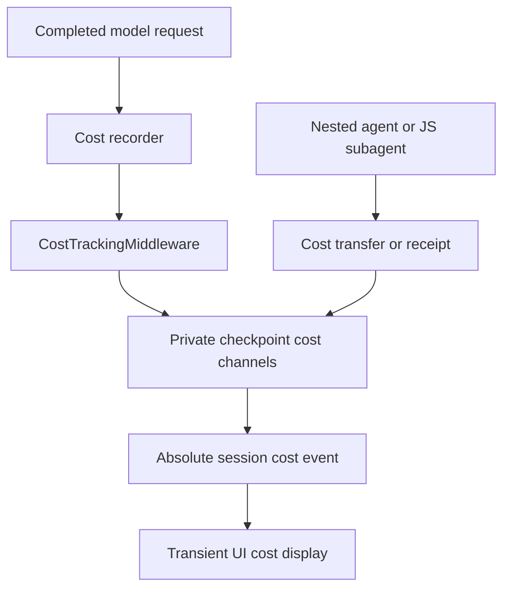
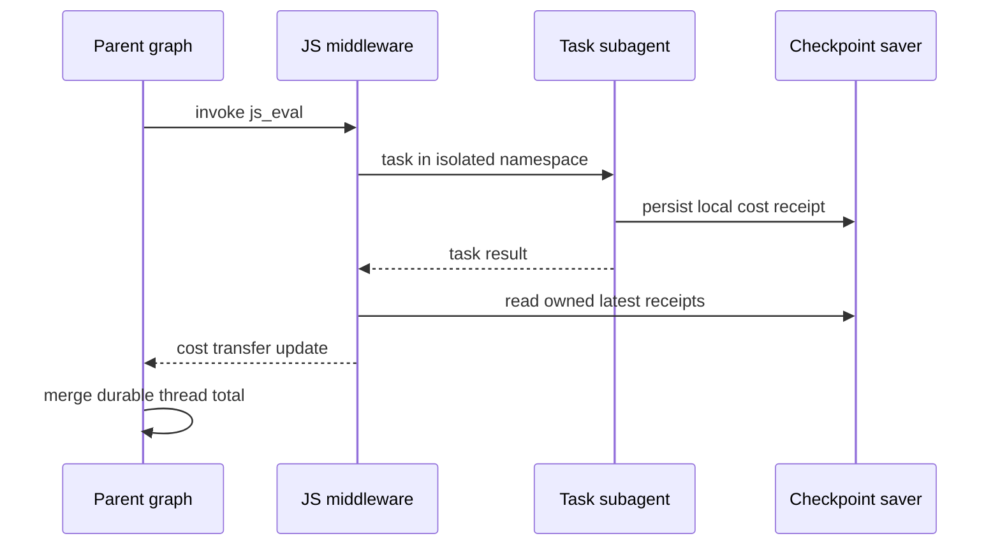

# dcode Costs, Traces, and Session Operations

## Durable state versus live display

A dcode thread is durable LangGraph checkpoint state in the sessions SQLite database. Its graph-owned cost is an **estimated** cumulative dollar total, not a provider invoice, budget, reservation, or spend limit. Reconcile provider billing separately.

The durable graph channels are private: `_session_cost_usd` is additive and `_session_cost_breakdown` merges structured version-one detail. `CostTrackingMiddleware` drains completed records after model work and at agent completion, so late work such as rubric processing is normally included without making a turn fail when accounting itself fails. Nested agents accumulate locally and hand their completed totals to the owning parent through `_session_cost_transfers`; this allows independent parallel transfers without exposing the channels as public graph input.

*Durable checkpoint accounting is the source of truth for a thread; the UI consumes absolute totals and does not own the ledger.*

`SessionStats` is deliberately separate process-local telemetry. It revises an earlier streaming contribution when cumulative usage, a completed response, or a better model identity arrives, preventing one model call from becoming multiple display requests. Its totals and provisional nested `model_usage` events are useful live feedback, but are not a replacement for durable checkpoint cost.

Pricing is best effort. Unsupported models and malformed usage produce no estimate rather than interrupting model work; the breakdown preserves request counts, token categories, priced-request counts, and completeness flags so an unpriceable request is visible as partial rather than silently treated as zero cost.

## JavaScript subagent cost transport

When the interpreter is enabled, the agent installs `CostAwareCodeInterpreterMiddleware` in place of the stock code-interpreter middleware. The synchronous wrapper is intentionally transparent. Its asynchronous wrapper replaces only `task` tools with proxies, gives each dispatched task an isolated checkpoint namespace, and gives the whole JavaScript evaluation an accounting owner derived from scope and a hashed tool-call identity. The hash avoids placing prompt text in checkpoint names.

A proxied child inherits the accounting owner and executes with synchronous durability. Each local node calls `record_cost_receipt()` before returning its graph update. That function writes a receipt checkpoint carrying the local dollar delta and optional breakdown; it passes the thread ownership token to an owned saver when one is present. A receipt namespace is written once, so replay does not overwrite or duplicate it. At the outer evaluation boundary, the middleware reads the latest receipt per namespace, validates finite non-negative dollars, merges detail, and attaches a `_session_cost_transfers` update addressed to the parent scope.

*Receipts survive interruption, cancellation, and a fresh-process resume before their completed total is transferred to the parent.*

The bridge waits for tracked dispatches when evaluation exits and propagates cancellation and LangGraph control-flow exceptions. Ordinary child failures become bounded retryable error values, so a JavaScript program can handle a failed sibling without discarding already durable receipts. Receipt totals also preserve zero-dollar priced or unpriceable usage detail; missing or invalid receipt detail marks historical completeness false rather than inventing attribution.

## Threads, ownership, and deletion

Thread checkpoint writes are fenced by an operating-system-backed per-thread lease and token. The owned SQLite saver validates the reservation and token under its serialized writer guard, so a released lease or new owner rejects an old writer at the persistence boundary.

Thread discovery reads compact metadata rather than checkpoint blobs. `list_threads()` creates a covering index before grouping checkpoints, loads durable names separately, and delays message count and initial-prompt deserialization until requested. In-memory derived-field caches are keyed by the latest checkpoint identity; the app prewarms those fields in a background worker at startup and refreshes them after a completed turn. This is an optimization only: cached selector rows and formatted timestamps are transient display state, whereas checkpoints, `dcode_thread_names`, and saved message-count rows are local durable data.

Names are validated as trimmed printable single-line values of 1–50 characters. Renaming is transactional: it writes `dcode_thread_names` and mirrors the value into the latest checkpoint metadata for compatibility. Reads prefer the durable name table and fall back to checkpoint metadata.

Deletion first acquires the thread reservation; it refuses a live thread owned elsewhere. While guarded, it deletes checkpoint and write rows plus dcode-owned name, message-count, prompt, and side-question-cost data, then attempts offloaded-history removal. Archive cleanup is best effort and does not change the Boolean result, which reports only whether checkpoint rows were deleted. Operators should therefore treat a successful delete as durable SQLite removal, and inspect logs if archive cleanup matters.

## Server-side offload settlement

`/offload` is a server-owned checkpoint mutation, not a client-authorized state write. It serializes operations by thread, requires a registered thread in an idle or error status, and verifies quiescence and the checkpoint identity before committing. The writable state channels are derived from `OffloadStateUpdate`, which prevents the operation from updating conversation messages.

The request boundary validates its narrow payload and context. It strips client-supplied endpoint, proxy, transport, and header model parameters, then replaces model selection with the model specification and parameters checkpointed by a successful agent turn. Thus a local client cannot redirect a credentialed summarization request or select a new provider for existing thread history.

Offload preparation destructively claims model-cost records. Its state update and prepared cost must settle together: after a confirmed write, it commits; after a failed write that readback proves unchanged, it rolls back. If readback shows advancement or cannot read the thread, it keeps the records claimed to avoid double charging, reports an indeterminate outcome, and may understate the thread total. Cancellation is handled through the same classification path. Deferred archive append/link happens after the summary reservation, so an archive problem is not reported as an uncommitted compaction.

At server shutdown, the Starlette lifespan cancels and joins runtime prebuild work, shuts down extensions, then attempts to flush existing LangSmith tracers. The flush runs in a daemon thread because the LangSmith wait has no timeout; dcode polls for at most two seconds, logs timeout or failure, and continues shutdown. This improves delivery of already-buffered traces but does not guarantee traces emitted while the runtime is cancelling.

## Trace redaction

When tracing is enabled and has an upload target, dcode can configure LangSmith with `create_cached_secret_anonymizer()`. It uses LangSmith's default secret rules and the default traversal depth, so output matches the stock secret anonymizer. The cache is a lock-protected per-string LRU shared safely by tracer and event-loop threads; it caches both changed and unchanged results because growing trace histories repeatedly contain the same strings.

The cache is bounded to 50,000 entries and 16 MiB of key plus changed-value characters. Old entries are evicted, and oversized strings are redacted every time rather than retained. Caching is therefore a performance optimization, not a relaxation of redaction: cache hits return the same masked value that rules produced.

Redaction setup is fail closed once tracing could upload. If redaction is disabled, dcode warns that traces may be unredacted. If configuration or client installation fails, it disables tracing through the SDK and falls back to clearing tracing environment controls rather than leave an active unredacted uploader. Reauthentication reinstalls the redacting client so rotated credentials cannot retain a stale client.

## UI and hook lifecycle

The Textual adapter contains callbacks, not accounting ownership. The app wires durable `_on_session_cost` updates to `_set_session_cost`, provisional request estimates to `_add_provisional_cost`, usage updates to display refresh, and stream completion to the thread-turn completion handler. During streaming, only a validated main-graph absolute cost event is passed to the durable-total callback; callback failures are logged and do not break the stream. Nested `model_usage` events instead feed provisional `SessionStats` handling.

Session lifecycle hooks are separate from a checkpoint's persistence lifecycle. The adapter invokes `on_session_start(COMPACT)` after automatic compaction, and the app awaits `on_session_end(CLEAR)` before dropping the old transcript and switching to a newly reserved thread. A hook may stop the relevant lifecycle operation; UI resets, spinners, cached thread rows, and cost widgets remain transient client state and must never be mistaken for a durable thread transition.

## Focused verification

- Run `tests/unit_tests/test_cost_tracking.py` for middleware draining, breakdown completeness, and prepared-operation settlement.
- Run `tests/unit_tests/test_js_cost_tracking.py` after changing interpreter dispatch, receipt namespaces, cancellation, replay, nested transfers, or SQLite resume behavior; run `test_js_cost_sync.py` for synchronous wrapper behavior.
- Run `tests/unit_tests/test_trace_redaction.py` after changing redaction rules, cache bounds, or concurrency behavior; it checks equivalence with LangSmith's stock anonymizer under repeated growing payloads and eviction.
- Run `tests/unit_tests/test_sessions.py`, `test_thread_ownership.py`, and `test_app_thread_ownership.py` after changing names, listing caches, deletion, or checkpoint fencing.
- Run `tests/unit_tests/test_offload_api.py` when changing server offload validation, trusted model context, write classification, archive behavior, cancellation, or shutdown trace flush.

Related material: [Code agent architecture](../architecture/code-agent.md), [Context management](../concepts/context-management.md), [State persistence](../concepts/state-persistence.md), and [Security operations](security.md).
