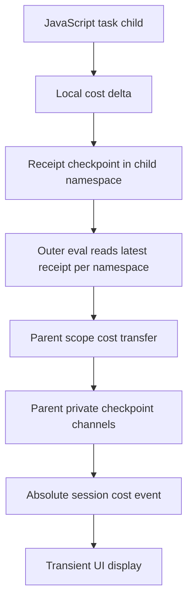
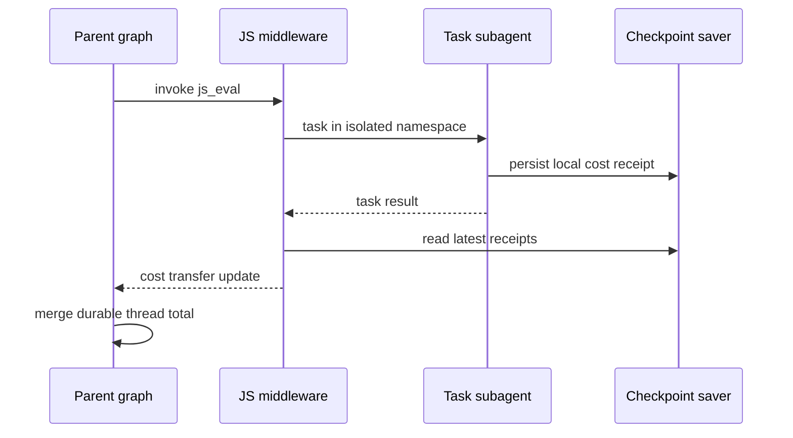
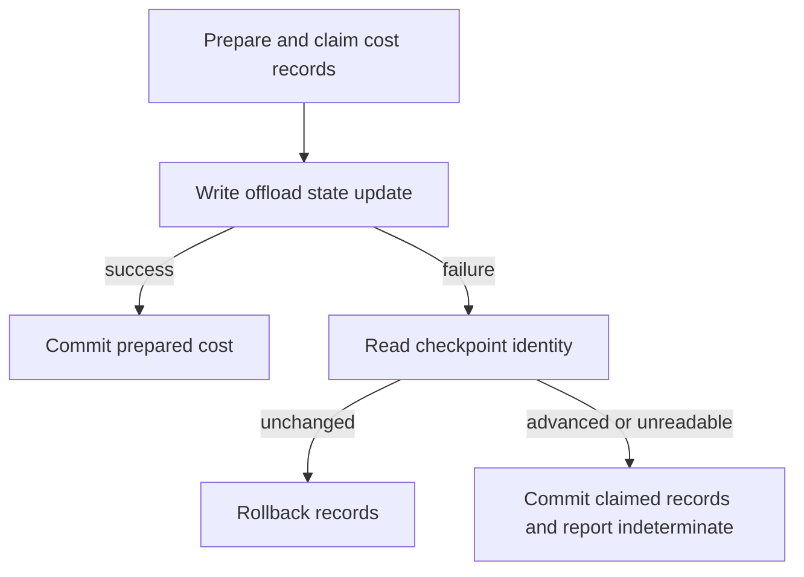

# dcode Costs, Traces, and Session Operations

## Durable accounting versus live display

A dcode thread is durable LangGraph checkpoint state in the sessions SQLite database. Its graph-owned cost is an **estimated** cumulative dollar total, not a provider invoice, budget, reservation, or spend limit. Reconcile provider billing separately.

The private graph channels `_session_cost_usd` and `_session_cost_breakdown` hold, respectively, an additive total and merged version-one structured detail. `CostTrackingMiddleware` drains completed model records after model work and again after agent completion, so late work such as rubric processing is normally included. Tracking failure must not fail a user turn: the middleware logs the failure and restores drained records where possible for a later charge. Nested agents checkpoint local deltas and transfer their completed totals through `_session_cost_transfers` to the owning parent graph; the map lets parallel children hand off independently without making cost public graph input.

*The verified JavaScript path persists local child receipts before the outer `js_eval` call aggregates them into a parent transfer; the parent checkpoint ledger—not the UI—owns the resulting total.*

`SessionStats` is deliberately separate process-local telemetry. It revises an earlier streaming contribution when cumulative usage, a completed response, or a better model identity arrives, preventing one model call from becoming multiple display requests. Its totals and provisional nested `model_usage` events provide live feedback; they do not replace durable checkpoint cost.

Pricing is best effort. Unsupported models and malformed usage yield no estimate instead of interrupting model work. The breakdown still records total and priced request counts, token categories, and completeness flags, making partial attribution visible instead of treating an unpriceable request as zero cost.

### Prepared side-operation charges

Server operations such as offload call `prepare_operation_cost()`. It destructively claims recorder entries and returns a `PreparedOperationCost` whose additive `update` must be persisted with the operation state. Settle every prepared object exactly once:

- **Commit** only after the checkpoint update landed.
- **Rollback** only when readback proves the update did not land; this restores the entries for later pricing.
- **Do not restore** after a landed or indeterminate write. Restoring then would double charge on the next drain.

An abandoned prepared value loses its claimed spend permanently (and emits a warning on collection); a zero-dollar preparation still owns records and therefore also needs settlement.

## JavaScript subagent cost transport

When `enable_interpreter=True`, `create_cli_agent()` installs `CostAwareCodeInterpreterMiddleware` as the `js_eval` interpreter middleware; remote sandboxes are rejected for that option. The cost wrapper is intentionally asynchronous: its synchronous tool wrapper delegates unchanged. In an async evaluation it proxies only structured `task` tools. The evaluation gets an accounting owner derived from the current checkpoint scope and a hash of the tool-call ID. Each dispatch gets a request-isolated child checkpoint namespace derived from a hash of its description, subagent type, response schema, and an occurrence counter; checkpoint names retain hashes rather than prompt text.

A proxied child inherits the accounting owner, uses synchronous durability, and resets the subgraph counter. While pricing a child node, `CostTrackingMiddleware` calls `record_cost_receipt()` before returning its graph update. The function writes the local delta and optional breakdown to an owner-tagged receipt checkpoint, forwards an owned-saver token when present, and does nothing without both an owner and a checkpoint saver. A receipt namespace is written only once, so replay cannot replace or duplicate it. Once all tracked dispatch tasks have settled, only the outer evaluation reads the latest receipt for each namespace, accepts only finite non-negative dollar values, merges detail, and attaches `_session_cost_transfers` addressed to the parent scope. A nested evaluation sees the inherited owner and does not create a second parent transfer.

*Completed child receipts are durable before their total is transferred to the parent.*

Receipt namespaces and latest-per-namespace aggregation prevent replay and parallel-dispatch double counting. Completed child cost survives interruption, cancellation, ordinary child failure, and SQLite-backed fresh-process resume. The bridge waits for tracked dispatches when evaluation ends and propagates cancellation and LangGraph control-flow exceptions; ordinary child failures become bounded retryable error values so sibling receipts remain usable. Invalid or missing historical receipt detail makes completeness false rather than inventing attribution.

## Threads, ownership, and deletion

Thread checkpoint writes are fenced by an operating-system-backed per-thread lease and token. `writer_guard()` serializes writers with a per-thread file gate, validates the saved owner token while holding that gate, and rejects both a released client and a new owner. The owned SQLite saver applies that guard to checkpoints and pending writes, preserving the token in returned checkpoint configuration. Cancellation is joined to the in-flight mutation, so a reservation is not released while a write or deletion can still be running.

Thread discovery reads compact metadata rather than checkpoint blobs. `list_threads()` creates a covering metadata index before grouping checkpoints, loads durable names separately, and defers checkpoint deserialization for message counts and initial prompts. Derived-field caches are keyed by latest checkpoint identity, so changed checkpoints are reloaded. Startup and completed-turn prewarming are display optimizations only: checkpoints, `dcode_thread_names`, and saved message-count rows are durable local state.

Names are trimmed printable single-line values of 1–50 characters. Renaming is transactional: it writes `dcode_thread_names` and mirrors the value into latest checkpoint metadata for compatibility. Reads prefer the durable table and fall back to checkpoint metadata.

Deletion acquires a reservation first and rejects a thread owned elsewhere. Under the writer guard it removes checkpoint and write rows plus dcode-owned names, message counts, prompts, and side-question cost, then attempts offloaded-history removal. Archive cleanup is best effort; the Boolean result reports checkpoint deletion only. Treat a successful deletion as SQLite removal and inspect logs when archive cleanup matters.

## Server-side offload settlement

`/offload` is a server-owned checkpoint mutation, not a client-authorized state write. It serializes operations by thread, requires a registered thread in idle or error status, and verifies quiescence and checkpoint identity before committing. Writable channels are derived from `OffloadStateUpdate`, preventing the operation from updating conversation messages.

The request boundary validates the narrow payload and context. It strips client-supplied endpoint, proxy, transport, header, and model parameters, then uses the model specification and parameters checkpointed by a successful agent turn. A client therefore cannot redirect a credentialed summarization request or select a different provider for existing history.

Offload preparation claims model-cost records. The summary update and prepared cost settle together. After a failed write, dcode reads the thread back:

*Readback determines whether restoring a claimed offload charge is safe.*

An unchanged checkpoint rolls records back. An advanced or unreadable thread keeps records claimed to avoid double charging, reports an indeterminate outcome, and can understate the durable total. Cancellation follows the same classification and is not allowed to skip settlement. Deferred archive append and link happen after the summary reservation: an archive failure is not reported as an uncommitted compaction.

At server shutdown, the Starlette lifespan cancels and joins runtime prebuild work, shuts down extensions, then flushes existing LangSmith tracers. Because `wait_for_all_tracers()` has no timeout, the flush runs in a daemon thread and the server polls for at most two seconds. Failure and timeout are logged without blocking shutdown; this improves delivery of already-buffered traces but does not guarantee traces emitted while runtime cancellation is in progress.

## Trace lifecycle, redaction, and server optimization

When tracing has an upload target, dcode configures LangSmith with `create_cached_secret_anonymizer()`. It uses LangSmith's stock default secret rules and traversal depth behind a lock-protected, bounded per-string LRU. Cache hits, eviction, and oversized strings retain the same masking behavior: caching is a performance optimization, never a redaction bypass.

Redaction setup is fail closed once tracing could upload. A successful setup installs a fresh anonymizing client. If setup or client installation fails, dcode disables tracing through the SDK and clears tracing environment controls rather than leaving an unredacted uploader active. Reauthentication reinstalls the redacting client so rotated credentials do not retain a stale client.

The server pins one tracing configuration for its process lifetime before a runtime executes; workspaces with different tracing environment values or redaction choice cannot share that server. The pinning path configures redaction on the server task, then installs `install_untraced_inline_override()` once. This ordering preserves the fail-closed ContextVar behavior.

The runtime override is **server-only** and process-global: do not install it in a client or a process that does not own its event loop and stable tracing configuration. LangSmith normally sends `@traceable` middleware setup and end bookkeeping through a worker thread even when tracing is disabled. The override executes only those untraced, non-uploading `_setup_run` and `_handle_container_end` calls inline. All other calls—including client API work that could perform network I/O—and traced bookkeeping retain LangSmith's normal thread hop and nesting behavior. Thus the optimization removes no-op server-loop thread hops without changing trace delivery, trace hierarchy, or redaction policy.

## UI and hook lifecycle

The Textual adapter contains callbacks, not accounting ownership. The app wires graph-owned absolute `_on_session_cost` updates to `_set_session_cost`, provisional request estimates to `_add_provisional_cost`, usage updates to display refresh, and stream completion to the thread-turn completion handler. Only a validated main-graph absolute cost event reaches the durable-total callback; callback failures are contained so UI display cannot break streaming. Nested `model_usage` events feed provisional `SessionStats` handling.

Session hooks are separate from checkpoint persistence. The adapter invokes `on_session_start(COMPACT)` after automatic compaction, while the app awaits `on_session_end(CLEAR)` before dropping the old transcript and switching to a newly reserved thread. Hooks may stop the relevant lifecycle operation. UI resets, spinners, cached rows, and cost widgets remain transient client state and must never be treated as a durable thread transition.

## Focused verification

- Run `tests/unit_tests/test_cost_tracking.py` for middleware drains, pricing/breakdown completeness, and `PreparedOperationCost` settlement.
- Run `tests/unit_tests/test_js_cost_tracking.py` after interpreter dispatch, receipt namespaces, cancellation, replay, nested transfers, or SQLite resume changes; run `test_js_cost_sync.py` for the intentional synchronous pass-through. `test_agent.py` covers interpreter installation and remote-sandbox rejection, while `test_app.py` covers checkpoint-to-display session-cost synchronization.
- Run `tests/unit_tests/test_thread_ownership.py` after lease, token, writer-guard, cancellation, or owned-saver changes. It covers cross-process exclusion, stale writers after release or takeover, and cancellation that must wait for mutation cleanup.
- Run `tests/unit_tests/test_sessions.py` and `test_app_thread_ownership.py` after changing names, listing caches, deletion, or checkpoint fencing.
- Run `tests/unit_tests/test_offload_api.py` when changing validation, trusted model context, write classification, archive behavior, cancellation, or shutdown trace flush; in particular it exercises cancellation while settlement is pending and a cancelled readback probe.
- Run `tests/unit_tests/test_langsmith_runtime.py` after changing the inline override. It checks that untraced traceable hooks avoid executor hops and preserve errors, while arbitrary calls still hop and traced runs retain nesting.
- Run `tests/unit_tests/test_trace_redaction.py` after changing redaction rules, cache bounds, or concurrency behavior.

Related material: [Code agent architecture](../architecture/code-agent.md), [Profiles and models](../concepts/profiles-models.md), [State persistence](../concepts/state-persistence.md), [Subagents and skills](../concepts/subagents-skills.md), [Sandbox partners](../integrations/sandbox-partners.md), and [Testing guide](../testing/testing-guide.md).
