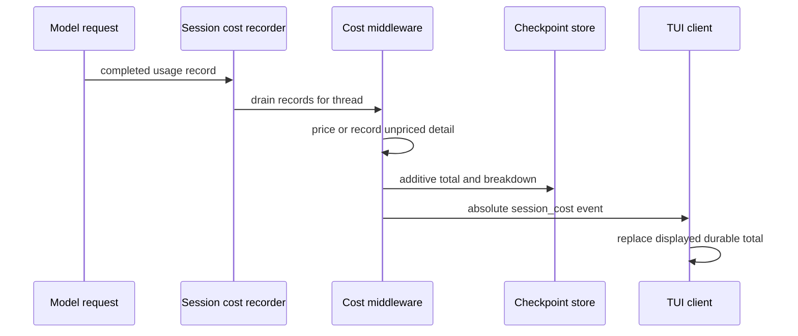
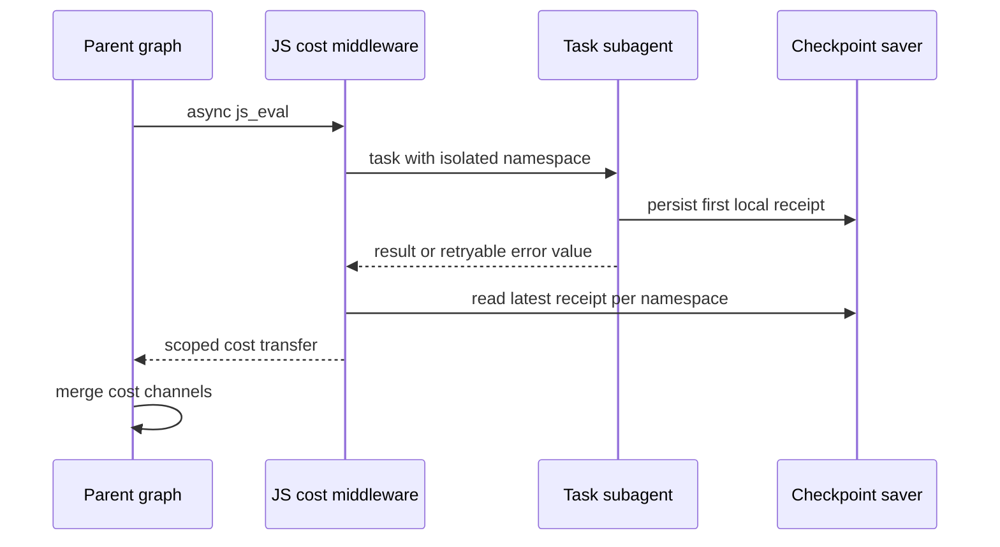

# dcode Costs, Traces, and Session Operations

## Scope and ownership

Cost is **best-effort telemetry**, not provider billing, a reservation, or a budget-enforcement mechanism. A thread's durable main-graph estimate is private checkpoint state: `_session_cost_usd` is additive and `_session_cost_breakdown` is merged with a versioned reducer. `CostTrackingMiddleware` is the writer; the TUI reads an absolute total and must not re-price model requests or maintain an independent lifetime ledger.

This boundary is deliberately broad. The process-wide `_SessionCostRecorder` collects completed model calls for the agent, subagents, and direct model work such as offload, summarization, and Auto-mode classification. The middleware drains and prices those records on the checkpoint path. It also has a fallback for the latest main-agent message when callbacks did not produce a joinable record, preferring an undercount to double-charging an unidentified response.

A main middleware instance drains after each model step and once more after the agent so late work can join the turn's checkpoint. Exceptions in that accounting hook are logged rather than failing the user's turn; a destructive drain is restored where possible so a later drain can retry it. A run without a thread ID has no durable owner and does not drain recorded work.

The middleware's default `TracePolicy` omits hook inputs. Cost state is also private graph state rather than public graph input/output, limiting accidental exposure through ordinary graph payloads.

### Settlement flow

*Completed usage is priced on the graph checkpoint path; the stream event is a display notification carrying the resulting absolute estimate.*

## Pricing, catalog data, and completeness

`estimate_cost()` is the public total-only entry point; internal structured estimation also decomposes input, output, cache-creation, cache-read, and reasoning tokens and costs when the usage and provider data permit it. It is the sole location that loads `genai-prices`, and the import is lazy to keep pricing data off the CLI startup path.

The primary catalog is tried first. On a rate miss, dcode can use an override catalog: a user `~/.deepagents/prices.json` takes precedence over the maintainer-curated `bundled_prices.json`. The bundled file currently supplies Baseten aliases for `glm-4-7`, `inkling`, and `inkling-small`, with per-million-token input, cache-read, and output rates. An upstream rate wins over either fallback, so an override naturally becomes unused when the upstream catalog gains that model.

After the first successful pricing import, a daemon updater may refresh price data hourly. Set `DEEPAGENTS_CODE_PRICES_AUTO_UPDATE=0` or `[update].prices_auto_update = false` to disable it; `DEEPAGENTS_CODE_OFFLINE` also suppresses the network update. These controls affect estimate availability, not model execution.

Unsupported models, invalid or overlapping usage details, and ordinary pricing failures produce no estimate rather than interrupting a model turn. The breakdown remains important in this case: it records total `request_count`, `priced_request_count`, token completeness, cost completeness, and—when the usage can be separated—`unpriced_*_tokens`. Thus a zero or small total must never be interpreted as a complete bill.

### Reading a breakdown

A version-one breakdown is additive. Input and output include their cache and reasoning subsets. A category may have tokens but lack a separately attributable cost, and old or malformed history makes `historical_complete` false. Missing pre-split unpriced-token fields are handled conservatively: the aggregate may be retained, but priced rows are labelled as including unpriced usage rather than claiming a separation that was never persisted.

The modal renders only a version-one, historically complete mapping. It shows priced input/output/cache/reasoning rows, optional unpriced input/output rows when separable, a partial total when not all requests have price data, and explanatory notes. Values below four decimal dollars render as `<0.0001` rather than scientific notation. If no usable historical detail exists, opening the view reports that no details are available instead of inventing a table.

## Session event and TUI presentation

The durable graph writer emits `session_cost` version 2 with the full checkpoint-derived total, optional absolute breakdown, thread ID, and `pricing_ok` health flag. Because it is an absolute value rather than a delta, the display converges after a missed event; because it is thread-tagged, a client can discard a delayed event after switching threads. `pricing_ok` distinguishes a broken pricing installation in the process that did pricing from an unsupported model.

The status bar presents the cumulative estimate next to context tokens. Its cost span is clickable and adds a warning marker when the thread is partial; the marker is also shown for a sub-cent or zero priced total that omits unpriceable usage. Clicking opens a single live-updating, copyable modal; `c` copies it and `Esc` closes it. The TUI can temporarily add provisional streamed nested-request estimates for responsiveness, but the next server-owned total supersedes them and does not mutate the checkpoint ledger.

Some work cannot rely on a later main-graph checkpoint. Side questions and thread naming use isolated recorders and persist their subtotals in the sessions database because they may finish after the graph stops. The client combines independently settled presentation values, while the main graph still remains the authority for its durable checkpoint total.

## Nested graphs and JavaScript subagents

A nested `CostTrackingMiddleware(nested=True)` initializes a local total and breakdown, checkpoints its completed local calls, and then stages a scope-addressed `_session_cost_transfers` entry. The owning parent claims only entries addressed to its checkpoint scope, merges their details, and removes them. This keeps child-private channels isolated while retaining completed child work across an interrupt.

`create_cli_agent()` uses `CostAwareCodeInterpreterMiddleware` for local `js_eval` when `enable_interpreter=True`; it rejects that enabled interpreter with a remote sandbox. The wrapper leaves synchronous tool calls untouched. In asynchronous evaluation it wraps only the structured `task` tool, derives or inherits an accounting owner, and assigns each dispatch a hashed, occurrence-qualified child checkpoint namespace. This keeps parallel identical tasks distinct without putting prompt text in checkpoint namespace names.

*The child receipt is durable before the outer evaluation transfers the aggregated estimate to its parent.*

`record_cost_receipt()` is a no-op without both an accounting owner and checkpoint saver. Otherwise it writes the local node delta and optional breakdown before its graph update returns, preserving the thread ownership token. Receipt writes are first-write-wins; aggregation accepts the latest checkpoint for each receipt namespace, validates amounts as finite and non-negative, and treats invalid or legacy dollar-only detail as historically incomplete. Only the outer evaluation transfers aggregate receipts, preventing nested evaluation boundaries from double counting.

Cancellation and control-flow exceptions retain their meaning. The wrapper cancels and gathers active dispatch tasks when evaluation unwinds, while ordinary child failures become bounded retryable error values so siblings can settle. The receipt design preserves completed subagent cost through interruption, cancellation, ordinary failure, and SQLite-backed fresh-process resume.

## Server-owned operations: prepare, write, settle

Model work outside the agent loop uses `prepare_operation_cost(state, thread_id)`. It destructively drains records and returns a `PreparedOperationCost` containing the additive checkpoint `update`. Persist that update atomically with the operation state, then call `commit()`.

If the state write definitely did **not** land, call `rollback()` to restore the records. Never roll back after a landed write: the next drain would charge the same records again. Conversely, an abandoned prepared object loses its claimed spend permanently—even at a zero dollar delta—because the records were already removed; the implementation warns when such an unsettled object is collected.

## Safe changes and focused verification

- Do not turn estimate failures into model failures or use this ledger as billing/enforcement. Preserve the unpriced request counts and completeness semantics when extending a provider or usage category.
- Keep receipt persistence before a child graph update returns, retain owner-scoped transfer claiming, and aggregate the latest receipt per namespace. Moving any of those boundaries can reintroduce interruption loss, replay, or parallel-dispatch double counting.
- Preserve the checkpoint-before-`commit()` protocol for server operations and test both write-failure rollback and landed-write behavior.
- Keep emitted totals absolute and thread tagged. A stream event or status-bar value is not authorization to write a thread total.
- Run `tests/unit_tests/test_cost_tracking.py` for estimator behavior, pricing fallback/catalog handling, recorder drains, completeness, transfer ownership, operation settlement, and non-fatal failures.
- Run `tests/unit_tests/test_cost_breakdown.py` after changing breakdown fields or formatting. It verifies priced/unpriced separation, partial category costs, legacy compatibility, fully priced totals, sub-display precision, and suppression of invalid history.
- Run `tests/unit_tests/test_js_cost_tracking.py` for receipt identity, interruption, cancellation, persistence, resume, and parallel dispatch; run `tests/unit_tests/test_js_cost_sync.py` after synchronous wrapper changes to verify pass-through behavior across interpreter modes, tools, and invoke/stream execution.

Related material: [Profiles and models](../concepts/profiles-models.md), [Subagents and skills](../concepts/subagents-skills.md), [Run a dcode session](../workflows/run-dcode-session.md), and the [Testing guide](../testing/testing-guide.md).
