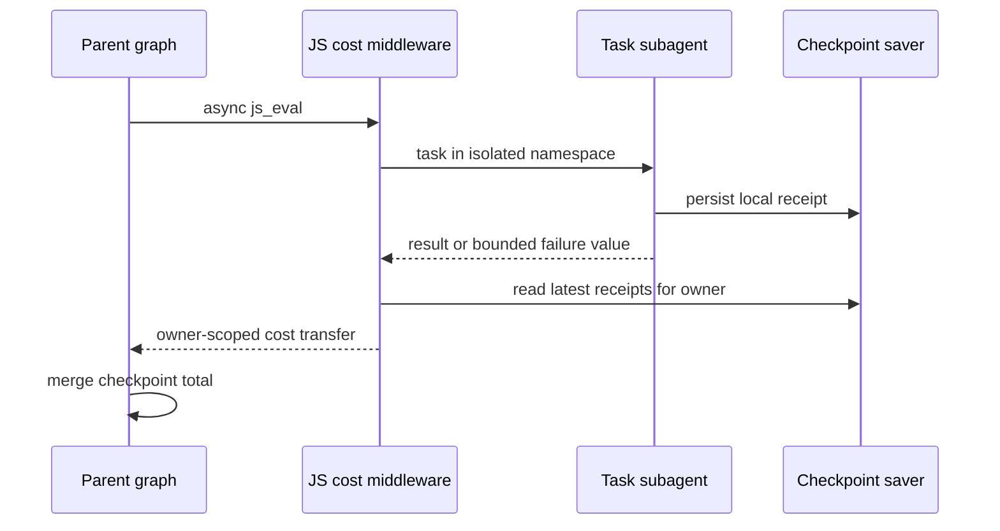
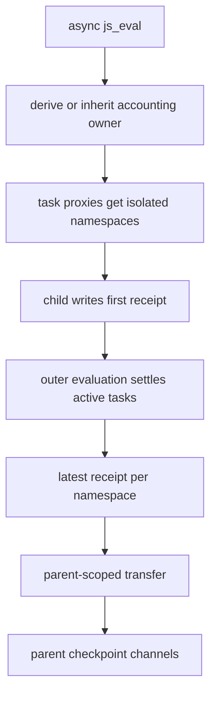

# dcode Costs, Traces, and Session Operations

## Accounting ownership

Cost figures are **best-effort telemetry**, not invoices, reservations, or a budget-control mechanism. Unsupported models or incomplete usage must not fail a model turn; the structured breakdown records request counts and completeness so partial pricing is observable. Reconcile actual provider billing separately.

The checkpointed graph, not the UI, owns a thread's total. `CostTrackingMiddleware` writes additive private `_session_cost_usd` and `_session_cost_breakdown` updates. It drains completed model-call records after model work and again after the agent, which captures late work where possible. A failed tracking attempt does not fail the user turn: drained records are restored when a recorder is available so a later drain can price them.

The client is only a reader of the absolute `session_cost` stream event. That event carries the merged checkpoint estimate for its thread, allowing a display that missed an earlier event to converge on the next one. Do not derive or persist a thread total from a UI widget or process-local session statistics.

### Nested graph and operation settlement

A nested `CostTrackingMiddleware(nested=True)` starts a local cost channel, then emits its completed local total as an owner-scoped `_session_cost_transfers` entry. The parent claims only transfers addressed to its checkpoint scope, merges the detail, and removes claimed entries. This keeps child-private state isolated while preserving completed work that precedes an interrupt.

Server-side model work that is outside the graph loop uses `prepare_operation_cost()`. Its returned `PreparedOperationCost` has already destructively claimed recorder records. Persist its additive `update` with the operation state and then commit it; rollback only when the write definitely did not land. Restoring after a landed write double charges on a later drain, while abandoning a prepared value permanently loses its claimed spend—even if the dollar delta is zero.

## JavaScript subagent receipt transport

`create_cli_agent()` installs `CostAwareCodeInterpreterMiddleware` as `js_eval` when `enable_interpreter=True`; a remote sandbox is rejected for that option. The wrapper extends the QuickJS interpreter strictly for accounting transport. Its synchronous `wrap_tool_call()` delegates unchanged, so receipt transport is an asynchronous path only.

On an asynchronous `js_eval` call, the middleware derives an accounting owner from the current checkpoint namespace and a digest of the tool-call ID (or inherits the owner for a nested evaluation). It proxies only the structured `task` tool. Each proxy creates a child namespace from a digest of the task description, subagent type, optional response schema, and an occurrence number. Thus identical parallel dispatches remain distinct, while checkpoint names do not expose prompt text. It also carries the owner token when present, requests synchronous child durability, and resets the child subgraph counter.

*The child receipt becomes durable before the outer evaluation transfers it to the parent checkpoint.*

### Receipt lifecycle and invariants

When child cost middleware has an accounting owner, it calls `record_cost_receipt()` before returning its graph update. The function is a no-op without both an owner and a checkpoint saver. Otherwise it writes the node-local delta and optional breakdown to an owner-tagged receipt checkpoint, forwarding the thread ownership token. A receipt namespace is first-write-wins: replay cannot replace a previously persisted receipt.

The outermost evaluation waits for active dispatch tasks to settle, then lists owner-tagged receipts and accepts the latest checkpoint per receipt namespace. It sums only finite, non-negative numeric amounts. Missing or malformed receipt detail does not fabricate categories: legacy dollar-only detail is retained as historically incomplete, and invalid receipt data makes historical completeness false. The outer evaluation attaches the merged result as `_session_cost_transfers`; nested evaluations, which inherit an owner, do not create a second transfer boundary.

*Only the evaluation that created the accounting owner performs receipt aggregation and transfer.*

This design preserves completed child spend when a sibling interrupts, the evaluation fails, or the caller cancels after a receipt starts writing. On cancellation the asynchronous cost hook shields and joins its thread-backed work, and the interpreter wrapper cancels and gathers tracked dispatch tasks before unwinding. `CancelledError`, `GraphBubbleUp`, and `NodeCancelledError` retain their control-flow meaning; ordinary child exceptions are converted to a bounded retryable error value so sibling results and receipts remain usable. SQLite resume, including a fresh process and an owned saver, reuses persisted receipts rather than charging replayed work again.

## Operating and changing the path

- Keep receipt persistence before the child graph update returns. Moving it after that boundary reintroduces the interrupt/cancellation window this transport closes.
- Preserve the owner boundary. Aggregating in nested `js_eval` calls or changing the receipt query from latest-per-namespace risks double charging.
- Keep the receipt and transfer channels private graph state. A streamed cost event is a display notification, not an authorization to update a thread total.
- Do not make accounting failure fatal to agent work. Pricing and checkpoint failures have explicit restoration or best-effort semantics.
- QuickJS itself exposes `task()` inside an approved evaluation. Per-dispatch parent-level HITL approval is not applied there; gate `js_eval`, add subagent approval middleware, or disable interpreter subagents when that approval boundary is required.

## Focused verification

- Run `tests/unit_tests/test_js_cost_sync.py` after touching synchronous wrappers. It covers `thread`, `turn`, and `call` interpreter modes; direct `js_eval` and ordinary tools; and `invoke` versus streaming. The assertion is intentional pass-through tool behavior.
- Run `tests/unit_tests/test_js_cost_tracking.py` after changing receipt identity, dispatch configuration, cancellation, transfer ownership, breakdown compatibility, or persistence. It covers durable child costs across interrupts, normal failures, cancellation during SQLite writes, owned-SQLite fresh-process resume, parallel identical requests, completion-order changes, direct/nested grandchildren, zero-dollar receipts, and legacy dollar-only receipts.
- Run `tests/unit_tests/test_cost_tracking.py` when changing middleware drains, transfer claiming, pricing completeness, or `PreparedOperationCost` settlement. Use it to verify that tracking remains non-fatal and that record restoration remains safe.
- Run the relevant interpreter and sandbox integration tests when changing agent construction: `create_cli_agent()` must continue to install the cost-aware middleware locally and reject `enable_interpreter=True` with a remote sandbox.

Related material: [Runtime behavior](../architecture/runtime-behavior.md), [State persistence](../concepts/state-persistence.md), [Sandbox partners](../integrations/sandbox-partners.md), and [Testing guide](../testing/testing-guide.md).
