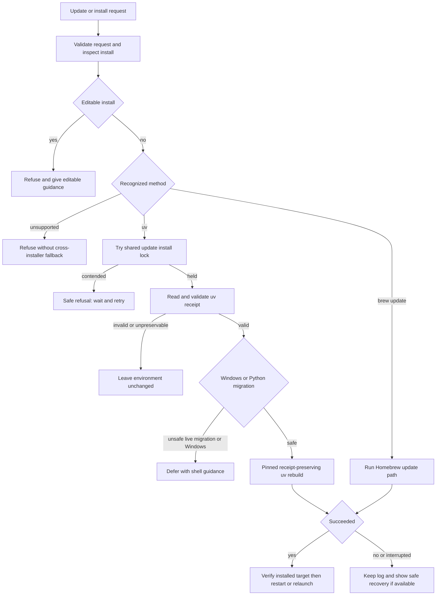

# dcode Installation and Update Lifecycle

`deepagents_code.update_check` owns the package-environment lifecycle: release discovery, upgrade command construction and execution, receipt-aware rebuilds, and update state. The CLI (`dcode update`, `dcode install`, and `dcode uninstall`), the TUI (`/update`, `/install`, `/uninstall`), and startup auto-update are entrypoints over that same core. They are deliberately conservative: a detected installation method determines what may execute; an unavailable or unsafe path is reported as a refusal or deferral, not retried through another installer.

This page covers the application package and its optional Python dependencies, not managed host tools or marketplace plugin updates. For normal local development and editable environments, see [Development](/openwiki/operations/development.md).

## Entry points and user-visible modes

| Need | Entry points | What happens |
| --- | --- | --- |
| Check and upgrade from a shell | `dcode update` or `dcode --update` | Checks the selected channel and, after the installation lock is acquired, performs a method-specific upgrade. `--prerelease` is valid only with this update mode. |
| Upgrade in a session | `/update`, optionally `--deps` or `--prerelease` | Checks first, confirms where appropriate, and runs the same protected performer. A dependency-only refresh rebuilds the current app version rather than selecting a newer one. |
| Automatically update before launch | Normal startup | Enabled auto-update consumes cached availability before the TUI/server loads, then upgrades and re-execs on success. |
| Discover an update in a running TUI | Background and periodic checks | Checks and presents a durable notification or restart prompt; it does **not** silently replace the running environment merely because a release was found. |
| Add an optional extra | `dcode install NAME`, `/install NAME`, or legacy `--install` | Rebuilds a supported uv tool environment while preserving the recorded selection. |
| Add an arbitrary package | `dcode install NAME --package` or `/install NAME --package` | Uses the same uv-tool rebuild mechanism, with a confirmation for third-party code unless explicitly approved. |
| Remove an extra | `dcode uninstall NAME`, `/uninstall NAME`, or legacy `--uninstall` | Rebuilds the recorded tool selection without that extra; an already-absent extra is an idempotent success. |

`dcode --auto-update` and `/auto-update` toggle the persisted automatic-update preference. Update checking and automatic installation are separate decisions: a check can be enabled while auto-update is disabled.

## Decision and recovery flow

*The execution path validates, serializes, preserves recorded context, and either verifies success or safely refuses, defers, or supplies bounded recovery guidance.*

The **user-facing hint** is intentionally less authoritative than this execution flow. `upgrade_command()` can render a documented uv fallback when detection fails so a notification has a useful manual instruction. That display fallback does not authorize `perform_upgrade()` to run uv against an unrecognized environment. In particular, it does not mean that Homebrew, an editable checkout, or an unknown installer may be updated by a different package manager.

## Release discovery, cached state, and notifications

### Metadata cache

`get_latest_version()` reads `latest_version.json` in the dcode state directory before calling PyPI. A cache younger than 24 hours can satisfy stable or prerelease lookup and includes release upload times used for age copy. A successful PyPI response refreshes stable and prerelease candidates, release times, a check timestamp, and metadata used for targeted prerelease dependency handling. Cache read, HTTP, parse, and write failures are absorbed: callers receive a cached answer when possible or `None` rather than an update-check exception.

The separate update-state file tracks notification and “what's new” history, including the version and time last notified/seen. It throttles repeat announcements across invocations; it is not the source of the auto-update preference.

The configuration manifest supplies these effective settings through the standard configuration resolution model described in [Configuration layering](/openwiki/concepts/config-layering.md):

- `update.auto_update` defaults to enabled and maps to `[update].auto_update` and `DEEPAGENTS_CODE_AUTO_UPDATE`.
- `update.no_update_check` maps to `[update].check` with inverted TOML semantics and to `DEEPAGENTS_CODE_NO_UPDATE_CHECK`.
- Managed-policy failures fail closed for update behavior rather than allowing an uncertain policy to enable network or install work.

### TUI discovery versus installation

When checks are enabled, `DeepAgentsApp` starts a background check and periodic rechecks. It skips editable installations. It retains a last-known warning if PyPI is unavailable, updates the stale-install header when it can determine age, and always signals completion so dependent startup work is not stranded.

A found update has two distinct presentations:

- With auto-update enabled, the TUI tells the user to quit and relaunch; startup owns automatic execution.
- With auto-update disabled, the initial check registers an actionable notification and opens the update UI; a periodic check registers it and posts a durable message pointing to `/update` or the notification center.

Notification throttling suppresses repeat presentation without pretending the update disappeared. Only an actually scheduled modal sets the modal-pending state, so a throttled update does not suppress unrelated startup notices.

## Install-method boundary and serialization

Install detection classifies the current prefix as `uv`, `brew`, `other`, or `unknown`. A uv tool prefix permits receipt-preserving tool operations; Homebrew has its own update command; `other` and editable/`unknown` paths do not get a speculative tool install. Editable detection is also checked directly on extra/package operations because an editable checkout can be located under a uv-looking prefix.

All operations that rebuild the tool environment—upgrade, dependency refresh, extra add/remove, and arbitrary package add—use `update_install_lock()`. It combines an in-process non-reentrant guard with a nonblocking cross-process file lock. A loser gets an immediate “another update or install is already running” refusal and must not be given a manual rebuild command, because that could bypass the lock while the winner is rebuilding.

The normal lock is installation scoped so profiles sharing the same tool environment serialize. If that location is not writable, dcode uses a profile-scoped fallback; if lock infrastructure is unusable it logs a warning and proceeds unsynchronized rather than permanently disabling updates. This is best-effort serialization, not a reason to run concurrent manual rebuilds.

## Upgrade execution and interpreter migration

For uv, an upgrade resolves a target release then installs an exact `deepagents-code==target` requirement constructed from the uv receipt. This preserves selected extras, recorded `--with` packages, and the receipt’s interpreter choice. If the receipt or installed context cannot be safely introspected, dcode refuses before spawning uv rather than rebuilding a bare tool that drops selections. The installer must verify that the installed version equals the target; a zero subprocess exit alone is insufficient.

For a target whose `Requires-Python` excludes the current interpreter, dcode can ask uv to rebuild using the supported Python 3.14 bridge. It announces the migration before installation, uses the longer migration timeout, and reads the installed distribution through the rebuilt interpreter afterward. It does not downgrade a newer interpreter or guess a compatible one from an unsupported requirement.

A migration replaces the shared environment and can invalidate other dcode processes. On POSIX, non-editable sessions hold a shared installation session lock for their lifetime, including inherited server descriptors. Startup auto-update permits a migration only when it can establish that it is the sole session. In a live TUI or with other sessions, it defers without changing the environment and tells the user to close sessions and run an explicit update. On Windows, running dcode files may be locked, so uv updates—including non-migration updates—are deferred to a shell after dcode is closed.

If a migration is interrupted, the environment may be partially rebuilt. The migration runner emits recovery guidance before propagating cancellation; failed migration guidance points to the log and a recovery installer rather than suggesting an uninstall-first sequence.

### Prerelease behavior

There are two distinct prerelease cases:

1. A user already following a prerelease dcode channel, or explicitly requesting `--prerelease`, uses uv's prerelease-allowing resolution and is refused on non-uv installs.
2. A stable dcode release can require an exact prerelease first-party dependency. dcode obtains and validates exact pins from release metadata, writes a temporary constraints file, and invokes uv with `if-necessary-or-explicit`. This admits the named prerequisite without globally widening unrelated optional dependencies to prerelease candidates.

Cached prerelease pins are revalidated before use because they become constraint-file content. If dcode cannot safely stage those constraints, it does not run the installation.

## Startup lifecycle and failure semantics

Startup auto-update is gated by: non-editable installation, update checking enabled, auto-update enabled, cached availability, and a target newer than the installed version. It also uses a persisted failure/defer marker to avoid retrying the same broken target on every launch. The first time the default-enabled auto-update policy needs announcement, it announces the behavior and gives the user an opportunity to opt out before performing that install.

A successful startup install is followed by process re-exec so Python does not continue with a mixture of old imported modules and newly replaced files. If re-exec cannot occur after the installation lands, startup exits rather than starting a mixed-version TUI. By contrast, a failed installation is fail-soft: dcode reports the problem and continues using the installed version. A restart sentinel detects a no-op/restart loop and stops repeated automatic attempts.

Every invocation that launches an install can create an update log. CLI and TUI failure surfaces show a bounded output tail and the log location when creation succeeded; they do not advertise a nonexistent log. A safe, receipt-derived recovery command may be shown after a failed or interrupted rebuild, but not after lock contention or before enough validated context exists to build one.

## Extras and arbitrary packages

### Adds

`dcode install NAME` treats `NAME` as a dcode extra. Names are validated before prompts or subprocesses. The known-extra list is a curated suggestion list, not an allowlist: a syntactically valid unknown extra warns and requires confirmation unless `--yes` is supplied. The authoritative resolution remains the package metadata handled by uv.

`dcode install NAME --package` is the escape hatch for an arbitrary package, such as a custom provider package. The package name is validated before it can be incorporated into a shell command. Because arbitrary packages are third-party code rather than curated extras, the CLI requires an interactive confirmation unless `--yes` is present; noninteractive use without approval is refused. The TUI presents a confirmation without blocking its message pump.

Both forms refuse automated mutation on editable, Homebrew, unknown, or missing-uv environments. They preserve the existing receipt context under the shared lock. Successful extra changes may require relaunching or restarting the relevant dcode server so the running process imports the rebuilt environment.

### Removal

Uninstall validates the extra and installation method before reading the receipt. It uses the recorded requirement selection—not an inference from currently importable transitive packages—to construct a rebuild that removes only the requested extra while retaining remaining extras, `--with` packages, and interpreter choice. Therefore a removed extra stays removed on subsequent rebuilds.

The operation fails closed when the receipt is missing, malformed, uses a source it cannot preserve, contains unsafe/ambiguous selections, or the installed dcode version cannot be determined. It also refuses removal of protected base-provider extras and refuses a direct member selection whose packages are still supplied by a selected composite extra. Removing an extra that is already absent is the intentional idempotent exception: it returns success without running uv.

## Editable-install behavior

Editable installs are never automatically upgraded and cannot have extras or arbitrary packages mutated by these commands. Instead, dcode explains how to resolve the desired dependency in the checkout's own environment, or—in the extra case—how to rerun the editable uv tool installation with the extra included. This protects a development tree from a tool-environment rebuild whose receipt cannot represent the checkout.

## Operational guardrails

- Treat install method, receipt inspection, package/extra-name validation, and lock contention as safety boundaries. Do not work around them by substituting a package manager or manually racing a held lock.
- Use an explicit shell update after a Windows or live-session migration deferral; do not expect the running process to replace its own locked environment.
- Preserve logs when diagnosing resolver, timeout, or migration failures. Recovery advice is meaningful only when dcode has produced it from validated context.
- For a local checkout, manage dependencies using the development workflow rather than package lifecycle commands. See [Development](/openwiki/operations/development.md).
- `dcode doctor` provides an offline view of effective update settings and cached status, useful when diagnosing without triggering a new network check.

## Focused test coverage

The installation lifecycle is tested at the behavior boundaries that prevent environment corruption:

- Update tests cover the 24-hour cache, stale/malformed cache behavior, prerelease metadata and constraints, installer verification, and the no-cross-installer rule.
- Startup and TUI tests cover lock ownership and release, re-exec and cooldown behavior, notification throttling, editable skips, migration deferral, and safe handling of a shadowed executable.
- Python-migration bridge tests verify exact-release metadata, receipt-preserved extras/packages/interpreter, sole-session deferral, Windows deferral, cancellation recovery, and verification through the rebuilt interpreter.
- Install/uninstall tests cover validation before subprocesses, noninteractive confirmations, receipt preservation, protected/composite extra rules, idempotent removal, lock contention with withheld manual commands, logs, and interruption recovery.

For broader command and UI testing conventions, see the [Testing guide](/openwiki/testing/testing-guide.md). For the user-facing session lifecycle in which TUI notices occur, see [Run a dcode session](/openwiki/workflows/run-dcode-session.md).
