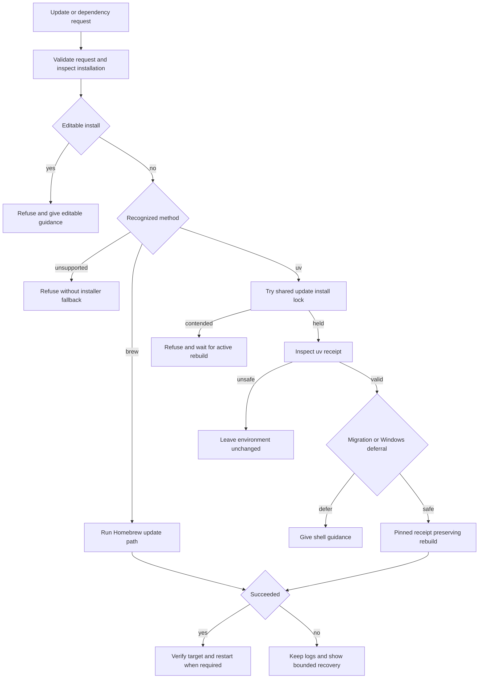

# dcode Installation and Update Operations

`deepagents_code.update_check` owns the installed package lifecycle: PyPI discovery and cache state, install-method detection, receipt-aware rebuild commands, and update preferences. Shell commands, TUI actions, and startup auto-update use that shared boundary. It is deliberately conservative: a displayed command is guidance, not authorization to switch package managers or rebuild an environment whose context cannot be preserved.

This page concerns the published `deepagents-code` distribution and its Python extras or `--with` packages, not plugin-marketplace updates. For a local checkout, use the [Development](/openwiki/operations/development.md) workflow instead of package lifecycle commands.

## Published package contract

Version `0.2.15` is published as `deepagents-code` and exposes both `dcode` and `deepagents-code` console scripts. It supports Python `>=3.14,<3.15`; the committed uv resolution is correspondingly Python 3.14 and includes platform-specific resolution markers. `pyproject.toml` is the released dependency and extra contract, while `uv.lock` records the resolved development workspace graph and artifact hashes. Do not treat editable path sources in the lock as requirements for an installed wheel.

The core contract pins the Deep Agents SDK exactly to `deepagents==0.7.42`, while the LangChain, LangGraph client/server, and built-in Anthropic, Google GenAI, and OpenAI integrations have bounded compatible ranges. The changelog records dependency changes for each release; dependency upgrades should be evaluated as part of the release rather than assumed to be interchangeable with the prior lockfile.

### Optional capabilities

Optional extras are installation-time selections, not runtime feature flags. Their published names and ranges come from `[project.optional-dependencies]` in `pyproject.toml`; the workspace lockfile is useful for reviewing the resolved graph but does not define the distributable contract:

- **Model providers:** `anthropic`, `baseten`, `bedrock`, `cohere`, `deepseek`, `fireworks`, `google-genai`, `groq`, `huggingface`, `ibm`, `litellm`, `meta`, `mistralai`, `nvidia`, `ollama`, `openai`, `openrouter`, `perplexity`, `together`, `vertex`, and `xai`. `all-providers` expands to that set. Several base providers are already core dependencies; selecting their matching extra is still a valid published contract.
- **Sandboxes:** `agentcore`, `daytona`, `modal`, `openshell`, `runloop`, and `vercel`; `all-sandboxes` expands to all six. The base distribution also includes `langsmith[sandbox]`.
- **Standalone integrations:** `media` adds `av` and Pillow; `quickjs` remains an empty compatibility extra because the QuickJS integration is now core.

MCP is a base capability through `fastmcp>=4.0.0b4` and `mcp>=2.0.0`; ACP is a base capability through `deepagents-acp>=0.1.0,<1.0.0`. The price subsystem uses `genai-prices>=0.2.5,<0.3.0` and bundled fallback price data. A deliberate uv override forces `filelock>=4.2.1,<4.3`, even though the declared direct range starts at 3.29.7, to keep the resolved graph on a patched release. These are operational compatibility boundaries: widening or removing a bound requires checking the call sites that rely on it.

## Installation, removal, and entry points

The supported installer downloads through `https://langch.in/dcode` and installs an isolated uv tool environment. It can be rerun: it prompts before an interactive upgrade, upgrades unattended runs, and accepts `DEEPAGENTS_CODE_YES=1` for explicit automation. `DEEPAGENTS_CODE_EXTRAS`, `DEEPAGENTS_CODE_VERSION`, `DEEPAGENTS_CODE_PRERELEASE`, and `DEEPAGENTS_CODE_PYTHON` select the tool environment; exact version and explicit prerelease strategy are mutually exclusive. The script defaults to uv prerelease admission so a stable dcode release with a prerelease dependency can resolve.

`uv tool uninstall deepagents-code` removes the tool venv and both console binaries, but not the effective `DEEPAGENTS_HOME` profile data. Run `dcode doctor` first to identify the data directory, and remove only that confirmed dedicated directory if profile erasure is intended. The script also offers `DEEPAGENTS_CODE_NO_MODIFY_PATH=1` for managed PATH setups and a verified managed-ripgrep path with an offline opt-out.

| Need | Entry point | Result |
| --- | --- | --- |
| Update from a shell | `dcode update` or `dcode --update` | Selects a release channel and executes only the detected installer path. |
| Update in a session | `/update`, optionally with dependency or prerelease choices | Uses the same protected update performer; a dependency refresh keeps the current dcode release. |
| Update before an interactive launch | Normal startup | Uses cached availability and, if permitted, rebuilds before the TUI/server loads. |
| Discover while the TUI is open | Initial and periodic background checks | Presents a notification or restart prompt; discovery itself does not mutate the environment. |
| Add/remove optional dependencies | `dcode install`, `dcode uninstall`, `/install`, `/uninstall` | Rebuilds a supported uv tool environment from recorded selections. |
| Inspect without network access | `dcode doctor` | Reports install method, dependency versions, effective update policy, and cached update state. |

## Configuration and safe inspection

The manifest is the canonical declaration for update settings. `update.auto_update` is a Boolean defaulting to `true`, exposed as `DEEPAGENTS_CODE_AUTO_UPDATE`, persisted at `[update].auto_update`, and bound to `--auto-update`. `update.no_update_check` defaults to `false`, uses `DEEPAGENTS_CODE_NO_UPDATE_CHECK`, and has inverted TOML semantics: `[update].check = false` disables checking. `update.prices_auto_update` independently controls hourly upstream pricing-catalog refresh; it does not self-update dcode.

Readers resolve the manifest options from managed and user configuration snapshots. Managed policy wins. An unusable managed file or invalid managed update value disables the affected behavior; an invalid environment value is warned about and falls through. Auto-update also fails closed when an existing user configuration cannot yield a usable `[update]` section and no higher-priority source decides the value. An absent user configuration receives the manifest default.

- Set `[update].auto_update = false` or `DEEPAGENTS_CODE_AUTO_UPDATE=0` to keep checks but opt out of automatic installation.
- Set `[update].check = false` or `DEEPAGENTS_CODE_NO_UPDATE_CHECK` to disable automatic checks and prevent startup auto-update from using cached availability.
- The interactive auto-update toggle atomically persists `[update].auto_update`; an inability to write it is surfaced instead of silently changing only the process.
- `dcode doctor` is offline: its Updates section reports effective check and auto-update settings plus cache-backed latest-version and last-checked values. Editable installs are explicitly reported as auto-update-disabled.

## Decision and execution flow

*The lifecycle validates the request and installation context before it mutates an environment, then verifies success or safely refuses or defers.*

## Discovery, cache, and TUI behavior

`get_latest_version()` caches stable and prerelease release candidates in `latest_version.json` for 24 hours. The cache also carries release times and targeted prerelease-pin metadata. Cache parsing, file I/O, missing dependencies, and PyPI failures are absorbed: callers receive a cached answer where available or a sentinel such as `None`, rather than an update-check exception.

The separate update-state file records notification and "what's new" history; it is not the auto-update preference store. TUI discovery skips editable installations and retains an existing warning if lookup fails. When a newer release is found, enabled auto-update produces a durable restart/relaunch prompt so startup owns installation. With auto-update disabled, dcode surfaces an actionable update notification. Neither background path silently installs into a running session.

## Installer boundary, receipts, and concurrency

Install detection classifies the environment as `uv`, `brew`, `other`, or `unknown` (editable/development). `upgrade_command()` may render a documented uv fallback when detection fails, but `perform_upgrade()` runs only the detected method. Unknown/editable and other installs are refused rather than speculatively updating a different environment.

All tool-environment rebuilds—app upgrades, dependency refreshes, extra additions/removals, and arbitrary package additions—serialize through `update_install_lock()`. It is nonblocking and combines a process-local guard with an installation-scoped file lock, falling back to profile scope when necessary. Contention returns immediately and callers suppress manual recovery commands that would race the active rebuild. If no usable lock can be established, dcode warns and proceeds unsynchronized rather than permanently disabling updates; do not interpret that fail-open behavior as permission for concurrent manual rebuilds.

For a uv upgrade, dcode builds an exact target requirement from the tool receipt so existing extras, `--with` packages, and interpreter choice survive. If receipt or installed-context introspection is unsafe, it does not fall back to a bare install that might drop selections. A successful uv subprocess must also yield the requested installed version on readback; exit status alone is insufficient, except for the documented ambiguous stale-`dist-info` exact-pin case.

A stable target that requires an exact prerelease first-party dependency uses validated pins from release metadata, a temporary constraints file, and uv's `if-necessary-or-explicit` strategy. This admits the named prerequisite without globally opening unrelated dependencies to prereleases. Explicitly following dcode's prerelease channel is a separate uv-only mode.

## Python migration, startup, and failures

The release's Python contract is `>=3.14,<3.15`. When the target release requires an interpreter migration, dcode preserves receipt context and uses the target release's Python requirement rather than guessing. A live-session migration is deferred without mutation when the rebuilt environment cannot safely replace a shared running installation. On Windows, uv updates are deferred to an external shell after dcode closes because the running environment can be locked.

Startup runs auto-update only for a non-editable interactive launch that passes update-check, auto-update, cached-availability, and version gates. Resume launches have bounded deferral behavior so resuming work is not interrupted indefinitely. A persisted failure/defer state prevents repeated retries of the same broken target, and the default-enabled policy is announced once before its first automatic install so the user can opt out.

After a successful startup install, dcode re-execs to avoid importing a mixture of old and replaced modules. If re-exec cannot happen after files changed, startup exits with relaunch guidance rather than launching the TUI in a mixed-version state. Failed installation remains fail-soft: the existing version starts and logs/error guidance are reported. A restart sentinel breaks a no-op update/restart loop.

## Extras and arbitrary packages

`dcode install NAME` treats `NAME` as an extra; `dcode install NAME --package` uses uv's `--with` mechanism for an arbitrary package. Names are validated before prompting or command construction. An unlisted but syntactically valid extra is warned about rather than rejected—the curated known-extra list is not the authoritative package-metadata allowlist. Arbitrary packages are third-party code and require interactive confirmation unless `--yes` is supplied; noninteractive use without that approval is refused.

These operations require a supported uv environment, preserve receipt context under the shared lock, and refuse editable installs with instructions to manage dependencies in the editable environment. Extra removal rebuilds from recorded receipt selections, retaining remaining extras, packages, and interpreter. It fails closed for missing or ambiguous receipt/source state and for protected or composite-provided extras. Removing an already absent extra is intentionally an idempotent no-op.

## Operational guardrails and focused tests

- Do not substitute a different package manager because a displayed hint mentions uv. The hint is not execution authorization.
- Treat receipt failures, invalid names, editable detection, and lock contention as safety boundaries rather than steps to bypass.
- After Windows or live-session migration deferral, close dcode and use the emitted shell command.
- Preserve update logs when investigating a resolver, timeout, or migration failure. Recovery commands are safe only when dcode generated them from validated context.
- Use [Development](/openwiki/operations/development.md) for local checkouts rather than package lifecycle commands. See [Profiles and models](/openwiki/concepts/profiles-models.md) for provider selection and [Cost and sessions](/openwiki/operations/cost-and-sessions.md) for price behavior.

Update-check, main/startup, app/TUI, Python-migration bridge, extras, uninstall, and manifest tests exercise cache failure behavior, no-cross-installer execution, receipt preservation and target verification, prerelease constraints, migration and Windows deferral, locking and withheld recovery commands, notifications, validation-before-subprocesses, confirmation requirements, and idempotent/protected extra removal. The manifest tests separately protect defaults and TOML mappings; the lockfile and changelog make the published dependency graph and its release-to-release changes reviewable.
