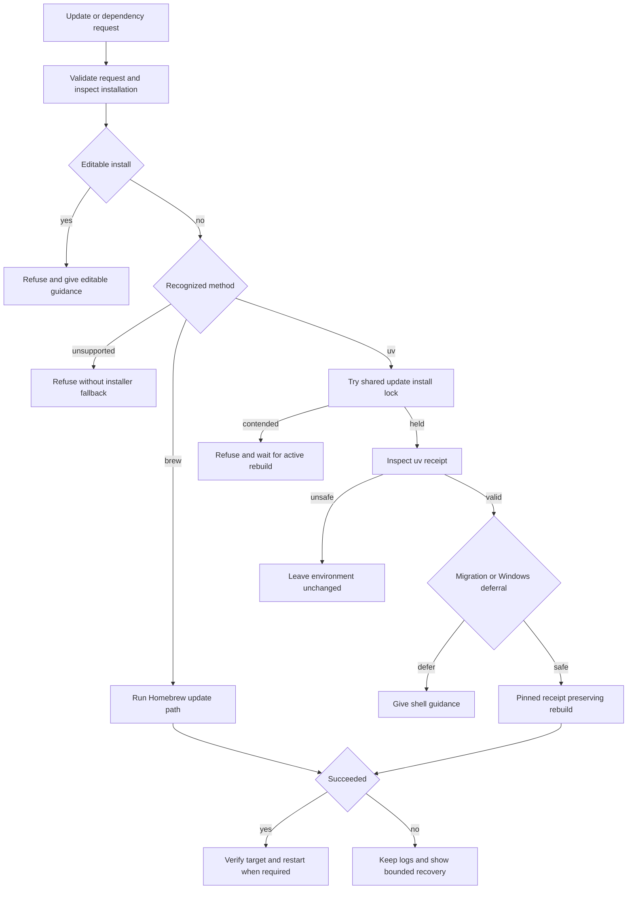

# dcode Installation and Update Lifecycle

`deepagents_code.update_check` owns dcode's application-package lifecycle: PyPI discovery and cache state, install-method detection, receipt-aware rebuild commands, and update preferences. Shell commands, TUI actions, and startup auto-update use that shared boundary. They are intentionally conservative: a hint may show a useful documented command, but execution does not switch package managers or rebuild an environment whose context cannot be preserved.

This page concerns the `deepagents-code` package and its Python extras or `--with` packages, not plugin-marketplace updates. For editable/local checkout workflows, see [Development](/openwiki/operations/development.md).

## Entry points

| Need | Entry point | Result |
| --- | --- | --- |
| Update from a shell | `dcode update` or `dcode --update` | Selects a release channel and executes only the detected installer path. |
| Update in a session | `/update`, optionally with dependency or prerelease choices | Uses the same protected update performer; a dependency refresh keeps the current dcode release. |
| Update before an interactive launch | Normal startup | Uses cached availability and, if permitted, rebuilds before the TUI/server loads. |
| Discover while the TUI is open | Initial and periodic background checks | Presents a notification or restart prompt; discovery itself does not mutate the environment. |
| Add/remove optional dependencies | `dcode install`, `dcode uninstall`, `/install`, `/uninstall` | Rebuilds a supported uv tool environment from recorded selections. |

## Configuration and safe inspection

The manifest is the canonical declaration for the scalar update settings. `update.auto_update` is a Boolean with a default of `true`, is exposed as `DEEPAGENTS_CODE_AUTO_UPDATE`, persists at `[update].auto_update`, and has the `--auto-update` CLI binding. `update.no_update_check` defaults to `false`, is exposed as `DEEPAGENTS_CODE_NO_UPDATE_CHECK`, and uses the inverse TOML representation `[update].check`: `check = false` disables checking. The separate `update.prices_auto_update` setting controls model-pricing-catalog refresh, not application self-updates.

Update readers resolve those manifest options from one managed/user configuration snapshot, using the same resolver model described in [Configuration layering](/openwiki/concepts/config-layering.md). Managed policy wins. An unusable managed file or an invalid managed update value disables the affected update behavior; an invalid environment value is warned about and falls through. Auto-update also fails closed when an existing user configuration cannot yield a usable `[update]` section and no higher-priority source decided the value. An absent user configuration still receives the manifest default.

This distinction matters operationally:

- Set `[update].auto_update = false` or `DEEPAGENTS_CODE_AUTO_UPDATE=0` to opt out of automatic installation while retaining checks.
- Set `[update].check = false` or `DEEPAGENTS_CODE_NO_UPDATE_CHECK` to disable automatic checks. This also prevents startup auto-update from consuming cached availability.
- The interactive auto-update toggle persists `[update].auto_update` through the configuration writer; an inability to write it is surfaced rather than silently changing only the current process.
- Use `dcode doctor` for an offline, non-network view. Its stable Updates section reports effective update checks and auto-updates plus cache-backed latest-version and last-checked status. It marks an editable install as auto-update-disabled.

The manifest tests specifically verify that the persisted paths resolve as the runtime expects, including the inverted `[update].check` semantics. This protects both configuration introspection and the lifecycle controls from schema drift.

## Decision and execution flow

*The lifecycle validates the request and installation context before it mutates an environment, and either verifies success or safely refuses or defers.*

## Discovery, cache, and TUI behavior

`get_latest_version()` caches stable and prerelease release candidates in `latest_version.json` for 24 hours. The cache also carries release times and targeted prerelease-pin metadata. Cache parsing, file I/O, dependency import, and PyPI failures are absorbed: a caller gets a cached answer where available or a sentinel such as `None`, rather than an update-check exception.

The separate update-state file records notification and "what's new" history; it is not the auto-update preference store. TUI discovery skips editable installations and retains an existing warning if lookup fails. When a newer release is found, enabled auto-update produces a durable restart/relaunch prompt so startup can own installation. With auto-update disabled, dcode surfaces an actionable update notification. Neither background path silently installs into a running session.

## Installer boundary, receipts, and concurrency

Install detection classifies the current environment as `uv`, `brew`, `other`, or `unknown` (editable/development). `upgrade_command()` may render a documented uv fallback when detection fails, but `perform_upgrade()` runs only the detected method. Unknown/editable and other installs are refused rather than speculatively updating a different environment.

All tool-environment rebuilds—app upgrades, dependency refreshes, extra additions/removals, and arbitrary package additions—serialize through `update_install_lock()`. It is nonblocking and combines a process-local guard with an installation-scoped file lock, falling back to profile scope when necessary. Contention returns immediately; callers suppress a manual recovery command in that case, because it could race the rebuild already holding the lock. If locking cannot be established, dcode warns and proceeds unsynchronized rather than permanently disabling updates; operators should not treat that as permission to run concurrent manual rebuilds.

For a uv upgrade, dcode builds an exact target requirement from the tool receipt so existing extras, `--with` packages, and interpreter choice survive. If receipt or installed-context introspection is unsafe, it does not fall back to a bare install that might drop selections. A successful uv subprocess must also yield the requested installed version on readback (with the documented exact-pin handling for ambiguous stale dist-info); exit status alone is not sufficient.

A stable target that requires an exact prerelease first-party dependency uses validated pins from release metadata, a temporary constraints file, and uv's `if-necessary-or-explicit` strategy. This admits the named prerequisite without globally opening unrelated dependencies to prereleases. Explicitly following dcode's prerelease channel is a separate uv-only mode.

## Python migration, startup, and failures

The package currently declares Python `>=3.14,<3.15`. When the target release requires a compatible interpreter migration, dcode preserves the receipt context and uses the target release's Python requirement rather than guessing. A shared-environment migration is deferred without mutation if a live session cannot safely rebuild. On Windows, uv updates are deferred to an external shell after dcode closes because the running environment can be locked.

Startup runs the auto-update path only for a non-editable interactive launch that passes update-check, auto-update, cached-availability, and version gates. Resume launches receive a bounded deferral path so immediately resuming work is not interrupted indefinitely. A persisted failure/defer state prevents repeatedly retrying the same broken target, and the default-enabled policy is announced once before its first automatic install so the user can opt out.

After a successful startup install, dcode re-execs to avoid a process importing a mixture of old and replaced modules. If that re-exec cannot happen after files changed, startup exits with a relaunch instruction rather than launching the TUI in a mixed-version state. Failed installation remains fail-soft: the existing version starts and the error/log guidance is reported. A restart sentinel also breaks a no-op update/restart loop.

## Extras and arbitrary packages

`dcode install NAME` treats `NAME` as an extra; `dcode install NAME --package` uses uv's `--with` mechanism for an arbitrary package. Names are validated before prompting or command construction. An unlisted but syntactically valid extra is warned about rather than rejected—the curated known-extra list is not the authoritative package-metadata allowlist. Arbitrary packages are third-party code and require interactive confirmation unless `--yes` is supplied; noninteractive use without that approval is refused.

These operations require a supported uv environment, preserve receipt context under the shared lock, and refuse editable installs with instructions to manage dependencies in the editable environment. Extra removal rebuilds from the receipt's recorded selections, retaining remaining extras, packages, and interpreter. It fails closed for missing or ambiguous receipt/source state and for protected or composite-provided extras. Removing an already absent extra is intentionally an idempotent no-op.

## Operational guardrails

- Do not substitute a different package manager because a displayed hint mentions uv. The hint is not execution authorization.
- Treat receipt failures, invalid names, editable detection, and lock contention as safety boundaries rather than steps to bypass.
- After Windows or live-session migration deferral, close dcode and use the emitted shell command.
- Preserve update logs when investigating a resolver, timeout, or migration failure. Recovery commands are safe only when dcode generated them from validated context.
- Use the [Development](/openwiki/operations/development.md) workflow for local checkouts rather than package lifecycle commands.

## Focused tests

The behavior boundaries are covered by update-check, main/startup, app/TUI, Python-migration bridge, extras, and uninstall tests. They exercise cache failure behavior, no-cross-installer execution, receipt preservation and target verification, prerelease constraints, migration and Windows deferral, locking and withheld recovery commands, notification behavior, validation-before-subprocesses, confirmation requirements, and idempotent/protected extra removal. The manifest tests separately protect the default and TOML mappings used by the update controls. See the [Testing guide](/openwiki/testing/testing-guide.md) for repository-wide test conventions.
