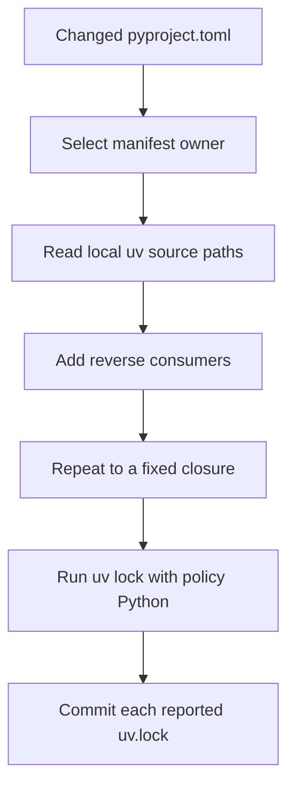
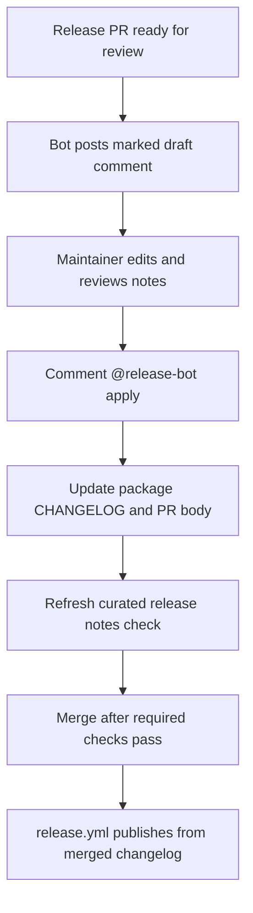
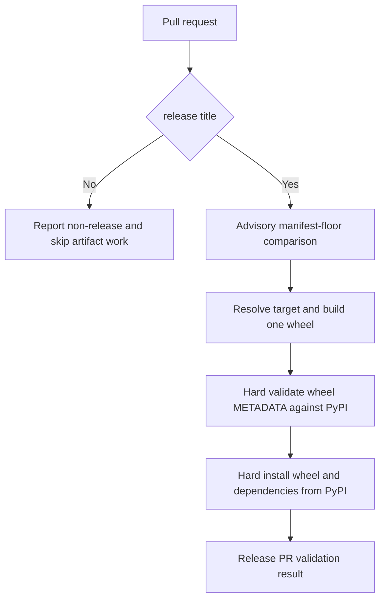

# Development and Release Operations

This repository is a monorepo of independently versioned Python packages. Work in the package that owns a change: packages under `libs/` have their own `pyproject.toml`, `Makefile`, and README, and there is no root `pyproject.toml`. A manifest is the published dependency contract; local `uv` source mappings make sibling packages editable during checkout development. See the [Quickstart](../quickstart.md) for initial setup and the [Testing Guide](../testing/testing-guide.md) for test selection.

## Package-local environment and compatibility

Use `uv` to provision interpreters, environments, and dependencies; do not use `pip`, Poetry, Conda, or a shared manually activated environment. Each package's `requires-python` is its compatibility contract, rather than a repository-wide Python pin. Its `Makefile` is the supported task interface, so begin with `make help`.

```bash
uv tool install pre-commit
pre-commit install --install-hooks

cd libs/deepagents
uv sync --all-groups
make test
make lint
```

Use `uv run ...` for a one-off command. The aggregate `libs/Makefile` can fan out some operations, but it does not replace package-specific targets or their requirements. Install dependencies explicitly with `uv sync`; do not create environments outside the package or mix environments in one session.

| Layer | Owner and purpose | Change rule |
| --- | --- | --- |
| Published metadata | `[project]` dependencies, extras, and `requires-python` in `pyproject.toml` | This is what downstream users install. Choose bounds and pins deliberately. |
| Workspace wiring | `[tool.uv.sources]` path mappings | These select editable sibling checkouts locally; they do not change published metadata. |
| Resolved environment | Package-local `uv.lock` | Generated development and CI state. Regenerate with `uv`; do not edit it manually. |

Editable workspace sources can conceal an incompatibility in a released dependency: local tests can consume a sibling checkout even when an end user would receive an insufficient published version. Validate an installed, source-free route when changing a public dependency boundary.

Deep Agents and ACP publish support for Python `>=3.11,<4.0`; Code and Talon publish only `>=3.14,<3.15`. These ranges describe what each package supports, not necessarily the interpreter chosen to resolve its checked-in lockfile.

Unexpected pytest warnings fail package test suites by default. Treat the filters after the `error` policy as a reviewed allowlist: a warning may fail an individual test, fail collection, or abort pytest configuration depending on when it is emitted.

## Lockfile policy and refresh

The shared CI `uv_setup` action pins uv to `0.13.6`, requires a major.minor Python input, and normally enables a pruned dependency cache. Cache invalidation is intentionally limited to `pyproject.toml`, `uv.lock`, and `requirements*.txt` in the caller's working-directory scope.

There are two lock entrypoints with different interpreter mappings:

- `.github/scripts/checks/check_lockfiles_pre_commit.py` uses Python 3.14 for top-level ACP, Code, Evals, and Talon packages; it uses 3.12 for every other discovered library, partner, or example package.
- `make -C libs lock`, `lock-bump`, and `lock-check` map only ACP to 3.14 and all other packages to 3.12.

For changed Code, Evals, or Talon manifests, use the targeted scripts below rather than treating the aggregate Make target as CI-equivalent. The reusable `Check Lockfiles` workflow disables cache setup because `uv lock --check` does not create the cache directory that setup-uv would attempt to save; it invokes the checker with no paths and therefore checks every discovered package.

### Refresh the reverse-consumer closure

A manifest change can invalidate locks beyond its owning package. `refresh_lockfiles.py` starts from the owners of its supplied manifest paths, reads each discovered package's local `[tool.uv.sources]` paths, and repeatedly includes packages that consume an already selected local package. It then runs `uv lock --directory <directory> --python <selected version>` for every package in that reverse transitive closure and prints the resulting lockfile paths. Commit every printed `uv.lock`.



*The refresh path includes the changed package and its transitive local-source consumers.*

From the repository root:

```bash
python .github/scripts/checks/refresh_lockfiles.py libs/code/pyproject.toml
python .github/scripts/checks/check_lockfiles_pre_commit.py libs/code/pyproject.toml
```

The refresh tool computes the closure, but the checker intentionally does not. With paths, the checker tests only package directories directly touched by those paths; with no paths, it tests all discovered packages. If no supplied path belongs to a package, it succeeds as a no-op. At the first stale lock it returns `uv lock --check`'s failure and prints an exact non-check `uv lock` repair command. Run the complete final check with no paths:

```bash
python .github/scripts/checks/check_lockfiles_pre_commit.py
```

## Code and sibling-package constraints

`deepagents-code` publishes an exact `deepagents==0.7.38` dependency, but its workspace configuration resolves `deepagents` from editable `../deepagents`. Thus local Code development does not exercise the version of the SDK that PyPI users receive. When Code begins to require a newer SDK capability, update the exact published pin and regenerate Code's lockfile with Python 3.14.

Talon is a Python-3.14-only package and requires `deepagents>=0.7.38` plus `deepagents-code>=0.2.7,<1.0.0`. Its editable source mappings are local wiring rather than published dependency metadata.

`make -C libs/code check` includes an SDK-pin comparison after its local checks. An equal or ahead pin succeeds. An older pin produces exit code 1 and is advisory to that Make target; missing, malformed, or unsupported version data produces exit code 2 and fails it. The release workflow is the hard gate against shipping Code with a pin older than the workspace SDK, unless its dangerous pin-check bypass is deliberately selected.

After an SDK release is published, the Code SDK-pin workflow creates or refreshes its marked automation PR only if Code's pin is behind. It preserves an ahead pin, updates Code's manifest and Python 3.14 lockfile together, and uses a `chore(deps):` commit so the maintenance update does not itself create an unintended Code release.

## Scheduled ecosystem floor updates

`raise_langchain_minimums.yml` runs daily at 09:00 UTC and can also be dispatched for one release component or `all`. It considers `>=` and `~=` lower bounds for dependencies whose normalized names begin with `langchain`, `langgraph`, `langsmith`, or `deepagents`, preserving other range semantics, extras, markers, compatible-release ceilings, and exact pins. A manual run can narrow to exact normalized distribution names; absence, a workspace-only dependency, or no raiseable floor fails closed, while an already-current raiseable floor is a successful no-op.

Before changing manifests, the updater tests proposed edits with the lock checker's interpreter policy across changed packages and reverse local-source consumers. It fails for an unresolvable baseline or resolver failure; for a combined conflict it retains compatible dependency-wide groups and reports the rejected groups. The workflow regenerates returned affected locks by default, then creates or refreshes a bot-authored `chore(deps):` PR using an app token. It refuses to overwrite a branch whose tip is not bot-authored and opens or updates a marked tracking issue on failure. This maintenance workflow changes constraints and locks, never release versions or baselines.

Run its focused tests when changing the updater or workflow:

```bash
uv run --no-project --with "packaging>=26.2" pytest .github/scripts/tests/checks/test_raise_langchain_minimums.py
```

## Release boundaries and curated notes

Release Please tracks nine independently released package paths. Its present baselines are Deep Agents `0.7.38`, ACP `0.0.13`, Code `0.2.8`, Talon `0.1.0`, Daytona `0.0.9`, Modal `0.0.8`, Runloop `0.0.7`, Vercel `0.0.2`, and QuickJS `0.3.12`. Configuration assigns Python release handling, separate draft release PRs, and pre-1.0 version-bump behavior to every managed package. Release Please prepares release PRs but does not create the GitHub release; `release.yml` publishes after a release PR is merged.

When adding, removing, renaming, or changing the release-relevant paths of a package, reconcile `.release-please-manifest.json`, `release-please-config.json`, and release workflow routing. The manifest is release automation state: do not hand-edit an established entry except as part of adding a managed package. For a new first release at source version `0.0.1`, use a `0.0.0` manifest baseline unless `0.0.1` was previously released; otherwise Release Please treats `0.0.1` as already shipped and proposes `0.0.2`.

Keep a user-visible `feat`, `fix`, `perf`, or `revert` scoped to one owning component. A bump-worthy commit that touches lockfiles or other real files in another managed path can cause Release Please to open multiple release PRs. Put cross-package dependency and lockfile maintenance in a separate `chore(deps):` change when possible. The scope guard evaluates trusted base-revision logic, fails closed for an incomplete changed-file list, and requires `ci:allow-lockfile-release` to acknowledge bump-worthy lockfile-only or multi-component fan-out. See [CI labeling](ci-labeling.md) for label operations.

### Curated release-note gate

Every managed release PR must use curated notes unless a maintainer deliberately applies `ci:skip-curated-notes`. Keep a release PR draft while it accumulates changes. Once ready for review, the bot posts a marked draft comment; edit it while retaining its version heading, then comment `@release-bot apply`. Apply writes that package's `CHANGELOG.md` and mirrors the notes to the PR body. The required `curated release notes` check must pass before merge.

Drafts use release-please's fixed ordering—`⚠ BREAKING CHANGES`, `Features`, `Bug Fixes`, `Performance Improvements`, and `Reverted Changes`—omitting empty sections. They must link every PR in the generated changelog section and no other link; this prevents incomplete or invented release-note references. The merged changelog, not the PR description, is the source for the published GitHub release body.

The automation derives the release package from the release PR branch and configuration, so it covers all release-please components without a per-package workflow list. It validates and executes helpers from a trusted `main` checkout; release-PR content is read as untrusted API data at the validated SHA rather than checked out in privileged jobs. Draft and apply mutations use short-lived GitHub App tokens after command and maintainer-permission validation. Commands are serialized per PR rather than cancelling an in-progress curation run.

A later `main` commit touching the release package requires `@release-bot draft` again. A release-branch lock-only update caused by an unrelated `main` change does not invalidate the prose; if that refresh overwrites applied notes, apply again. A manual draft can include up to 500 characters of subordinate editing instructions; `apply` republishes the stored draft and ignores trailing instructions.



*Curated notes become publishable only after the package changelog and the required release-note check agree.*

## Dependency freshness and built-wheel release validation

`check_dep_freshness.yml` runs on pull-request changes but only performs release-artifact work for a `release(...)` PR. Its first comparison is advisory: it examines changed release-package manifests, reports lower bounds that trail available PyPI versions, and maintains a marked PR comment. Stale bounds and known PyPI query failures do not fail this comparison; malformed inputs or unexpected script failures fail closed. An indeterminate query preserves an existing advisory comment rather than claiming the warning was cleared.

The same workflow then performs hard validation for a release PR: it resolves the package from the release title, builds exactly one wheel using the release interpreter, validates the wheel's actual `METADATA` against live PyPI, and creates a fresh release-version virtual environment that installs the wheel with dependencies from `https://pypi.org/simple`. This is deliberately separate from workspace sources and from the advisory manifest-floor report.



*The lower-bound freshness report is advisory; wheel metadata and the source-free PyPI installation are hard workflow failures.*

The metadata validator reads `Name`, `Version`, `Requires-Python`, `Requires-Dist`, and extras from the built archive, ignores inactive marker variants, and queries each active PyPI dependency once. A direct URL dependency, missing or unreadable wheel metadata, unavailable PyPI query, no published satisfying version, or a real Python-coverage gap fails the release. For repo-managed sibling dependencies, the newest eligible PyPI distribution must have Python compatibility equivalent to the sibling's current manifest; this prevents a consumer release from relying on unpublished compatibility metadata.

Third-party dependencies that only omit a contiguous suffix of unreleased CPython minors produce a warning and exit successfully. Excluding the wheel's minimum, an already released minor, an interior minor, or a patch-level target remains a hard failure. The validator writes GitHub annotations and a summary, escaping metadata-derived text so it cannot inject workflow commands. Code and Talon release artifacts use Python 3.14; other release artifacts use Python 3.11. Talon's PyPI install explicitly permits prereleases.

Run the focused validation suites after changing either release check:

```bash
uv run --no-project --with "packaging>=26.2" pytest .github/scripts/tests/release/test_check_wheel_dep_freshness.py
uv run --no-project --with pyyaml pytest .github/scripts/tests/release/test_release_notes.py
```

## Validation expectations

- **Package implementation:** use the owning package's `make test` and `make lint`.
- **Manifest or local-source change:** use `refresh_lockfiles.py` on the changed manifest, commit the whole reported closure, and run the targeted checker. Before merging broad dependency work, run the checker without arguments.
- **Code SDK dependency:** update the exact pin if the change requires newer SDK behavior, regenerate the Code Python 3.14 lock, and run `make -C libs/code check`. Do not treat an editable-source test as proof of the published pin.
- **Release PR:** wait for release-please and its lockfile refresh; curate, apply, and revalidate notes at the current release-PR head. Review advisory floor warnings, but treat built-wheel metadata and the isolated PyPI installation as release blockers.
- **Release configuration:** verify manifest/configuration/routing correspondence and avoid a bump-worthy multi-package dependency or lockfile commit unless the fan-out is intentional and acknowledged.
- **Repository hygiene:** installed pre-commit hooks run package formatting/linting for matching changed files, lock freshness for manifest or lock changes, and Conventional Commit validation.
