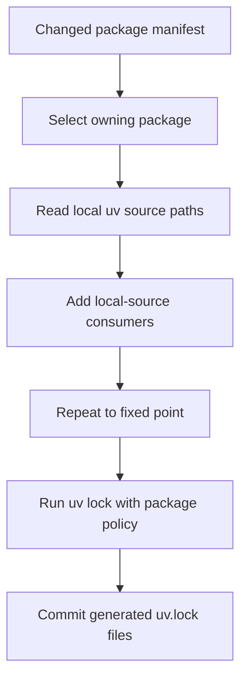
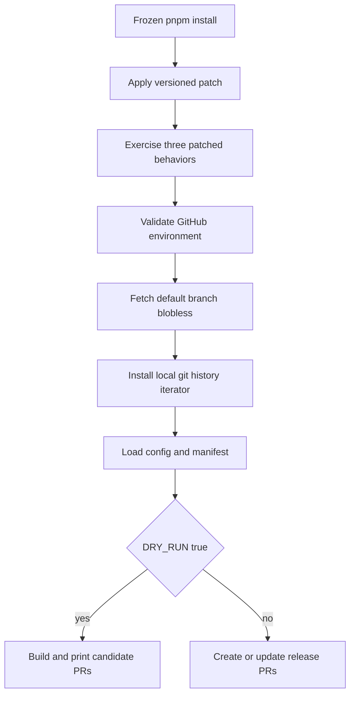
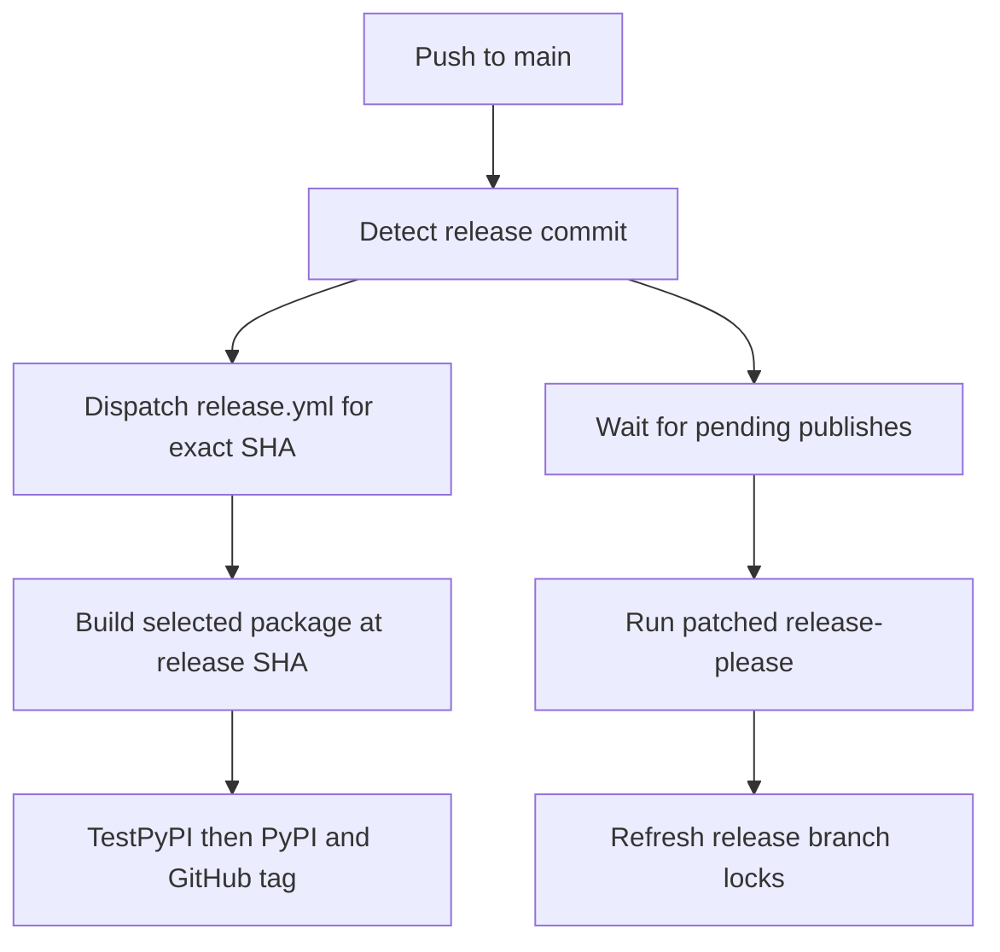

# Development and Release Operations

This repository is a monorepo of independently versioned packages under `libs/`, not a root Python project. Work in the package that owns the change: its `pyproject.toml` is the published compatibility contract and its `Makefile` is the supported task interface. See [Quickstart](../quickstart.md) for setup and the [Testing Guide](../testing/testing-guide.md) for package tests.

## Package-local development and dependency contracts

Use `uv` for interpreters, environments, and dependencies, and `make` for normal tasks. `uv` provisions the package-required interpreter, while each package declares its supported range in `requires-python`.

```bash
uv tool install pre-commit
pre-commit install --install-hooks

cd libs/deepagents
uv sync --all-groups
make test
make lint
```

Run `make help` in the owning package for its supported targets; use `uv run ...` for an exceptional one-off command. From `libs/`, `make lint`, `make lock`, `make lock-check`, and `make lock-bump DEP=<pkg>` fan out across discovered packages, but do not replace package-local setup.

| Layer | Meaning | Operational rule |
| --- | --- | --- |
| `[project]` dependencies, extras, `requires-python` | Wheel metadata installed by users | Treat as the public compatibility contract. |
| `[tool.uv.sources]` | Editable sibling-checkout wiring | A successful local resolution does not prove the published dependency graph resolves. |
| `uv.lock` | Generated development and CI resolution | Regenerate with `uv`; do not hand-edit it. |
| `release-please-config.json` | Managed paths, components, changelogs, exclusions, and release behavior | Update it as release integration wiring. |
| `.release-please-manifest.json` | Last-released baseline at each managed path | Let release-please make ordinary updates. |

### SDK, Code, and Talon compatibility

`deepagents-code` publishes the exact requirement `deepagents==0.7.42`, while its workspace maps `deepagents` to editable `../deepagents`. Thus a passing Code workspace can use unreleased sibling code and is not evidence of the PyPI installation users receive. Raise the exact Code SDK pin in the PR that first requires new SDK behavior rather than deferring it to a release PR. The `ci:dcode-skip-sdk-pin` label is the explicit acknowledgement for an intentionally older pin.

Talon is Python `>=3.14,<3.15`; it publishes `deepagents>=0.7.42` and `deepagents-code>=0.2.15,<1.0.0`, while its local source mappings are development-only wiring. A Talon change that relies on its Code floor must therefore follow a published Code release satisfying that floor.

## Lockfile propagation

A changed package manifest can invalidate its own lockfile and every transitive consumer that takes it through a local `uv` source. Refresh the reverse-consumer closure, then check the directly touched package path:

```bash
python .github/scripts/checks/refresh_lockfiles.py libs/code/pyproject.toml
python .github/scripts/checks/check_lockfiles_pre_commit.py libs/code/pyproject.toml
```



*Refreshing includes the changed owner and every transitive local-source consumer.*

`refresh_lockfiles.py` fails on resolver failure. Given paths, the checker intentionally tests only directly touched package paths; with no paths, it tests all discovered packages. The package-specific resolver policy uses Python 3.14 for ACP, Code, Evals, and Talon, and Python 3.12 otherwise. For broad dependency work, run:

```bash
python .github/scripts/checks/check_lockfiles_pre_commit.py
```

After release-please creates or refreshes a release PR, its release-branch job regenerates every tracked `uv.lock`. A rejected push fetches the branch tip, regenerates, and retries up to three times. Lockfiles and their propagation are generated committed output, not handwritten release changes.

## Release-please ownership, baselines, and scope

The registry is the source of the nine managed components and their changelog targets. Current manifest baselines are Deep Agents `0.7.42`, ACP `0.1.0`, Code `0.2.15`, Talon `0.1.2`, Daytona `0.0.9`, Modal `0.0.8`, Runloop `0.0.7`, Vercel `0.0.2`, and QuickJS `0.4.0`. It creates separate draft release PRs and deliberately skips GitHub-release creation; `release.yml` publishes after a release PR merges.

Do not manually rebase a release branch, merge `main` into it, or edit it while automation is queued or running. Wait for the relevant `release-please.yml` run and the release PR's **Update lockfiles** job before review or note curation.

Attribution is path-based rather than solely Conventional Commit scope. Package tests and `uv.lock` are excluded. A bump-worthy PR that changes release-relevant files in more than one configured component is blocked unless a maintainer applies `ci:allow-lockfile-release`; the label acknowledges intentional fan-out but does not suppress the extra releases. The scope gate reads trusted base configuration and fails closed if GitHub's changed-file list is incomplete.

`feat`, `fix`, `perf`, and `revert` appear in generated changelogs. Packages are pre-1.0: `feat` produces a patch bump and a breaking `feat!` produces a minor bump. Hidden types can ship in an existing release without a visible entry. The generated dependency section records dependency-range changes.

## Patched local release-please runner

The release-please job uses a pinned local npm installation instead of `googleapis/release-please-action`, whose prebuilt bundle cannot carry unreleased fixes. The local package pins `release-please` `17.11.2` and pnpm; pnpm applies the versioned patch during a frozen, script-free install. Installation fails if the patch no longer applies, which makes a stale patch an early workflow failure rather than a silent behavior change.

The patch currently has three responsibilities:

- permit `exclude-paths` to name an individual file, so package `uv.lock` exclusions work;
- parse multi-character tag separators, including repository tags such as `deepagents-code==0.2.7`; and
- start merged, open, and snoozed release-PR lookups concurrently with candidate construction.

Before creating a GitHub client, `run.mjs` exercises all three patched behaviors. It rejects an installation where file exclusions still retain a lockfile commit, `==` tags parse to the wrong component, or pull-request lookups run serially. It then validates `GITHUB_TOKEN` and `GITHUB_REPOSITORY`, fetches the default branch into a blobless local ref, and constructs the release-please manifest. In normal mode it creates or updates release PRs and writes compatible `pr` and `prs` step outputs.



*The runner validates the patched dependency before either dry-run planning or GitHub mutation.*

The runner replaces release-please's GraphQL history walk with a full-history blobless-clone `git log` iterator and removes the 500-commit cap. It reconstructs PR data from squash and merge subjects, fetches override PR bodies when `BEGIN_COMMIT_OVERRIDE` is present, uses first-parent files for merges, and represents both paths of a rename. Those details keep path-based release attribution aligned with GitHub behavior while avoiding per-page GraphQL history requests.

### Safe local dry runs and upgrades

Run the local runner from a full-history clone. `DRY_RUN=true` fetches `main`, builds candidates, prints the release PRs it would open or update, and writes nothing to GitHub:

```bash
pnpm install --dir .github/release-please --frozen-lockfile --ignore-scripts
GITHUB_TOKEN="$(gh auth token)" GITHUB_REPOSITORY=langchain-ai/deepagents DRY_RUN=true \
  node .github/release-please/run.mjs
```

Treat this comparison as the acceptance check for a runner upgrade: the candidates should match the open `release(...)` PRs. To upgrade, first change the pinned version and run `pnpm install --ignore-scripts`; the old version-named patch should fail. Generate a patch for the new version with `pnpm patch release-please@<new version>`, reapply only fixes not yet upstream, then run `pnpm patch-commit <directory>`. Remove the old patch file and workspace entry, and finish with the dry run. Remove a patch change when the pinned upstream version already includes it.

## Curated release notes

Every managed release PR is eligible for note curation. The notes workflow derives the component from a trusted internal release branch and validates it against the registry and `release(<component>): <version>` title. It runs automation from `main` and reads release-branch material through the API at a validated SHA rather than checking it out or executing it. Manual `@release-bot` commands require write-level maintainer permission.

1. Keep the release PR draft while changes accumulate, then mark it ready for review to create a bot-authored draft.
2. Review and edit the marked draft comment, retaining its version heading and generated `### Dependencies` section.
3. Comment `@release-bot apply`. The guarded flow writes curated text to the package `CHANGELOG.md` and mirrors it to the PR preview.
4. Merge only after the `curated release notes` gate passes. `ci:skip-curated-notes` is the exceptional bypass for shipping generated notes unchanged.

Release-branch text is untrusted drafting input. The model never receives `### Dependencies`; the workflow restores that subsection verbatim. Applying fails rather than writing if headings, generated entries, dependencies, bot metadata, branch or head state, or concurrent PR state has changed. The release-branch dependency generator diffs `pyproject.toml` from the resolved predecessor tag to release head; it warns and leaves the changelog unchanged if generation fails, so dependency notes do not block lockfile updates.

## Publication lifecycle and recovery



*Detected publishing is dispatched before serialized release-PR maintenance.*

Empty commits are rejected because they have no paths to scope. Before recomputing release PRs, the workflow waits for repository-wide pending publishes to reach a known-safe state. It fails closed when release state cannot be read; a genuinely stuck pending publish defers maintenance rather than recomputing against a manifest whose tag is not yet present.

`release.yml` is dispatch-only, including manual dispatch. A normal release validates that the supplied exact 40-character `release-sha` is reachable from `main` and that the package manifest declares the requested version. It builds the detached tree at that SHA, verifies downloaded artifact checksums, publishes through TestPyPI and PyPI, then creates `<package>==<version>` and the GitHub release. A PyPI-published version is immutable: do not move or recreate its tag; publish a new version for a defect.

Release-body generation intentionally fails open: publication and tagging continue with an empty GitHub release body if it fails. Rebuild against the exact release SHA and edit only the notes:

```bash
python .github/scripts/release/build_release_notes.py \
  --package "<package>" --version "<version>" \
  --sha "<release-sha>" --repo "langchain-ai/deepagents" \
  --actor "<actor>" --base-branch "<base-branch>" \
  --out /tmp/release-body.md

gh release edit "<package>==<version>" --repo "langchain-ai/deepagents" \
  --notes-file /tmp/release-body.md
```

The builder resolves a reachable predecessor tag, extracts the requested changelog section at the release SHA, and bounds and escapes package-scoped history so later commits and unsafe subjects cannot be attributed to the release.

## Focused validation

For metadata changes, run package tests, refresh the reverse-consumer closure, and run the all-package lock check. For changes to lock propagation or release operations, run the focused regression tests:

```bash
uv run --no-project --with "pytest" pytest \
  .github/scripts/tests/checks/test_check_lockfiles_pre_commit.py \
  .github/scripts/tests/checks/test_refresh_lockfiles.py \
  .github/scripts/tests/release/test_check_lockfile_release_scope.py \
  .github/scripts/tests/release/test_build_release_notes.py
node --test .github/scripts/tests/release/release-notes.test.js
node --test .github/scripts/tests/release/release-please-history.test.mjs
uv run --no-project --with "pyyaml" pytest .github/scripts/tests/release/test_release_please_workflow.py
```

In particular, the release-please history tests protect squash and merge PR reconstruction, override-body selection, merge and rename path handling, bounded iteration, and API failure behavior. The workflow tests protect dispatch-before-maintenance ordering and the fail-closed conditions around pending publishing and lockfile regeneration.
