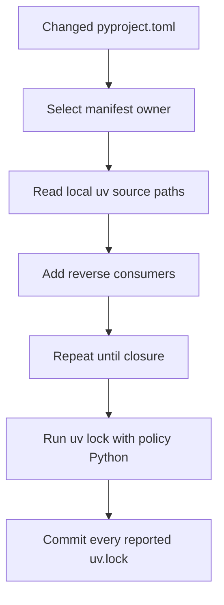

# Development and Dependency Operations

This repository is a monorepo of independently versioned Python packages. Work in the package that owns the change: each package has its own `pyproject.toml`, `Makefile`, and lockfile; there is no root `pyproject.toml`. The package manifest is the published dependency contract, while local `uv` source mappings make sibling packages editable during repository development. See the [Quickstart](../quickstart.md) for initial setup and the [Testing Guide](../testing/testing-guide.md) for choosing tests.

## Package-local environment

Use `uv` for interpreters, virtual environments, and dependencies; do not substitute a repository-wide Python installation or a different environment manager. `uv` provisions the needed interpreter, so the selected package's `requires-python` is the compatibility contract rather than a global Python pin. The package `Makefile` is the supported task interface—start with `make help`.

```bash
uv tool install pre-commit
pre-commit install --install-hooks

cd libs/deepagents
uv sync --all-groups
make test
make lint
```

For an intentional one-off command, use `uv run ...`; do not manually activate or share a virtual environment across packages. The top-level `libs/Makefile` can fan out operations across library, partner, and example package directories, but it does not replace package-local targets.

Published Python support is package-specific. Deep Agents and ACP declare `>=3.11,<4.0`; Code and Talon declare `>=3.14,<3.15`. This is distinct from the interpreter selected to resolve a development lockfile.

### Dependency layers

| Layer | Owner and purpose | Change rule |
| --- | --- | --- |
| Published metadata | `[project]` dependencies, extras, and `requires-python` in `pyproject.toml` | This is what downstream installers receive. Set compatible ranges or pins deliberately. |
| Workspace wiring | `[tool.uv.sources]` path mappings | These point to editable sibling checkouts for monorepo work; they are not a substitute for published metadata. |
| Resolved environment | Package-local `uv.lock` | Generated state for local development and CI. Regenerate with `uv`; never hand-edit it. |

Editable sources can hide a released-package incompatibility: a local test may consume a sibling checkout even when the version that an end user installs would be insufficient. When changing a public dependency boundary, validate an installed or source-free route as well as the workspace route.

## Interpreter policy and CI setup

The shared `uv_setup` action pins uv at `0.13.6`, takes a required major.minor Python version, and normally enables a pruned dependency cache. Its cache key input is deliberately limited to `pyproject.toml`, `uv.lock`, and `requirements*.txt` under the caller's working-directory scope.

There are two similar-looking lock entrypoints with different Python mappings:

- `.github/scripts/checks/check_lockfiles_pre_commit.py` resolves ACP, Code, Evals, and Talon using Python 3.14; every other discovered package uses Python 3.12.
- `make -C libs lock`, `lock-bump`, and `lock-check` discover the same broad package categories, but map only ACP to 3.14 and everything else to 3.12.

Consequently, use the targeted scripts below for a changed Code, Evals, or Talon manifest; the aggregate Make target is not CI-equivalent for those packages. The reusable `Check Lockfiles` workflow intentionally disables caching: `uv lock --check` does not create the cache directory that setup-uv would try to save. It runs the checker without paths, which validates every discovered package.

## Lockfile refresh is a reverse-dependency closure

A manifest change can invalidate more than its own `uv.lock`. The lock refresh helper reads local path sources from every discovered package and begins with the owners of the supplied manifest paths. It repeatedly adds packages that consume any selected package through `[tool.uv.sources]`, then runs `uv lock --directory <directory> --python <selected version>` for every member of that reverse transitive closure. It prints each resulting lockfile path; commit all of them.



*Lock refresh includes the changed package and all transitive consumers that resolve it from a local source.*

From the repository root:

```bash
python .github/scripts/checks/refresh_lockfiles.py libs/code/pyproject.toml
python .github/scripts/checks/check_lockfiles_pre_commit.py libs/code/pyproject.toml
```

`refresh_lockfiles.py` computes the closure above. The checker deliberately has narrower selection semantics: with paths, it checks package directories directly touched by those paths; with no arguments, it checks all discovered packages. A path that touches no package is a successful no-op. On the first stale lock, the checker returns that `uv lock --check` failure and emits the exact non-check `uv lock` repair command. For a final repository-wide check, invoke it without paths:

```bash
python .github/scripts/checks/check_lockfiles_pre_commit.py
```

## Code's exact Deep Agents SDK pin

`deepagents-code` publishes an exact `deepagents==0.7.35` requirement, while `[tool.uv.sources]` replaces `deepagents` with editable `../deepagents` in the workspace. The exact pin is therefore a release contract, not evidence of what local Code tests exercised. If Code begins to require newer SDK behavior, update its published pin and regenerate its Python 3.14 lockfile.

`make -C libs/code check` runs `check_sdk_pin.py` after its other local gates. The check compares Code's exact pin to the workspace Deep Agents version: an equal or ahead pin succeeds, a behind pin exits 1 and is advisory to the Make target, and malformed, absent, or unsupported version data exits 2 and fails the target. The release pipeline, rather than the local check, is the hard protection against releasing Code with a stale pin.

After a Deep Agents release is published, the Code pin-bump workflow can create or refresh its marked automation PR. It only edits the pin when Code is behind, preserves an intentionally ahead pin, regenerates `libs/code/uv.lock` with Python 3.14, and uses `chore(deps):` for the generated commit. Review and merge that PR before a subsequent Code release.

## Release-manifest implications

Release Please manages nine independently released package paths. The current manifest baselines are: Deep Agents `0.7.35`, ACP `0.0.13`, Code `0.2.6`, Talon `0.1.0`, Daytona `0.0.9`, Modal `0.0.7`, Runloop `0.0.7`, Vercel `0.0.2`, and QuickJS `0.3.12`. The matching configuration gives each path a Python release type, separate draft release PRs, and pre-1.0 bump behavior; Release Please itself skips GitHub release creation, which the release workflow handles after release-PR processing.

This means a package addition, removal, rename, or release-relevant path change is not only a manifest edit: reconcile `.release-please-manifest.json` with `release-please-config.json` and the release workflow's package routing. Keep a user-facing `feat` or `fix` scoped to the owning managed package. Cross-package dependency and lockfile maintenance should normally use `chore(deps):`, because a bump-worthy commit touching multiple managed paths can produce multiple release PRs.

The pre-merge scope check runs its detector and Release Please configuration from the trusted PR base revision, fails closed when GitHub's changed-file response is incomplete, and requires the explicit `ci:allow-lockfile-release` label to acknowledge a detected lockfile-only or multi-component fan-out. See [CI labeling](ci-labeling.md) for label operations.

## Focused validation checklist

- **Package code or metadata:** run that package's `make test` and `make lint`; use `make help` rather than assuming targets are uniform.
- **Any `pyproject.toml` change:** run `refresh_lockfiles.py` for the changed manifest, commit the complete reported closure, then run the targeted checker. Before merging broad dependency work, run the checker with no paths.
- **Code's Deep Agents dependency:** update the exact pin when required, regenerate the Code lock with Python 3.14, and run `make -C libs/code check`. Remember that the workspace source mapping cannot validate the PyPI pin.
- **Shared fan-out Makefile or hygiene changes:** run `make -C libs hygiene`; it applies its explicit text hooks only to the configured changed-file range.
- **Release configuration change:** verify the manifest/configuration correspondence and avoid a bump-worthy multi-package dependency/lockfile commit unless the release fan-out is intentional and acknowledged.
