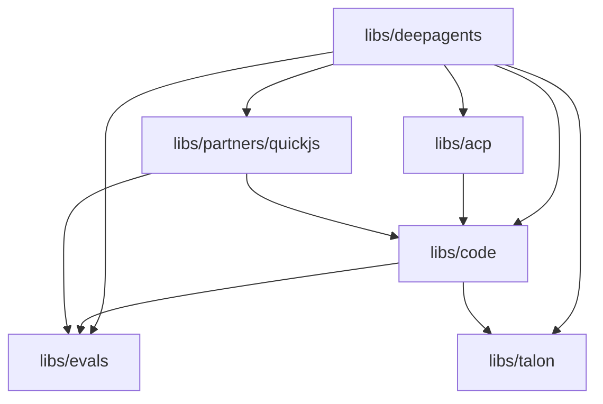
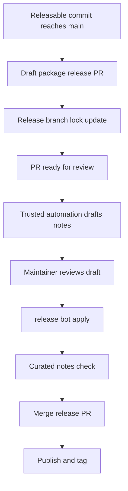

# Development, Dependencies, Lockfiles, and Releases

This repository is a monorepo of independently versioned packages under `libs/`, not a root Python project. Work in the package that owns the change: its `pyproject.toml` declares the public package contract, its `Makefile` is the supported command interface, and its `uv.lock` is generated development resolution state. For runtime orientation, see the [architecture overview](../architecture/overview.md); for test selection, see the [Testing Guide](../testing/testing-guide.md).

## Package-local development

Use `uv` for interpreters, environments, and dependency installation, and use `make` from the package directory for normal development. `uv` provisions interpreters, so follow the changed package's `requires-python`; do not introduce a repository-wide Python pin. Install hooks once, synchronize the package and its groups, then use its advertised targets (`make help` is the local command inventory).

```bash
uv tool install pre-commit
pre-commit install --install-hooks

cd libs/deepagents
uv sync --all-groups
make test
make lint
```

`uv sync --all-groups` installs the package and its declared dependency groups. Use `uv run ...` for a deliberate one-off command rather than substituting another package manager. The installed hooks include commit-message validation, changed-package formatting/linting, lock checks, and a pre-push branch-name check; rerun `pre-commit install --install-hooks` in an existing checkout after hook changes.

Keep a bump-worthy user-facing change in one releasable component. Cross-package dependency or lockfile churn normally belongs in a separate `chore(deps):` change, because Release Please assigns changes by path and a mixed `feat` or `fix` can fan out into unintended consumer releases. PR titles use scoped Conventional Commits; external contributors need an approved linked issue or discussion and an assignment before opening a PR.

## Separate public contracts from checkout wiring

Do not conflate these three layers:

| Layer | Owner and purpose | Change consequence |
| --- | --- | --- |
| Published metadata | `[project]` dependencies, extras, and `requires-python` in a package's `pyproject.toml` | The contract a downstream installer resolves from package indexes. Bounds must express supported public combinations. |
| Local source wiring | `[tool.uv.sources]` in that manifest | Directs `uv` to sibling checkout paths, often editable, during monorepo work. It does not change wheel metadata. |
| Resolution output | The package's `uv.lock` | Concrete local/CI resolution state. Regenerate with `uv`; never hand-edit it. |

For example, Code publishes `deepagents==0.7.32`, `deepagents-acp>=0.0.13,<1.0.0`, and bounded QuickJS compatibility, while its source map substitutes sibling Deep Agents, ACP, and partner packages in a checkout. ACP publishes an unpinned `deepagents` dependency but maps it to `../deepagents`; QuickJS publishes `deepagents>=0.7.32,<0.8.0` and maps the same sibling. Evals and Talon publish their own ranges while sourcing local Code and/or Deep Agents. Editable sources make in-repository integration coherent, but they do not prove that released metadata can resolve from PyPI.

### The Code SDK-pin rule

`deepagents-code`'s exact `deepagents==X.Y.Z` dependency is a minimum SDK compatibility assertion, not release-time bookkeeping. Raise it in the PR that first uses the new SDK functionality. The editable source can otherwise conceal an obsolete pin locally. The release guide's labels for deliberately older or coordinated prerelease pins are exceptions, not a reason to weaken this invariant.

## Lockfiles: refresh the reverse-consumer closure

A consumer's resolution incorporates a local producer's metadata. Therefore a changed `pyproject.toml` can stale its own lock and every transitive package that consumes it through `[tool.uv.sources]`. The repair set is the manifest owner plus its reverse transitive local-source consumers.



*Arrows point from a locally sourced producer to its consumer. A manifest change refreshes that node and all nodes reachable downstream.*

For example, a `libs/code/pyproject.toml` change requires locks for Code, Evals, and Talon: Evals and Talon map `deepagents-code` to `../code`. A Deep Agents manifest change reaches ACP, Code, Evals, Talon, and QuickJS, with the remaining edges then considered transitively. Do not maintain this list by hand—the helper resolves source paths relative to each manifest and repeatedly adds consumers until the set stops growing.

From the repository root, refresh locks for changed manifests with:

```bash
python .github/scripts/checks/refresh_lockfiles.py libs/code/pyproject.toml
```

The helper runs `uv lock --directory <package> --python <version>` once per closure member and prints each resulting lock path. The pre-commit checker uses the same closure function when a manifest changes; otherwise it checks packages touched by supplied paths, or every discovered package when called without paths. An out-of-date lock reports the exact regeneration command.

The checker resolves first-party ACP, Code, Evals, and Talon locks with Python 3.14; all other discovered packages use 3.12. This is lock-generation policy, not a substitute for each package's published `requires-python`. In particular, use the targeted helper or the command printed by the checker for these packages: `libs/Makefile`'s aggregate `make lock` and `make lock-check` currently select 3.14 only for `acp`. The aggregate targets (`make lock`, `make lock-check`, and `make lock-bump DEP=<pkg>`) remain useful for broad work where their interpreter mapping is appropriate.

Treat `uv.lock` as generated state. Some package Makefiles set `UV_FROZEN=true`, so routine commands expose stale locks instead of updating them as a side effect. Resolve explicitly, review and commit every generated lock in the closure, then rerun the owning package checks.

## Release Please state and scope

Release Please manages a component only when it appears in both `release-please-config.json` and `.release-please-manifest.json`. The manifest is the latest released baseline, not the working source version or a dependency pin. For a newly managed package whose source begins at `0.0.1`, use a `0.0.0` manifest baseline if the first generated release should publish `0.0.1`.

| Distribution | Path | Manifest baseline |
| --- | --- | --- |
| `deepagents` | `libs/deepagents` | `0.7.32` |
| `deepagents-acp` | `libs/acp` | `0.0.13` |
| `deepagents-code` | `libs/code` | `0.2.2` |
| `deepagents-talon` | `libs/talon` | `0.1.0` |
| `langchain-daytona` | `libs/partners/daytona` | `0.0.9` |
| `langchain-modal` | `libs/partners/modal` | `0.0.7` |
| `langchain-runloop` | `libs/partners/runloop` | `0.0.7` |
| `langchain-vercel-sandbox` | `libs/partners/vercel` | `0.0.2` |
| `langchain-quickjs` | `libs/partners/quickjs` | `0.3.11` |

Configuration creates separate draft Python release PRs titled `release(${component}): ${version}`. All configured components currently use pre-1.0 behavior: `feat` produces a patch bump and a breaking feature produces a minor bump. Generated changelogs expose `feat`, `fix`, `perf`, and `revert`; configured documentation, style, chore, refactor, test, CI, and hotfix types are hidden.

`skip-github-release` deliberately separates proposal from publication: Release Please creates or refreshes release PRs, while `release.yml` publishes. On a `main` push, the release workflow blocks ordinary empty commits because a pathless commit could fan out to every component. It identifies a merged release by both a `release(component): version` subject and the matching package changelog path, then dispatches publication.

Before merge, the release-please parse check reconstructs the would-be squash-merge message and uses the exact-pinned Conventional Commits parser. It blocks malformed bodies that Release Please would otherwise silently omit from changelog processing, but does not decide package-path assignment or scope correctness.

## Curated notes: trusted automation over untrusted PR data

After releasable commits reach `main`, wait for Release Please and its release-branch lockfile update to finish. Do not manually rebase, merge `main` into, or edit a release branch while automation is queued or running: a refresh can replace changes or race note application.



*The release PR carries a generated preview; curation applies reviewed prose to both the package changelog and that preview before merge.*

The release-notes workflow runs trusted automation from a `main` checkout, not from the release PR. It derives the component from a validated internal release-branch name, requires an open PR targeting `main`, and requires the title to name that component. The component registry is built from `release-please-config.json`, so an added configured component is covered without a second package list. PR text, changelog content, branch names, and model output are untrusted API data: fetched at validated SHAs, never checked out as PR code, and never executed as workflow code.

### Draft and apply operator flow

1. Keep the release PR as a draft while commits accumulate. Mark it ready for review to request a draft automatically, or have a write-level maintainer comment `@release-bot draft`, optionally with a short one-line editorial instruction.
2. Review and edit the bot-authored draft comment while retaining its generated version heading. It must retain the eligible generated PR links and cannot invent arbitrary references.
3. Comment `@release-bot apply`. Apply accepts only the valid bot-authored draft for that component and version, updates the package `CHANGELOG.md`, mirrors the section into the release-PR preview, and advances the branch without rewriting history.
4. Merge only after the required `curated release notes` check passes. `ci:skip-curated-notes` is the explicit opt-out when intentionally publishing the uncurated generated changelog.

Manual commands are accepted only on a ready internal release PR and only from a maintainer with write-level permission. Comments containing more than one command are rejected. Runs serialize per PR with `cancel-in-progress: false`, so a second command queues rather than cancelling an in-flight draft or apply. A successful manual command changes its acknowledgement reaction from eyes to rocket; failures appear on the PR and in workflow logs.

### Freshness and integrity checks

Drafting reads the generated version section at the validated release-branch head, fingerprints generated entries separately from the heading, and stores trusted state outside the model process's writable working area. It revalidates release PR identity and head before posting. Model output must be nonempty section content only: metadata markers and extra version headings are rejected so output cannot forge trusted comment state.

Applying revalidates bot identity using both configured login and immutable numeric ID, the PR identity and head, draft revision, and generated-changelog fingerprint. A scoped draft can survive an unrelated `main` refresh, including harmless heading restyling, but a new change under the released package path requires a new draft. Apply fails closed if generated entries appeared, the version heading changed, the preview terminator is ambiguous, or concurrent edits change the PR/draft while it prepares. The required check verifies applied metadata, changelog section, preview, and branch ancestry agree; a comment alone is insufficient.

The model process receives only the selected provider credential and makes a fixed model request. Short-lived GitHub App credentials perform comments, PR-body updates, and the non-force Git Data API branch update. This boundary permits trusted-main automation to mutate an internal release branch without granting untrusted release-PR material shell, filesystem, network-tool, or workflow-code authority. Focused Node tests cover release identity, authorization and ambiguity handling, section extraction, prompt/output sanitization, stale-head retries, package-scoped freshness, concurrent application, and required-check agreement.

## Publication safety and recovery

Merging a release PR triggers its package release workflow. The operational invariant is one version, one artifact: a published PyPI version and its GitHub tag identify the same source. For an ordinary manual recovery dispatch, supply a version and exact 40-character `release-sha`; the selected commit must declare that version. If failure occurs before PyPI upload, repair without changing the version and dispatch from the exact corrected SHA. Once PyPI contains a version, do not republish it and do not move or recreate its tag; publish a new version instead.

After successful publication, the release PR label changes from `auto:release-pending` to `auto:release-tagged`. Before Release Please recomputes other open release PRs, it waits for merged pending releases across the repository, preventing recomputation against a manifest baseline whose tag does not yet exist. Manual non-main releases, backports, and prereleases are exceptional paths; use the detailed procedures and labels in [`.github/RELEASING.md`](https://github.com/langchain-ai/deepagents/blob/main/.github/RELEASING.md).
