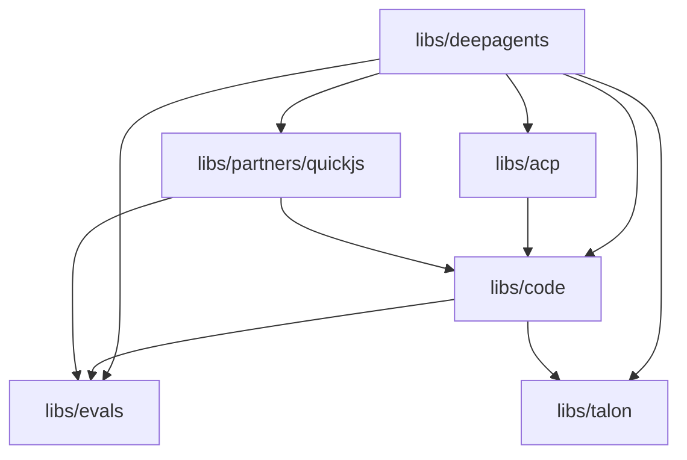
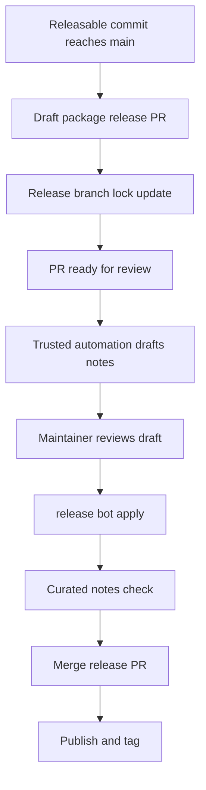

# Development, Dependencies, Lockfiles, and Releases

This is a monorepo of independently versioned packages under `libs/`, not a root Python project. Work in the package that owns the change: its `pyproject.toml` defines its distributable contract, its `Makefile` is the supported command interface, and its `uv.lock` records generated resolution state. For runtime orientation, see the [architecture overview](../architecture/overview.md); for test selection, see the [Testing Guide](../testing/testing-guide.md).

## Package-local development

Use `uv` for interpreters, environments, and dependency installation, and use `make` from the owning package for normal development. `uv` provisions interpreters, so honor that package's `requires-python`; do not introduce a repository-wide Python pin. Install hooks once, synchronize the package and its groups, then use the package's advertised targets (`make help` is the local command inventory).

```bash
uv tool install pre-commit
pre-commit install --install-hooks

cd libs/deepagents
uv sync --all-groups
make test
make lint
```

`uv sync --all-groups` installs the package and declared dependency groups. Use `uv run ...` for a deliberate one-off command rather than another package manager. The installed hooks validate commit messages, format and lint changed packages, check applicable locks, and check the branch name before pushes. Re-run `pre-commit install --install-hooks` in an existing checkout after hook changes.

Keep a bump-worthy user-facing change in one releasable component. Cross-package dependency or lockfile churn normally belongs in a separate `chore(deps):` change, because Release Please assigns changes by path and a mixed `feat` or `fix` can fan out into unintended consumer releases. PR titles use scoped Conventional Commits; external contributors need an approved linked issue or discussion and an assignment before opening a PR.

## Three dependency layers

Do not conflate these layers:

| Layer | Owner and purpose | Change consequence |
| --- | --- | --- |
| Published metadata | `[project]` dependencies, extras, and `requires-python` in `pyproject.toml` | The public contract resolved by downstream installers. Bounds must express supported released combinations. |
| Local source wiring | `[tool.uv.sources]` in that manifest | Directs `uv` to sibling checkout paths, often editable, during monorepo work. It is not wheel metadata. |
| Resolution output | Package `uv.lock` | Concrete development/CI resolution state. Regenerate with `uv`; never hand-edit it. |

For example, Code publishes an exact `deepagents==0.7.32` dependency, bounded ACP and QuickJS requirements, and a Python 3.14-only contract. Its source map replaces those first-party packages and partner integrations with siblings in a checkout. ACP publishes `deepagents` and maps it to `../deepagents`; QuickJS publishes `deepagents>=0.7.32,<0.8.0` and maps the same sibling. Evals and Talon likewise consume local Code and/or SDK sources. Editable sources make workspace integration coherent, but do not prove released metadata can resolve from PyPI.

### Code SDK pin and compatibility

`deepagents-code`'s exact `deepagents==X.Y.Z` dependency is a compatibility floor, not release-time bookkeeping. Raise it in the PR that first needs newer SDK behavior; the editable workspace source otherwise masks an obsolete published pin. Its `make check` runs the shared comparison as an advisory: exit `1` means an older pin, while exit `2` means the pin/version could not be determined and must not be treated as a pass.

The release workflow is the hard boundary: a Code publish fails if its pin is older than the workspace SDK, unless an operator deliberately enables `dangerous-skip-sdk-pin-check`. The release-PR check comments on stale pins but does not block merge; a prerelease SDK pin is valid only when it is not older, and additionally fails until the PR has `ci:ack-release-deps`. An intentional older-pin exception requires `ci:dcode-skip-sdk-pin` before merge (or the dangerous dispatch override) and a review confirming Code does not use newer SDK functionality.

After an SDK package has been published, automation creates or updates one `chore(deps):` Code pin-bump PR when the pin is behind, regenerating `libs/code/uv.lock`. It preserves an ahead-of-workspace pin for coordinated prerelease work. Treat that automation as maintenance assistance, not evidence of compatibility: test the changed package and its consumers before release.

## Lockfiles: refresh the reverse-consumer closure

A consumer's resolution incorporates a local producer's metadata. Therefore a changed `pyproject.toml` can stale its own lock and each transitive package that consumes it through `[tool.uv.sources]`. The repair set is the manifest owner plus its reverse transitive local-source consumers.



*Arrows point from a locally sourced producer to its consumer; refresh the changed node and every reachable downstream node.*

For example, a `libs/code/pyproject.toml` change requires Code, Evals, and Talon locks. A Deep Agents manifest change reaches ACP, Code, Evals, Talon, and QuickJS, then their downstream consumers. Do not maintain this set by hand: the helper resolves source paths relative to each manifest and repeatedly adds consumers until the set stops growing.

From the repository root, refresh the closure for changed manifests:

```bash
python .github/scripts/checks/refresh_lockfiles.py libs/code/pyproject.toml
```

The helper runs `uv lock --directory <package> --python <version>` once per closure member and prints each resulting lock. The pre-commit checker uses the same closure function when a manifest changes; for other changed paths it checks the touched package, and without paths it checks every discovered package. A stale result reports the exact repair command.

The targeted checker resolves ACP, Code, Evals, and Talon with Python 3.14; all other discovered packages use 3.12. This is lock-generation policy, not a replacement for published `requires-python`. Prefer the targeted helper or checker-supplied command for a changed manifest: `libs/Makefile` maps only ACP to 3.14, so its broad `make lock` and `make lock-check` targets do not mirror the targeted policy for Code, Evals, or Talon. Those fan-out targets remain the final broad validation when their mapping is appropriate:

```bash
make -C libs lock-check
make -C libs lint
```

Many package Makefiles set `UV_FROZEN=true`, ensuring routine test and lint commands expose a stale lock rather than silently changing it. Resolve explicitly, review and commit every generated lock in the closure, then run the owning package's `make test` and `make lint`; use the fan-out targets for changes with repository-wide consequences.

## Release Please: scope, state, and publication

Release Please manages a component only when it appears in both `release-please-config.json` and `.release-please-manifest.json`. The manifest is the latest released baseline, not the working source version or a dependency pin. For a newly managed package whose source begins at `0.0.1`, use a `0.0.0` manifest baseline when the first generated release should publish `0.0.1`.

| Distribution | Path | Manifest baseline |
| --- | --- | --- |
| `deepagents` | `libs/deepagents` | `0.7.32` |
| `deepagents-acp` | `libs/acp` | `0.0.13` |
| `deepagents-code` | `libs/code` | `0.2.2` |
| `deepagents-talon` | `libs/talon` | `0.1.0` |
| `langchain-daytona` | `libs/partners/daytona` | `0.0.9` |
| `langchain-modal` | `libs/partners/modal` | `0.0.7` |
| `langchain-runloop` | `libs/partners/runloop` | `0.0.7` |
| `langchain-vercel-sandbox` | `libs/partners/vercel` | `0.0.2` |
| `langchain-quickjs` | `libs/partners/quickjs` | `0.3.11` |

Configuration creates separate draft Python release PRs named `release(${component}): ${version}`. All configured packages use pre-1.0 behavior: `feat` is a patch bump and a breaking feature is a minor bump. Generated changelogs expose `feat`, `fix`, `perf`, and `revert`; documentation, style, chore, refactor, test, CI, and hotfix types are hidden.

`skip-github-release` separates proposal from publication: Release Please creates or refreshes release PRs, while `release.yml` publishes. Before merge, the parse check reconstructs the would-be squash-merge message and uses the exact-pinned Conventional Commits parser. It blocks malformed bodies that Release Please would otherwise silently drop from changelog processing, but does not decide package-path assignment or scope correctness.

On a `main` push, the release workflow rejects ordinary empty commits because a pathless commit could fan out to every component. A merged release is identified by both a `release(component): version` subject and the matching package changelog path, then dispatches publication.

## Curated release notes and safe publication

After releasable commits land on `main`, wait for Release Please and its release-branch lock update to finish. Do not manually rebase, merge `main` into, or edit a release branch while automation is queued or running: a refresh can replace changes or race note application.



*The release PR carries a generated preview; curation applies reviewed prose to the package changelog and that preview before merge.*

The release-notes workflow runs trusted automation from a `main` checkout, never checks out or executes release-PR material, and treats PR text, changelog content, branch names, and model output as untrusted API data. It derives the component from a validated internal release-branch name and the Release Please registry. A fixed model request has no filesystem, shell, or network tools; short-lived GitHub App credentials perform the comments and non-force branch update.

1. Mark the draft release PR ready, or have a write-level maintainer comment `@release-bot draft` (optionally with a short editorial instruction).
2. Review the bot-authored draft comment, retaining its generated version heading and eligible generated PR links.
3. Comment `@release-bot apply`. Apply accepts only valid bot-authored state for that component and version, updates `CHANGELOG.md`, and mirrors the section into the release-PR preview.
4. Merge only after the required `curated release notes` check passes. `ci:skip-curated-notes` is the explicit opt-out for an intentionally uncurated changelog.

Commands require a ready internal release PR and write-level permission, reject ambiguous multiple commands, and serialize per PR without cancelling a run in progress. Draft/apply fail closed against forged or stale state: drafts fingerprint generated entries and reject injected metadata or headings; apply rechecks the bot identity, PR/head, revision, generated entries, and package changes since drafting.

Merging a release PR triggers its package release workflow. Preserve one-version-one-artifact integrity: a manual recovery release selects an exact 40-character source SHA whose package metadata declares the requested version. If failure occurs before PyPI upload, repair without changing the version and dispatch from the corrected exact SHA. Once PyPI contains a version, do not republish it or move/recreate its tag; publish a new version instead. See [`.github/RELEASING.md`](https://github.com/langchain-ai/deepagents/blob/main/.github/RELEASING.md) for recovery, prerelease, and backport procedures.
