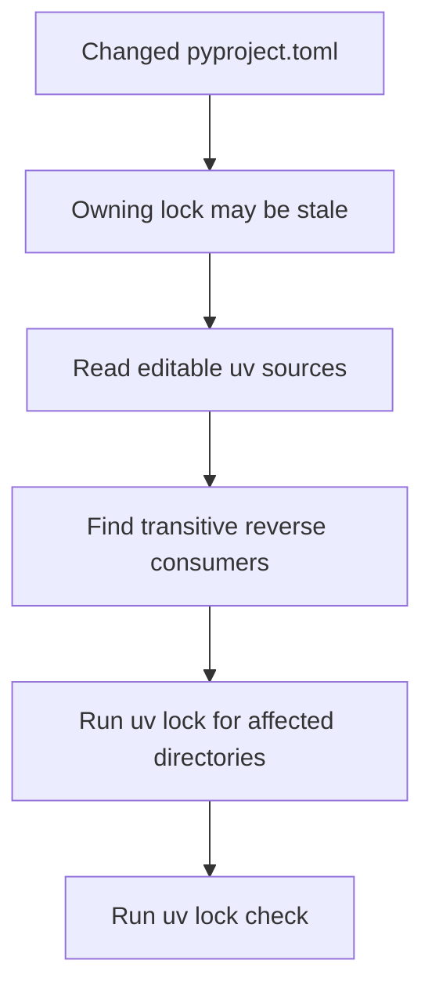
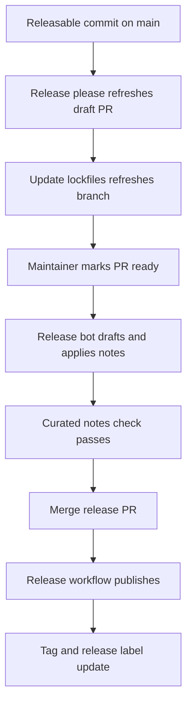

# Development, Dependencies, Lockfiles, and Releases

This is a monorepo of independently versioned distributions under `libs/`, not a root Python project. Work in the package that owns the change: its `pyproject.toml` is the published compatibility contract, its `Makefile` is the supported command interface, and it owns its uv environment and `uv.lock`. For runtime context, see the [architecture overview](../architecture/overview.md); for test design, see the [Testing Guide](../testing/testing-guide.md).

## Package-local setup and validation

Use `uv` for interpreters, environments, and dependencies; do not substitute `pip`, Poetry, or Conda for the normal repository workflow. `uv` provisions a suitable interpreter, so there is no repository-wide Python installation to pin. Run `make help` in the package being changed, synchronize that package, and prefer its targets for normal work.

```bash
uv tool install pre-commit
pre-commit install --install-hooks

cd libs/deepagents
uv sync --all-groups
make test
make lint
```

`uv sync --all-groups` installs the selected package and declared groups. Use `uv run ...` for an intentional one-off command. Each package's `requires-python` and dependency constraints, rather than an editable workspace resolution, define what downstream users can install.

The common package workflow keeps unit tests network-free, permits network access in integration tests, and accepts `TEST_FILE` to narrow normal test targets. Deep Agents and Code export `UV_FROZEN=true`, so their ordinary targets cannot silently repair a stale lock. Their unit-test targets run parallel pytest with non-Unix sockets disabled and Unix sockets allowed; integration tests select the integration tree with a 30-second timeout. `make lint` checks Ruff formatting, runs Ruff, and invokes `ty`; `make format` applies Ruff formatting and safe fixes.

Code supplies a local CI-parity entrypoint:

```bash
cd libs/code
make bootstrap  # syncs the test group and installs hooks
make check
```

`make check` runs linting, import checks, unit tests, extras synchronization, version-file equality, and lock freshness. Its SDK-pin check is advisory only when it returns status `1`; any other error remains fatal. Use this before a Code PR when practical.

Pre-commit validates Conventional Commit messages, repository hygiene, package formatting/linting for selected packages, lock freshness, extras synchronization, and the relevant version-file pairs. Its pre-push hook checks branch names. Re-run `pre-commit install --install-hooks` after updating an existing checkout so the pre-push hook is installed.

External contributors must link an approved issue or discussion and be assigned before opening a PR. Use a scoped Conventional Commit title. Keep a bump-worthy change scoped to one releasable component; put cross-package dependency and lockfile churn in a separate `chore(deps):` PR. That prevents release-please from attributing one visible change to multiple distributions merely because their files changed.

## Public requirements versus editable workspace sources

A requirement in `[project.dependencies]` is a PyPI contract; a `[tool.uv.sources]` entry is a development-only resolution mapping. For example, Code publishes `deepagents==0.7.30`, while resolving Deep Agents, ACP, and partner packages from editable sibling paths during local development. Do not loosen an exact public pin merely to make sibling development convenient.

That exact Code SDK pin is a minimum-SDK contract. Raise it in the same PR that starts using new SDK functionality; the scheduled lower-bound updater intentionally leaves exact pins untouched. The release process checks the pin against the workspace SDK, with `ci:dcode-skip-sdk-pin` and the manual `dangerous-skip-sdk-pin-check` input as explicit exceptions for an intentionally older pin.

### Lockfile reverse closure

An editable consumer's lockfile embeds requirements from its local producer. Consequently, changing a package manifest makes the changed package lock and every transitive editable-path consumer lock stale. Never hand-edit `uv.lock`.



*Editable local sources make manifest changes propagate to the transitive reverse-consumer lockfile closure.*

The lock checker discovers package directories under `libs/`, partner packages, and examples. With no paths it checks all discovered packages; with paths it checks owners of those changed paths. The refresh helper computes the changed manifests' transitive reverse-consumer closure and relocks every member:

```bash
python .github/scripts/checks/refresh_lockfiles.py libs/code/pyproject.toml
```

The lock policy uses Python 3.14 for first-party `acp`, `code`, `evals`, and `talon`, and Python 3.12 for other discovered packages. On a stale lock, the checker prints a root-relative repair command. From `libs/`, the aggregate Makefile supplies broader fan-out operations, each stopping at the first failure.

| Command | Purpose |
| --- | --- |
| `make lock [no-cache]` | Resolve all discovered library, partner, and example locks; `no-cache` adds `--no-cache`. |
| `make lock-check` | Run `uv lock --check` for every discovered owner. |
| `make lock-bump DEP=<pkg>` | Re-resolve every discovered lock with `-P <pkg>`; `DEP` is required. |
| `make lint` / `make format` | Fan out across library packages. |

CI calls the same lockfile check from PR, `main` push, and merge-group CI. A release-please branch also receives an `update-lockfiles` pass because release-please changes package versions but does not regenerate `uv.lock` itself.

### Scheduled dependency floors

The daily minimums workflow raises eligible PyPI floors in the LangChain ecosystem. It considers normalized names beginning with `langchain`, `langgraph`, `langsmith`, or `deepagents` in project dependencies, extras, and dependency groups. Only `>=` and `~=` lower bounds are eligible; the selected version must be stable, non-yanked, and within the existing range.

The updater preserves upper bounds, extras, markers, and compatible-release ceilings; it neither lowers a deliberately higher floor nor changes exact pins. It plans edits before writing them and fails rather than reporting a false clean result when PyPI metadata is unavailable, a requirement cannot be rewritten, or a requested narrowed dependency is not eligible. After an edit, automation regenerates the affected editable-consumer closure before opening or refreshing its dependency PR. `skip-dependent-locks` is an explicit exception for deferring that lock repair.

## Release ownership and version state

Release-please manages a package only when it appears in both `release-please-config.json` and `.release-please-manifest.json`. The manifest records the last released baseline, not the desired working-tree version; do not manually alter an established line. A never-published package whose source starts at `0.0.1` needs a `0.0.0` manifest baseline so its first proposal is `0.0.1`, not `0.0.2`.

The current managed baselines are:

| Distribution | Path | Baseline |
| --- | --- | --- |
| `deepagents` | `libs/deepagents` | `0.7.30` |
| `deepagents-acp` | `libs/acp` | `0.0.13` |
| `deepagents-code` | `libs/code` | `0.2.0` |
| `deepagents-talon` | `libs/talon` | `0.1.0` |
| `langchain-daytona` | `libs/partners/daytona` | `0.0.8` |
| `langchain-modal` | `libs/partners/modal` | `0.0.6` |
| `langchain-runloop` | `libs/partners/runloop` | `0.0.7` |
| `langchain-vercel-sandbox` | `libs/partners/vercel` | `0.0.2` |
| `langchain-quickjs` | `libs/partners/quickjs` | `0.3.9` |

Release-please creates separate draft Python release PRs, maintains configured version files and `CHANGELOG.md`, and uses `release(${component}): ${version}` titles. The configuration has pre-1.0 bump behavior: `feat` produces a patch bump and a breaking feature produces a minor bump. Generated changelogs expose `feat`, `fix`, `perf`, and `revert`; configured docs, style, chore, refactor, test, CI, and hotfix types are hidden.

`skip-github-release` means release-please prepares the PR but `release.yml` owns publication, tagging, and the GitHub release. The detector recognizes a managed release only when the merge commit has the matching release title **and** changes that component's `CHANGELOG.md`. Ordinary empty commits are rejected before release-please sees them because a pathless commit can fan out to every managed component. The narrow exception is a validated empty `hotfix(repo):` history-repair merge whose introduced commits all touch files.

## Release PR lifecycle and curated notes

After releasable commits land on `main`, wait for release-please to refresh the package PR **and** for its `Update lockfiles` job. Do not manually rebase a release branch, merge `main` into it, or edit it while the automation is queued or running: it can replace changes, invalidate reviewed notes, or race note application.



*The managed release lifecycle has lockfile and curated-note gates before publication.*

The generated PR body is a preview; the merged package `CHANGELOG.md` provides the published GitHub release body. Keep a release PR in draft while changes accumulate. When ready, mark it ready for review, review or revise the release-bot draft while retaining its version heading, then comment `@release-bot apply`. The bot updates the package changelog and mirrors notes into the PR body. Merge after the `curated release notes` check passes; repeat the process for each PR in a fan-out.

Run `@release-bot draft` if automatic drafting failed or later `main` changes touch that package. A release-branch lockfile-only refresh due to unrelated work does not invalidate an existing draft. `ci:skip-curated-notes` is the explicit opt-out for intentionally shipping the generated changelog uncurated. Curation checks out trusted `main` automation while reading release-PR content via the GitHub API as untrusted data; it does not check out or execute that content. Commands are serialized per PR without cancelling in-flight runs.

A changelog-only `@release-bot apply` commit by the trusted bot on a release-please branch has a narrow CI optimization. CI loads the detector from the trusted base ref and requires one conclusive parent `✅ CI Success` result; it then suppresses selected package lint and test jobs and derives the head result from that parent. An inconclusive parent falls back to normal package jobs, while a failed parent does not satisfy the gate. Skipped package jobs in this case are expected, not a broad testing waiver.

## Publishing, recovery, and troubleshooting

When a release PR merges, the release-please workflow dispatches `release.yml` before refreshing other release PRs. The publisher maps the distribution to its working directory. For ordinary releases, provide a version and the exact 40-character release SHA whose `pyproject.toml` declares that version. The workflow resolves and validates the target, builds from that source tree, checks PyPI, and fails closed when that version is already published or cannot be verified. It builds artifacts and runs pre-release checks before TestPyPI and trusted PyPI publication, then creates the tag and GitHub release from the same source tree.

Release-note generation is non-blocking: note-generation failure does not prevent PyPI publication or GitHub release creation, so operators should repair an empty or failed release body afterward. The essential invariant is that a PyPI version and its GitHub tag identify the same code. If the pipeline fails before PyPI receives the version, fix the issue while retaining that version and manually dispatch from the exact hotfix SHA. Once PyPI has it, do not republish it or move/recreate its tag; release a new version instead.

Before recomputing open release PRs, the post-merge flow waits for every merged PR still marked `auto:release-pending`. This repository-wide wait prevents release-please from seeing a manifest update without its tag and proposing a bootstrap downgrade. Successful publication changes the original PR label to `auto:release-tagged`.

Manual dispatch is for recovery, backports, and prereleases rather than the normal path. `dangerous-nonmain-release` is the explicit exception for throwaway non-main prerelease or maintenance branches. Keep PEP 440 prerelease version shapes off `main` and long-lived version branches because release-please cannot safely maintain their version-file transitions. For detailed recovery—including a pending-label stall, a failed pre-PyPI release, or a bug found after publication—start with [`.github/RELEASING.md`](https://github.com/langchain-ai/deepagents/blob/main/.github/RELEASING.md), especially **Hotfix Protocol** and **Alpha / Beta / Pre-release Versions**.
