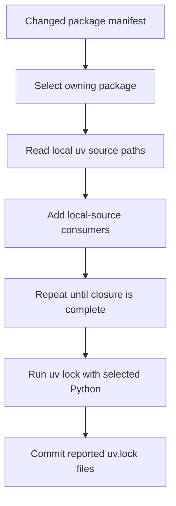
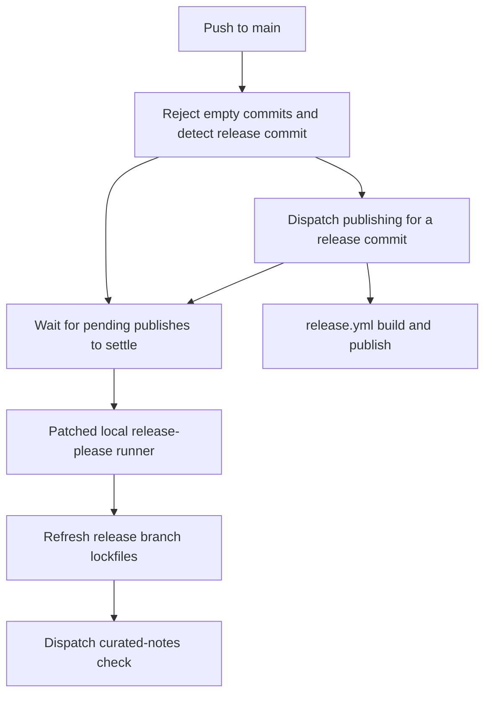

# Development and Release Operations

This repository is a monorepo of independently versioned packages under `libs/`, with no root `pyproject.toml`. Work in the owning package: its `pyproject.toml` defines the distribution contract and its `Makefile` is the supported task interface. See the [Quickstart](../quickstart.md) for initial setup and the [Testing Guide](../testing/testing-guide.md) for selecting package tests.

## Package-local development

Use `uv` for interpreters, environments, and dependencies, and `make` for normal package tasks. Do not use `pip`, Poetry, Conda, a manually activated shared environment, or a repository-wide Python pin. `requires-python` in each package manifest is the package's supported-Python contract.

```bash
uv tool install pre-commit
pre-commit install --install-hooks

cd libs/deepagents
uv sync --all-groups
make test
make lint
```

Run `make help` in the package to discover its targets. Use `uv run ...` for a direct one-off command. The aggregate targets in `libs/` can fan out work, but do not substitute for a package's own setup and targets.

| Layer | Meaning | Safe change rule |
| --- | --- | --- |
| `[project]` dependencies, extras, and `requires-python` | Published install and compatibility contract | Set version bounds deliberately for downstream users. |
| `[tool.uv.sources]` path mappings | Editable, checkout-local wiring to sibling packages | Do not mistake this for published dependency metadata. |
| `uv.lock` | Generated local/CI resolution state | Regenerate with `uv`; never hand-edit it. |

### Published contracts versus editable siblings

An editable source mapping can make local tests use a newer sibling checkout than an end user receives from PyPI. Treat tests through such mappings as insufficient proof of the published dependency boundary; build/install or otherwise validate the source-free published route when changing it.

For example, Code publishes `deepagents==0.7.39` but resolves `deepagents` from the editable `../deepagents` source locally. Code supports Python `>=3.14,<3.15`. Talon has the same Python range and publishes `deepagents>=0.7.39` plus `deepagents-code>=0.2.9,<1.0.0`; its local source mappings are likewise development wiring, not distribution metadata.

## Lockfile refresh is a reverse-consumer operation

A changed `pyproject.toml` may invalidate not only its own lock, but also every package that consumes it through a local `uv` source, transitively. From the repository root, refresh that closure and then check the directly changed package(s):

```bash
python .github/scripts/checks/refresh_lockfiles.py libs/code/pyproject.toml
python .github/scripts/checks/check_lockfiles_pre_commit.py libs/code/pyproject.toml
```



*The refresh operation includes the changed owner and all transitive local-source consumers.*

`refresh_lockfiles.py` delegates closure calculation to `stale_lock_dirs` and locks each resulting directory. The resolver policy is Python 3.14 for top-level ACP, Code, Evals, and Talon packages and Python 3.12 for all other discovered libraries, partners, and examples. Commit every printed lockfile; these are generated artifacts, not files to repair manually.

The checker intentionally has a narrower path mode: supplied paths select only directly touched package directories. With no paths it checks every discovered package; paths outside a package are a successful no-op. Run the no-argument form before merging broad dependency work:

```bash
python .github/scripts/checks/check_lockfiles_pre_commit.py
```

## Release ownership, scope, and generated state

The release registry is `release-please-config.json`; the release manifest records latest released baselines. It manages nine Python components with separate draft PRs, pre-1.0 bump behavior, and package-local changelogs: Deep Agents `0.7.39`, ACP `0.0.13`, Code `0.2.10`, Talon `0.1.0`, Daytona `0.0.9`, Modal `0.0.8`, Runloop `0.0.7`, Vercel `0.0.2`, and QuickJS `0.3.12`. Release Please is configured not to create GitHub releases itself; `release.yml` performs the publishing path after a merged release PR.

Do not hand-edit `.release-please-manifest.json`, generated release PR content, or generated changelog/version artifacts. When adding a managed package, add matching configuration and manifest entries. The manifest is a latest-released baseline: for an unshipped source version `0.0.1`, use baseline `0.0.0` so the first generated release is `0.0.1`.

Keep a bump-worthy `feat`, `fix`, `perf`, or `revert` change release-relevant in one managed component. Release Please assigns commits by changed paths, not their title scope. Each package excludes tests and its `uv.lock`, so relocking dependents does not itself release them; changing another package's source or manifest can fan out to separate release PRs. The scope workflow reads trusted base-revision configuration and a complete GitHub changed-file list, fails closed when it cannot establish that list, and blocks multi-component fan-out unless a maintainer explicitly applies `ci:allow-lockfile-release`. See [CI labeling](ci-labeling.md) for label operations.

## Release-please runner and lifecycle

The workflow uses the pinned npm package in `.github/release-please/`, rather than `googleapis/release-please-action`, because the repository needs patched behavior before upstream releases it. pnpm applies the patch during a frozen, script-free install; `run.mjs` exercises both patched behaviors before it calls GitHub: `exclude-paths` must match a single file and `==` component tags must parse correctly. An install whose patch no longer applies fails rather than silently changing release semantics.

`run.mjs` replaces the upstream GraphQL history iterator with a local full-history, blobless-clone walk. It fetches the default branch, provides release-please commits from `git log`, and removes the 500-commit search cap while Release Please still stops at each component's last release. The adapter obtains PR identity from squash `(#N)` or merge subjects, uses the commit message as the body by default, and fetches bodies carrying `BEGIN_COMMIT_OVERRIDE`; a rename is represented by both paths and a merge is diffed against its first parent. That preserves path-based component attribution without relying on slow or timeout-prone paginated history queries.



*Publishing dispatch is allowed before serialized release-PR maintenance; maintenance waits for a known-safe release state.*

An empty commit has no path for Release Please to assign, so it could fan out across every package; the workflow rejects it before release processing. It also waits for every merged PR still carrying `auto:release-pending`: a missing tag during an in-flight publish can make release computation treat a component as never released. The guard proceeds only after a positive all-clear, defers on a persistent in-flight publish, and fails if GitHub state is unreadable. The serialized runner is intentionally job-scoped, allowing publishing dispatch to occur while maintenance waits; the newest surviving maintenance run recomputes all components after a burst.

When a managed release PR is merged, release detection requires both its `release(<component>): <version>` subject and that component's `CHANGELOG.md` change. The workflow dispatches `release.yml`; that workflow resolves the package and an exact release SHA, then builds, pre-checks, publishes through TestPyPI and PyPI, and marks the release. Use manual dispatch only for recovery, with an exact SHA whose manifest declares the requested version; do not reuse or move a tag for a version already uploaded to PyPI.

## Curated release notes

Every managed release PR normally requires curated notes. Keep it draft while release-please is refreshing it; when ready, mark it ready for review, edit the marked bot draft without changing its version heading, and comment `@release-bot apply`. Apply updates only the package `CHANGELOG.md` and mirrors the note section to the PR body. The merged changelog is the source of the GitHub release body. `ci:skip-curated-notes` is the explicit bypass.

The drafter accepts only `anthropic`, `google_genai`, and `openai` `provider:model` specifications and requests schema-structured output. Its system prompt treats changelog material as data, permits only pull-request links, and fixes the output category order. Before writing the draft it rejects abnormal provider stops, malformed structured output, multiline entries, commit hashes, non-PR links, and missing or invented PR links. A network request is capped at ten minutes and the draft file is written with mode `0o600`.

After changes land on `main`, wait for the release-please run and the release branch's `Update lockfiles` job to finish before drafting or applying notes. Do not manually rebase or race that automation: it can replace the branch contents and invalidate reviewed notes. If new `main` changes touch the releasing package, generate a new draft; if an unrelated refresh overwrites previously applied notes, apply the stored draft again.

## Focused validation

Use the smallest relevant package checks first, then run automation tests when changing release infrastructure:

```bash
node --test .github/scripts/tests/release/release-please-history.test.mjs
uv run --no-project --with "pyyaml" pytest .github/scripts/tests/release/test_release_please_workflow.py
```

The history test creates a temporary Git repository to verify squash and merge PR reconstruction, first-parent merge files, rename handling, overrides, early iterator termination, and API failure behavior. The workflow test parses the workflow and evaluates the important `needs` conditions as truth tables, protecting dispatch-before-maintenance ordering and fail-closed guard, lockfile, labeling, and notes-dispatch gates.

For release-runner upgrades, update the pinned package and patch through pnpm's patch workflow, then compare a full-history local dry run with existing release PRs:

```bash
pnpm install --dir .github/release-please --frozen-lockfile --ignore-scripts
GITHUB_TOKEN="$(gh auth token)" GITHUB_REPOSITORY=langchain-ai/deepagents DRY_RUN=true \
  node .github/release-please/run.mjs
```

Do not turn off the dry run for exploratory validation. When changing package metadata, also regenerate the reverse-consumer lock closure and run the checker described above.
