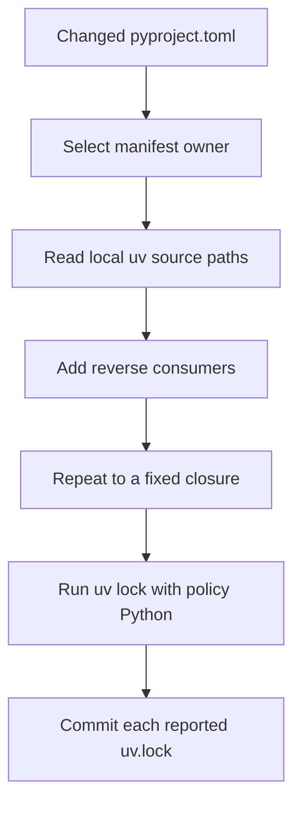

# Development and Release Operations

This repository is a monorepo of independently versioned Python packages. Work in the package that owns a change: packages under `libs/` have their own `pyproject.toml`, `Makefile`, and README, and there is no root `pyproject.toml`. A manifest is the published dependency contract; local `uv` source mappings make sibling packages editable during checkout development. See the [Quickstart](../quickstart.md) for initial setup and the [Testing Guide](../testing/testing-guide.md) for test selection.

## Package-local environment

Use `uv` to provision interpreters, environments, and dependencies; do not use `pip`, Poetry, Conda, or a shared manually activated environment. Each package's `requires-python` is its compatibility contract, rather than a repository-wide Python pin. Its `Makefile` is the supported task interface, so begin with `make help`.

```bash
uv tool install pre-commit
pre-commit install --install-hooks

cd libs/deepagents
uv sync --all-groups
make test
make lint
```

Use `uv run ...` for a one-off command. The aggregate `libs/Makefile` can fan out some operations, but it does not replace package-specific targets or their requirements.

### Dependency layers

| Layer | Owner and purpose | Change rule |
| --- | --- | --- |
| Published metadata | `[project]` dependencies, extras, and `requires-python` in `pyproject.toml` | This is what downstream users install. Choose bounds and pins deliberately. |
| Workspace wiring | `[tool.uv.sources]` path mappings | These select editable sibling checkouts locally; they do not change published metadata. |
| Resolved environment | Package-local `uv.lock` | Generated development and CI state. Regenerate with `uv`; do not edit it manually. |

Editable workspace sources can conceal an incompatibility in a released dependency: local tests can consume a sibling checkout even when an end user would receive an insufficient published version. Validate a source-free or installed route when changing a public dependency boundary.

Deep Agents and ACP publish support for Python `>=3.11,<4.0`; Code and Talon publish only `>=3.14,<3.15`. These ranges describe what each package supports, not necessarily the interpreter chosen to resolve its checked-in lockfile.

## Lockfile policy and refresh

The shared CI `uv_setup` action pins uv to `0.13.6`, requires a major.minor Python input, and normally enables a pruned dependency cache. Cache invalidation is intentionally limited to `pyproject.toml`, `uv.lock`, and `requirements*.txt` in the caller's working-directory scope.

The repository has two lockfile entrypoints with different interpreter mappings:

- `.github/scripts/checks/check_lockfiles_pre_commit.py` uses Python 3.14 for top-level ACP, Code, Evals, and Talon packages; it uses 3.12 for every other discovered library, partner, or example package.
- `make -C libs lock`, `lock-bump`, and `lock-check` map only ACP to 3.14 and all other packages to 3.12.

For changed Code, Evals, or Talon manifests, use the targeted scripts below rather than treating the aggregate Make target as CI-equivalent. The reusable `Check Lockfiles` workflow disables cache setup because `uv lock --check` does not create the cache directory that setup-uv would attempt to save; it invokes the checker with no paths and therefore checks every discovered package.

### Refresh the reverse-consumer closure

A manifest change can invalidate locks beyond its owning package. `refresh_lockfiles.py` starts from the owners of its supplied manifest paths, reads each discovered package's local `[tool.uv.sources]` paths, and repeatedly includes packages that consume an already selected local package. It then runs `uv lock --directory <directory> --python <selected version>` for every package in that reverse transitive closure and prints the resulting lockfile paths. Commit every printed `uv.lock`.



*The refresh path includes the changed package and its transitive local-source consumers.*

From the repository root:

```bash
python .github/scripts/checks/refresh_lockfiles.py libs/code/pyproject.toml
python .github/scripts/checks/check_lockfiles_pre_commit.py libs/code/pyproject.toml
```

The refresh tool computes the closure, but the checker intentionally does not. With paths, the checker tests only package directories directly touched by those paths; with no paths, it tests all discovered packages. If no supplied path belongs to a package, it succeeds as a no-op. At the first stale lock it returns `uv lock --check`'s failure and prints an exact non-check `uv lock` repair command. Run the complete final check with no paths:

```bash
python .github/scripts/checks/check_lockfiles_pre_commit.py
```

## Code's Deep Agents SDK contract

`deepagents-code` publishes an exact `deepagents==0.7.35` dependency, but its workspace configuration resolves `deepagents` from editable `../deepagents`. Thus local Code development does not exercise the version of the SDK that PyPI users receive. When Code begins to require a newer SDK capability, update the exact published pin and regenerate Code's lockfile with Python 3.14.

`make -C libs/code check` includes an SDK-pin comparison after its local checks. An equal or ahead pin succeeds. An older pin produces exit code 1 and is advisory to that Make target; missing, malformed, or unsupported version data produces exit code 2 and fails it. The release workflow is the hard gate against shipping Code with a pin older than the workspace SDK, unless its dangerous pin-check bypass is deliberately selected.

After an SDK release is published, the Code SDK-pin workflow creates or refreshes its marked automation PR only if Code's pin is behind. It preserves an ahead pin, updates Code's manifest and Python 3.14 lockfile together, and uses a `chore(deps):` commit so the maintenance update does not itself create an unintended Code release.

## Release boundaries and fan-out

Release Please tracks nine independently released package paths. Its present baselines are Deep Agents `0.7.35`, ACP `0.0.13`, Code `0.2.7`, Talon `0.1.0`, Daytona `0.0.9`, Modal `0.0.7`, Runloop `0.0.7`, Vercel `0.0.2`, and QuickJS `0.3.12`. Configuration assigns Python release handling, separate draft release PRs, and pre-1.0 version-bump behavior to every managed package. Release Please does not create the GitHub release; `release.yml` publishes after a release PR is merged.

When adding, removing, renaming, or changing the release-relevant paths of a package, reconcile `.release-please-manifest.json`, `release-please-config.json`, and release workflow routing. The manifest is release automation state: do not hand-edit an established entry except as part of adding a managed package. For a new first release at source version `0.0.1`, use a `0.0.0` manifest baseline unless `0.0.1` was previously released; otherwise Release Please treats `0.0.1` as already shipped and proposes `0.0.2`.

Keep a user-visible `feat`, `fix`, `perf`, or `revert` scoped to one owning component. A bump-worthy commit that touches lockfiles or other real files in another managed path can cause Release Please to open multiple release PRs. Put cross-package dependency and lockfile maintenance in a separate `chore(deps):` change when possible.

The release-please scope guard runs its detector and configuration from the trusted PR-base revision, fails closed if GitHub's changed-file list is incomplete, and requires `ci:allow-lockfile-release` to acknowledge detected bump-worthy lockfile-only or multi-component fan-out. See [CI labeling](ci-labeling.md) for label operations.

## Validation expectations

Run the smallest package-local checks that prove the changed behavior, then expand the validation scope when metadata crosses package boundaries.

- **Package implementation:** use the owning package's `make test` and `make lint`. Package tests distinguish network-free `tests/unit_tests/` from networked `tests/integration_tests/`; unexpected pytest warnings are errors unless explicitly accepted.
- **Manifest or local-source change:** use `refresh_lockfiles.py` on the changed manifest, commit the whole reported closure, and run the targeted checker. Before merging broad dependency work, run the checker without arguments.
- **Code SDK dependency:** update the exact pin if the change requires newer SDK behavior, regenerate the Code Python 3.14 lock, and run `make -C libs/code check`. Do not treat an editable-source test as proof of the published pin.
- **Code command registry change:** run `make -C libs/code commands-catalog`; Code's lint target verifies that `COMMANDS.md` matches the registry.
- **Repository hygiene:** `make -C libs hygiene` applies only its explicit text hooks to the configured changed-file range. Installed pre-commit hooks also run package formatting/linting for matching changed files, lock freshness for manifest or lock changes, and Conventional Commit validation.
- **Release configuration:** verify manifest/configuration/routing correspondence and avoid a bump-worthy multi-package dependency or lockfile commit unless the fan-out is intentional and acknowledged.
