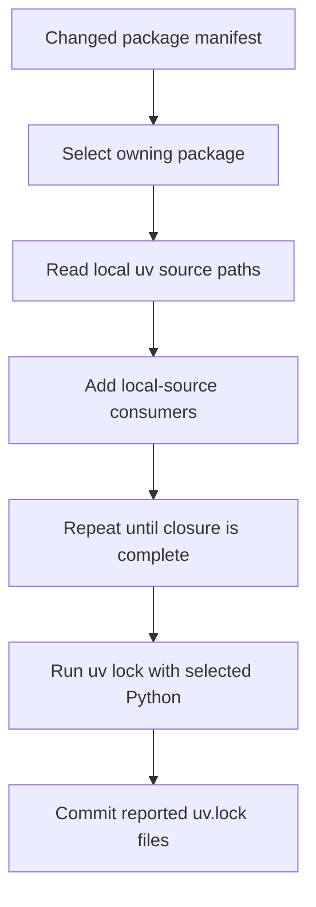
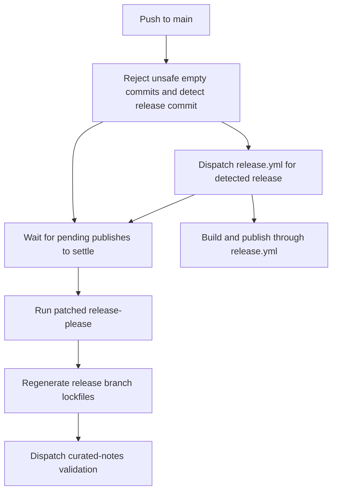

# Development and Release Operations

This repository is a monorepo of independently versioned packages under `libs/`, with no root `pyproject.toml`. Work in the owning package: its `pyproject.toml` defines the published contract and its `Makefile` is the supported task interface. See the [Quickstart](../quickstart.md) for initial setup and the [Testing Guide](../testing/testing-guide.md) for selecting package tests.

## Package-local development

Use `uv` for interpreters, environments, and dependencies, and `make` for ordinary package tasks. Do not use `pip`, Poetry, Conda, a manually activated shared environment, or a repository-wide Python pin. `uv` provisions an interpreter; each package's `requires-python` is its compatibility contract.

```bash
uv tool install pre-commit
pre-commit install --install-hooks

cd libs/deepagents
uv sync --all-groups
make test
make lint
```

Run `make help` in the package for its supported targets; use `uv run ...` for a one-off command. From `libs/`, aggregate targets fan out linting and lock operations across library, partner, and example packages, but they do not replace package-local setup.

| Layer | Meaning | Safe change rule |
| --- | --- | --- |
| `[project]` dependencies, extras, and `requires-python` | Published install and compatibility contract | Set downstream bounds deliberately. |
| `[tool.uv.sources]` path mappings | Editable, checkout-local sibling wiring | Do not treat it as published metadata. |
| `uv.lock` | Generated resolver state used by development and CI | Regenerate with `uv`; never hand-edit it. |

### Published contracts versus editable siblings

Editable mappings can make local tests exercise a sibling checkout newer than the distribution a user receives. Validate the source-free installation/build route when modifying this boundary. For example, Code publishes `deepagents==0.7.40` but maps `deepagents` to editable `../deepagents`; it supports Python `>=3.14,<3.15`. Talon has the same Python range, publishes `deepagents>=0.7.40` and `deepagents-code>=0.2.11,<1.0.0`, and uses local mappings only for development.

## Lockfiles: refresh the reverse-consumer closure

A changed manifest can invalidate its own lockfile and every package that consumes it through a local `uv` source, transitively. From the repository root, refresh that closure, then check the directly touched package(s):

```bash
python .github/scripts/checks/refresh_lockfiles.py libs/code/pyproject.toml
python .github/scripts/checks/check_lockfiles_pre_commit.py libs/code/pyproject.toml
```



*The manual refresh includes the changed owner and all transitive local-source consumers.*

`refresh_lockfiles.py` uses `stale_lock_dirs` to calculate this closure, runs `uv lock` per result, and prints every resulting `uv.lock`. ACP, Code, Evals, and Talon resolve with Python 3.14; other discovered libraries, partners, and examples resolve with Python 3.12. A lock failure stops the refresh, so do not commit a partial result as if it were complete.

The checker deliberately has narrower path mode: supplied paths select only directly touched package directories, while no paths checks every discovered package. Paths outside a package are a successful no-op. Before broad dependency work merges, run:

```bash
python .github/scripts/checks/check_lockfiles_pre_commit.py
```

The release-please workflow has a separate concern: after it creates or updates a release PR, its `Update lockfiles` matrix regenerates **all tracked** `uv.lock` files on that release branch. It uses the same 3.14 package set, serializes per release branch, and retries a rejected push by fetching the branch, regenerating again, and trying up to three times. This keeps generated version changes in release manifests synchronized without making lockfile-only changes release-worthy.

## Release ownership and scope

`release-please-config.json` is the package registry; `.release-please-manifest.json` records the last released baseline. It manages nine Python components with separate draft PRs, package-local changelogs, and pre-1.0 bump policy: Deep Agents `0.7.40`, ACP `0.0.13`, Code `0.2.11`, Talon `0.1.0`, Daytona `0.0.9`, Modal `0.0.8`, Runloop `0.0.7`, Vercel `0.0.2`, and QuickJS `0.3.12`. Release Please does not create GitHub releases itself; `release.yml` publishes after a release PR merges.

Do not hand-edit `.release-please-manifest.json`, generated release-PR content, changelog/version artifacts, or release-please branches. To add a managed package, update matching config, manifest, workflow detection/dispatch, and release mapping. The manifest is a last-released baseline: an unshipped `0.0.1` package needs baseline `0.0.0` to generate its first release.

Release Please scopes by changed paths, not the Conventional Commit title scope. A bump-worthy `feat`, `fix`, `perf`, or `revert` touching release-relevant files in two managed components is blocked by the scope workflow unless a maintainer applies `ci:allow-lockfile-release`. The detector runs trusted base-revision configuration, derives its candidate types and excluded paths from that config, and fails closed if GitHub's changed-file list is incomplete. Every configured package excludes `tests/` and its `uv.lock`, so tests or dependent relocks alone do not release a package. See [CI labeling](ci-labeling.md) for label operations.

## Patched release-please runner

The workflow installs a pinned local runner instead of `googleapis/release-please-action`, whose prebuilt bundle cannot carry unreleased fixes. The local package pins `release-please` `17.11.2` and pnpm `12.18.0`; the workspace applies a version-specific pnpm patch and an override for vulnerable `minimatch`. The frozen, script-free install fails if that patch no longer applies. Before it makes GitHub calls, `run.mjs` executes both patched behaviors: a single-file `exclude-paths` entry must exclude `uv.lock`, and a `deepagents-code==0.2.7` tag must parse its component and `==` separator correctly.

The runner replaces release-please's GraphQL history walk with a full-history blobless-clone `git log` iterator and removes the 500-commit cap. It reconstructs PR identity from squash `(#N)` or merge subjects, uses override PR bodies when present, represents merge files against the first parent, and emits both rename paths. Release Please still stops when it reaches the relevant component's last release, while the local history source avoids paginated history timeouts and preserves path attribution.

For an upgrade, use pnpm's patch workflow so the patch, workspace entry, and lockfile stay aligned; then compare a dry run with the open release PRs:

```bash
pnpm install --dir .github/release-please --frozen-lockfile --ignore-scripts
GITHUB_TOKEN="$(gh auth token)" GITHUB_REPOSITORY=langchain-ai/deepagents DRY_RUN=true \
  node .github/release-please/run.mjs
```

Keep `DRY_RUN=true` for exploratory validation. It prints candidate PRs and does not write to GitHub.

## Release lifecycle and failure boundaries



*Release dispatch occurs before serialized release-PR maintenance; maintenance runs only after a known-safe publishing state.*

The detector blocks empty commits because pathless commits cannot be safely assigned and can fan out across packages; it also rejects unsupported octopus merges. A release is recognized only when the `release(<component>): <version>` subject and that package's `CHANGELOG.md` change agree. The workflow dispatches `release.yml` with the named package, version, and exact merge SHA.

Before maintenance, the guard checks repo-wide merged PRs still labeled `auto:release-pending` (including a legacy label during migration). It waits up to 45 minutes for a publish to create its tag and clear the pending state; otherwise it defers maintenance. It fails loudly when GitHub state remains unreadable or an ordinary push finds a failed pending release, preventing release computation against a half-published baseline. A release commit can dispatch its publish before this guard; the serialized release-please job then recomputes remaining PRs. Cancellation of obsolete queued maintenance jobs is intentional: the newest surviving run recomputes every component.

`release.yml` resolves a package and validates an exact release SHA against the requested manifest version before build and publishing. Its sequence is build, pre-release checks, TestPyPI, PyPI, and GitHub release; it runs as top-level `workflow_dispatch` rather than a reusable workflow so PyPI Trusted Publishing can use its direct OIDC identity. Manual dispatch is recovery-only: use an exact SHA and do not move or reuse a version tag that PyPI already has.

## Curated release notes

The release-note drafter accepts only `anthropic`, `google_genai`, and `openai` `provider:model` specifications and asks those providers for schema-structured sections. It treats changelog source as untrusted data and validates the response before writing: abnormal completion, invalid structure, empty or multiline entries, commit hashes, non-PR links, missing required PR links, and invented links all fail. Requests time out after ten minutes; a validated draft is written with mode `0o600`.

After release-please updates a PR, wait for its lockfile job and the dispatched notes check rather than manually racing the release branch. New generated entries require a fresh draft. `ci:skip-curated-notes` is the explicit bypass.

## Focused validation

Start with the package checks affected by a change. For lockfile helper, scope gate, or release-runner changes, run the focused tests:

```bash
uv run --no-project --with "pytest" pytest \
  .github/scripts/tests/checks/test_check_lockfiles_pre_commit.py \
  .github/scripts/tests/checks/test_refresh_lockfiles.py \
  .github/scripts/tests/release/test_check_lockfile_release_scope.py
node --test .github/scripts/tests/release/release-please-history.test.mjs
uv run --no-project --with "pyyaml" pytest .github/scripts/tests/release/test_release_please_workflow.py
```

These tests protect direct-versus-transitive lock selection and resolver versions, release fan-out exclusions, local history reconstruction, and workflow condition truth tables for dispatch-before-maintenance and fail-closed guards. When package metadata changes, also refresh the reverse-consumer closure and run the no-argument checker.
