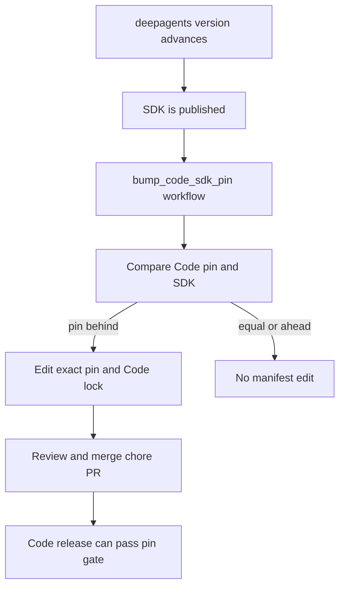
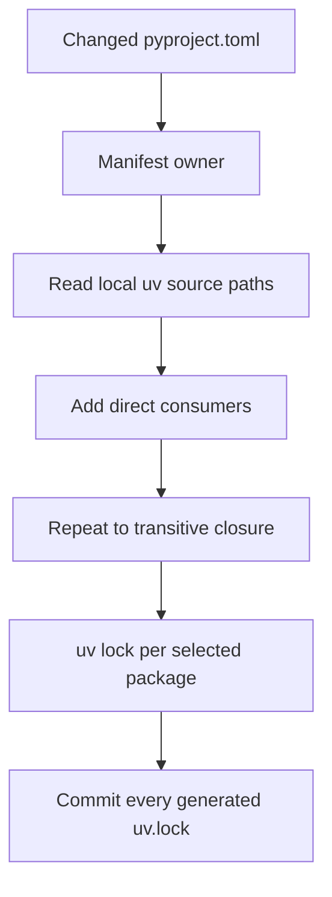

# Development, Dependencies, Lockfiles, and Releases

This repository is a monorepo of independently versioned Python packages. There is no root Python project: work from the package that owns the change, use its `pyproject.toml` for its public dependency contract, and use its `Makefile` for its normal checks. See the [Quickstart](../quickstart.md) for setup and the [Testing Guide](../testing/testing-guide.md) for test selection.

## Package-local development and dependency layers

`uv` provisions interpreters, virtual environments, synchronization, and resolution. Each package declares its own `requires-python`; do not impose a repository-wide interpreter pin. Install hooks and then synchronize the package you are changing:

```bash
uv tool install pre-commit
pre-commit install --install-hooks

cd libs/deepagents
uv sync --all-groups
make test
make lint
```

Use `make help` in the owning directory before assuming a target exists. `uv run ...` is appropriate for deliberate one-off commands. The shared CI setup pins uv to `0.13.6`, accepts a requested major.minor Python version, and by default uses a pruned dependency cache keyed to that working directory's manifests, locks, and requirements files.

A package dependency has three deliberately separate layers:

| Layer | Meaning | Safe change rule |
| --- | --- | --- |
| Published metadata | `[project]` dependencies, extras, and `requires-python` | This is the installer-visible compatibility contract. Declare the released versions and ranges that downstream users can install. |
| Workspace wiring | `[tool.uv.sources]` path entries | These editable sibling mappings apply to monorepo development; they are not wheel metadata. |
| Resolution | Package-local `uv.lock` | This is generated concrete closure for development and CI. Regenerate it with `uv`; do not hand-edit it. |

An editable sibling can make local tests pass while a published dependency floor is inadequate. When altering a public compatibility boundary, validate a source-free or installed-artifact path as well as the workspace path.

## Two ownership models: exact SDK pins and lower-bound floors

The distinction is intentional:

- **Exact pins are release-coupled compatibility decisions.** `libs/code/pyproject.toml` publishes `deepagents==0.7.32`, even though its `[tool.uv.sources]` maps `deepagents` to `../deepagents` for local work. Raise that pin in the change that starts depending on a newer SDK behavior; local editable development cannot prove that a PyPI install receives a sufficient SDK.
- **Range floors are ecosystem-maintenance input.** The scheduled updater raises compatible `>=` and `~=` floors for `langchain*`, `langgraph*`, `langsmith*`, and `deepagents*` dependencies. It deliberately does not change `==` pins, including Code's SDK pin.

`make -C libs/code check` runs the SDK comparison, but treats a stale older pin as advisory. It reports status 1 without failing the aggregate check; malformed or unsupported version data yields status 2 and fails. The release workflow is the hard boundary: it rejects a Code release whose pin is older than the workspace SDK unless `dangerous-skip-sdk-pin-check` is explicitly selected. The release-PR check also comments on stale pins; prerelease pins require the `ci:ack-release-deps` acknowledgement before that check passes.

After a published `deepagents` release, `release.yml` dispatches `bump_code_sdk_pin.yml`. The workflow only acts if the main-branch Code pin is behind the workspace SDK; it creates or updates its marked automation PR, changes exactly the quoted `deepagents==...` line, and regenerates `libs/code/uv.lock` with Python 3.14. A pin ahead of the workspace version is preserved for intentional prerelease coordination. Review and merge this `chore(deps):` PR before the next Code release.



*The exact Code pin is a separately reviewed release contract, not input to the broad lower-bound updater.*

## Automated stable lower-bound raises

`.github/workflows/raise_langchain_minimums.yml` runs daily at 09:00 UTC and can be dispatched for one managed release package or `all`. An optional comma-separated `dependencies` input narrows the run to exact, PEP 503-normalized distribution names; it replaces prefix matching rather than augmenting it. The workflow serializes runs at package granularity and uses an App installation token for branch and PR writes so the resulting PR runs normal `pull_request` checks.

The entrypoint is:

```bash
python .github/scripts/checks/raise_langchain_minimums.py --package deepagents-code
```

The script scans `[project.dependencies]`, `[project.optional-dependencies]`, and `[dependency-groups]`. For each in-scope `>=` or `~=` requirement, it obtains stable PyPI releases with a non-yanked file, chooses the newest one still admitted by the existing requirement range, and rewrites only the strongest floor. Upper bounds, extras, and markers survive. For `~=`, it retains the original component width so the compatible-release ceiling is not inadvertently narrowed. A floor already newer than PyPI's stable release is not lowered.

A versioned local path source remains eligible: its published floor still matters to PyPI users, but the candidate is capped at the local checkout's declared version so local `uv lock` can resolve. URL requirements, the package's own name, and local sources without a readable version are excluded. The script plans all manifest rewrites before writing any, avoiding a half-written multi-manifest run.

Automation fails closed rather than reporting an incomplete result as current: PyPI metadata failures, failed manifest rewrites, an empty broad scope, an unknown narrowed dependency, and a narrowed dependency with no raiseable floor all fail. A genuine no-op—requested raiseable floors already current—succeeds without opening a PR. Its PR body summarizes edits and explicitly identifies dependencies or manifests that could not be raised. The workflow verifies that every reported manifest actually changed before it stages the generated files, refreshes an existing bot-authored PR rather than duplicating it, and creates or updates one tracking issue if an unattended run fails.

Use `chore(deps):` for generated bump PRs. A releasable commit type inside managed package paths could otherwise cause Release Please multi-component fan-out.

## Lockfile closure and validation

A manifest update changes more than its own lock: a consumer lock can embed a requirement resolved through a local `[tool.uv.sources]` path. `refresh_lockfiles.py` and the updater share the targeted lock-checker's package discovery, reverse-consumer calculation, and Python-version policy.



*Lock regeneration starts with the manifest owner and includes every reverse transitive local-source consumer.*

From the repository root, manually refresh after a manifest change:

```bash
python .github/scripts/checks/refresh_lockfiles.py libs/code/pyproject.toml
make -C libs lock-check
```

The helper computes that closure and runs `uv lock --directory … --python …` for each selected package. The ordinary targeted checker instead checks package directories directly touched by supplied paths, or every discovered package if invoked without paths; an out-of-date lock reports the concrete repair command. Thus the helper is deliberately broader than the checker's diff selection.

The targeted checker uses Python 3.14 for ACP, Code, Evals, and Talon, and 3.12 for other discovered packages. `libs/Makefile` is a simpler fan-out interface: it maps only ACP to 3.14. Prefer the targeted refresher for dependency edits because its interpreter policy matches CI; use `make -C libs lock-check` as the broad package-local validation pass.

The lower-bound workflow writes `lock_specs` as `directory=python` pairs for its changed manifests plus reverse dependents, then locks each pair and verifies the expected `uv.lock` exists. Its optional `skip_dependent_locks` mode intentionally restricts regeneration to directly changed owners and leaves reverse consumer locks stale; use it only when that deferred incompatibility is understood and will be fixed.

## Release boundaries

Release Please manages nine independently released components. `.release-please-manifest.json` records their released baselines: Deep Agents `0.7.32`, ACP `0.0.13`, Code `0.2.4`, Talon `0.1.0`, Daytona `0.0.9`, Modal `0.0.7`, Runloop `0.0.7`, Vercel `0.0.2`, and QuickJS `0.3.11`. Configuration creates separate draft Python release PRs with pre-1.0 bump behavior and delegates publication to `release.yml`.

Release Please uses changed paths as well as Conventional Commit semantics. Keep user-facing `feat` or `fix` work contained to one managed component, and isolate cross-package dependency/lockfile maintenance in a separate `chore(deps):` change. The scope guard evaluates detector/configuration at the trusted PR base revision, fails closed if GitHub's changed-file list is incomplete, and requires `ci:allow-lockfile-release` to acknowledge bump-worthy lockfile-only or multi-component fan-out.

After a release PR merge, publication runs only when the commit is recognized as a release-form commit and changes that component's changelog; ordinary empty commits are blocked because no changed path could fan out to every component. The publisher builds the selected source SHA, validates normal releases are reachable from `main` and that package metadata matches the requested version, refuses an already published PyPI version, and carries SHA-256 sums across artifact boundaries before TestPyPI and PyPI publication. Manual recovery uses an exact 40-character source SHA whose metadata declares the requested version. Once published, a version must not be republished and its tag must not move.

Release Please serializes release-branch maintenance against pending publication across all packages: unreadable state blocks maintenance, a pending publish may defer a refresh, and recomputation waits because it covers all components.

## Release notes and focused validation

The release workflow generates GitHub release notes from the changelog at the selected release SHA, finds a reachable predecessor tag, and adds a package-scoped bounded Git log. Missing or unusable history is a warning, not fabricated history. `.github/scripts/release/build_release_notes.py` is also the recovery entrypoint: it can write to a file or GitHub output, supports `--offline` without GitHub attribution lookups, and fails loudly for an invalid package directory or unresolved SHA. Notes generation is intentionally fail-open after artifact prerequisites: publication and tagging proceed, but an empty GitHub release body must be repaired using the emitted recovery command.

Run focused validation for the layer you changed:

- Package implementation: run its `make test` and `make lint`; use `make -C libs/code check` when changing Code's package/release contract.
- Any manifest edit: run `refresh_lockfiles.py` for the changed manifest, commit the entire reported closure, then run `make -C libs lock-check`.
- Lower-bound updater changes: run `pytest .github/scripts/tests/checks/test_raise_langchain_minimums.py`. These tests cover range preservation, exact-pin exclusion, local-version caps, narrowing failure semantics, closure, branch identity, and workflow package-option parity.
- Release-note changes: run `pytest .github/scripts/tests/release/test_build_release_notes.py`; it checks release-SHA extraction/history behavior, recovery output, and workflow/helper package-map parity.
- Managed package, release mapping, or release-label changes: update the Release Please config and manifest together with relevant workflow mappings. Consult [`.github/RELEASING.md`](https://github.com/langchain-ai/deepagents/blob/main/.github/RELEASING.md) for operational release and incident procedures.
