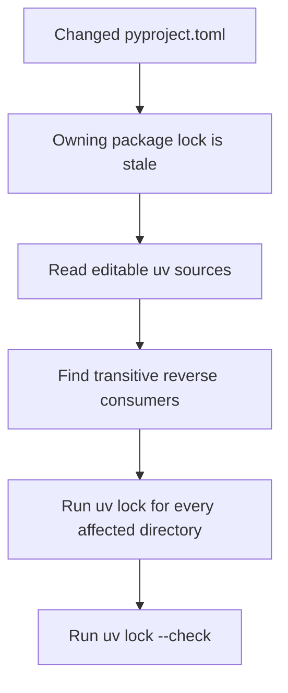

# Development, Dependencies, and Releases

This is a monorepo of independently versioned distributions under `libs/`, not a root Python project. Work in the package that owns a change: its `pyproject.toml` declares its published compatibility contract, its `Makefile` defines supported developer commands, and it owns the relevant uv environment and `uv.lock`. See the [architecture overview](../architecture/overview.md), [sandbox partners](../integrations/sandbox-partners.md), [quickstart](../quickstart.md), and [Testing Guide](../testing/testing-guide.md) for adjacent topics.

## Package-local development

Use `uv` for interpreters, environments, and dependencies; do not substitute `pip`, Poetry, or Conda. `uv` provisions an appropriate interpreter, so there is no repository-wide Python installation to impose. Run `make help` in the package, synchronize there, and use its targets for ordinary work rather than a shared environment.

```bash
uv tool install pre-commit
pre-commit install --install-hooks

cd libs/deepagents
uv sync --all-groups
make test
make lint
```

`uv sync --all-groups` installs the selected package and its declared groups. Prefer package `make` targets; use `uv run ...` for a direct one-off command. The Deep Agents and Code Makefiles set `UV_FROZEN=true`, so their normal commands do not silently repair stale locks.

In those two packages, `make test` runs the `test` group with parallel pytest, non-Unix sockets disabled and Unix sockets allowed; `TEST_FILE` narrows the target. `make integration_test` selects integration tests with a 30-second timeout. `make lint` verifies Ruff formatting, runs Ruff checks, and runs `ty`; `make format` applies Ruff formatting and safe fixes. Code additionally provides `make check`, a local CI-parity gate for linting, imports, tests, extras synchronization, version-marker equality, and lock freshness. Its SDK-pin check treats exit status `1` as advisory, but propagates other failures.

External contributors must link an approved issue or discussion and be assigned before opening a PR. Use a Conventional Commit title with a scope, and keep bump-worthy work scoped to one releasable component; put cross-package dependency or lockfile churn in a separate `chore(deps):` PR.

## Manifest contracts, pins, and local sources

A package's `requires-python` is its published runtime contract, not necessarily the interpreter used to resolve its lock. ACP and QuickJS require Python 3.11 or newer; Code and Talon require Python 3.12 or newer; Deep Agents supports Python 3.11 or newer below Python 4. Current core floors include `langchain>=1.4.6,<2.0.0` in Deep Agents, Code, Talon, and QuickJS; where declared, Deep Agents, Talon, and QuickJS use `langchain-core>=1.6.11,<2.0.0`; Talon and QuickJS use `langgraph>=1.2.15,<2.0.0`.

Published requirement constraints and local development mappings are deliberately different things. A constraint such as Code's `deepagents==0.7.28` is what an installed consumer receives from PyPI. In contrast, `[tool.uv.sources]` maps a dependency name to an editable sibling path only while resolving the workspace. Do not weaken a published exact pin merely to make local development convenient.

Code is currently `0.1.86` in project metadata and its release-please version marker, and its changelog begins with that release. Its exact `deepagents==0.7.28` pin is a minimum-SDK contract: when `dcode` starts using newly required SDK functionality, update the pin in the same PR. Do not defer it to a release PR or convert it to `>=`; the scheduled floor updater does not manage exact pins. An intentionally older pin requires the release bypass (`ci:dcode-skip-sdk-pin` on a release PR, or `dangerous-skip-sdk-pin-check` for a manual dispatch).

### The editable-consumer closure

Code maps Deep Agents, ACP, and listed partner integrations to editable sibling paths. Other packages do likewise, such as Talon consuming both Deep Agents and Code. A consumer lockfile embeds the producer's requirements as well as its own declarations. Therefore a producer manifest change makes the producer lock **and every transitive local-path consumer lock** stale; never hand-edit `uv.lock`.



*Editable local sources turn a manifest change into a transitive reverse-consumer lockfile closure.*

The checker discovers library, partner, and example package directories. With no paths it checks all package locks; with paths it checks packages those paths touch. The refresh helper computes the reverse closure for changed manifests and runs `uv lock` for it:

```bash
python .github/scripts/checks/refresh_lockfiles.py libs/code/pyproject.toml
```

Both helpers use Python 3.14 for ACP and Python 3.12 for every other discovered package. A stale check prints the root-relative repair command. From `libs/`, the aggregate Makefile offers the broader operations below; its fan-out recipes stop at the first failure.

| Command | Purpose |
| --- | --- |
| `make lock [no-cache]` | Resolve all discovered library, partner, and example locks; `no-cache` adds `--no-cache`. |
| `make lock-check` | Run `uv lock --check` for every discovered owner. |
| `make lock-bump DEP=<pkg>` | Re-resolve every discovered lock with `-P <pkg>`; `DEP` is required. |
| `make lint` / `make format` | Fan out to discovered library packages. |

CI calls the reusable lockfile workflow for pull requests, pushes to `main`, and merge groups, enforcing the same ACP-3.14/other-3.12 resolution policy.

## Scheduled dependency maintenance

`raise_langchain_minimums.yml` runs daily at 09:00 UTC or manually for a release component or `all`. Its updater raises only `>=` and `~=` floors for in-scope PyPI-resolved `langchain`, `langgraph`, `langsmith`, and `deepagents` requirements. It preserves upper bounds, extras, markers, and compatible-release ceilings; leaves exact pins and already-higher floors alone; plans writes before applying them; and fails rather than treating unresolved metadata or invalid narrowing as current.

When floors change, it reports locks for the complete editable-consumer closure, and the workflow regenerates those locks before creating or refreshing a generated dependency PR. `skip-dependent-locks` intentionally reports direct package locks only, so use it only when the reverse-consumer repair is planned separately.

`bump_genai_prices.yml` is distinct: daily it upgrades `genai-prices` in Code's lock within the declared range, raises the manifest floor to the resolved version, and refreshes affected locks. A moved allowed pin or a floor behind that pin is staleness; a newer version merely present on PyPI is not. The workflow safely reuses its bot branch and PR, does not overwrite a human tip, and reports a stable release capped by the manifest ceiling or an execution failure through deduplicated tracking issues.

## Release state, scopes, and publication

### Managed release lines

The release-please manifest records released baselines, not development-version inputs. It currently manages these nine independently released lines:

| Component / distribution | Path | Baseline |
| --- | --- | --- |
| `deepagents` | `libs/deepagents` | `0.7.28` |
| `deepagents-acp` | `libs/acp` | `0.0.13` |
| `deepagents-code` | `libs/code` | `0.1.86` |
| `deepagents-talon` | `libs/talon` | `0.0.9` |
| `langchain-daytona` | `libs/partners/daytona` | `0.0.8` |
| `langchain-modal` | `libs/partners/modal` | `0.0.6` |
| `langchain-runloop` | `libs/partners/runloop` | `0.0.7` |
| `langchain-vercel-sandbox` | `libs/partners/vercel` | `0.0.2` |
| `langchain-quickjs` | `libs/partners/quickjs` | `0.3.9` |

Unlisted package directories are not release-please-managed merely because they have a manifest or can be selected by the manual release workflow. Adding managed coverage requires both a `release-please-config.json` package entry and a manifest baseline. For a never-published `0.0.1` package, use a `0.0.0` baseline so its first release is `0.0.1`; do not manually edit an established baseline.

Release-please creates separate draft Python release PRs, maintains each package changelog and version files, and uses `release(${component}): ${version}` titles. All managed packages are pre-1.0, so a feature becomes a patch bump and a breaking feature a minor bump. Only `feat`, `fix`, `perf`, and `revert` are shown in generated changelog sections; documentation, chore, refactor, test, CI, style, and hotfix types are hidden. Release-please is configured with `skip-github-release`; `release.yml`, not release-please, publishes artifacts and creates GitHub releases.

Keep a bump-worthy change scoped. Component attribution is path based, so ordinary empty commits are rejected before release-please can fan them out to every package. After a release PR merge, detection requires both a matching `release(component): version` title and that component's `CHANGELOG.md` change.

### Release PR lifecycle and curated notes

After releasable commits land on `main`, let release-please finish refreshing the package release PR **and its `Update lockfiles` job**. Do not manually rebase, merge `main` into, or edit the release branch while that automation is queued or running: it can replace changes, invalidate reviewed notes, or race a note application. The lockfile update is required because release-please changes the package version in `pyproject.toml` but does not regenerate `uv.lock`.

The generated PR body is a preview; the merged package `CHANGELOG.md` supplies the published GitHub release body. Keep the release PR draft while work accumulates. When ready, mark it ready for review, edit the `release-bot` draft comment while keeping its version heading, then comment `@release-bot apply`. The bot writes the package changelog and mirrors the notes to the PR body; merge only after the `curated release notes` check passes. Use this process separately for every release PR in a fan-out release.

Run `@release-bot draft` again if automatic drafting failed or later `main` changes touch that package. A release-branch lockfile-only refresh caused by unrelated work does not invalidate a draft. Use `ci:skip-curated-notes` only to intentionally ship the generated changelog without curation. Curated-notes-only apply commits may skip package lint/test jobs, but CI accepts them only by reusing a successful parent CI result.

The curation workflow derives the package from the release branch and runs automation from trusted `main`; it reads release-PR content through the API rather than checking it out or executing it. It serializes commands per PR without canceling an in-flight draft or apply operation.

### Publication and recovery boundary

After a release PR merge, the publisher maps the component to a working directory, resolves an exact release SHA, and validates source-version consistency for normal releases. It builds from that SHA, rejects an already-published or unverifiable PyPI version, runs pre-release checks, publishes to TestPyPI and then PyPI through trusted publishing, and creates the tag and GitHub release from the same source tree. The exact-SHA policy preserves the invariant that a PyPI version and its GitHub tag identify the same code.

Release-note generation is deliberately non-blocking: failure does not stop publishing or GitHub-release creation, so a successful release can have an empty release body. If a release fails before PyPI publication, repair it with a hotfix that retains the target version and manually dispatch from that exact SHA. Once PyPI has the version, do not retag or republish it; release a new version instead.

The post-merge release workflow dispatches publication before it refreshes other open release PRs. It waits for every merged PR still marked `auto:release-pending` to settle before recomputing release-please state, because a missing tag alongside an updated manifest can make release-please propose a bootstrap downgrade. A successful publisher marks the release PR from `auto:release-pending` to `auto:release-tagged`.

Manual dispatch is an exception path for recovery, backports, or prereleases. For normal manual releases, supply the version and a 40-character `release-sha` whose `pyproject.toml` declares that version. `dangerous-nonmain-release` is the explicit escape hatch for a non-main throwaway prerelease branch; do not commit PEP 440 prerelease version shapes to `main` or a long-lived version branch, because release-please cannot safely maintain them.
