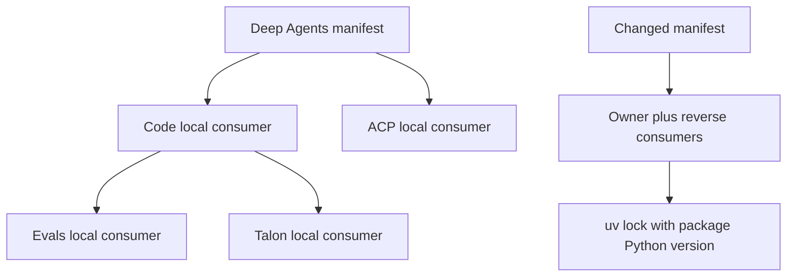
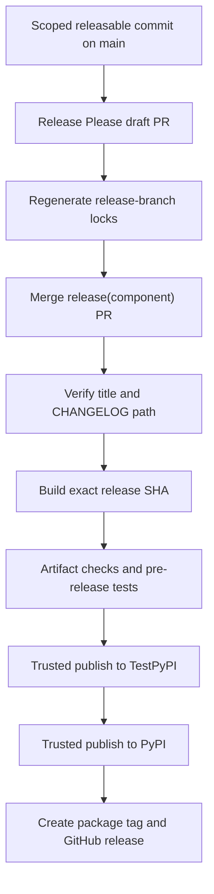

# Development, Dependencies, Lockfiles, and Releases

This repository is a monorepo of independently versioned Python packages. There is no root Python project: make changes, synchronize dependencies, and run the owning package's commands in its directory. For routine test selection, see the [Testing Guide](../testing/testing-guide.md); for the package layout and first setup, see [Quickstart](../quickstart.md).

## Work package-first

`uv` owns Python installation, virtual environments, synchronization, and resolution. Each package's `pyproject.toml` declares its supported Python range and published dependency contract; each `Makefile` is the normal interface for test, lint, and format commands. Do not impose a repository-wide interpreter pin.

```bash
uv tool install pre-commit
pre-commit install --install-hooks

cd libs/deepagents
uv sync --all-groups
make test
make lint
```

Use `make help` in the target directory before assuming a target exists; use `uv run ...` for intentional one-off commands. The shared CI setup takes a required major.minor Python version, pins uv to `0.13.6`, and by default uses a pruned cache keyed only by the selected working directory's manifests, locks, and requirements files.

A package's dependency setup has three distinct layers:

| Layer | Owner and meaning | Change rule |
| --- | --- | --- |
| Published metadata | `[project]` dependencies, extras, and `requires-python` | The installer-visible compatibility contract. State released versions and supported ranges here. |
| Workspace wiring | `[tool.uv.sources]` path entries | Development-only sibling mappings for uv; they do not become wheel metadata. |
| Resolution | Package-local `uv.lock` | The generated, concrete environment used by development and CI. Regenerate with uv; never hand-edit it. |

Local editable sources can hide a published constraint that is too old. Test an installed artifact or source-free resolution when changing a public compatibility boundary.

### Code and the SDK pin

`deepagents-code` declares an exact `deepagents==0.7.32` requirement while mapping the SDK and sibling packages to editable local paths for monorepo work. Raise that pin in the change that begins relying on newer SDK behavior; otherwise local development can pass while downstream installs receive an insufficient SDK.

`make -C libs/code check` runs the pin check as an advisory: an older pin produces exit status 1, which the Makefile reports without failing the aggregate check. Malformed or unsupported version data instead returns status 2 and is an error. Publication is stricter: the release workflow rejects a Code artifact whose pin is older than the workspace SDK unless `dangerous-skip-sdk-pin-check` was explicitly selected.

## Lockfiles and reverse-consumer fan-out

Locks are package-local, including library, partner, and example projects. The targeted lock checker discovers library directories with `Makefile`s, partner directories with `Makefile`s, and each direct example directory containing a `pyproject.toml`. It checks packages touched by supplied paths, or every discovered package when no paths are supplied. Its repair diagnostic includes the exact `uv lock --directory … --python …` command.

The checker resolves ACP, Code, Evals, and Talon with Python 3.14; other discovered packages use Python 3.12. This intentionally differs from the broad `libs/Makefile`, which maps only ACP to 3.14. Prefer the targeted refresh command after a manifest edit, then use broad fan-out checks as additional validation.

A manifest edit can invalidate a consumer's lock even when that consumer's own manifest is unchanged. `refresh_lockfiles.py` parses local `[tool.uv.sources]` paths, starts with the changed manifest owner, repeatedly adds packages consuming any marked package, and locks the complete reverse-transitive closure using the checker’s Python policy.



*Manifest changes propagate to local-source consumers; each selected package receives its own lock regeneration.*

From the repository root, refresh a changed manifest and commit every printed lockfile:

```bash
python .github/scripts/checks/refresh_lockfiles.py libs/code/pyproject.toml
make -C libs lock-check
```

The helper is deliberately broader than the ordinary checker: the checker tests directly touched package directories, whereas the helper protects consumer locks affected through local sources.

## Release Please boundaries and fan-out control

A managed distribution must appear in both `release-please-config.json` and `.release-please-manifest.json`. The manifest is the latest released baseline, not the version currently present in a development checkout or a dependency constraint. A first managed package intended to release `0.0.1` should have a `0.0.0` manifest baseline.

Nine managed baselines currently exist: Deep Agents `0.7.32`, ACP `0.0.13`, Code `0.2.4`, Talon `0.1.0`, Daytona `0.0.9`, Modal `0.0.7`, Runloop `0.0.7`, Vercel `0.0.2`, and QuickJS `0.3.11`. Release Please creates separate draft Python release PRs. All use pre-1.0 behavior: `feat` produces a patch bump and a breaking feature produces a minor bump. The generated visible changelog sections are Features, Bug Fixes, Performance Improvements, and Reverted Changes.

Release Please scopes a bump-worthy commit by changed paths, not merely by Conventional Commit scope. Keep a user-facing `feat` or `fix` within one managed component; put cross-package lower-bound and lockfile churn in a separate `chore(deps):` change. The PR scope guard runs its detector and configuration from the trusted base revision, obtains the complete changed-file list through the GitHub API, and fails closed when that list is incomplete. It blocks a bump-worthy PR that either changes non-lock files in multiple managed components or changes only a managed package lockfile. `ci:allow-lockfile-release` is an explicit, reviewed acknowledgement—not a way to suppress the fan-out.

Do not push ordinary empty commits to `main`. With no changed paths, Release Please cannot assign the commit and can fan out to every component. The release workflow rejects them before Release Please runs, apart from its narrow history-repair exception for an empty `hotfix(repo):` merge whose introduced commits all touch files.

## Publication lifecycle

On a `main` push, the release workflow detects a release only when both the commit subject matches `release(<component>): <version>` and that component’s `CHANGELOG.md` changed. It dispatches `release.yml` as a top-level workflow, rather than a reusable workflow, to support PyPI Trusted Publishing.



*Normal release path: the published artifact and package tag are tied to the same selected source commit.*

The release build resolves a package to its working directory, validates that a normal release SHA is reachable from `main`, and verifies that its `pyproject.toml` declares the requested version. It builds at that detached SHA, records distribution SHA-256 sums, and verifies the downloaded artifact against those sums in both TestPyPI and PyPI publication jobs. Before publishing, it queries PyPI’s per-version endpoint and aborts on an existing version, unexpected response, or connectivity failure. Pre-release checks install and test the built distribution rather than trusting the checkout environment.

For recovery, dispatch `release.yml` with the exact 40-character `release-sha` whose package metadata declares the intended version. `dangerous-nonmain-release` is for explicitly selected branch releases and relaxes the normal `main`/input-version validation. If a failure happened before PyPI publication, a corrective hotfix may retain the version and be dispatched by its exact SHA. After a version reaches PyPI, never republish it and never move or recreate its tag: publish a new version instead.

The release publisher labels the matching merged release PR from `auto:release-pending` to `auto:release-tagged`. Release Please waits for pending publication state across the repository before recomputing other release branches, because it recomputes all components and must not observe a manifest bump before its tag exists. An unreadable state blocks maintenance; a publish still in progress can defer it to the next push.

## Release-note reconstruction and failure recovery

`release.yml` builds the GitHub release body with `.github/scripts/release/build_release_notes.py`. The workflow checks out the artifact source at the selected release SHA and separately checks out the helper from the workflow revision, then passes the workflow-resolved package directory and the same authoritative prerelease flag used for GitHub’s prerelease setting. Tests pin this wiring and require the script's package map to match the workflow's selectable package/working-directory map.

The helper reads `CHANGELOG.md` **at the release SHA**, extracts only the requested version section, appends a package-scoped Git log, and adds an immutable full-changelog link. It resolves a predecessor tag from reachable package tags, including earlier same-base prereleases; missing or unreachable history produces warnings instead of silently claiming a reliable initial release. The log and attribution are bounded: at most 100 commits and a size budget are rendered, and GitHub API lookups for contributors, closed-issue reporters, and merger are capped and warn when incomplete. `--offline` skips those API lookups, allowing local reconstruction from a full clone with tags.

Run this recovery from a repository clone with full history and tags:

```bash
python .github/scripts/release/build_release_notes.py \
  --package deepagents-code \
  --version 0.2.4 \
  --sha <release-sha> \
  --repo langchain-ai/deepagents \
  --out /tmp/release-body.md

gh release edit "deepagents-code==0.2.4" \
  --repo langchain-ai/deepagents \
  --notes-file /tmp/release-body.md
```

Use `--offline` when API attribution is unavailable; omit it when `gh` authentication is available and contributor/releaser credit should be rebuilt. For a non-default branch release, also pass `--base-branch` (and `--default-branch` when it is not `main`) to preserve provenance. The CLI fails for an unresolvable SHA or invalid package directory, writes `--out` atomically, and prints the assembled body if an output-file failure would otherwise lose it.

Release-note generation is intentionally fail-open: a notes failure does not block TestPyPI, PyPI, tag, or GitHub release creation after artifacts are ready. The resulting GitHub release can therefore have an empty body; the marking job emits an error and a paste-ready reconstruction command in the run summary. Treat warnings or an empty body as an operator task after publication, not as proof that the released artifact is invalid.

## Focused checks when changing this area

- For a package change, run its `make test` and `make lint`; for Code's aggregate parity target, use `make -C libs/code check`.
- After changing a manifest, run `refresh_lockfiles.py` with the changed manifest and commit its complete closure; then run `make -C libs lock-check`.
- Changes to release-note rendering should run `pytest .github/scripts/tests/release/test_build_release_notes.py`. The tests cover exact-version changelog extraction, predecessor selection across stable and prerelease histories, release-SHA bounds, log-size limits, contributor API degradation, CLI recovery output, and workflow/script map and flag parity.
- Changes to managed packages, release paths, or release labels must update the matching Release Please config/manifest and the detection/dispatch mapping together. Consult [`.github/RELEASING.md`](https://github.com/langchain-ai/deepagents/blob/main/.github/RELEASING.md) for curated-note, prerelease, and incident procedures.
