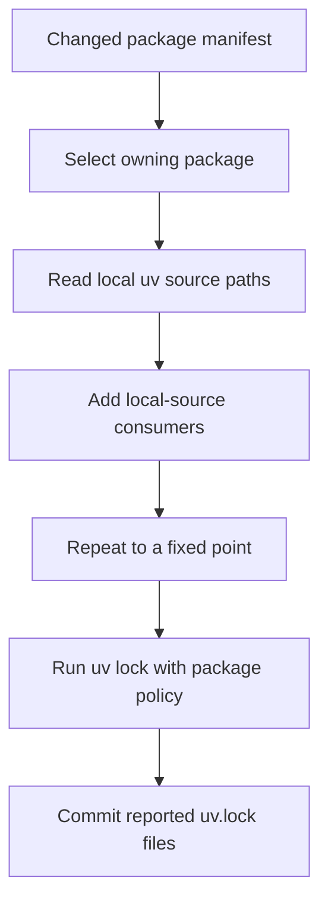
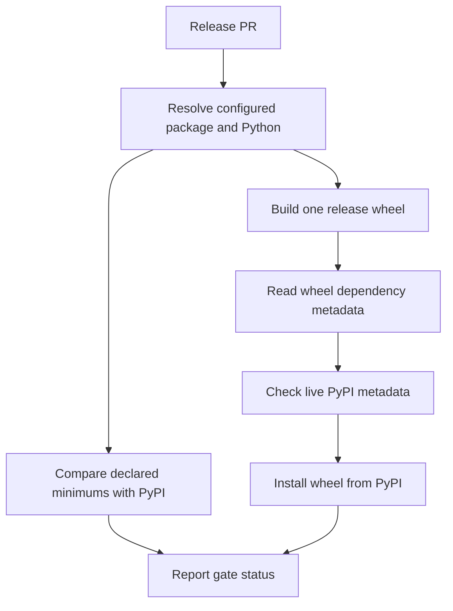
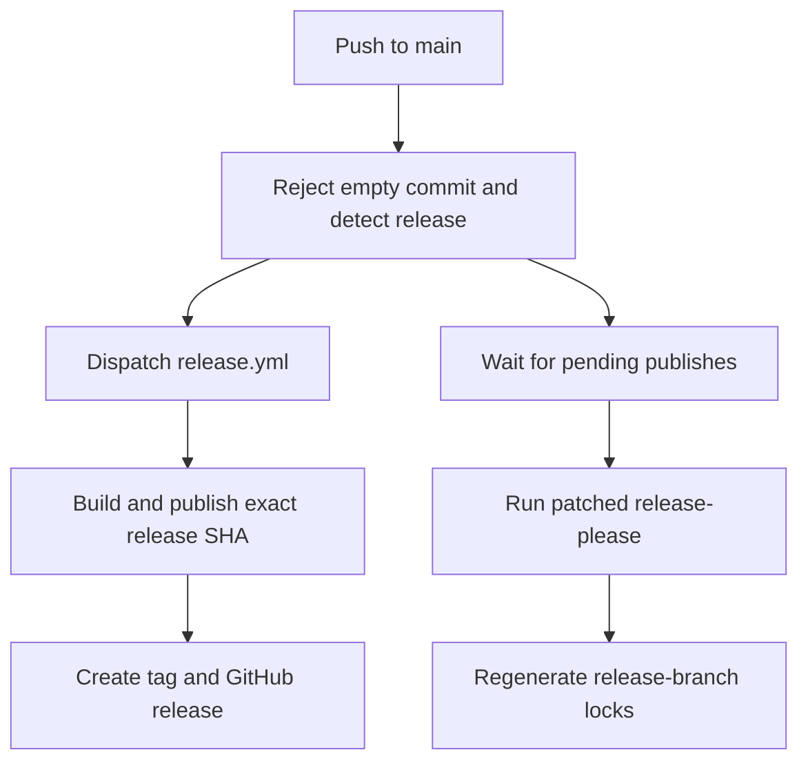

# Development and Release Operations

This repository contains independently versioned packages under `libs/` and no root `pyproject.toml`. Work in the package that owns the change: its `pyproject.toml` is the published contract and its `Makefile` is the supported task interface. See [Quickstart](../quickstart.md) for initial setup and the [Testing Guide](../testing/testing-guide.md) for package tests.

## Package-local development and metadata layers

Use `uv` for interpreters, environments, and dependencies, and `make` for ordinary package tasks. `uv` provisions the needed interpreter, so packages—not the repository—own Python compatibility through `requires-python`. Start in the package directory, synchronize explicitly, and use its advertised targets:

```bash
uv tool install pre-commit
pre-commit install --install-hooks

cd libs/deepagents
uv sync --all-groups
make test
make lint
```

Run `make help` in a package for its supported targets; use `uv run ...` for a one-off command. From `libs/`, aggregate targets fan out linting and lock operations across discovered library, partner, and example packages, but do not replace package-local setup.

| Layer | Owner and meaning | Safe change rule |
| --- | --- | --- |
| `[project]` dependencies, extras, and `requires-python` | Published wheel metadata and compatibility contract | Set downstream bounds deliberately; this is what an installer receives. |
| `[tool.uv.sources]` path mappings | Checkout-local editable sibling wiring | Do not treat it as published metadata or release compatibility evidence. |
| `uv.lock` | Generated development/CI resolution for one package | Regenerate with `uv`; do not hand-edit it. |
| `release-please-config.json` | Managed distribution registry, paths, changelog targets, and release behavior | Change alongside release wiring when adding or changing a managed distribution. |
| `.release-please-manifest.json` | Last released version baseline for each managed path | Let managed release operations update it; it is not package metadata. |

### Editable workspaces are not published installs

A green editable environment does **not** prove that the wheels users install can resolve. Local source mappings can exercise a sibling checkout newer than the distribution on PyPI; the release artifact gate deliberately tests the other boundary.

For example, Code publishes an exact `deepagents==0.7.41` requirement while mapping `deepagents` to editable `../deepagents`. Its Python contract is `>=3.14,<3.15`. Talon has the same Python range, publishes `deepagents>=0.7.41` and `deepagents-code>=0.2.12,<1.0.0`, and maps both siblings only for local development. Raise an exact downstream pin in the PR that first needs the new sibling behavior—do not defer it to release time.

## Lockfiles: refresh the reverse-consumer closure

A changed `pyproject.toml` can invalidate its own lockfile and every package that consumes it through a local `uv` source, transitively. From the repository root, refresh that closure and then check the directly touched packages:

```bash
python .github/scripts/checks/refresh_lockfiles.py libs/code/pyproject.toml
python .github/scripts/checks/check_lockfiles_pre_commit.py libs/code/pyproject.toml
```



*The refresh operation covers the changed owner and all transitive local-source consumers.*

`refresh_lockfiles.py` uses `stale_lock_dirs` to compute that reverse closure, runs `uv lock` for each result, and prints each resulting `uv.lock`; a resolver failure stops the operation. The resolver policy is Python 3.14 for ACP, Code, Evals, and Talon, and Python 3.12 for the other discovered packages. In contrast, the path-mode checker intentionally checks only package directories directly touched by its supplied paths; with no paths it checks every discovered package, and paths outside packages are a successful no-op. Before broad dependency work merges, run:

```bash
python .github/scripts/checks/check_lockfiles_pre_commit.py
```

The aggregate `libs/Makefile` applies the same package discovery and Python policy through `lock`, `lock-check`, and `lock-bump DEP=<pkg>` targets.

When release-please creates or updates a release PR, its separate lockfile job regenerates every tracked `uv.lock` on the release branch. If its branch push loses a race, it fetches the new tip, regenerates and commits again, up to three attempts. This keeps generated locks synchronized with release version changes without making lockfile-only edits release-worthy.

## Managed release baselines and scope

`release-please-config.json` is the source of truth for the nine managed Python distributions, their paths, components, changelog targets, and excluded paths. `.release-please-manifest.json` records the current last-released baselines: Deep Agents `0.7.41`, ACP `0.1.0`, Code `0.2.13`, Talon `0.1.1`, Daytona `0.0.9`, Modal `0.0.8`, Runloop `0.0.7`, Vercel `0.0.2`, and QuickJS `0.4.0`. The configuration creates separate draft release PRs and skips GitHub-release creation; `release.yml` performs publication after a release PR is merged.

Do not hand-edit generated release-PR artifacts, manifest versions, or release branches in ordinary development. Adding a managed distribution is an integration change: align the release config and manifest with release detection, dispatch/package mapping, and artifact validation. For an unshipped `0.0.1` package, use a `0.0.0` manifest baseline so release-please can propose its first release.

Release attribution is path-based, rather than based on the Conventional Commit scope. A bump-worthy PR that changes release-relevant files in two managed components is blocked unless a maintainer applies `ci:allow-lockfile-release`. The gate reads the detector and configuration at the trusted base revision, excludes configured `tests/` and `uv.lock` paths, and fails closed if GitHub's changed-file listing is incomplete. The bypass acknowledges an intentional fan-out; it does not prevent the fan-out. See [CI labeling](ci-labeling.md) for label operations.

## Release-PR dependency gate

On a release-please PR, dependency freshness and artifact validation are separate checks. The workflow first compares declared minimums with PyPI, then resolves the configured release target from the PR title, builds exactly one wheel, validates the wheel's installed metadata, and installs it into a new target-Python environment using only `https://pypi.org/simple`. Non-release PRs explicitly skip artifact validation.



*The gate validates the built artifact and public index separately from editable workspace resolution.*

The validator reads `Requires-Python`, `Requires-Dist`, and extras from wheel `METADATA`. It rejects malformed metadata, direct URL dependencies, unavailable PyPI metadata, unsatisfied constraints, and incompatible Python support. It evaluates dependency markers across declared extras and representative platform environments. A PyPI-query failure is indeterminate and fails validation instead of assuming availability.

For repository-managed sibling dependencies, the newest eligible published release must have `Requires-Python` equivalent to the current sibling manifest, allowing only a redundant next-major ceiling. This prevents a new, unpublished sibling metadata constraint from being hidden by an older release that happens to satisfy a version range. For third-party dependencies only, a cap that excludes only a contiguous suffix of unreleased CPython minors is a warning; a gap at the package floor, within a released minor, or at patch level remains a failure.

The source-free install unsets `UV_PYTHON` so the created target interpreter, rather than the workflow setup interpreter, controls installation. Treat this build-and-install route—not `uv sync` in a checkout—as evidence that a proposed distribution can be installed by users.

## Patched release-please runner

The release workflow uses a pinned local runner rather than `googleapis/release-please-action`, because the action bundle cannot carry unreleased fixes. It pins `release-please` `17.11.2` and pnpm `12.18.0`; pnpm applies a version-specific patch and overrides vulnerable `minimatch` versions. A frozen, script-free install fails when the patch no longer applies. Before making GitHub calls, the runner directly verifies that a single-file `exclude-paths` rule excludes `uv.lock` and that `deepagents-code==0.2.7` parses with the component and `==` separator intact.

The runner replaces release-please's GraphQL history walk with a full-history, blobless-clone `git log` iterator and removes the 500-commit cap. It derives PR identity from squash or merge subjects, uses a fetched override PR body when present, compares merge files with the first parent, and reports both paths for a rename. Release-please still stops at each component's last release; the local history source avoids long paginated walks while preserving path attribution.

For a runner or patch upgrade, regenerate the pnpm patch artifacts together and compare an exploratory dry run with open release PRs:

```bash
pnpm install --dir .github/release-please --frozen-lockfile --ignore-scripts
GITHUB_TOKEN="$(gh auth token)" GITHUB_REPOSITORY=langchain-ai/deepagents DRY_RUN=true \
  node .github/release-please/run.mjs
```

`DRY_RUN=true` prints candidates and does not write to GitHub. Use a full-history clone.

## Release lifecycle and handoff



*For a merged release PR, publishing is dispatched before serialized release-PR maintenance.*

Release processing rejects ordinary empty commits because no paths would otherwise scope them; it recognizes a release when its `release(<component>): <version>` subject and that package's changelog change agree. It dispatches `release.yml` with the named package, version, and exact merge SHA. Before recomputing release PRs, the workflow waits for repository-wide PRs still labeled `auto:release-pending` to reach a known-safe state. Unknown GitHub state fails closed; a genuinely stuck publish defers maintenance to a later push rather than recomputing against half-published version/tag state.

`release.yml` resolves the requested package to a working directory and requires a valid commit SHA for normal mainline releases. It verifies that the manifest at that SHA declares the requested version and that the SHA is reachable from `main`, then builds and publishes from that same tree. Its documented sequence is build, pre-release checks, TestPyPI, PyPI, and GitHub release. Build and trusted-publishing jobs are separated: publishing consumes and verifies the built artifacts rather than rebuilding them. The workflow is dispatched instead of reusable so PyPI Trusted Publishing retains a direct OIDC identity. Do not move or recreate a tag for a version already published to PyPI.

## Focused validation

Start with the owning package's tests and Make targets. When changing lockfile, release-scope, release-history, or wheel-validation operations, run their focused tests:

```bash
uv run --no-project --with "pytest" pytest \
  .github/scripts/tests/checks/test_check_lockfiles_pre_commit.py \
  .github/scripts/tests/checks/test_refresh_lockfiles.py \
  .github/scripts/tests/release/test_check_lockfile_release_scope.py \
  .github/scripts/tests/release/test_check_wheel_dep_freshness.py
node --test .github/scripts/tests/release/release-please-history.test.mjs
uv run --no-project --with "pyyaml" pytest .github/scripts/tests/release/test_release_please_workflow.py
```

Wheel-validator coverage includes sibling metadata lag, marker and extra applicability, unsafe Python coverage gaps, direct URLs, Actions-output escaping, and matching source-free install flags between the release-PR gate and publication workflow. For a package-metadata change, refresh the reverse-consumer closure, run the no-argument lock checker, and rely on the release-PR artifact gate for published-wheel evidence.
