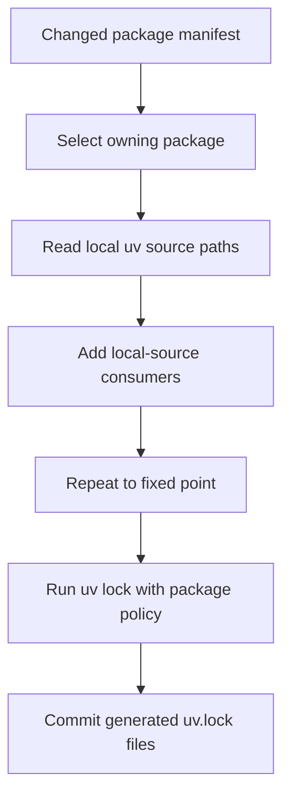
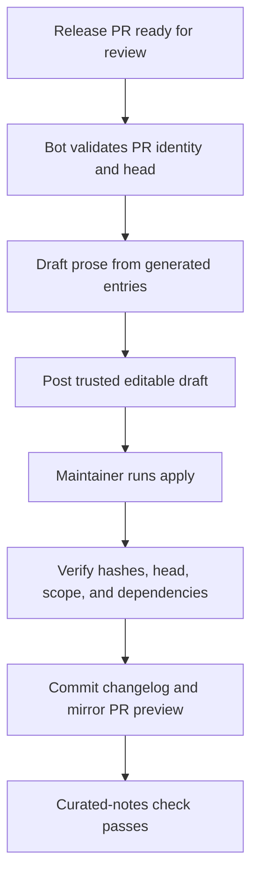
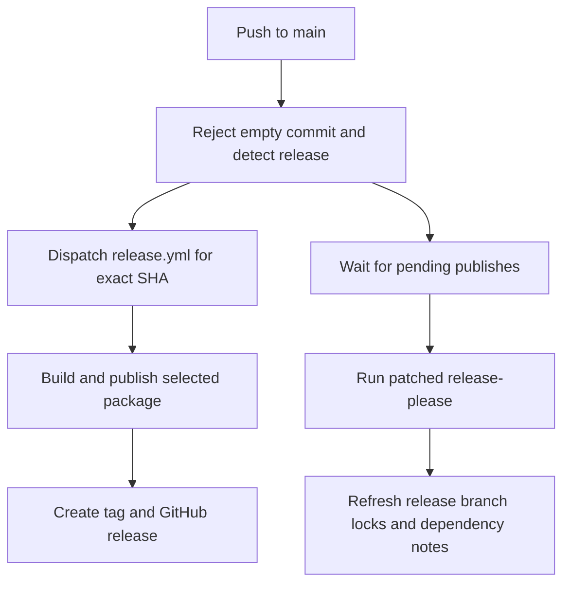

# Development and Release Operations

This monorepo has independently versioned packages under `libs/`, not a root Python project. Develop in the package that owns a change. Its `pyproject.toml` is the published compatibility contract and its `Makefile` is the supported interface. See [Quickstart](../quickstart.md) for initial setup and the [Testing Guide](../testing/testing-guide.md) for package tests.

## Package-local development and dependency contracts

Use `uv` for interpreters, environments, and dependencies, and `make` for normal tasks. `uv` provisions the required interpreter; each package owns its supported range through `requires-python`.

```bash
uv tool install pre-commit
pre-commit install --install-hooks

cd libs/deepagents
uv sync --all-groups
make test
make lint
```

Use `make help` in a package to discover its targets and `uv run ...` for an exceptional one-off command. From `libs/`, the aggregate `Makefile` fans out operations over library, partner, and example packages, but does not replace package-local setup.

| Layer | Meaning | Operational rule |
| --- | --- | --- |
| `[project]` dependencies, extras, `requires-python` | Wheel metadata installed by users | Treat this as the public compatibility contract. |
| `[tool.uv.sources]` | Editable sibling checkout wiring | Never use local resolution as evidence that the published graph resolves. |
| `uv.lock` | Generated package development and CI resolution | Regenerate with `uv`; never hand-edit. |
| `release-please-config.json` | Managed paths, components, changelogs, exclusions, and release behavior | Update as release integration wiring. |
| `.release-please-manifest.json` | Last released baseline at each managed path | Release-please owns ordinary updates. |

### SDK, Code, and Talon compatibility

`deepagents-code` publishes an exact `deepagents==0.7.41` requirement while its workspace maps `deepagents` to the editable `../deepagents` checkout. Thus a successful Code workspace can use unreleased sibling code and is not proof of the PyPI installation a user receives. Raise the exact Code SDK pin in the PR that first requires new SDK behavior; do not postpone it to a release PR. A deliberately older pin requires the documented `ci:dcode-skip-sdk-pin` acknowledgement.

Talon is Python `>=3.14,<3.15`, publishes `deepagents>=0.7.41` and `deepagents-code>=0.2.13,<1.0.0`, and maps those packages locally only for development. Its floor means Talon releases must follow a published Code release that satisfies it.

## Lockfile propagation

A changed package manifest can invalidate its own lock and every transitive consumer that uses it as a local `uv` source. Refresh the **reverse-consumer closure**, then check direct changed package paths:

```bash
python .github/scripts/checks/refresh_lockfiles.py libs/code/pyproject.toml
python .github/scripts/checks/check_lockfiles_pre_commit.py libs/code/pyproject.toml
```



*The refresh operation includes the changed owner and all transitive local-source consumers.*

`refresh_lockfiles.py` resolves that closure and stops on resolver failure. The checker deliberately checks only directly touched packages when paths are supplied; without paths it checks every discovered package. The shared policy uses Python 3.14 for ACP, Code, Evals, and Talon, and Python 3.12 for the other packages. For broad dependency work, run the no-argument check:

```bash
python .github/scripts/checks/check_lockfiles_pre_commit.py
```

The release branch is also automated: after release-please creates or refreshes a PR, its lockfile job regenerates every tracked lock and dependency-note section. On a rejected branch push it fetches the tip, regenerates, and retries up to three times. Generated locks and their propagation are therefore committed output, not handwritten release changes.

## Release-please ownership and scope

The registry manages nine distributions. Current manifest baselines are Deep Agents `0.7.41`, ACP `0.1.0`, Code `0.2.14`, Talon `0.1.1`, Daytona `0.0.9`, Modal `0.0.8`, Runloop `0.0.7`, Vercel `0.0.2`, and QuickJS `0.4.0`. Configuration creates separate draft PRs and skips GitHub-release creation; the dispatched `release.yml` workflow publishes after a release PR merges.

Release-please owns version/manifest updates and generated release-PR artifacts. Do not manually rebase a release branch, merge `main` into it, or edit it while an update is queued. Wait for both the `release-please.yml` run for the relevant `main` commit and the release PR's **Update lockfiles** job to finish before review or note curation.

Attribution is path-based, not solely Conventional Commit scope. The configuration excludes each package's tests and `uv.lock`; a bump-worthy PR touching release-relevant files in more than one managed component is blocked unless a maintainer applies `ci:allow-lockfile-release`. That acknowledgement permits the intentional fan-out; it does not stop the additional releases. The gate reads trusted base configuration and fails closed if GitHub's changed-file response is incomplete.

`feat`, `fix`, `perf`, and `revert` appear in generated changelogs. Current packages are pre-1.0: `feat` produces a patch bump and a breaking `feat!` produces a minor bump. Hidden commit types can still ship with an existing release but do not add their own visible entry. Dependency range changes remain visible through the generated dependency section described below.

## Curated release notes

Every managed release PR is eligible because the notes workflow derives its component from the trusted internal release-branch name and confirms it against the registry and `release(<component>): <version>` title. The workflow runs trusted automation from `main`; it reads release-branch content through the API at a validated SHA rather than checking out or executing it. Only maintainers with write-level permission can issue manual commands.

1. Keep a release PR draft while changes accumulate. Mark it ready for review to create a bot-authored draft.
2. Review and edit the marked draft comment, retaining its version heading and generated `### Dependencies` section.
3. Comment `@release-bot apply`. The guarded flow writes the curated section to that package's `CHANGELOG.md` and mirrors it to the PR preview.
4. Merge only after the `curated release notes` gate passes. `ci:skip-curated-notes` is the explicit, exceptional bypass when generated notes are intentionally shipped unchanged.



*Curated prose is a guarded transformation of release-please output, not a direct edit to generated release artifacts.*

The model receives generated changelog entries as untrusted source material, but never the dependency subsection. The workflow restores that subsection verbatim, so dependency ranges cannot be reworded or dropped. It validates exactly one release section, binds drafts to bot identity, component, version, release head, generated-entry fingerprint, and (for new drafts) the `main` baseline. It rejects altered headings, changed generated entries, edited dependencies, stale package changes, untrusted comments, concurrent PR/body changes, and branch-head races. A release-branch rewrite caused solely by unrelated `main` changes can retain a package-scoped draft; unknown, incomplete, or package-relevant change detection requires a fresh draft.

Use `@release-bot draft` to redo a failed draft or after new `main` changes affect that package. It may take up to 500 characters of one-line editorial guidance; a second `@` ends the guidance. `apply` ignores trailing instructions and republishes the stored draft. Re-drafting updates the original bot comment in place and posts a pointer comment; commands are serialized per PR rather than cancelling an in-flight curation. A manual command is acknowledged with 👀 and changed to 🚀 when it succeeds.

The automatic dependency generator diffs the package `pyproject.toml` from the resolved predecessor tag to the release branch head and inserts, replaces, or removes `### Dependencies` in that version section. It warns and leaves the changelog untouched if it cannot compute the list, so a dependency-note problem cannot block lock regeneration. Because the published GitHub release body is extracted from the merged `CHANGELOG.md`, this keeps dependency metadata changes visible from one source of truth.

## Release lifecycle and publication



*Publishing a detected merged release is dispatched before serialized release-PR maintenance.*

Empty commits are rejected because they contain no paths to scope and could fan out a release to every component. A release is detected only when the `release(<component>): <version>` subject and that package's `CHANGELOG.md` change agree. Before recomputing PRs, the workflow waits for every merged PR still marked `auto:release-pending`, since any package between version bump and tag creation makes repository-wide version computation unsafe. An unreadable GitHub state fails closed; a publish that remains in flight is deferred rather than recomputed against partial state.

`release.yml` resolves a named package and exact release SHA, verifies the version in that tree and normal mainline reachability, then builds and publishes the same tree. The operational sequence is build, pre-release checks, TestPyPI, PyPI, and GitHub release. A version that has reached PyPI is immutable: never move or recreate its tag; publish a new version for a fix.

The repository runs a pinned, patched local `release-please` runner rather than the upstream action. It uses full-history blobless `git log` attribution instead of the GraphQL walk and removes the 500-commit cap, while retaining path attribution for merge and rename cases. Its frozen pnpm install applies version-specific patches and validates them before GitHub calls. Upgrade the runner and patch artifacts together, then compare a full-history dry run with open release PRs.

## Focused validation

For dependency or package metadata changes, run package tests, refresh the reverse-consumer closure, and run the all-package lock check. For release automation, use focused tests that protect the actual failure boundaries:

```bash
uv run --no-project --with "pytest" pytest \
  .github/scripts/tests/checks/test_check_lockfiles_pre_commit.py \
  .github/scripts/tests/checks/test_refresh_lockfiles.py \
  .github/scripts/tests/release/test_check_lockfile_release_scope.py \
  .github/scripts/tests/release/test_build_release_notes.py
node --test .github/scripts/tests/release/release-notes.test.js
node --test .github/scripts/tests/release/release-please-history.test.mjs
uv run --no-project --with "pyyaml" pytest .github/scripts/tests/release/test_release_please_workflow.py
```

The release-note tests cover exact PR identity, untrusted/fork rejection, command permission and ambiguity, head-change retries, marker and heading injection resistance, stale-state detection, dependency immutability, and non-force application. The Python release-body tests cover predecessor-tag selection across stable and pre-release versions, SHA-bounded changelog extraction, bounded and escaped package history, and dependency-section updates. These tests matter whenever changing the note protocol, its parser, release tags, or publication body construction.
