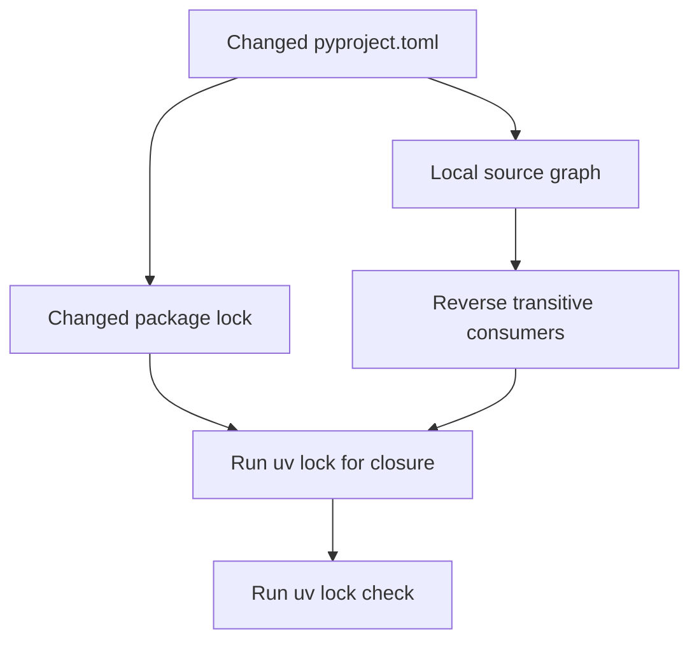
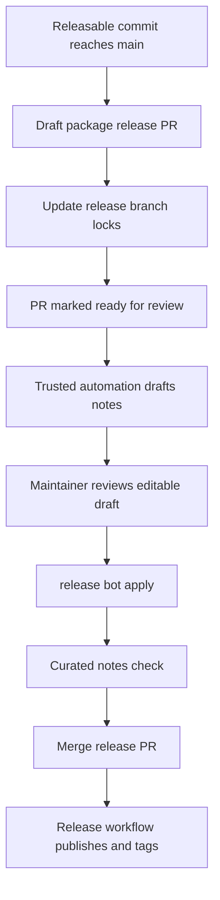

# Development, Dependencies, Lockfiles, and Releases

This repository is a monorepo of independently versioned packages under `libs/`; it is not a root Python project. Work in the package that owns a change: its `pyproject.toml` defines package metadata and public installation constraints, its `Makefile` defines its supported commands, and its `uv.lock` records a concrete development resolution. For runtime orientation, see the [architecture overview](../architecture/overview.md); for test selection, see the [Testing Guide](../testing/testing-guide.md).

## Package-local development

Use `uv` for interpreters, environments, and dependency installation, and use `make` from the package directory for normal development. `uv` provisions an appropriate interpreter, so contributors should follow each package's `requires-python` rather than impose a repository-wide Python pin. Start by installing hooks, synchronizing the changed package, then use its advertised targets (`make help` is the local command inventory).

```bash
uv tool install pre-commit
pre-commit install --install-hooks

cd libs/deepagents
uv sync --all-groups
make test
make lint
```

`uv sync --all-groups` installs the package plus its declared dependency groups. Use `uv run ...` for a deliberate one-off command rather than substituting a different package manager. The pre-commit installation supplies commit-message and pre-push checks; rerun `pre-commit install --install-hooks` in an existing checkout after hook changes.

Keep a bump-worthy user-facing change in one releasable component. A cross-package dependency or lockfile update is normally a separate `chore(deps):` change: Release Please uses changed paths to assign work, so combining it with a `feat` or `fix` can create unintended release PRs for consumers. PR titles use scoped Conventional Commits, and external contributors need an approved linked issue or discussion and an assignment before opening the PR.

## Three separate dependency concerns

Do not conflate package source metadata, local development wiring, and resolved lock state:

| Layer | Owner and purpose | Change consequence |
| --- | --- | --- |
| Published metadata | `[project]`, especially `dependencies`, optional dependencies, and `requires-python` in a package's `pyproject.toml` | The contract an installer can resolve from package indexes. Bounds must represent supported public combinations. |
| Local source wiring | `[tool.uv.sources]` in that same manifest | Directs `uv` to sibling checkout paths, often editable, for monorepo development only. It does not alter published wheel metadata. |
| Resolution output | That package's `uv.lock` | Pins the resolution used locally and in checks; regenerate it with `uv`, never hand-edit it. |

For example, Code publishes an exact `deepagents==0.7.32` requirement, a bounded QuickJS requirement, and a bounded ACP requirement, but its uv source map points those distributions to sibling directories. ACP and QuickJS similarly publish a Deep Agents requirement while mapping `deepagents` to a local editable path. Evals consumes local Code, Deep Agents, and QuickJS; Talon consumes local Deep Agents and Code. Editable sources make in-repository testing coherent, but they do not prove that released metadata is satisfiable from PyPI.

### The Code SDK-pin rule

`deepagents-code`'s exact `deepagents==X.Y.Z` dependency is a minimum SDK compatibility assertion, not a release-time bookkeeping value. Raise it in the same PR that begins using the new SDK functionality. Its editable source means a local checkout can otherwise conceal an obsolete pin. The release guide describes exceptional labels for deliberately older or coordinated prerelease pins; they are escape hatches, not a reason to weaken the normal invariant.

## Lockfiles: refresh the reverse consumer closure

A local-source consumer lock includes its producer's dependency information. Thus a changed manifest can make its own lock stale and can make every transitive consumer lock stale. The required repair set is the changed package plus the reverse transitive closure of packages that reach it through `[tool.uv.sources]` paths.



*Manifest changes require locks for the owner and all discovered editable-source consumers.*

Because Evals and Talon declare dcode as a local source, a dcode manifest change puts `libs/code`, `libs/evals`, and `libs/talon` in the direct affected lockfile set before any additional transitive consumers are discovered. The helper calculates rather than assumes the final closure: it discovers package manifests, resolves each path source relative to its manifest, and repeatedly adds consumers until none remain.

From the repository root, refresh locks for a changed manifest with:

```bash
python .github/scripts/checks/refresh_lockfiles.py libs/code/pyproject.toml
```

The helper runs `uv lock --directory <package> --python <version>` once for each member of that closure and prints the resulting lock path. The corresponding checker accepts changed paths: with none it checks every discovered package, otherwise it checks owners of the supplied paths. It uses Python 3.14 for first-party ACP, Code, Evals, and Talon; other discovered packages use Python 3.12. A stale lock failure prints the exact repair command. The aggregate `libs/` targets remain useful for broad work: `make lock`, `make lock-check`, and `make lock-bump DEP=<pkg>` fan out over packages.

Treat `uv.lock` as generated resolution state. Some package Makefiles deliberately set `UV_FROZEN=true`, so routine commands reveal a stale lock instead of repairing it as a side effect. Resolve explicitly, review and commit the generated locks, then rerun the owning package's checks.

## Release Please state and scope

Release Please manages a package only when it is represented in both `release-please-config.json` and `.release-please-manifest.json`. The manifest records the latest released baseline, rather than the working package version or dependency metadata. A newly managed package whose source begins at `0.0.1` uses a `0.0.0` manifest baseline if its first generated release should be `0.0.1`.

| Distribution | Path | Manifest baseline |
| --- | --- | --- |
| `deepagents` | `libs/deepagents` | `0.7.32` |
| `deepagents-acp` | `libs/acp` | `0.0.13` |
| `deepagents-code` | `libs/code` | `0.2.2` |
| `deepagents-talon` | `libs/talon` | `0.1.0` |
| `langchain-daytona` | `libs/partners/daytona` | `0.0.9` |
| `langchain-modal` | `libs/partners/modal` | `0.0.7` |
| `langchain-runloop` | `libs/partners/runloop` | `0.0.7` |
| `langchain-vercel-sandbox` | `libs/partners/vercel` | `0.0.2` |
| `langchain-quickjs` | `libs/partners/quickjs` | `0.3.11` |

Configuration creates separate draft Python release PRs titled `release(${component}): ${version}`. All currently configured components use pre-1.0 behavior: `feat` produces a patch bump and a breaking feature produces a minor bump. Generated changelogs expose `feat`, `fix`, `perf`, and `revert`; configured documentation, style, chore, refactor, test, CI, and hotfix types are hidden.

`skip-github-release` deliberately separates proposal from publication: Release Please creates or refreshes release PRs, while `release.yml` performs publication. On a `main` push, the release workflow first blocks ordinary empty commits because a pathless commit could otherwise fan out to every component. It identifies a merged release by its `release(component): version` title and the matching package changelog change, then dispatches the publication path.

Before merge, the release-please parse check reconstructs the would-be squash-merge message and uses the exact-pinned Conventional Commits parser. It blocks malformed bodies that Release Please would otherwise silently omit from changelog processing, but it intentionally does not decide package-path assignment or scope correctness.

## Curated notes: trusted automation over untrusted PR data

After releasable commits reach `main`, wait for Release Please and its release-branch lockfile update to finish. Do not manually rebase, merge `main` into, or edit a release branch while automation is queued or running: a refresh can replace changes or race note application.



*The release PR carries a generated preview; curation applies reviewed prose to both the package changelog and that preview before merge.*

The release-notes workflow runs from a trusted `main` checkout, not from the release PR. It derives the component from a validated internal release-branch name and requires that the open PR targets `main` and that its title names the same component. The component registry comes from `release-please-config.json`, so an added configured component is covered without duplicating a package list. PR text, changelog content, branch names, and model output are treated as untrusted API data: they are fetched at validated SHAs and are never checked out or executed as workflow code.

### Draft and apply operator flow

1. Keep the release PR as a draft while commits accumulate. When ready, mark it ready for review; this automatically requests a draft. A maintainer with write access can also comment `@release-bot draft`, optionally followed by a short one-line editorial instruction.
2. Review and edit the bot-authored draft comment, retaining its generated version heading. The expected sections follow the generated changelog ordering; the draft must retain the eligible PR links rather than invent arbitrary references.
3. Comment `@release-bot apply`. Apply only accepts the valid bot-authored draft for that component and version, updates that package's `CHANGELOG.md`, mirrors the same section into the release-PR preview, and advances the branch without rewriting history.
4. Merge only after the required `curated release notes` check passes. `ci:skip-curated-notes` is the explicit opt-out when intentionally publishing the uncurated generated changelog.

Manual commands are accepted only on a ready, internal release PR and only from a maintainer with write-level permission. Ambiguous comments containing more than one command are rejected. Commands are serialized per PR (`cancel-in-progress: false`), so a second command queues rather than cancelling an in-flight draft or apply. A successful manual command changes its acknowledgement reaction from eyes to rocket; failures are surfaced on the PR and in workflow logs.

### Freshness and integrity checks

Drafting reads the generated version section at the validated release-branch head, fingerprints the generated entries separately from the heading, and stores trusted state outside the model process's writable work directory. It revalidates the release PR identity and head before posting. Model output must be nonempty section content only: metadata markers and extra version headings are rejected so output cannot forge trusted comment state.

Applying revalidates the bot identity by both configured login and immutable numeric ID, the PR identity and head, the draft revision, and the generated changelog fingerprint. A scoped draft remains usable after an unrelated `main` change refreshes the release branch, including harmless heading restyling; a new change under the released package path requires a new draft. Apply fails closed if a generated entry appeared, the version heading changed, the preview terminator is ambiguous, or concurrent edits change the PR/draft while it prepares. The required check then verifies that applied metadata, changelog section, preview, and branch ancestry agree; a mere comment is not sufficient.

The workflow gives the drafting process only the selected provider credential and a fixed model call, while short-lived GitHub App credentials perform comments, PR-body updates, and the non-force Git Data API branch update. This separation is essential: trusted-main automation may mutate an internal release branch, but untrusted release-PR material must never acquire shell, filesystem, network-tool, or workflow-code authority.

Focused Node tests exercise the release identity checks, command authorization and ambiguity handling, exact section extraction, prompt/output sanitization, stale-head retries, package-scoped draft freshness, concurrent apply rejection, and the required-check agreement across metadata, changelog, preview, and ancestry.

## Publication safety and recovery

The merged release PR triggers the package release workflow. The operational invariant is that a published PyPI version and its GitHub tag identify the same source. For an ordinary manual recovery dispatch, provide a version and an exact 40-character `release-sha`; the selected commit must declare that version. If a failure occurs before PyPI upload, repair without changing the version and dispatch from the exact corrected SHA. Once PyPI contains a version, do not republish it and do not move or recreate its tag; release a new version instead.

Successful publication changes the release PR label from `auto:release-pending` to `auto:release-tagged`. Before Release Please recomputes other open release PRs, it waits for merged pending releases across the repository, preventing it from recomputing a manifest baseline before the corresponding tag exists. Manual non-main releases, backports, and prereleases are exceptional paths; use the detailed procedures and labels in [`.github/RELEASING.md`](https://github.com/langchain-ai/deepagents/blob/main/.github/RELEASING.md).
