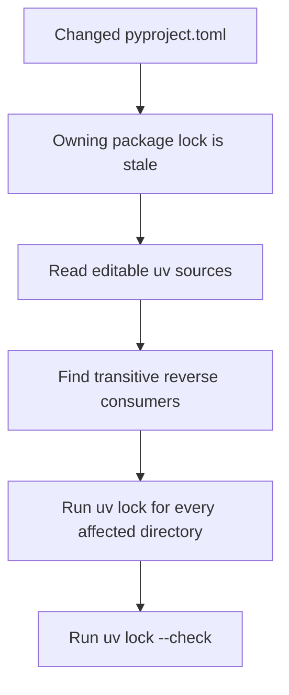
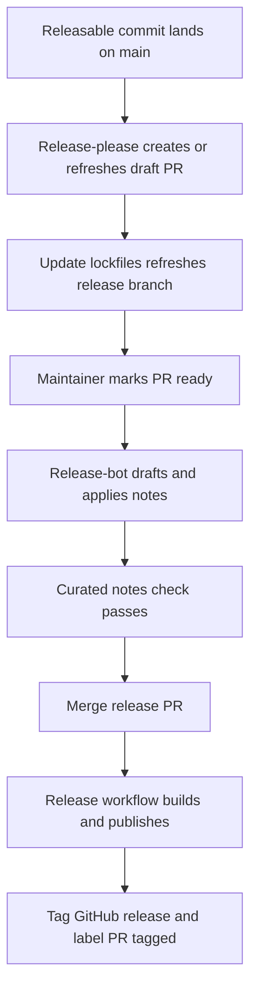

# Development, Dependencies, and Releases

This repository is a monorepo of independently versioned distributions beneath `libs/`, not a root Python project. Work in the package that owns a change: its `pyproject.toml` is the published compatibility contract, its `Makefile` is the supported command interface, and it owns its uv environment and `uv.lock`. For runtime context, see the [architecture overview](../architecture/overview.md); see the [Testing Guide](../testing/testing-guide.md) for test-writing guidance.

## Package-local workflow

Use `uv` for interpreters, environments, and dependencies; do not substitute `pip`, Poetry, or Conda for the repository workflow. `uv` provisions the appropriate interpreter, so contributors do not impose one repository-wide Python installation. Run `make help` in the package you are changing, synchronize that package, and use its targets for normal work.

```bash
uv tool install pre-commit
pre-commit install --install-hooks

cd libs/deepagents
uv sync --all-groups
make test
make lint
```

`uv sync --all-groups` installs the selected package and its declared groups. Prefer package `make` targets; use `uv run ...` for a direct one-off command. Package manifests, especially `requires-python` and dependency constraints, define what downstream users can install; the interpreter used to create a checked lock may be different.

The package guide establishes a useful baseline: unit tests are network-free, integration tests may use the network, and `TEST_FILE` narrows the normal test target. Deep Agents and Code export `UV_FROZEN=true`, so ordinary target invocations do not silently repair a stale lock. Their unit-test targets use parallel pytest with non-Unix sockets disabled and Unix sockets allowed; their integration targets select integration tests with a 30-second timeout. `make lint` checks Ruff formatting, runs Ruff, and invokes `ty`; `make format` applies Ruff formatting and safe fixes.

Code has additional local CI-parity entrypoints:

```bash
cd libs/code
make bootstrap  # syncs the test group and installs hooks
make check
```

`make check` runs linting, import checks, unit tests, extras synchronization, version-file equality, and lock freshness. Its SDK-pin check is deliberately advisory only for exit status `1`; other failures remain failures. Run this target before a Code PR when practical.

External contributors must link an approved issue or discussion and be assigned before opening a PR. PR titles use Conventional Commits with a scope. Keep a bump-worthy change scoped to one releasable component; route cross-package dependency and lockfile churn through a separate `chore(deps):` PR. This avoids having release-please attribute one visible change to several packages merely because their files changed.

## Published requirements versus workspace sources

A dependency declaration is the package's PyPI contract. A `[tool.uv.sources]` entry is a development-only resolution mapping. Code currently publishes the exact requirement `deepagents==0.7.30`, while its workspace mapping resolves Deep Agents, ACP, and partner packages from editable sibling paths. Do not loosen an exact public pin merely to make sibling development convenient.

The exact Code SDK pin is a minimum-SDK contract: if Code starts using a new SDK capability, raise the pin in that same PR. The daily minimums updater does not change exact pins. The release workflow enforces that Code's pin is not older than the workspace SDK; the release-PR label `ci:dcode-skip-sdk-pin` and the manual `dangerous-skip-sdk-pin-check` input are explicit exceptions for intentionally older pins.

### Lockfile reverse closure

An editable consumer's lockfile embeds requirements from its local producer. Therefore, a manifest change makes both the changed package's lock and every transitive editable-path consumer lock stale. Never hand-edit `uv.lock`.



*Editable local sources turn a manifest change into a transitive reverse-consumer lockfile closure.*

The lock checker discovers library, partner, and example package directories. With no paths it checks every discovered package; with paths it checks only touched package directories. The refresh helper calculates the changed manifests' transitive reverse-consumer closure and locks every member:

```bash
python .github/scripts/checks/refresh_lockfiles.py libs/code/pyproject.toml
```

Both helpers use Python 3.14 for ACP and Python 3.12 for every other discovered package. On a stale lock, the checker prints the root-relative repair command. From `libs/`, the aggregate Makefile provides broader fan-out operations; each stops at the first failure.

| Command | Purpose |
| --- | --- |
| `make lock [no-cache]` | Resolve all discovered library, partner, and example locks; `no-cache` adds `--no-cache`. |
| `make lock-check` | Run `uv lock --check` for every discovered owner. |
| `make lock-bump DEP=<pkg>` | Re-resolve every discovered lock with `-P <pkg>`; `DEP` is required. |
| `make lint` / `make format` | Fan out to discovered library packages. |

CI invokes the reusable lockfile workflow from pull requests, pushes to `main`, and merge groups, enforcing the same ACP-3.14/other-3.12 policy.

## Scheduled dependency floors

`raise_langchain_minimums.yml` runs daily at 09:00 UTC and can be dispatched for one release component or `all`. Its updater considers PyPI-resolved requirements whose normalized names start with `langchain`, `langgraph`, `langsmith`, or `deepagents`, in project dependencies, extras, and dependency groups. It raises only `>=` and `~=` lower bounds to a compatible stable PyPI version with a non-yanked file.

The updater preserves upper bounds, extras, markers, and compatible-release ceilings, leaves exact pins alone, and does not lower an intentionally higher floor. It plans all manifest changes before writing any; unavailable PyPI metadata, an unrewritable requirement, or an invalid narrowed request causes failure rather than a misleading successful no-op. If there are edits, the workflow regenerates every affected consumer-closure lock before opening or refreshing its `chore(deps):` PR. `skip-dependent-locks` is an intentional exception that leaves reverse-consumer locks stale for separate repair.

## Release ownership, baselines, and working tree versions

Release-please manages a package only when it has both a `release-please-config.json` package entry and a `.release-please-manifest.json` released baseline. The manifest is release state, not a requested source version, and should not be manually edited for an established line. A never-published source package at `0.0.1` needs a `0.0.0` manifest baseline; otherwise release-please treats `0.0.1` as shipped and proposes `0.0.2` first.

The released baselines presently tracked in the manifest are:

| Component / distribution | Path | Released baseline |
| --- | --- | --- |
| `deepagents` | `libs/deepagents` | `0.7.30` |
| `deepagents-acp` | `libs/acp` | `0.0.13` |
| `deepagents-code` | `libs/code` | `0.1.88` |
| `deepagents-talon` | `libs/talon` | `0.0.9` |
| `langchain-daytona` | `libs/partners/daytona` | `0.0.8` |
| `langchain-modal` | `libs/partners/modal` | `0.0.6` |
| `langchain-runloop` | `libs/partners/runloop` | `0.0.7` |
| `langchain-vercel-sandbox` | `libs/partners/vercel` | `0.0.2` |
| `langchain-quickjs` | `libs/partners/quickjs` | `0.3.9` |

Released baselines are not automatically the same thing as a working-tree package version: the former is release-please state, whereas the latter is declared in the package manifest and may be ahead on an open release branch. In the current `main` working tree, `libs/deepagents/pyproject.toml` declares `0.7.30` and `libs/code/pyproject.toml` declares `0.1.88`; Code also pins `deepagents==0.7.30`.

Release-please creates separate draft Python release PRs, maintains package version files and `CHANGELOG.md`, and titles each PR `release(${component}): ${version}`. All configured lines are pre-1.0: a `feat` produces a patch bump and a breaking feature produces a minor bump. Generated changelogs expose `feat`, `fix`, `perf`, and `revert`; configured documentation, style, chore, refactor, test, CI, and hotfix types are hidden.

Release-please has `skip-github-release` enabled. It prepares the release PR; `release.yml` owns artifact publication, tag creation, and the GitHub release. The release detector requires both a matching `release(component): version` commit title and that component's `CHANGELOG.md` among the commit's changed files.

Do not push an ordinary empty commit to `main`. Because component attribution uses changed paths, a pathless commit could fan out to every managed component. The workflow rejects it before release-please runs, except for the narrowly validated history-repair form of an empty `hotfix(repo):` merge whose introduced commits all touch files.

## Release PR lifecycle and curated notes

After releasable commits land on `main`, wait for release-please to refresh the package release PR **and** for its `Update lockfiles` job. Release-please changes package versions but does not itself regenerate `uv.lock`. Do not rebase a release branch, merge `main` into it, or edit it while that automation is queued or running: the automation can replace the change, invalidate reviewed notes, or race note application.



*Managed release PRs move from generated draft through lock and note gates before publication.*

The generated PR body is a preview. The merged package `CHANGELOG.md` supplies the published GitHub release body. Keep a release PR in draft while changes accumulate. When it is ready, mark it ready for review, revise the `release-bot` draft comment while retaining its version heading, then comment `@release-bot apply`. The bot writes the package changelog and mirrors the notes into the PR body. Merge only after the `curated release notes` check passes. In a fan-out, repeat this for each package PR.

Run `@release-bot draft` if automatic drafting failed or new `main` changes touch the package. A release-branch lockfile-only refresh due to unrelated work does not invalidate a draft. `ci:skip-curated-notes` is the explicit opt-out when the generated changelog is intentionally being shipped without maintainer curation. Curation derives the component from the release branch, runs automation from trusted `main`, and reads release-PR content through the GitHub API as untrusted data rather than checking it out or executing it. Commands are serialized per PR without cancelling in-flight drafting or application.

A changelog-only `@release-bot apply` commit from the trusted bot on a release-please branch is a special CI path: CI reads the detector from the trusted base ref, verifies it can find one conclusive parent `✅ CI Success` result, then suppresses package lint and test selection for that apply commit. The current head still receives its own CI success result, derived from the parent; if the parent is not conclusively successful or failed, normal package jobs run or the gate fails. Skipped package jobs in this narrow case are therefore expected, not a waiver for an untested release branch.

## Publishing and recovery

When a release PR merges, the release-please workflow dispatches `release.yml` before it refreshes other release PRs. The publisher maps the package to its working directory and, for normal releases, requires a version plus an exact release SHA whose `pyproject.toml` declares that version. It builds from that SHA, checks PyPI first, and fails if the version is already published or cannot be verified. It then builds artifacts, runs pre-release checks, publishes to TestPyPI, publishes to PyPI through trusted publishing, and creates the tag and GitHub release from the same source tree.

Release-note generation is intentionally non-blocking: a notes failure does not prevent PyPI publication or GitHub release creation, and can result in an empty release body. This protects publication from a cosmetic failure, but operators should repair the notes afterward.

The exact-SHA requirement preserves an important invariant: a PyPI version and its GitHub tag identify the same code. If publishing fails before PyPI receives the version, repair the problem while retaining that version and manually dispatch from the exact hotfix SHA. Once PyPI has the version, do not republish it or move/recreate its tag; ship a new version instead.

The post-merge workflow waits for every merged PR still marked `auto:release-pending` before it recomputes remaining release PRs. This repo-wide wait avoids release-please seeing an updated manifest without its tag and proposing a bootstrap downgrade. After successful publishing and tag creation, the publisher changes the release PR label from `auto:release-pending` to `auto:release-tagged`.

Manual dispatch is for recovery, backports, or prereleases rather than the ordinary path. For a normal manual release, provide the version and an exact 40-character `release-sha` that matches the package manifest. `dangerous-nonmain-release` is the explicit exception for a throwaway non-main prerelease or maintenance branch. Do not commit PEP 440 prerelease shapes to `main` or a long-lived version branch: release-please cannot safely maintain those version-file transitions.
