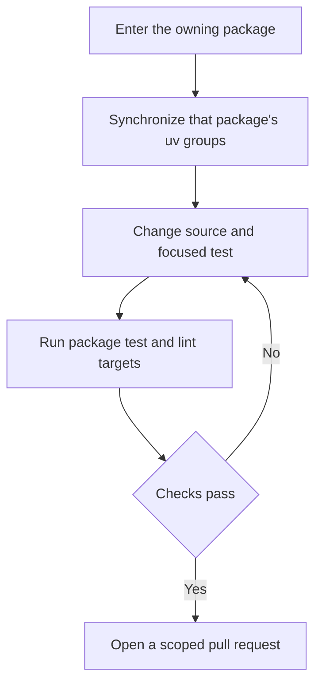
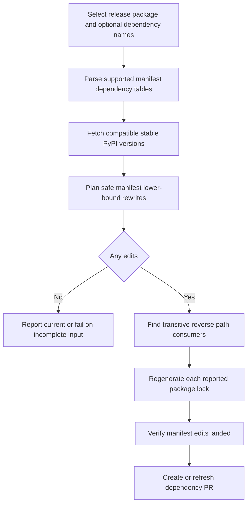
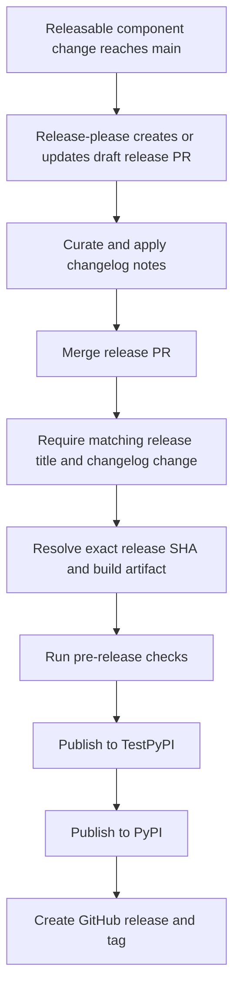

# Development, Dependencies, and Releases

This is a monorepo of independently versioned distributions under `libs/`, not one root Python project. Work in the package that owns the change: its `pyproject.toml` defines its Python and dependency contract, its `Makefile` defines supported commands, and it owns its own uv environment and `uv.lock`. Start with `make help` in that package. For adjacent topics, see the [architecture overview](../architecture/overview.md), [quickstart](../quickstart.md), and [Testing Guide](../testing/testing-guide.md).

## Package-local development

Use `uv` for interpreters, environments, and dependencies; do not substitute `pip`, Poetry, or Conda. `uv` provisions the interpreter selected by the package, so contributors should not impose a repository-wide Python installation. Do not create or activate a shared environment outside the package: synchronize and run commands from the package directory whose environment and lockfile you intend to use.

```bash
uv tool install pre-commit
pre-commit install --install-hooks

cd libs/deepagents
uv sync --all-groups
make test
make lint
```

`uv sync --all-groups` installs that package and all of its declared dependency groups. Prefer its `make` targets for normal work and use `uv run ...` only for direct, exceptional commands. The Deep Agents and Code Makefiles export `UV_FROZEN = true`, so commands do not silently repair a stale lock; update the owning package's lock intentionally.



*The local loop keeps each package's environment, manifest, and lock state explicit before validation.*

### Common package targets

Target sets vary; run `make help` in the package. In `libs/deepagents` and `libs/code`, `make test` uses the `test` group and parallel pytest, disables non-Unix sockets while allowing Unix sockets, disables benchmarks, and reports coverage; set `TEST_FILE` to focus it. `make integration_test` selects `tests/integration_tests/` with a 30-second timeout. `make lint` verifies Ruff formatting, runs Ruff checks, and invokes `ty`; `make format` applies Ruff formatting and safe fixes.

Code has additional package-local CI-parity gates:

- `make bootstrap` synchronizes its `test` group and installs hooks.
- `make check` runs lint, import checks, and tests; then checks extras synchronization, `pyproject.toml`/`_version.py` equality, and its own `uv.lock` freshness. Its SDK-pin check is advisory only for exit status `1`; other checker failures stop the target.
- `make commands-catalog` regenerates `COMMANDS.md`; `make commands-catalog-check` detects drift. Do not hand-edit that generated catalog.

External contributors must link an approved issue or discussion and be assigned before opening a PR.

## Compatibility contracts and lockfiles

Each package owns its own runtime compatibility range. ACP and QuickJS support Python 3.11+; Code and Talon require Python 3.12+; Deep Agents supports Python 3.11 through the pre-4.0 range. These runtime contracts are distinct from the interpreter selected to resolve a lockfile.

| Package | Current compatibility-critical requirements |
| --- | --- |
| `libs/deepagents` | `langchain>=1.4.5,<2.0.0`, `langchain-core>=1.6.10,<2.0.0`, and `langsmith>=0.14.8` |
| `libs/code` | Exact `deepagents==0.7.24` consumer pin; `langchain>=1.4.5,<2.0.0`; `deepagents-acp>=0.0.10,<1.0.0` |
| `libs/talon` | `deepagents>=0.7.24`, `deepagents-code>=0.1.71,<1.0.0`, `langchain>=1.4.5,<2.0.0`, and `langgraph>=1.2.15,<2.0.0` |
| `libs/partners/quickjs` | `deepagents>=0.7.0,<0.8.0`, `langchain>=1.4.5,<2.0.0`, `langchain-core>=1.6.10,<2.0.0`, and `langgraph>=1.2.15,<2.0.0` |

The Deep Agents source is currently `0.7.25`, while Code's exact consumer pin remains `deepagents==0.7.24`. Do not convert that pin into a floor: the daily minimum-raise automation deliberately excludes `==` requirements. A successful Deep Agents publish instead dispatches the dedicated Code SDK-pin bump workflow as a non-blocking follow-up.

Local consumers use editable `[tool.uv.sources]` paths. For example, Code resolves Deep Agents, ACP, and partner integrations from sibling directories, allowing local consumer work without a publish. Consequently, a producer manifest change is also a consumer-lock concern: a consumer lock embeds requirements resolved through its local path.

Regenerate the changed package's lock and every reverse path-dependent consumer lock; never edit `uv.lock` by hand. The aggregate resolver uses Python 3.14 for ACP and Python 3.12 for other discovered library and example locks. That lock-resolution policy does not change any package's `requires-python` contract.

From `libs/`, the aggregate Makefile discovers library/partner Makefiles and example manifests. Its fan-out recipes use `set -e`, so the first failure stops the operation. These are aggregate operations; package-specific work should still run from the owning package and affect its uv environment and lockfile.

| Command from `libs/` | Purpose |
| --- | --- |
| `make lint` / `make format` | Invoke that target across discovered library packages. |
| `make lock [no-cache]` | Resolve all discovered library and example locks; `no-cache` adds `--no-cache`. |
| `make lock-check` | Run `uv lock --check` for each discovered owner. |
| `make lock-bump DEP=<pkg>` | Re-resolve every discovered lock with `-P <pkg>`; `DEP` is required. |
| `make bench-all` | Run `bench` for Deep Agents and Code. |

CI calls the lockfile check workflow on every pull request, push to `main`, and merge group. The workflow uses Python 3.14 to run its checker; that checker supplies 3.14 for ACP and 3.12 for every other package when it invokes `uv lock --check`.

## Automated dependency minimums

`raise_langchain_minimums.yml` runs daily at 09:00 UTC and can be manually dispatched for one release component or `all`. Its optional comma-separated `dependencies` input narrows a run to exact normalized PyPI names; `skip_dependent_locks` is an explicit exception that leaves reverse consumers stale. The workflow invokes `raise_langchain_minimums.py`, regenerates every reported `directory=Python` lock specification, verifies reported manifest edits changed the tree, and creates or refreshes a generated dependency PR only when edits occurred.

The script reads `[project.dependencies]`, `[project.optional-dependencies]`, and top-level `[dependency-groups]`. By default it considers PyPI-resolved names beginning `langchain`, `langgraph`, `langsmith`, or `deepagents`; local path/URL sources and the manifest's own distribution are excluded. A narrowed request replaces prefix selection rather than adding to it.

It raises only `>=` and `~=` floors to the newest stable PyPI release with a non-yanked file that remains inside the existing requirement range. It preserves upper bounds, extras, and markers, leaves `==` pins alone, and never lowers a floor already ahead of the latest stable release. For compatible-release constraints, it preserves the original number of release components so a rewritten floor cannot silently narrow the implied ceiling.



*The updater turns safe manifest edits and the complete path-consumer lockfile closure into one change set.*

Failure is deliberately fail-closed. An unknown package, empty broad scope, unresolved PyPI metadata, an unrewritable manifest, or a narrowed name that is absent, locally resolved, or has no raiseable floor fails rather than producing a misleading success. It plans every manifest before writing any of them, while isolating a manifest rewrite failure so valid plans can be reported alongside that failure. Literal replacements are anchored to full quoted TOML requirement strings, applied longest-first, and required to match; this prevents corruption of prefix-like requirements or comments.

When floors change, the normal lock set is the transitive reverse closure of `[tool.uv.sources]` consumers because their locks embed producer requirements. `--skip-dependent-locks` intentionally reports only directly changed package locks; use it only with an explicit plan to repair the stale dependent locks. Focused tests cover upper and compatible-release bounds, extras and markers, exact pins, local-source exclusion, dependency-group discovery, replacement anchoring, package selection, scope narrowing, and transitive stale-lock discovery.

## Release baselines and release-please

Release-please manages nine separately drafted Python release PRs. Configuration supplies each distribution name, component, changelog location, source metadata and `_version.py` extra version files, pre-1.0 bump behavior, and test-path exclusions. PR titles use `release(${component}): ${version}`. `skip-github-release` delegates publication and GitHub release creation to `release.yml`.

The release-please manifest records last-release state, not a development version input. Current baselines are:

| Manifest path | Baseline |
| --- | --- |
| `libs/deepagents` | `0.7.25` |
| `libs/acp` | `0.0.13` |
| `libs/code` | `0.1.84` |
| `libs/talon` | `0.0.9` |
| `libs/partners/daytona` | `0.0.8` |
| `libs/partners/modal` | `0.0.6` |
| `libs/partners/runloop` | `0.0.7` |
| `libs/partners/vercel` | `0.0.2` |
| `libs/partners/quickjs` | `0.3.9` |

When adding a managed package, update both `release-please-config.json` and `.release-please-manifest.json`. For an unreleased first source version `0.0.1`, use a `0.0.0` manifest baseline; a `0.0.1` baseline means that version was already released and would make the first release PR target `0.0.2`.

Code illustrates the metadata invariant: `deepagents-code` is `0.1.84` in project metadata and its annotated version marker, its changelog starts at that release, and it has the exact `deepagents==0.7.24` SDK pin.

Release attribution is path-based. Keep bump-worthy work scoped to one managed component: a changed dependent lock may fan out to other components, while a pathless commit can fan out to every package. The release-please workflow rejects ordinary empty commits before release-please runs. After a release PR merge, publication dispatch requires both the matching `release(component): version` title and that component's `CHANGELOG.md` change.

## Curated notes and publication lifecycle

Keep a release PR draft while changes accumulate. The curated-notes gate applies only to trusted, open release-please branches targeting `main`; it derives the allowed component and changelog path from `release-please-config.json`, and rejects a title that disagrees with the branch component. Non-release PRs do not need curated notes.

When ready, review the bot-authored draft and comment `@release-bot apply`. The gate and apply path use the current release PR head; comment and manual refreshes create a native check on that head. An always-run finalizer converts an interrupted in-progress refresh check to failure so a required check cannot remain pending indefinitely.



*Release-please prepares component-specific state; `release.yml` validates and publishes the resolved source tree.*

The release workflow maps a package to its working directory, resolves an exact commit SHA, and, for ordinary releases, verifies that the target tree's `pyproject.toml` version equals the requested version. It builds from that same tree, refuses an already-published version, and fails closed if PyPI cannot be consulted reliably. Pre-release checks and TestPyPI publishing precede PyPI publishing. Build jobs have read-only repository permissions; publishing jobs receive PyPI trusted-publishing `id-token: write`, separating build-time dependencies from publish authority.

Release-note generation is intentionally non-blocking: publishing and GitHub release creation can complete with an empty release body if it fails. The GitHub release tags the same resolved SHA and updates the merged release PR from the pending label to the tagged label; that transition lets later release-please runs avoid calculating against half-published state.

If a release fails before PyPI publication, use the documented hotfix path and manually dispatch the preserved version from an explicit hotfix SHA. Once a version is on PyPI, do not reuse it or move its tag; ship a new patch release instead.
