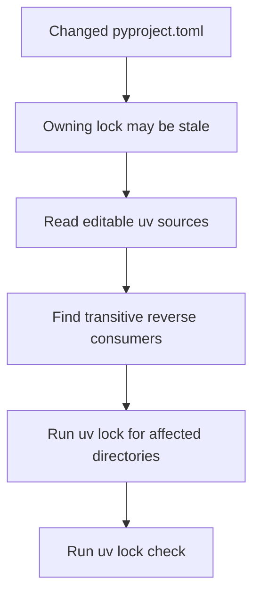
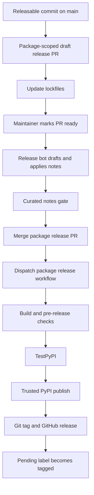

# Development, Dependencies, Lockfiles, and Releases

This repository is a monorepo of independently versioned distributions under `libs/`, not a root Python project. Work in the package that owns a change: its `pyproject.toml` is the published compatibility contract, its `Makefile` is the normal command interface, and it owns its uv environment and `uv.lock`. See the [architecture overview](../architecture/overview.md) for runtime context and the [Testing Guide](../testing/testing-guide.md) for test design.

## Package-local development

Use `uv` for interpreters, environments, and dependencies; do not substitute `pip`, Poetry, or Conda in the normal workflow. `uv` provisions the interpreter, so there is no repository-wide Python version to install or pin. Run `make help` in the package being changed, sync that package, and use its targets for ordinary edit/test/lint work.

```bash
uv tool install pre-commit
pre-commit install --install-hooks

cd libs/deepagents
uv sync --all-groups
make test
make lint
```

`uv sync --all-groups` installs the package and its declared groups. Use `uv run ...` for an intentional one-off command. Each package's `requires-python` and dependency constraints—not editable workspace resolution—define what downstream users can install.

Deep Agents, Code, QuickJS, and Talon export `UV_FROZEN=true`, so their ordinary targets do not silently repair a stale lock. Deep Agents and Code unit tests run parallel pytest with non-Unix sockets disabled and Unix sockets allowed; Code integration tests select integration tests with a 30-second timeout. QuickJS uses the same socket restriction for unit tests and parallel integration tests. Talon runs its Node-based WhatsApp bridge tests before its Python suite, with sockets restricted and a 10-second timeout. Each package's `make lint` runs Ruff checks, verifies Ruff formatting, and runs `ty`; `make format` formats and applies safe Ruff fixes. `TEST_FILE` narrows the usual test target where supported.

Code has a useful local CI-parity entrypoint:

```bash
cd libs/code
make bootstrap
make check
```

`make bootstrap` syncs the test group and installs hooks. `make check` runs linting, import checks, unit tests, extras synchronization, version-file equality, and lock freshness. Its SDK-pin check is advisory only for exit status `1`; another failure remains fatal.

### dcode process-directory review gate

`make lint` for `libs/code` also verifies the generated slash-command catalog and runs `scripts/check_process_cwd.py deepagents_code`. This AST-based gate exists because one workspace-server process can serve many bound workspaces: reading the process current directory answers correctly only for the workspace from which that server was launched. Server paths should use the directory recorded for the workspace instead.

The checker recognizes direct `Path.cwd()`, `os.getcwd()`, and calls to `find_project_root` (which can fall back to the process directory when invoked without an argument). Every recognized call must have a matching `CallSite` in its allowlist, with a reason explaining the process context; conversely, an allowlist entry without a matching call fails as stale. A call's identity includes its package-relative path, enclosing scope, kind, a digest of the call and enclosing statement, and—only for duplicate calls—an occurrence number. Editing the enclosing statement therefore produces both an unreviewed replacement and a stale old entry, deliberately requiring renewed review.

Do not treat a clean run as a proof that no process-directory read exists. The scanner intentionally does not detect equivalent spellings such as `Path(".").resolve()`, `os.path.abspath(".")`, or calls through an attribute or saved reference. If a newly detected call is legitimate, prefer passing an explicit workspace directory; otherwise add a narrowly scoped allowlist entry with a reason that names why the process directory is correct. Read or parse errors fail closed so the unchecked file cannot pass the gate.

Pre-commit installs commit-message and pre-push hooks. It validates Conventional Commit messages and repository hygiene, runs matching package format/lint targets, and checks affected lockfiles, extras, and version-file pairs. The pre-push hook delegates branch naming to `.githooks/pre-push`; re-run `pre-commit install --install-hooks` in an existing checkout after hook configuration changes.

External contributors must link an approved issue or discussion and be assigned before opening a PR. Use a scoped Conventional Commit title. Keep a bump-worthy change in one releasable component; put cross-package dependency and lockfile churn in a separate `chore(deps):` PR so release-please does not attribute one visible change to several distributions.

## Public dependencies and local sources

A requirement in `[project.dependencies]` is the PyPI contract; `[tool.uv.sources]` maps a dependency to a development-only local resolution. Keep those layers separate. For example, Code publishes `deepagents==0.7.32` and `langchain-quickjs>=0.3.9,<0.4.0`, while resolving Deep Agents, ACP, and partner packages from sibling editable paths during local development. Evals similarly publishes floors for Deep Agents, dcode, and QuickJS but points its checkout at their sibling sources; Talon publishes bounded or minimum requirements for Deep Agents and dcode while mapping both to sibling editable checkouts; QuickJS publishes a `deepagents>=0.7.32,<0.8.0` compatibility range while mapping Deep Agents locally. Do not loosen an exact public pin merely to simplify sibling work.

### The dcode-to-SDK pin invariant

`deepagents-code` must pin the **minimum** `deepagents==X.Y.Z` that its code requires. Raise that exact pin in the same PR that first uses new SDK functionality; do not defer it to release time. The scheduled floor updater deliberately does not alter exact pins. Release validation compares the Code pin with the workspace SDK; `ci:dcode-skip-sdk-pin` and the manual `dangerous-skip-sdk-pin-check` input are exceptional overrides for an intentionally older pin. Pins ahead of the workspace SDK are permitted for deliberate prerelease coordination.

### Lockfile reverse closure

An editable consumer lock embeds requirements from its local producer. A manifest change therefore stales the changed package's lock and every transitive editable-path consumer lock. Never hand-edit `uv.lock`.



*Editable local sources propagate manifest changes to the transitive reverse-consumer lockfile closure.*

The checker discovers library, partner, and example package directories. With no paths it checks all discovered packages; with paths it checks the owners of changed paths. The refresh helper computes a changed manifest's reverse-consumer closure and relocks every member:

```bash
python .github/scripts/checks/refresh_lockfiles.py libs/code/pyproject.toml
```

The path-aware checker and refresh helper resolve first-party `acp`, `code`, `evals`, and `talon` with Python 3.14, and other discovered packages with Python 3.12. Their lockfiles record the supported Python and platform marker coverage: Evals and Talon are locked for Python 3.14, while QuickJS's `>=3.11,<4.0` lock covers multiple Python and Emscripten branches. A stale-lock error prints the root-relative repair command. From `libs/`, aggregate targets fan out and stop at the first failure; its Makefile currently selects Python 3.14 only for `acp` and 3.12 for every other package:

| Command | Purpose |
| --- | --- |
| `make lock [no-cache]` | Resolve library, partner, and example locks; `no-cache` adds `--no-cache`. |
| `make lock-check` | Run `uv lock --check` for every discovered package. |
| `make lock-bump DEP=<pkg>` | Re-resolve every discovered lock with `-P <pkg>`; `DEP` is required. |
| `make lint` / `make format` | Fan out across library packages. |

CI invokes the lock check for pull requests, pushes to `main`, and merge groups. Release-please branches also receive an `update-lockfiles` pass because release-please changes package versions but does not regenerate `uv.lock`.

### Scheduled dependency floors

The daily minimums workflow raises eligible PyPI floors for normalized names beginning `langchain`, `langgraph`, `langsmith`, or `deepagents`, including project dependencies, extras, and dependency groups. Only `>=` and `~=` lower bounds qualify; the selected release must be stable, non-yanked, and within the existing range.

The updater preserves upper bounds, extras, markers, and compatible-release ceilings, never lowers a deliberately higher floor, and leaves exact pins alone. It plans all manifest edits before writing. Metadata failures, unrewriteable requirements, and an ineligible requested dependency cause failure rather than a misleading clean result. A versioned local path source remains a published floor and caps the raised value at the local checkout version so `uv lock` can resolve it. After changes, automation regenerates the affected consumer closure before opening or refreshing its `chore(deps):` PR; `skip-dependent-locks` explicitly defers that repair.

## Release ownership and scope

Release-please manages a package only when it appears in both `release-please-config.json` and `.release-please-manifest.json`. The manifest holds the last released baseline, not a desired working-tree version. A never-published `0.0.1` package needs a `0.0.0` manifest baseline so its first proposal is `0.0.1`, rather than `0.0.2`.

| Distribution | Path | Manifest baseline |
| --- | --- | --- |
| `deepagents` | `libs/deepagents` | `0.7.32` |
| `deepagents-acp` | `libs/acp` | `0.0.13` |
| `deepagents-code` | `libs/code` | `0.2.1` |
| `deepagents-talon` | `libs/talon` | `0.1.0` |
| `langchain-daytona` | `libs/partners/daytona` | `0.0.9` |
| `langchain-modal` | `libs/partners/modal` | `0.0.6` |
| `langchain-runloop` | `libs/partners/runloop` | `0.0.7` |
| `langchain-vercel-sandbox` | `libs/partners/vercel` | `0.0.2` |
| `langchain-quickjs` | `libs/partners/quickjs` | `0.3.9` |

Configuration creates separate draft Python release PRs with titles `release(${component}): ${version}`. All managed packages currently use pre-1.0 behavior: `feat` makes a patch bump and a breaking feature makes a minor bump. Generated changelogs show `feat`, `fix`, `perf`, and `revert`; docs, style, chore, refactor, test, CI, and hotfix entries are hidden.

`skip-github-release` means release-please prepares PRs but `release.yml` publishes, tags, and creates GitHub releases. The detector recognizes a managed release only when the merge commit has a matching release title **and** changes that package's `CHANGELOG.md`. Ordinary empty commits are blocked before release-please can pathlessly fan out to every component. The narrow exception is a `hotfix(repo):` history-repair merge whose introduced second-parent commits all touch files.

## Release PR to publication

After releasable commits land on `main`, wait for both the release-please refresh and the release PR's `Update lockfiles` job. Do not manually rebase a release branch, merge `main` into it, or edit it while automation is queued or running: it can replace changes, invalidate reviewed notes, or race note application.



*Each package retains separate release ownership while publication follows the release-please-to-publisher gate sequence.*

Keep a release PR draft while changes accumulate. When ready, mark it ready for review, review or revise the release-bot draft while retaining its version heading, then comment `@release-bot apply`. The bot writes that package's `CHANGELOG.md` and mirrors the notes into the PR body. Merge only after the `curated release notes` check passes; repeat for every PR in a fan-out. `ci:skip-curated-notes` is the explicit opt-out for intentionally shipping the generated changelog uncurated.

Run `@release-bot draft` if automatic drafting failed or later `main` changes touch that package. A release-branch lockfile-only refresh caused by unrelated work does not invalidate an existing draft. Curation checks out trusted `main` automation and reads release-PR content through the API as untrusted data; it does not execute PR content. Commands serialize per PR without cancelling an in-flight run. The drafting helper constrains provider output to structured user-facing sections, accepts only PR links, and rejects non-normal or malformed model completions.

A trusted changelog-only `@release-bot apply` commit on a release-please branch has a narrow CI optimization. CI requires a conclusive parent `✅ CI Success` result, suppresses selected package lint and test jobs, and derives the head result from that parent. An inconclusive parent falls back to ordinary package jobs; a failed parent does not satisfy the gate.

## Publisher gates, recovery, and escape hatches

Merging a release PR dispatches `release.yml` before release-please refreshes other open release PRs. The publisher maps the distribution to its working directory. For an ordinary release, provide a version and exact 40-character `release-sha`; the selected commit's `pyproject.toml` must declare that version. It builds from that resolved SHA, checks whether the PyPI version already exists, and fails closed when PyPI is unavailable or unverifiable. Build artifacts and pre-release checks precede TestPyPI and trusted PyPI publication; the tag and GitHub release use the same source tree.

Release-note generation is intentionally non-blocking: a failure does not stop publication or GitHub release creation, so repair an empty release body afterward. The critical integrity invariant is that a PyPI version and its GitHub tag identify the same code. If failure occurs before PyPI upload, fix the problem without changing the version and manually dispatch from the exact hotfix SHA. Once PyPI has a version, do not republish it or move/recreate its tag; release a new version instead.

Before recomputing open release PRs, the post-merge path waits for every merged PR still marked `auto:release-pending`. This repository-wide wait prevents release-please from seeing a new manifest baseline without its tag and proposing a bootstrap downgrade. Successful publication changes the source release PR label to `auto:release-tagged`.

Manual dispatch is for recovery, backports, and prereleases rather than the normal route. `dangerous-nonmain-release` permits a throwaway non-main prerelease or maintenance branch; keep PEP 440 prerelease version transitions off `main` and long-lived version branches because release-please cannot safely maintain them.

Ripgrep is a release-sensitive artifact-test gate. Without an override, a failed ripgrep installation fails release prechecks. Applying `ci:skip-ripgrep` to the merged release PR causes release-please to dispatch `dangerous-skip-ripgrep-check=true`; an installation failure is then tolerated and `rg`-gated artifact tests skip. Use this only for a transient infrastructure failure, remove the label and re-run CI to restore coverage, and recognize that it weakens release validation rather than fixing ripgrep.

For detailed operator procedures—including pending-label stalls, pre-PyPI failures, post-publication fixes, and alpha/beta releases—use [`.github/RELEASING.md`](https://github.com/langchain-ai/deepagents/blob/main/.github/RELEASING.md).
