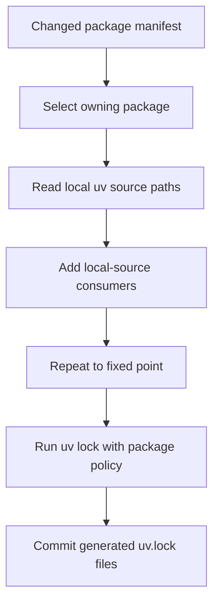
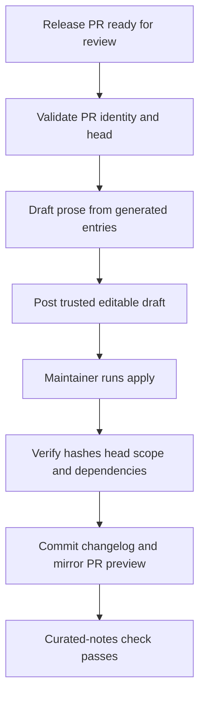
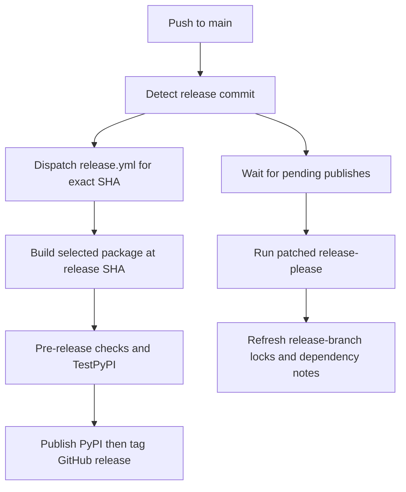

# Development and Release Operations

This is a monorepo of independently versioned packages under `libs/`, not a root Python project. Develop in the package that owns a change: its `pyproject.toml` is the published compatibility contract and its `Makefile` is the supported task interface. See [Quickstart](../quickstart.md) for initial setup and the [Testing Guide](../testing/testing-guide.md) for package tests.

## Package-local development and dependency contracts

Use `uv` for interpreters, environments, and dependencies, and `make` for standard tasks. `uv` provisions the package-required interpreter; each package declares its supported range through `requires-python`.

```bash
uv tool install pre-commit
pre-commit install --install-hooks

cd libs/deepagents
uv sync --all-groups
make test
make lint
```

Use `make help` inside the owning package and use `uv run ...` for an exceptional one-off command. From `libs/`, `make lint`, `make lock`, `make lock-check`, and `make lock-bump DEP=<pkg>` fan out across discovered library, partner, and example packages; this does not replace package-local setup.

| Layer | Meaning | Operational rule |
| --- | --- | --- |
| `[project]` dependencies, extras, `requires-python` | Wheel metadata installed by users | Treat as the public compatibility contract. |
| `[tool.uv.sources]` | Editable sibling-checkout wiring | Do not treat a local resolution as evidence that the published graph resolves. |
| `uv.lock` | Generated development and CI resolution | Regenerate with `uv`; never hand-edit. |
| `release-please-config.json` | Managed paths, components, changelogs, exclusions, and release behavior | Update as release integration wiring. |
| `.release-please-manifest.json` | Last-released baseline at each managed path | Let release-please make ordinary updates. |

### SDK, Code, and Talon compatibility

`deepagents-code` publishes the exact requirement `deepagents==0.7.41`, while its workspace maps `deepagents` to editable `../deepagents`. A passing Code workspace can therefore use unreleased sibling code and is not proof of the PyPI installation users receive. Raise the exact Code SDK pin in the PR that first requires new SDK behavior; do not defer it to a release PR. A deliberately older pin requires the `ci:dcode-skip-sdk-pin` acknowledgement or the dangerous manual-release bypass.

Talon is Python `>=3.14,<3.15`; it publishes `deepagents>=0.7.41` and `deepagents-code>=0.2.14,<1.0.0`, with local source mappings only for development. Its Code floor means a Talon release requiring that floor must follow a published Code release that satisfies it.

## Lockfile propagation

A changed package manifest can invalidate its own lock and every transitive consumer which takes it through a local `uv` source. Refresh the **reverse-consumer closure**, then check the directly touched package path:

```bash
python .github/scripts/checks/refresh_lockfiles.py libs/code/pyproject.toml
python .github/scripts/checks/check_lockfiles_pre_commit.py libs/code/pyproject.toml
```



*Refreshing includes the changed owner and every transitive local-source consumer.*

`refresh_lockfiles.py` stops on resolver failure. With paths, the checker intentionally tests only packages directly touched by those paths; with no paths, it tests every discovered package. Its resolver policy uses Python 3.14 for ACP, Code, Evals, and Talon, and Python 3.12 for others. The aggregate `libs/Makefile` has a separately implemented fan-out mapping: Code, Evals, and Talon use 3.14, while its remaining package-directory names use 3.12. For broad dependency work, run:

```bash
python .github/scripts/checks/check_lockfiles_pre_commit.py
```

After release-please creates or refreshes a release PR, its release-branch job regenerates every tracked lock and dependency-note section. A rejected push fetches the current branch tip, regenerates, and retries up to three times. Locks and their propagation are generated committed output, not handwritten release changes.

## Release-please ownership and scope

The registry manages nine distributions. Current manifest baselines are Deep Agents `0.7.41`, ACP `0.1.0`, Code `0.2.14`, Talon `0.1.2`, Daytona `0.0.9`, Modal `0.0.8`, Runloop `0.0.7`, Vercel `0.0.2`, and QuickJS `0.4.0`. Release-please creates separate draft PRs and deliberately skips GitHub-release creation; `release.yml` publishes when a release PR merges.

Do not manually rebase a release branch, merge `main` into it, or edit it while automation is queued or running. Wait for the relevant `release-please.yml` run and the release PR's **Update lockfiles** job before reviewing or curating notes.

Attribution is path-based, not solely Conventional Commit scope. Package tests and `uv.lock` are excluded. A bump-worthy PR that changes release-relevant files in more than one configured component is blocked unless a maintainer applies `ci:allow-lockfile-release`; that label acknowledges the intentional fan-out but does not suppress the extra releases. The scope gate reads trusted base configuration and fails closed when GitHub's changed-file response is incomplete.

`feat`, `fix`, `perf`, and `revert` appear in generated changelogs. Packages are pre-1.0: `feat` produces a patch bump and a breaking `feat!` produces a minor bump. Hidden types can ship in an existing release without adding a visible entry. The generated dependency section records dependency-range changes.

## Curated release notes

Every managed release PR is eligible: the notes workflow derives the component from a trusted internal release branch and validates it against the registry and `release(<component>): <version>` title. Automation runs from `main` and reads release-branch material through the API at a validated SHA rather than checking it out or executing it. Manual `@release-bot` commands require write-level maintainer permission.

1. Keep the release PR draft while changes accumulate, then mark it ready for review to create a bot-authored draft.
2. Review and edit the marked draft comment, retaining its version heading and generated `### Dependencies` section.
3. Comment `@release-bot apply`. The guarded flow writes curated text to the package `CHANGELOG.md` and mirrors it to the PR preview.
4. Merge only after the `curated release notes` gate passes. `ci:skip-curated-notes` is the explicit exceptional bypass for shipping generated notes unchanged.



*Curated prose is a guarded transformation of release-please output, not a direct edit to generated artifacts.*

Release-branch text is untrusted input to drafting. The model never receives `### Dependencies`; the workflow restores that subsection verbatim. Draft state is bound to bot identity, component, version, release head, generated-entry fingerprint, and for new drafts the `main` baseline. Applying fails rather than writing if headings, generated entries, dependencies, bot metadata, branch/head state, or concurrent PR state changed. Re-draft after a failed draft or package-relevant later `main` changes; unknown or incomplete change detection also requires a new draft. Commands are serialized per PR rather than cancelling an in-flight run.

The release-branch dependency generator diffs package `pyproject.toml` from the resolved predecessor tag to release head and updates `### Dependencies`. It warns and leaves the changelog unchanged if generation fails, so dependency notes do not block lockfile updates.

## Publication lifecycle and recovery



*Detected publication is dispatched before serialized release-PR maintenance.*

An empty commit is rejected because it has no paths to scope. Detection requires both a `release(<component>): <version>` subject and that package's `CHANGELOG.md` change. Before recomputing release PRs, the workflow waits for repository-wide merged PRs still marked `auto:release-pending`; an unreadable state fails closed and an in-flight publish defers recomputation.

`release.yml` is dispatch-only, including manual dispatch. Select the package and supply a version and exact 40-character `release-sha`; normal dispatch validates that the SHA is reachable from `main` and that its package `pyproject.toml` declares the requested version. The workflow builds that detached tree, verifies the version is not already on PyPI, runs pre-release checks and TestPyPI, then publishes the same checked artifact to PyPI and creates tag `<package>==<version>` at that SHA. Build is deliberately isolated from the jobs holding trusted-publishing or repository-write permissions, and artifact checksums are verified after each artifact download.

Use `dangerous-nonmain-release` only for a backport or pre-release branch. It permits fallback to the dispatched SHA and relaxes normal branch/version validation, but the release environment and trusted-publisher configuration still control whether publishing is possible. A version uploaded to PyPI is immutable: never move or recreate its tag; issue a new version for a fix.

### Release-body failure recovery

The release-notes job is intentionally fail-open: a notes failure neither blocks PyPI publishing nor GitHub tagging, and can leave a published GitHub release with an empty body. `mark-release` surfaces this outcome and prints the recovery command in its job summary. Rebuild the complete body locally against the exact release SHA, inspect it, then update only the release notes:

```bash
python .github/scripts/release/build_release_notes.py \
  --package "<package>" --version "<version>" \
  --sha "<release-sha>" --repo "langchain-ai/deepagents" \
  --actor "<actor>" --base-branch "<base-branch>" \
  --out /tmp/release-body.md

gh release edit "<package>==<version>" --repo "langchain-ai/deepagents" \
  --notes-file /tmp/release-body.md
```

The local builder needs a full-history clone with tags. It resolves a reachable predecessor tag, reads the requested version section from `CHANGELOG.md` at the release SHA, and bounds package-scoped history to that SHA. It caps and HTML-escapes history entries so later commits and unsafe subjects cannot be attributed to the release. For pre-releases it selects an earlier same-base pre-release where possible, then the base stable tag or latest stable tag; regular releases prefer the prior patch tag. Warnings distinguish an actual first release from an unreachable or incomplete tag history.

The repository uses a pinned, patched local release-please runner rather than the upstream action. Its blobless full-history `git log` walk removes the GraphQL 500-commit cap, reconstructs PR data from merge subjects, honors overrides, and preserves first-parent merge files and both rename paths for path attribution. Upgrade the runner and patch artifacts together, then compare a full-history dry run with open release PRs.

## Focused validation

For package metadata changes, run package tests, refresh the reverse-consumer closure, and run the all-package lock check. For release changes, focus on the tests that protect release-body bounds, lock propagation, scope, and workflow behavior:

```bash
uv run --no-project --with "pytest" pytest \
  .github/scripts/tests/checks/test_check_lockfiles_pre_commit.py \
  .github/scripts/tests/checks/test_refresh_lockfiles.py \
  .github/scripts/tests/release/test_check_lockfile_release_scope.py \
  .github/scripts/tests/release/test_build_release_notes.py
node --test .github/scripts/tests/release/release-notes.test.js
node --test .github/scripts/tests/release/release-please-history.test.mjs
uv run --no-project --with "pyyaml" pytest .github/scripts/tests/release/test_release_please_workflow.py
```

The release-body tests cover pre-release and stable predecessor selection, SHA-bounded changelog extraction, package-scoped bounded escaped history, and error reporting. Run them whenever changing tags, changelog parsing, recovery tooling, or release-body construction.
