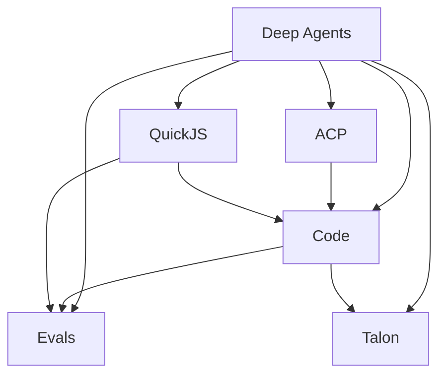
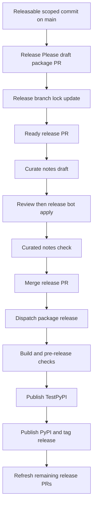

# Development, Dependencies, Lockfiles, and Releases

This repository is a monorepo of independently versioned packages. There is no root Python project: work in the package that owns the change. Its `pyproject.toml` declares the distributed contract, its `Makefile` is the normal developer interface, and its own `uv.lock` captures the resolved development environment. See the [Testing Guide](../testing/testing-guide.md) for test selection and [Run evals](../workflows/run-evals.md) for evaluation operations.

## Package-scoped uv workflow

Use `uv` for Python, environments, synchronization, and locking, and use the owning package's `make` targets for ordinary edit/test/lint work. `uv` obtains interpreters, so follow the package's `requires-python`; do not impose a repository-wide Python pin. CI uses the shared `.github/actions/uv_setup` composite action, which pins uv to `0.13.6`, sets the requested Python version, and keys a pruned uv cache from manifests, locks, and requirements files.

```bash
uv tool install pre-commit
pre-commit install --install-hooks

cd libs/deepagents
uv sync --all-groups
make test
make lint
```

`uv sync --all-groups` installs the selected package and its dependency groups; use `uv run ...` for a deliberate one-off command. Run `make help` in the package before assuming a target exists. Hooks cover commit messages, formatting/linting, relevant lock checks, and branch naming; repeat `pre-commit install --install-hooks` in an older checkout after hook changes.

Keep a bump-worthy, user-facing change within one releasable component. Dependency or lockfile churn that spans packages should normally be a separate `chore(deps):` PR. Release Please assigns commits by changed paths, so mixing a `feat`/`fix` with consumer locks or another component can create unwanted release PRs. The scope guard blocks a bump-worthy PR that changes non-lock files in more than one managed component, or changes only a managed package lockfile; `ci:allow-lockfile-release` is the explicit acknowledgement for an intentional fan-out.

## Dependency contracts and local wiring

These three layers have different owners and must not be conflated:

| Layer | Role | Safe change rule |
| --- | --- | --- |
| Published metadata | `[project]` requirements, extras, and `requires-python` | This is the public contract resolved by downstream installers. Declare supported released versions here. |
| Workspace wiring | `[tool.uv.sources]` paths | This directs uv to sibling checkouts during monorepo development; it is not distributed wheel metadata. |
| Generated resolution | Package-local `uv.lock` | A concrete uv resolution for that package's development/CI environment. Regenerate with `uv`; never edit it manually. |

For example, Code publishes the exact `deepagents==0.7.32` dependency and maps `deepagents`, ACP, and several partner integrations to sibling paths locally. Evals publishes its own dependency constraints but maps Code, Deep Agents, and QuickJS to local sources. A local editable source can make a checkout work while hiding an insufficient published constraint; validate the package as installed when changing compatibility boundaries.

### Code SDK pin

`deepagents-code`'s exact `deepagents==X.Y.Z` requirement is a compatibility floor. Raise it in the PR that starts using newer SDK behavior, rather than postponing it until release: the local editable source otherwise hides a stale pin. `make check` reports an older pin as advisory, but treats malformed or unsupported version data as indeterminate rather than a pass.

The release workflow is the hard gate: a Code release fails when its pin is behind the workspace SDK unless `dangerous-skip-sdk-pin-check` is deliberately selected. The release-PR check comments on an ordinary stale pin, while a prerelease pin also requires `ci:ack-release-deps` before merge. `ci:dcode-skip-sdk-pin` documents an intentional older-pin exception for the later automatic dispatch; it requires review that Code does not use newer SDK functionality.

After `deepagents` publishes, the SDK-pin workflow compares the workspace SDK and Code pin using PEP 440 ordering. If Code is behind, it creates or updates one App-authored `chore(deps):` PR, merges the current default branch into an existing PR rather than force-pushing it, and regenerates `libs/code/uv.lock` using Python 3.14. A pin ahead of the workspace version is left intact for prerelease coordination. Failures create or refresh a tracking issue so unattended maintenance is visible.

## Lockfiles: package-local, including evals and examples

A lock belongs to its package directory, not to the repository as a whole. This includes `libs/evals/uv.lock`, whose resolution is constrained to Python 3.14 and declares its supported platform markers and overrides, and example locks such as `examples/async-subagent-server/uv.lock`, which has its own broad Python/platform resolution. Do not copy or centralize these generated files: each expresses the manifest and target environments of its owning project.

A changed manifest can invalidate more than its own lock. A local-source consumer resolves the producer's metadata, so refresh the changed manifest owner and all reverse transitive consumers. The refresh helper calculates that closure from `[tool.uv.sources]` paths relative to each manifest.



*Reverse-consumer lockfile closure: arrows run from a locally sourced producer to a consumer, so refresh a changed node and every reachable consumer.*

Thus a `libs/code/pyproject.toml` change needs Code, Evals, and Talon locks; a Deep Agents manifest change reaches ACP, Code, Evals, Talon, and QuickJS and then their consumers. Refresh an affected closure from the repository root:

```bash
python .github/scripts/checks/refresh_lockfiles.py libs/code/pyproject.toml
```

The helper runs `uv lock --directory <package> --python <version>` for each member and prints every regenerated lock path. In contrast, the ordinary targeted checker checks packages touched by the supplied changed paths (or all discovered package directories when no paths are supplied); it does not itself expand reverse consumers. Use the helper whenever a manifest changes, review and commit every printed lock, then run the owning package tests and lint.

The checker discovers library packages with package Makefiles, partner packages, and every example directory with a `pyproject.toml`, which makes example locks part of normal lock validation. Its targeted Python policy is 3.14 for ACP, Code, Evals, and Talon, and 3.12 for other discovered packages. `libs/Makefile` fan-out commands include examples but map only ACP to 3.14, so prefer the targeted helper/checker repair command for a changed manifest; use broad checks as additional validation:

```bash
make -C libs lock-check
make -C libs lint
```

## Release Please and fan-out controls

Release Please manages a distribution only when it is listed in both `release-please-config.json` and `.release-please-manifest.json`. The manifest is the latest released baseline, not a dependency pin or source version. For a newly managed package starting at `0.0.1`, set a `0.0.0` manifest baseline if the first generated release should be `0.0.1`.

Nine package baselines are currently tracked: Deep Agents `0.7.32`, ACP `0.0.13`, Code `0.2.2`, Talon `0.1.0`, Daytona `0.0.9`, Modal `0.0.7`, Runloop `0.0.7`, Vercel `0.0.2`, and QuickJS `0.3.11`. Configuration makes separate draft Python release PRs titled `release(${component}): ${version}`. All current managed packages use pre-1.0 rules: `feat` produces a patch bump and a breaking feature produces a minor bump. The visible generated changelog sections are `feat`, `fix`, `perf`, and `revert`; internal types are hidden.

The parse check validates the would-be squash-merge message with the exact-pinned Conventional Commits parser, preventing malformed bodies from silently disappearing from changelog processing. It does not assign a component. Assignment and accidental fan-out are controlled independently by path-aware PR guards. Split cross-package dependency work from a bump-worthy user change whenever possible; use the bypass label only when the release fan-out is intentional and reviewed.

On every `main` push, the release workflow first rejects ordinary empty commits because Release Please cannot scope a pathless commit and could bump every package. A merged release is recognized only when its subject is `release(component): version` **and** its matching package `CHANGELOG.md` changed, then it dispatches the package publication workflow.



*Release lifecycle: publication is dispatched from the detected merged release commit; remaining release-branch maintenance follows publishing.*

Release Please creates/updates release PRs while `release.yml` owns build, checks, TestPyPI, PyPI, tag, and GitHub release creation. The release workflow validates the selected source SHA and its declared package version, builds from that exact commit, verifies artifact checksums across job boundaries, and fails closed if the target version already exists on PyPI. A release-notes rendering failure is intentionally non-blocking to publication; it can be recovered separately.

After dispatching a release, release-please waits for all merged `auto:release-pending` PRs repository-wide before recomputing remaining release PRs. This prevents recomputation against a package that is version-bumped but not yet tagged. It fails closed when release state is unreadable; a stuck publish eventually defers the maintenance pass, while a failed pending package requires recovery before ordinary maintenance proceeds.

## Curated release notes and recovery

Wait for Release Please and its release-branch lock update to finish before curation. Do not rebase a release branch, merge `main` into it, or edit it while automation is queued or running: refreshes can replace changes or race curation.

1. Mark the draft release PR ready for review; the bot drafts notes automatically, or a write-level maintainer may comment `@release-bot draft` with optional short editorial guidance.
2. Review the marked bot comment. Preserve the generated version heading and eligible generated PR links.
3. Comment `@release-bot apply`. The bot writes the curated section to the package `CHANGELOG.md`, mirrors it to the PR preview, and explicitly dispatches the required check for its newly created head.
4. Merge only after the `curated release notes` check passes. `ci:skip-curated-notes` is the explicit opt-out for an intentionally uncurated changelog.

The workflow runs trusted automation from a `main` checkout; it reads release-PR content through the API as untrusted data and never checks it out or executes it. It derives the package and changelog path from the validated internal release-branch name and Release Please registry. The model receives a fixed, tool-free drafting request, while the GitHub App's short-lived token is reserved for comments, PR-body changes, and non-force branch updates.

Commands require a ready internal release PR and write permission. Ambiguous commands are rejected, and concurrency is per PR without cancelling an in-flight operation. Draft and apply revalidate heads, component/version, bot ownership, fingerprints, headings, generated entries, and relevant package changes, failing closed on stale or forged state. Re-run `@release-bot draft` after relevant package changes on `main`; re-apply after a refresh overwrites an already applied preview.

Manual recovery preserves one-version-one-artifact integrity. Select an exact 40-character `release-sha` whose package metadata declares the requested version; normally it must be reachable from `main`. If publication failed before PyPI, fix the source while retaining the version and dispatch the exact corrected SHA. Once a version is on PyPI, never republish it or move/recreate its tag: ship a new version instead. See [`.github/RELEASING.md`](https://github.com/langchain-ai/deepagents/blob/main/.github/RELEASING.md) for prerelease, backport, and incident procedures.
