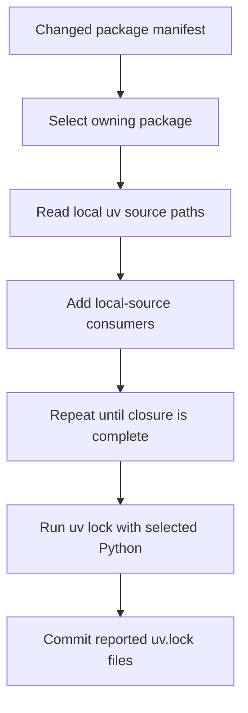
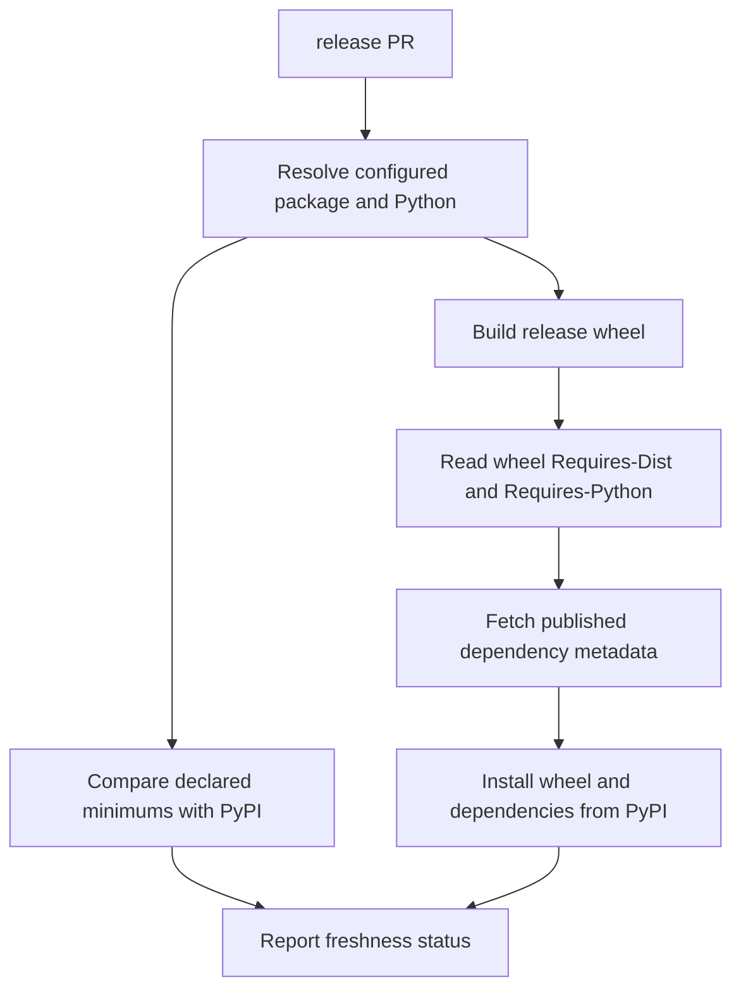
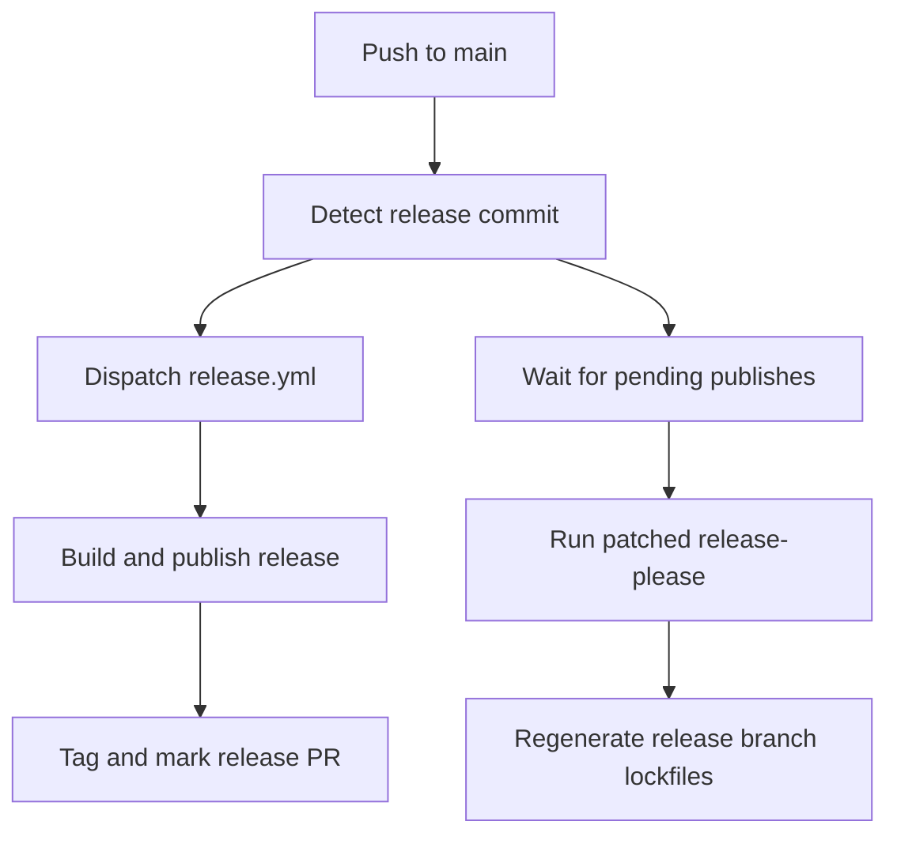

# Development and Release Operations

This monorepo has independently versioned packages under `libs/` and no root `pyproject.toml`. Work in the owning package: its `pyproject.toml` is the published contract and its `Makefile` is the supported task interface. See the [Quickstart](../quickstart.md) for initial setup and the [Testing Guide](../testing/testing-guide.md) for package tests.

## Package-local development

Use `uv` for interpreters, environments, and dependencies, and `make` for ordinary package tasks. Do not use `pip`, Poetry, Conda, a manually activated shared environment, or a repository-wide Python pin. `uv` provisions an interpreter; each package's `requires-python` is its compatibility contract.

```bash
uv tool install pre-commit
pre-commit install --install-hooks

cd libs/deepagents
uv sync --all-groups
make test
make lint
```

Run `make help` in the package for supported targets; use `uv run ...` for a one-off command. From `libs/`, aggregate targets fan out linting and lock operations across library, partner, and example packages, but they do not replace package-local setup.

| Layer | Meaning | Safe change rule |
| --- | --- | --- |
| `[project]` dependencies, extras, and `requires-python` | Published install and compatibility contract | Set downstream bounds deliberately. |
| `[tool.uv.sources]` path mappings | Editable, checkout-local sibling wiring | Do not treat it as published metadata. |
| `uv.lock` | Generated resolver state used by development and CI | Regenerate with `uv`; never hand-edit it. |

### Published contracts versus editable siblings

A green editable environment is **not** proof that published-wheel dependencies resolve correctly. Editable mappings can make local tests exercise a sibling checkout that is newer than the distribution a user receives. Validate the source-free build/install route when changing this boundary.

For example, Code publishes `deepagents==0.7.41` but maps `deepagents` to editable `../deepagents`; it supports Python `>=3.14,<3.15`. Talon has the same Python range, publishes `deepagents>=0.7.41` and `deepagents-code>=0.2.11,<1.0.0`, and uses local source mappings only for development. The exact Code pin is a release dependency: it should be raised in the PR that starts requiring new SDK functionality, not deferred to release time.

## Lockfiles: refresh the reverse-consumer closure

A changed manifest can invalidate its own lockfile and every package that consumes it through a local `uv` source, transitively. From the repository root, refresh that closure, then check the directly touched package(s):

```bash
python .github/scripts/checks/refresh_lockfiles.py libs/code/pyproject.toml
python .github/scripts/checks/check_lockfiles_pre_commit.py libs/code/pyproject.toml
```



*The manual refresh includes the changed owner and all transitive local-source consumers.*

`refresh_lockfiles.py` calculates this closure with `stale_lock_dirs`, runs `uv lock` per result, and prints every resulting `uv.lock`. ACP, Code, Evals, and Talon resolve with Python 3.14; other discovered libraries, partners, and examples resolve with Python 3.12. A lock failure stops the refresh, so do not present a partial result as complete.

The checker intentionally has narrower path mode: supplied paths select only directly touched package directories, while no paths checks every discovered package. Paths outside a package are a successful no-op. Before broad dependency work merges, run:

```bash
python .github/scripts/checks/check_lockfiles_pre_commit.py
```

After release-please creates or updates a release PR, a separate `Update lockfiles` job regenerates every tracked `uv.lock` on that release branch. It retries a rejected branch push by fetching, regenerating, and committing again up to three times. This synchronizes generated version changes without making lockfile-only changes release-worthy.

## Release ownership and scope

`release-please-config.json` is the package registry; `.release-please-manifest.json` records the last released baseline. The registry manages nine Python components with separate draft PRs and package-local changelogs. Current manifest baselines are Deep Agents `0.7.41`, ACP `0.0.13`, Code `0.2.12`, Talon `0.1.1`, Daytona `0.0.9`, Modal `0.0.8`, Runloop `0.0.7`, Vercel `0.0.2`, and QuickJS `0.4.0`. Release Please does not create GitHub releases itself; `release.yml` publishes after a release PR merges.

Do not hand-edit `.release-please-manifest.json`, generated release-PR content, changelog/version artifacts, or release-please branches. To add a managed package, update matching config, manifest, workflow detection/dispatch, and release mapping. The manifest is a last-released baseline: an unshipped `0.0.1` package needs baseline `0.0.0` to generate its first release.

Release Please scopes by changed paths, not Conventional Commit title scope. A bump-worthy `feat`, `fix`, `perf`, or `revert` touching release-relevant files in two managed components is blocked unless a maintainer applies `ci:allow-lockfile-release`. The scope detector reads trusted base-revision configuration, honors configured exclusions, and fails closed if GitHub's changed-file list is incomplete. Each managed package excludes its `tests/` and `uv.lock`, so tests or dependent relocks alone do not release a package. See [CI labeling](ci-labeling.md) for label operations.

## Release PR dependency gate

A release PR has two distinct dependency checks. The freshness step compares declared dependency minima with PyPI and manages an advisory PR comment. The artifact checks then build the selected wheel, inspect its actual `METADATA`, and create a fresh virtual environment that installs that wheel from PyPI. This is the source-free boundary that local `[tool.uv.sources]` resolution cannot test.



*The release-PR gate validates the artifact and public index separately from editable development resolution.*

The wheel validator resolves the package from the `release(...)` title and uses Python 3.14 for Code and Talon, otherwise 3.11. It rejects malformed wheel metadata, direct-URL requirements, missing PyPI responses, unsatisfied version constraints, and Python-support gaps at real supported interpreters. It evaluates active dependency markers across declared extras and representative Linux, macOS, Windows, and FreeBSD environments. A network/query failure is indeterminate and fails validation rather than assuming a dependency is available.

For repo-managed dependencies, the newest eligible PyPI release must also have `Requires-Python` equivalent to the current sibling manifest (apart from a redundant next-major ceiling). This catches an unpublished sibling metadata change even if an older public version still satisfies the nominal dependency range. For third-party packages only, a cap affecting exclusively a contiguous suffix of unreleased CPython minors is reported as a warning; a gap at the package floor, within an already released minor, or at patch level remains a failure.

The workflow additionally installs the built wheel in a new environment with `--index-url "https://pypi.org/simple"`. It deliberately unsets `UV_PYTHON` so that the installation targets the release package's selected interpreter rather than the workflow setup interpreter. Treat this check, not a workspace `uv sync`, as evidence that a user can resolve the proposed distribution.

## Patched release-please runner

The workflow installs a pinned local runner instead of `googleapis/release-please-action`, whose prebuilt bundle cannot carry unreleased fixes. The local package pins `release-please` `17.11.2` and pnpm `12.18.0`; the workspace applies a version-specific pnpm patch and an override for vulnerable `minimatch`. The frozen, script-free install fails if that patch no longer applies. Before GitHub calls, `run.mjs` checks both patched behaviors: a single-file `exclude-paths` entry excludes `uv.lock`, and a `deepagents-code==0.2.7` tag parses its component and `==` separator correctly.

The runner replaces the GraphQL history walk with a full-history blobless-clone `git log` iterator and removes the 500-commit cap. It reconstructs PR identity from squash `(#N)` or merge subjects, uses override PR bodies when present, represents merge files against the first parent, and emits both rename paths. Release Please still stops at the relevant component's last release, while the local history source avoids paginated-history timeouts and preserves path attribution.

For an upgrade, use pnpm's patch workflow so the patch, workspace entry, and lockfile stay aligned; compare a dry run with open release PRs:

```bash
pnpm install --dir .github/release-please --frozen-lockfile --ignore-scripts
GITHUB_TOKEN="$(gh auth token)" GITHUB_REPOSITORY=langchain-ai/deepagents DRY_RUN=true \
  node .github/release-please/run.mjs
```

Keep `DRY_RUN=true` for exploratory validation. It prints candidate PRs and does not write to GitHub.

## Release lifecycle and failure boundaries



*Publishing is dispatched before serialized release-PR maintenance, which waits for a known-safe repository-wide publish state.*

The detector rejects empty commits because they have no paths to scope, then recognizes a release only when a `release(<component>): <version>` subject and that package's `CHANGELOG.md` change agree. It dispatches `release.yml` with the named package, version, and exact merge SHA. Before maintenance, the guard waits for repo-wide merged PRs labeled `auto:release-pending` to reach a known-safe state; an unknown or failed pending release prevents unsafe recomputation.

`release.yml` resolves a named package and validates an exact release SHA before build and publication. It builds at that SHA, records artifact checksums, runs pre-release checks and TestPyPI before PyPI publication, then creates the GitHub release/tag from the same SHA. Build jobs are separated from trusted-publishing jobs; the latter download and verify the build artifact rather than rebuilding it. The workflow is dispatched rather than reusable so PyPI Trusted Publishing can use its direct OIDC identity. Never move or recreate a tag for a version already on PyPI: a version must identify one artifact.

## Focused validation

Start with the package checks affected by a change. For lockfile helper, release gate, or wheel-validator changes, run focused tests:

```bash
uv run --no-project --with "pytest" pytest \
  .github/scripts/tests/checks/test_check_lockfiles_pre_commit.py \
  .github/scripts/tests/checks/test_refresh_lockfiles.py \
  .github/scripts/tests/release/test_check_lockfile_release_scope.py \
  .github/scripts/tests/release/test_check_wheel_dep_freshness.py
node --test .github/scripts/tests/release/release-please-history.test.mjs
uv run --no-project --with "pyyaml" pytest .github/scripts/tests/release/test_release_please_workflow.py
```

The wheel tests cover authoritative `METADATA` parsing, marker and extra applicability, PyPI failures, direct URLs, Python-range witnesses, source-sibling metadata lag, warning-only future interpreter caps, and GitHub Actions output escaping. They also assert that the release-PR gate and release workflow retain matching source-free install flags. When package metadata changes, refresh the reverse-consumer lock closure, run the no-argument lock checker, and rely on the release-PR artifact gate for published-wheel evidence.
