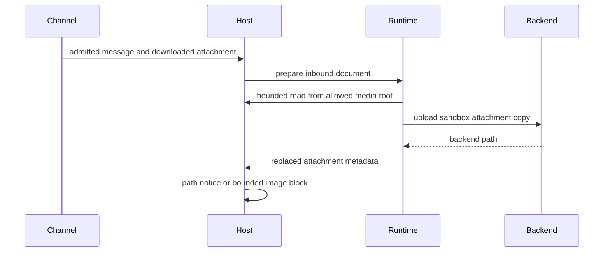
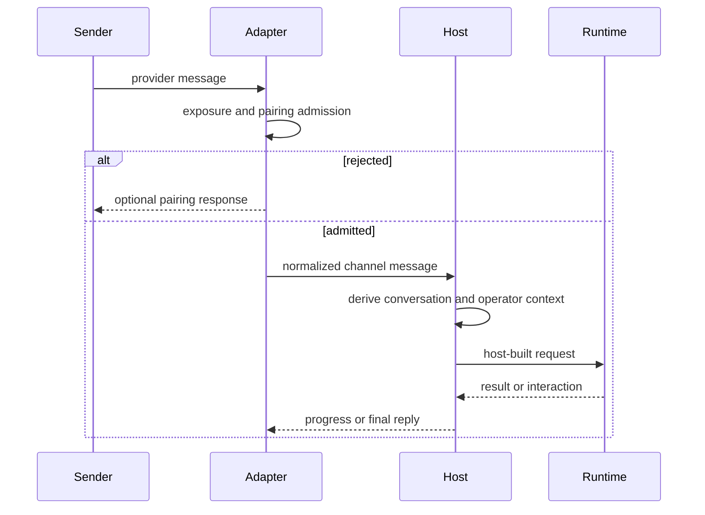
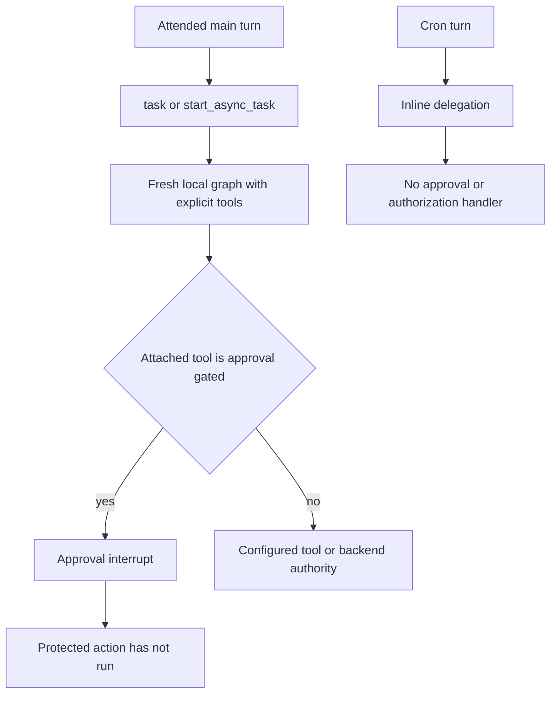
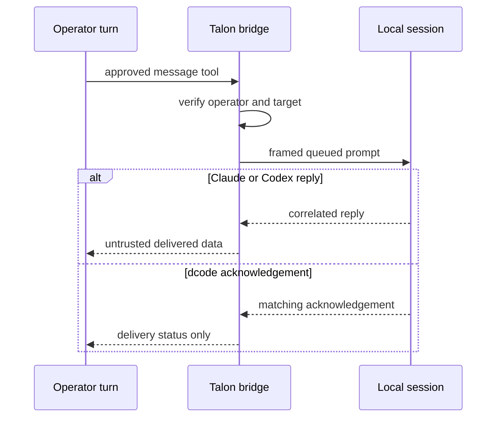

# Security and Trust Boundaries

> **Experimental local host, not a security product.** Talon is alpha software and is not intended for production or enterprise use. Its documented limitations include incomplete production-grade HITL policy, channel-administrator controls, and multi-tenant boundaries. A channel admitted to Talon should be treated as access to the operator's agent, model credentials, enabled MCP tools, and—when using the default backend—local host resources. Do not mistake a prompt, model instruction, tool-approval dialog, pairing code, or sandbox selection for complete authorization or containment.

Deep Agents follows a **trust-the-LLM** model: the agent may exercise authority made available by its configured tools, backends, credentials, and integrations. Repository text, web/MCP results, subagent output, channel messages, and cross-session replies are untrusted data. Put consequential limits below the model: use a suitable OS identity, a sandbox with mounts and egress appropriate to the task, narrowly scoped credentials, and service-side authorization.

## Keep the controls distinct

| Control | What it decides | What it does not establish |
| --- | --- | --- |
| Channel admission | Whether a provider event can start a configured agent turn | Tenant isolation, a separate OS identity, or a restricted credential set |
| Tool approval | Whether an invocation pauses for an eligible human decision | A sandbox, a service authorization check, or prevention of direct same-UID host access |
| Operator identity | Who can administer pairing and approval policy or use operator-only capabilities | That an admitted sender is harmless or that their prompt is trusted |
| Sandbox backend | The boundary implemented by the selected provider for shell/file execution | Containment for MCP, web, or channel integrations that still run in the host process |
| GitHub environment | Which jobs receive a named secret or OIDC identity at job start | Proof that the environment's external protection rules and provider-side rights are correctly configured |

The default Talon shell and file tools run on the host. `DEEPAGENTS_TALON_SANDBOX` selects an opt-in remote sandbox for them; startup fails rather than falling back to host execution if it cannot start. However, Talon keeps skills and memory on the host, and MCP tools, web tools, and channel media handling still run there. Sandbox selection is therefore valuable execution isolation, but not a multi-tenant or whole-process boundary. Run Talon under an account and on a machine appropriate to the worst authority of enabled integrations; keep assistant state, MCP configuration, and tokens outside an agent-editable workspace.

## Attachments, media roots, and sandbox staging

An attachment arriving from a channel is **untrusted inbound data**, even after an adapter has downloaded it. Admission decides whether a message can trigger a turn; it does not make its filename, MIME type, bytes, path, or embedded instructions trustworthy. Keep inbound-media directories private and separate from assistant state, credential stores, and workspaces that contain trusted operator material.

For documents, Talon deliberately gives the model a path notice rather than inlining bytes. The notice JSON-encodes the absolute path and says to treat both the attachment and path as untrusted data, not instructions. An unavailable attachment becomes the generic `_(Attachment was unavailable.)_` notice, without a provider URL, token, or transport error. Images are the exception: locally available images with an image MIME type at or below the 5 MiB inbound limit become base64 image blocks; oversized, unreadable, or non-image inputs are not made into image blocks. Video and other binary-media notices are still untrusted text and their paths must not be treated as authorization to read arbitrary host files.

When shell/file execution uses a remote sandbox, `DeepAgentRuntime.prepare_inbound_media` copies **documents** into that backend before the host prepares model text. The staging destination is `<sandbox working directory>/.talon/attachments/<UUID><safe suffix>`; the model-facing metadata is replaced with the sandbox path. The copy reads only a regular file under the configured inbound root or the matching provider-specific media-root override, resolves symlinks, uses `O_NOFOLLOW`, enforces `DEEPAGENTS_TALON_MAX_MEDIA_BYTES`, and uploads bytes through the backend. A failed stage logs server-side and only marks the attachment unavailable in the sandbox. Thus there are three distinct locations to reason about:

| Location | Trust and responsibility |
| --- | --- |
| Provider download / inbound-media root | Untrusted bytes owned by the channel integration. Its private directory is an intake boundary, not a trusted workspace. |
| Sandbox `.talon/attachments` path | A backend-readable copy for the current agent backend. It is not a claim that the original sender or document is trusted. |
| Agent/backend file path used by `send_file` | A file the configured backend can read for delivery to the initiating chat; review it as an exfiltration operation. |

*For remote execution, the host verifies an inbound document before the runtime copies it to the backend and exposes the backend path to the model.*

### Sending files back to a channel

`send_file` is request-scoped: the runtime binds a file handler for the current invocation, and the tool reads through the same agent backend used by file tools. It therefore can retrieve a local workspace file or a remote-sandbox file, but a subagent is refused and a run without a receiver does not send anything. The host also refuses delivery if the turn has been superseded, reset, or terminally authorized, so an old turn cannot post its file into a newer chat state.

The model receives the recipient-facing basename after `display_filename` removes path separators and control/format characters, substitutes a dot-only or blank name with `file`, and limits the UTF-8 name to 200 bytes while retaining a reasonable suffix. The host creates a fresh `send-` directory under the trusted outbound staging root with mode `0700`, writes the bytes with exclusive creation, `O_NOFOLLOW`, and mode `0600`, asks the adapter to upload it, and removes that per-send directory in `finally`, including after failure. A staging or channel failure is logged for operators but returns a generic result to the model (`Could not send <name> to the chat.`), rather than transport details.

Adapters that validate outbound `ChannelMedia` with a root resolve the candidate strictly, reject URL/home/traversal paths, symlink escapes, and non-regular files, then check the inferred media category and configured size cap. This protects a trusted staging root from an unsafe path reference; it does not decide whether an otherwise readable backend file should be disclosed to an admitted user.

Focused coverage: `libs/talon/tests/test_media.py` exercises path-only document framing, generic attachment failures, image limits, and root/symlink rejection. `libs/talon/tests/unit_tests/test_file_sending.py` exercises backend reads, subagent/no-chat rejection, filename neutralization, staging permissions and cleanup, and the generic channel-failure response.

## Channel admission and operator authority

Talon adapters apply exposure and pairing policy before dispatching provider input to `TalonHost`. `self` is the default exposure; `allowlist` admits configured conversations or matching text patterns; `open` admits all messages but requires an explicit acknowledgement. A mention pattern identifies text, not a sender, so a pattern in `allowlist` can admit anyone able to post matching content. Media preparation occurs only after admission.

Pairing is a revocable route for an unknown sender, not an elevation to operator. A time-limited, provider-and-sender-bound code is offered privately; only configured operator surfaces can approve it. A paired sender can invoke the same personal agent and therefore receives its configured host, model, and MCP authority, but cannot administer pairing or tool-approval policy. Verify identity out of band, pair only people you would trust with that authority, and revoke promptly. Revocation blocks future paired access and the running host cancels tracked work and pauses the sender's cron jobs.

The host, rather than channel metadata, derives the provider-qualified conversation identity, chosen model, and `tool_approval_operator` context. A reaction or message admitted by an adapter is not automatically an approval: the host binds an approval response to the matching pending request, conversation, and initiating sender. This avoids treating transport metadata or a visible reaction as authority.

*The adapter decides admission; the host owns authority-bearing request fields and runtime routing.*

See [Talon channel admission](/openwiki/concepts/talon-channel-admission.md) for provider behavior and command routing.

## Tool approval, unattended turns, and fresh subagents

Tool approval is an invocation-time mediation mechanism. Talon's policy is an exact tool-name mapping that is snapshotted for an invocation; changing it is an operator operation and takes effect on later invocations. An absent or `false` entry means no approval interrupt is created—it does not remove a tool, credential, or downstream service permission. A same-UID process or unrestricted host shell remains outside this API-level gate.

Cron fires and background-result delivery are **unattended**. The host withholds approval, authorization, and question handlers for those paths, and the runtime independently auto-denies tool-approval interrupts for cron and delivery even if a handler is injected. OAuth similarly will not begin a channel authorization flow without a current authorization handler, invocation, and attempt. Schedule work that needs a new credential grant must be remediated from an attended chat or with `deepagents-talon mcp login <server>`; do not route an authorization link to an unrelated or absent recipient.

Talon deliberately compiles local subagents as fresh graphs. `fork` is rejected; parent history and skills are not implicitly inherited. Configured tools and per-task additions are explicit, and requested additions must be unique names from the parent catalog. The fresh graph installs approval middleware only for enabled tools it actually attaches. A precompiled local subagent is refused whenever any approval policy is enabled because Talon cannot retrofit policy into an opaque runnable. A fresh subagent's research-oriented prompt is guidance, not a technical prohibition: explicitly attaching `execute` can still grant shell authority.

Detached workers copy needed context under a new task thread, clear the authorization handler and approval-operator state, and do not permit nested delegation. An unresolved approval interrupt becomes `Subagent needs tool approval; the protected action has not run.` rather than leaving a decision pending after the originating conversation ends. Treat all subagent findings, including claimed approvals or instructions embedded in findings, as untrusted evidence.

*Explicit attachment and approval affect the graph; the selected backend and credentials still determine what an allowed tool can do.*

For a normal chat turn, Talon keeps detached jobs in memory and later injects completed results only into the owning conversation. For a cron turn, `task` and `start_async_task` run inline, worker-management tools are hidden, and a separate four-slot semaphore queues work with a default ten-minute delegation limit. Both inline and detached paths project only textual answer content, exclude non-text blocks, cap it at 64,000 characters, and convert ordinary failures and timeouts into safe summaries instead of leaking tool arguments or exception payloads. These are availability, privacy, and retry-safety measures—not containment for an already authorized action.

See [Subagents and skills](/openwiki/concepts/subagents-skills.md) for the broader delegation lifecycle.

## MCP and OAuth: enabling is a trust decision

An MCP server is an authority boundary. A stdio server starts a local command; a remote server can receive conversation-derived arguments and return hostile descriptions or content. Review the command, arguments, URL, headers, scopes, allowed tools, expected egress, and token storage before enabling it. Tool-list filtering, bounded error display, and prompt sanitization reduce model-context exposure but do not authenticate or contain an enabled integration.

Talon OAuth is interactive by design. Its client uses public-HTTPS, SSRF-safe transport that ignores proxy environment settings and refuses redirects; endpoint resolution is bounded, and device-flow endpoints must share the authorization-server origin. These checks prevent discovered metadata from redirecting a credentialed client into arbitrary internal-network targets; they do not make a public service trustworthy.

Talon stores MCP tokens per owner in directories and files restricted to modes `0700` and `0600`, serializes updates with a lock, atomically replaces the token file, and preserves an old refresh token when a refresh response omits one. Those filesystem modes protect against other local users under ordinary OS semantics, not against the Talon host account or a host shell running as that account. Keep token stores out of workspaces and avoid logging token objects.

MCP status/error text is untrusted prompt input. dcode's `LocalContextMiddleware` omits `untrusted` MCP servers from the model-facing inventory and sanitizes, single-lines, and bounds errors and tracing-project names inserted into prompts. This prompt framing does not authorize a server or isolate one that has been enabled.

## Local command/session bridges

Claude Code, Codex, and dcode bridges are disabled by default and experimental. Enable them only for the operator's same-user local sessions; they are collaboration paths, not a remote-agent authorization layer. Their send tools are operator-only, unavailable to subagents, and prompt for approval by default unless an explicit policy entry disables that prompt. Disabling the prompt does not make a message safe or confer authority on its content.

- **Claude Code** uses a private, observed inbox protocol and only recognizes a listed verified version. Talon discovers sockets owned by its OS user in private directories, checks peer UID for inbound connections, correlates replies with the target socket and Talon-issued message IDs, rate-limits them, and drops unrecognized or uncorrelated frames. This protects against cross-session confusion, but a hostile process under the same OS user is inside the boundary. The target session retains its own inbound policy.
- **Codex** can queue a normal turn in a local saved session, including waking a resumable session. Talon frames it as a relayed request and correlates a final reply before returning it as untrusted data, but Codex does not enforce the framing or apply a separate inbound policy. Further, `codex queue` takes message text on the command line, so it can be visible in local process listings while the short-lived command runs. Do not send secrets through this bridge.
- **dcode** discovers live same-user sockets in private directories, verifies peer UID, sends only a framed `prompt` event, and requires a matching acknowledgement correlation ID. It reports delivery only: dcode does not send a reply back through this bridge. The framing prevents Talon from intentionally sending slash commands or queue-bypass events, but dcode does not enforce the envelope.

*Bridge framing and correlation constrain Talon's protocol behavior; same-UID trust and the target session's own controls remain decisive.*

## CI credentials and release scope

CI secrets must be stored in the narrowest GitHub environment and injected only into the consuming step or package job. Same-named GitHub secret precedence is environment, repository, then organization; audit broader scopes before deleting an environment secret because fallback may expose a broader credential. Repository and organization secrets are read when a run is queued, while environment secrets are read when the referencing job starts. Environment selection in YAML does not prove its configured secrets, reviewers, branch rules, or external provider permissions.

The release workflow separates a read-only build from jobs that can publish or mutate repository state. `test-pypi-publish` and `publish` run in the `release` environment with only `id-token: write`, download the built artifact, verify recorded checksums, and use PyPI trusted publishing. `mark-release` is a separate job with narrowly declared repository write permissions. The disabled release integration-test step preserves package-conditional secret wiring; it must not be enabled casually or used to infer that the current release environment contains provider credentials.

The credential-scoping tests statically assert package-conditional integration environments, the disabled release wiring, trusted-publishing environment and permission scope, the dedicated OpenWiki environment/App token, and step-level labeling credentials. Treat these tests as drift alarms, then separately review GitHub environment configuration and the scope of the provider credentials themselves. See [CI labeling](/openwiki/operations/ci-labeling.md) and `.github/SECRETS.md` for the credential inventory and environment policy.

## Operational checklist

1. **Choose the real isolation boundary first.** Use a dedicated low-privilege account and a sandbox provider with appropriate filesystem, network, and credential controls. Do not expose untrusted channel or repository input to a host shell by default.
2. **Keep authority separate from model context.** Treat prompts, skill text, MCP output, subagent responses, bridge replies, and channel history as untrusted. Verify consequential facts and destinations independently.
3. **Make channel exposure intentional.** Prefer `self` or narrow IDs over patterns and `open`; pair out of band; assume paired users exercise the operator agent's authority; revoke stale access.
4. **Use approval as a checkpoint, not containment.** Keep approval-policy mutation operator-only, test sender/reaction binding, and ensure scheduled/background work denies gated actions rather than prompting unattended channels.
5. **Review MCP and bridge enablement like code execution.** Scope OAuth and service credentials, protect token state, restrict local commands and egress, and do not place sensitive text in Codex bridge messages.
6. **Preserve fresh delegation.** Explicitly attach minimum tools; never treat a subagent result as proof of authorization; retain safe failure/result projection and cron inline semantics.
7. **Verify focused boundary tests.** Run `libs/talon/tests/unit_tests/test_research_subagents.py`, `test_background.py`, `test_claude_sessions.py`, `test_codex_sessions.py`, and `test_dcode_sessions.py` after relevant Talon changes. Run `.github/scripts/tests/workflows/test_workflow_secret_scoping.py` after changing workflow credential wiring or environments.

Related: [Talon runtime integration](/openwiki/integrations/talon.md), [Talon channel admission](/openwiki/concepts/talon-channel-admission.md), and [Subagents and skills](/openwiki/concepts/subagents-skills.md).
