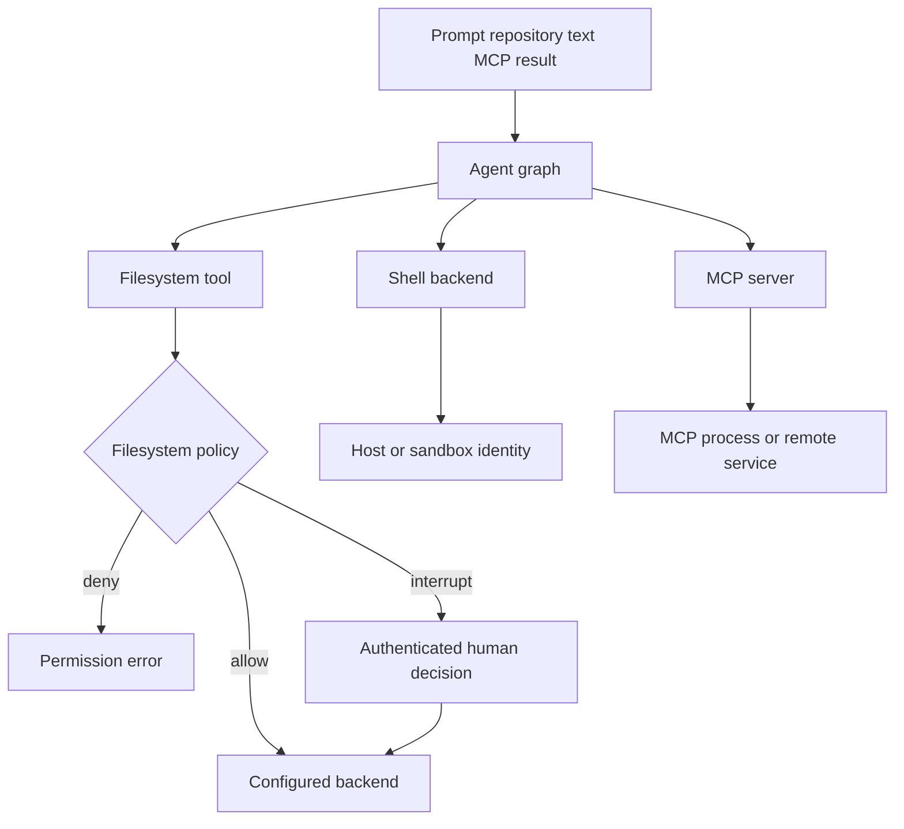

# Security Boundaries and Operational Safeguards

## Start with authority, not prompts

Deep Agents uses a **trust-the-LLM** model: an agent can do whatever its configured tools and backend permit. Prompts, repository instructions, tool output, MCP responses, and model self-restraint are therefore not access controls. Put hard confidentiality, integrity, process, and egress limits in the operating-system identity, backend, sandbox, network policy, and credential scope.

*Tool middleware can mediate a call, but the selected backend, process identity, credentials, and network ultimately determine authority.*

This distinction prevents common category errors:

- Filesystem permissions constrain built-in filesystem tools, not a direct backend call or a shell command.
- Approval pauses a configured action; it is not a sandbox, credential vault, or policy enforcement point for unmediated actions.
- A workspace binding prevents a reconnecting client from substituting server-selected policy; it does not make execution in that workspace safe.
- Repository configuration is input. It needs an external trust decision before it can cause code execution, credential use, or network access.

## Filesystem rules and execution are different boundaries

`FilesystemPermission` applies ordered `allow`, `deny`, and `interrupt` decisions to the SDK's built-in filesystem tools. Rules use absolute, non-traversing patterns; the first matching leaf rule applies and an unmatched operation is allowed. For a restrictive policy, pair narrow allows with a later catch-all deny.

The middleware handles bulk operations defensively. It removes denied paths from bulk reads, evaluates requested paths and resolved symlink targets on filesystem backends, and filters aliases that resolve into denied trees. For deletion, a confirmed leaf follows first-match behavior, but recursive or potentially recursive deletion uses conservative all-or-nothing overlap checks so an applicable deny cannot be bypassed by deleting a parent directory. Interrupt rules become HITL predicates: exact and bulk tools are scoped differently, current-directory or missing bulk paths are treated conservatively, and `glob` cannot use an absolute or `..` pattern to redirect a search outside a reviewed path.

A nonempty filesystem-permission policy is rejected on an execution-capable backend because `execute` is outside that middleware's enforcement. The limited `CompositeBackend` route-prefix exception protects routed file operations only; it does not contain the default executable route. Subagents can replace inherited permissions, and remote async subagents need their own approval policy.

### Local shell is host authority

`LocalShellBackend` deliberately runs `subprocess.run(..., shell=True)` on the host. Its working directory, virtual filesystem mode, timeout, output truncation, and optional environment shaping do not sandbox a command: it can access arbitrary paths, start processes, connect to the network, and act with the launching user's permissions. In particular, `virtual_mode=True` does not restrict `execute()`.

Use it only for suitably trusted local development. For untrusted inputs, shared services, or production, select an isolated sandbox/backend and an identity with no ambient secrets. HITL is useful defense in depth, but a user approval cannot undo a command's inherited authority.

## Sandboxes are provider boundaries with trusted setup

dcode creates or attaches to a selected sandbox through its registry. A fresh sandbox is normally cleaned up when the context exits; an attached `sandbox_id` is not treated as owned. Snapshot use is validated against provider capability and cannot be combined with attaching an existing sandbox.

Sandbox setup is itself executable authority: dcode reads the specified script, expands it against the workspace environment, and executes it with `bash -c` inside the sandbox. Treat setup scripts and provider parameters as trusted deployment inputs, not repository conveniences. A sandbox only supplies the isolation its provider and its configured credentials, mounts, and egress controls actually provide; it does not sanitize model instructions or make a broad provider identity least-privileged.

## Project extensions are code execution

Python extensions are experimental and disabled unless the experimental flag and extension setting allow them. User, installed-plugin, configured, and explicit CLI extension sources are already user-authorized under this model. Project `.deepagents/extensions/` is different: dcode loads it only after an explicit per-run grant, an `always` trust policy, or a persisted trust record for that project; interactive startup explains that it runs arbitrary Python and offers once, remember, or skip.

Trust is workspace-specific. When server configuration is resolved for another project, dcode drops launch-project MCP and sandbox-setup policy and does not carry explicit extension paths across; it re-reads only that target project's stored extension trust. A later grant is not silently applied to an already bound thread that was created without it. Operators should review extensions as local code, use a separate profile for experiments, and revoke project trust when changing ownership or switching clones.

## Treat dotenv and MCP definitions as untrusted project input

dcode blocks high-risk process-execution variables from dotenv layers and prevents project dotenv from setting MCP trust, Auto-review, subagent, and recursion controls. The project dotenv gate comes from trusted global configuration; if that cannot be read, project dotenv loading is skipped. Keep secrets and policy decisions in the launch environment, managed/user configuration, or a secret-injection system—not in a checkout.

A project `.mcp.json` can name a local command or remote endpoint and interpolate environment values. Its trust lists are consequently loaded only from managed/user configuration and selected process environment, never from repository configuration. Server approvals bind a definition fingerprint to a repository or worktree as appropriate; changed definitions and changed workspaces require fresh approval, denies accumulate, and malformed trust configuration is surfaced for fail-closed handling. The dangerous project-MCP environment option is an intentional process-level bypass, never a repository setting.

`resolve_mcp_server_env` expands only braced `${VAR}` and `${VAR:-default}` syntax in supported command, URL, argument, environment, header, and OAuth fields. It rejects malformed references and unset required values rather than passing ambiguous text through. This validates interpolation syntax and types; approving a stdio server still authorizes its command and environment, while approving a remote server authorizes its connection and request data.

## OAuth tokens: protected files, not a vault

Deep Agents Code stores MCP OAuth state in profile state under `mcp-tokens`. Safe server-name validation and URL/client identity hashing prevent path traversal and separate same-named servers at distinct endpoints. The JSON envelope can contain access and refresh tokens, expiry, OAuth metadata, and client registration, so it is secret material and must not be logged, committed, or placed on a shared volume.

Mutations take an in-process per-path lock, create a private directory where supported, write a `0600` temporary file, atomically replace the destination, and harden the resulting file. This protects complete-file publication and same-process updates, not a different process or principal that can read the account's files. Corrupt, non-object, or unsupported-version files fail with instructions to remove the file and log in again. Token representations may expose bearer values, so errors and logs must report structural facts rather than token objects.

Talon applies the same operational principle to its credential file and additionally guards OAuth discovery: its transport accepts safe public HTTPS endpoints, ignores proxy environment settings, disables redirects, bounds DNS/HTTP work and JSON response size, and rejects mixed public/private DNS resolution. These controls reduce SSRF exposure for OAuth metadata; they do not make an approved MCP service trustworthy or reduce an OAuth grant's scope.

## Workspace binding and secondary-model input handling

In server mode, dcode binds a thread to a canonical server-resolved workspace and policy in SQLite. Later runs reject unbound, substituted, incompatible, unsupported-schema, or identity-changed contexts. Policy fingerprints detect durable policy drift, while persisted workspace policy deliberately excludes model credentials and prompts. Protect the SQLite database and deployment tenancy separately.

Untrusted repository text, shell output, MCP results, and conversations can still influence a model. The thread-title generator limits its secondary call to bounded visible human/AI content, excludes system/internal/control and user-shell messages, disables callbacks, uses a tool-free model, times out, and normalizes output. Apply the same pattern to new summarizers and classifiers: explicit data allowlist, size limit, no tools/callbacks, bounded runtime, validated output, and no-secret assumption.

## Talon channels and approvals

Talon is a long-running host around channel adapters, an agent runtime, and optionally a scheduler. It serializes each conversation, replaces an active turn only after cancellation handling, and starts/stops channels and scheduler around the agent lifecycle. Treat inbound chat, thread history, media, reactions, and authorization callbacks as untrusted input to the agent rather than as operator instructions.

A pending tool approval is bound to the agent conversation, originating channel conversation, and initiating sender. A textual `approve` or `deny` from another sender is rejected and re-prompts; valid replies resolve the pending future. Reaction approvals additionally require a matching provider, conversation, prompt message, and authorized sender before they are accepted. The host audits matched or ignored reactions without logging raw identifiers unless the explicit diagnostic environment switch is enabled.

Channel exposure configuration is part of the security perimeter. Operator-only commands such as model selection require a configured operator identity (with the self-channel exception), while sender pairing and revocation can cancel the revoked sender's active work and pause jobs they created. Configure channel allowlists/pairing before enabling powerful tools, protect operator accounts, and regard channel approval as a human decision layer rather than a replacement for sandboxing.

## Privileged GitHub automation: `pull_request_target`

The PR labeler runs on `pull_request_target`, so it can label fork PRs with base-repository permissions and, for an opened PR, obtain a GitHub App token to check private organization membership. Its security invariant is explicit: it checks out the **base branch**, then loads the base branch's labeling script. It must never check out or execute the PR head in this privileged context.

The job requests only read contents plus pull-request/issue write permissions, uses the App token only where membership checks or downstream event propagation require it, and otherwise uses `GITHUB_TOKEN` for labeling. Secrets supplied to topic classification are another boundary: do not add PR-controlled code, actions, paths, or shell interpolation to a job that receives them. Preserve pinned action SHAs and review changes to this workflow as privileged-code changes.

## Operational checklist

1. **Choose hard boundaries first.** Use sandbox isolation, least-privileged OS/service identities, read-only mounts, restricted egress, and narrowly scoped credentials.
2. **Keep mediation honest.** Test filesystem order, symlinks, bulk filtering, recursive-delete overlap, glob redirection, approval/edit/reject paths, and direct-shell bypass assumptions.
3. **Treat repositories as hostile.** Do not permit project dotenv, MCP, extension, hook, or sandbox-setup content to grant itself trust.
4. **Operate credentials as secrets.** Monitor permission-hardening warnings, avoid token logging, test corruption recovery and endpoint separation, and protect profile/state directories.
5. **Secure human channels.** Authenticate operators, configure exposure and sender pairing, test mismatched text/reaction approvals, and plan revocation/cancellation behavior.
6. **Protect CI privilege.** In every `pull_request_target` job, execute only trusted base-repository code and minimize permissions, tokens, secrets, and write operations.
7. **Test injection boundaries.** Include adversarial repository text, tool output, shell output, MCP responses, channel messages, and extension/setup files in focused tests.

See [permissions and HITL](/openwiki/concepts/permissions-hitl.md), [filesystem tools](/openwiki/concepts/tools-filesystem.md), [MCP](/openwiki/integrations/mcp.md), [sandbox partners](/openwiki/integrations/sandbox-partners.md), and [CI labeling](/openwiki/operations/ci-labeling.md) for adjacent guidance.
