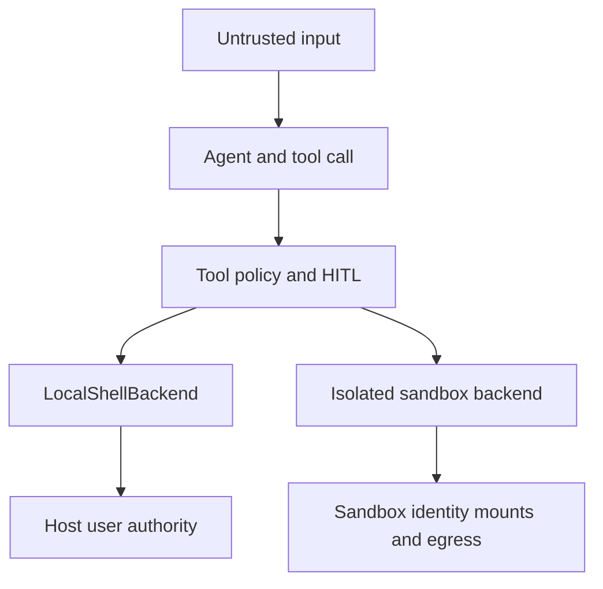
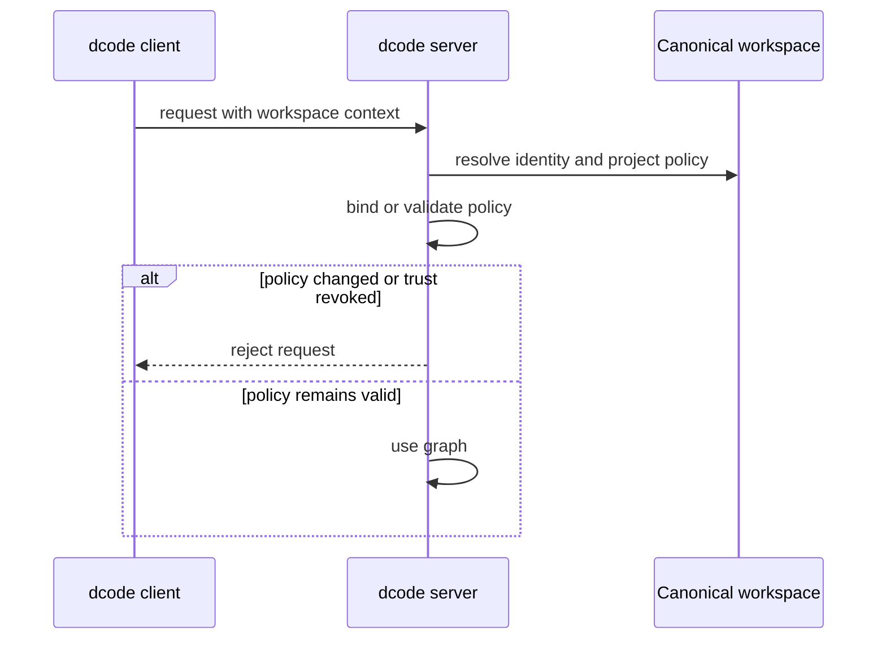

# Security and Trust Boundaries

Deep Agents uses a **trust-the-LLM** model: an agent can exercise the authority that its configured tools and backend expose. Treat prompts, repository content, tool output, MCP responses, and channel messages as untrusted inputs, not as an authorization boundary. Put limits at the tool, backend or sandbox, OS identity, network, and credential layers.

## Execution and filesystem authority

`LocalShellBackend` executes commands on the host without sandboxing or isolation. `virtual_mode` restricts filesystem-tool path handling, not shell commands, and inherited environment is opt-in. Use a genuinely isolated backend for untrusted input, shared hosts, or production: approval can authorize a call, but cannot confine a host shell.

*Tool approval decides whether a mediated action proceeds; the selected backend defines its execution boundary.*

### Filesystem middleware

Filesystem rules classify the built-in `ls`, `read_file`, `glob`, and `grep` tools as reads and `write_file`, `edit_file`, and `delete` as writes. Rules are evaluated in order with **first-match** semantics and an allow default. Patterns must be absolute and cannot contain `..` or `~`; rule effects are allow, deny, or approval interrupt.

For a local `FilesystemBackend`, including one selected by a `CompositeBackend`, the middleware evaluates both the requested path and its resolved target. A deny on either blocks the tool call; with a nonempty policy, a resolution failure is denied. Recursive deletion additionally checks whether the target overlaps a denied pattern. This applies to mediated filesystem tools, not arbitrary shell commands or direct backend use.

`RepositoryBounds` is a distinct read-only inspection boundary for coding subagents. It fails closed to `ls`, `read_file`, `glob`, and `grep`; applies lexical and canonical containment checks against traversal and symlink escape where possible; bounds result volume; and turns backend failures into bounded unavailable errors. It is not a general shell authorization mechanism.

## dcode server and workspace trust

### Sanitize the child server environment

The dcode launcher creates the `langgraph dev` child environment from the current process, removes project-dotenv-loaded values, then strips dynamic-loader, interpreter/path, shell-startup, askpass, and Node startup variables. It also removes LangGraph cloud/auth and LangSmith tenant/control-plane credentials, sets `LANGGRAPH_AUTH_TYPE=noop`, and disables the control-plane key. The default bind is loopback and the internal server uses an ephemeral port.

`PYTHONPATH` deserves separate treatment: the launcher removes it before the server interpreter starts so an inherited untrusted-project path cannot shadow imports. It carries the launch value in a private bootstrap variable that the approval-gated agent shell can later restore; pre-existing carrier variables are discarded. The launcher similarly replaces its LangSmith carrier from captured bootstrap state. Persistent or scoped restart overrides cannot alter the selected profile, profile marker, Python-path carrier, or LangSmith carrier.

Treat a production deployment's network and route authentication as deployment responsibilities. The generated built-in dcode configuration opts custom HTTP routes into LangGraph's route-auth layer when an auth backend is configured, but its ordinary production launcher uses noop auth and relies on its loopback bind.

### A checkout is not permission to execute its configuration

Project MCP configuration, sandbox setup, extension paths, and project extensions are directory-scoped execution grants which the server—not a client—must resolve. A bound workspace policy is re-resolved per request; if a recorded extension-trust grant disappears, including because the trust store cannot be read, dcode refuses the thread. Switching outside the launch project drops launch-project MCP configuration, sandbox setup, explicit extension paths, and project MCP trust, then reads extension trust for the target project.

*Project-scoped authority is resolved by the server for the canonical workspace, rather than inherited from a client path or previous checkout.*

Project dotenv files are untrusted. dcode denies values that can relocate the trust root or cause code execution through loaders, interpreter/path settings, shell startup, askpass, or Git configuration; `startup.read_project_dotenv` cannot itself be set by dotenv. Keep secrets in operator-controlled configuration.

Hooks use canonical workspace-root trust, atomically and restrictively persisted under locks; their session grants are tied to the current hook-file fingerprint. Resolution or fingerprint failures fail closed. Python extensions require experimental extensions, extension loading, and applicable project trust before trusted project sources can execute factories and register capabilities. Installed plugin Python declarations must remain existing `.py` files under the plugin root and have a nonempty version, but installation is still an operator trust decision because manifests can supply MCP and hooks.

## MCP and OAuth boundaries

An MCP server is an authority boundary: stdio starts a local command, while remote MCP can receive sensitive data and return hostile tool descriptions or content. Review command, arguments, URL, headers, OAuth configuration, scopes, allowed tools, and expected egress before enabling one.

Talon loads only well-formed named server entries; it expands `${VAR}` references from runtime or process environment and validates string fields. It supports `stdio`, `sse`, and streamable HTTP transports. Stdio environment values cannot set startup-hijacking variables such as `LD_PRELOAD`, `PYTHONPATH`, or shell initialization variables. Remote OAuth cannot be combined with an explicit `Authorization` header. Tool loading is bounded to 30 seconds, failed servers are reported as unavailable rather than contributing tools, and an optional allowlist or denylist filters a server's exposed tools.

OAuth login is intentionally interactive. Without a terminal or current Talon conversation authorization handler, an OAuth-required scheduled job or background subagent fails with instructions to authorize from chat or run `deepagents-talon mcp login <server>`; it does not create a prompt with no accountable recipient. Channel device-code authorization binds the server name, tool invocation, and expiry to its flow.

Talon's OAuth transport validates public HTTPS endpoints with SSRF protection, ignores proxy environment settings, does not follow redirects, bounds DNS resolution, requests, discovery, and response size, and revalidates metadata endpoints before using them. These controls prevent a discovered endpoint from becoming an arbitrary internal-network request; they do not establish trust in a public remote service.

dcode token storage derives safe paths from server identity and warns that token representations must not be logged. Talon token storage uses owner-only directories/files, locking, and atomic replacement, preserves an existing refresh token when a refresh response omits one, and warns that filesystem hardening is not confidentiality isolation from its default shell backend. Store tokens outside agent workspaces and run Talon under an account appropriate to the authority those tokens convey.

## Talon runtime, admission, and unattended work

Talon's default backend is still `LocalShellBackend`, but its child environment is deliberately reconstructed rather than inherited. It admits only a small runtime-oriented allowlist plus `LC_` keys, forces a fixed safe `PATH`, and removes loader/shell/Python hijack variables, LangSmith/LangChain settings, and keys whose names indicate credentials or tokens. This reduces incidental secret and startup-state exposure; it does not sandbox the host filesystem, process, or network.

Unknown direct-message senders require a time-limited pairing code bound to provider, sender, and conversation. Only operator surfaces can approve it. A paired sender receives the operator's configured credentials and host access but cannot administer pairing or tool-approval policy; verify identity out of band and revoke promptly.

Talon tool approval policy is an exact-name, revisioned immutable invocation snapshot. Enabled entries create approval interrupts; updates require operator context and a compare-and-swap revision, and take effect only for the next invocation. An absent or `false` entry does not create an approval gate, so policy edits can reduce oversight and need the same operational review as any authorization change.

Scheduled jobs and background-result delivery are **unattended**. Talon withholds question, breakout, tool-approval, and channel OAuth authorization handlers from background delivery; its runtime also rejects all approval interrupts for cron and background-delivery requests, even if a handler was supplied. Scheduled work has a 30-minute outer bound and is repaired after timeout; revoking the paired sender that created a job cancels that sender's scheduled work. Pre-authorize the exact capabilities that unattended work needs, or design its tools to fail safely without an interactive person.

## ACP and operating checklist

ACP persistent execution approval is scoped to canonical full tool-argument JSON and the current session context. Changed commands, arguments, contexts, or sessions require review; invalid requests cannot receive reusable permission. This narrow reuse rule applies to `execute`; verify the graph's `interrupt_on` configuration for every other sensitive tool.

1. **Choose the backend first.** Do not expose untrusted repository or channel input to a host shell, privileged OS account, inherited secrets, or unrestricted egress.
2. **Use path policy as tool mediation, not confinement.** Test requested paths, symlink targets, and recursive deletion; keep shell authority separately constrained.
3. **Grant checkout authority explicitly.** Review hooks, extensions, sandbox setup, and MCP per canonical workspace; do not carry grants across project switches.
4. **Treat MCP configuration and OAuth as deployment authority.** Restrict stdio commands and remote scopes, protect token state, and never log token objects.
5. **Require a human for human decisions.** Pair senders out of band, keep approval policy operator-owned, and ensure cron/background tasks auto-deny gated actions rather than prompting an unrelated channel.
6. **Exercise focused tests after boundary changes.** Relevant coverage includes `libs/code/tests/unit_tests/test_server_helpers.py`, `libs/acp/tests/unit_tests/test_execute_permissions.py`, and Talon's `test_tool_approval_batch.py` and `test_questions.py`.

See [Code agent architecture](/openwiki/architecture/code-agent.md), [permissions and HITL](/openwiki/concepts/permissions-hitl.md), [Talon channel admission](/openwiki/concepts/talon-channel-admission.md), and [MCP integration](/openwiki/integrations/mcp.md).
