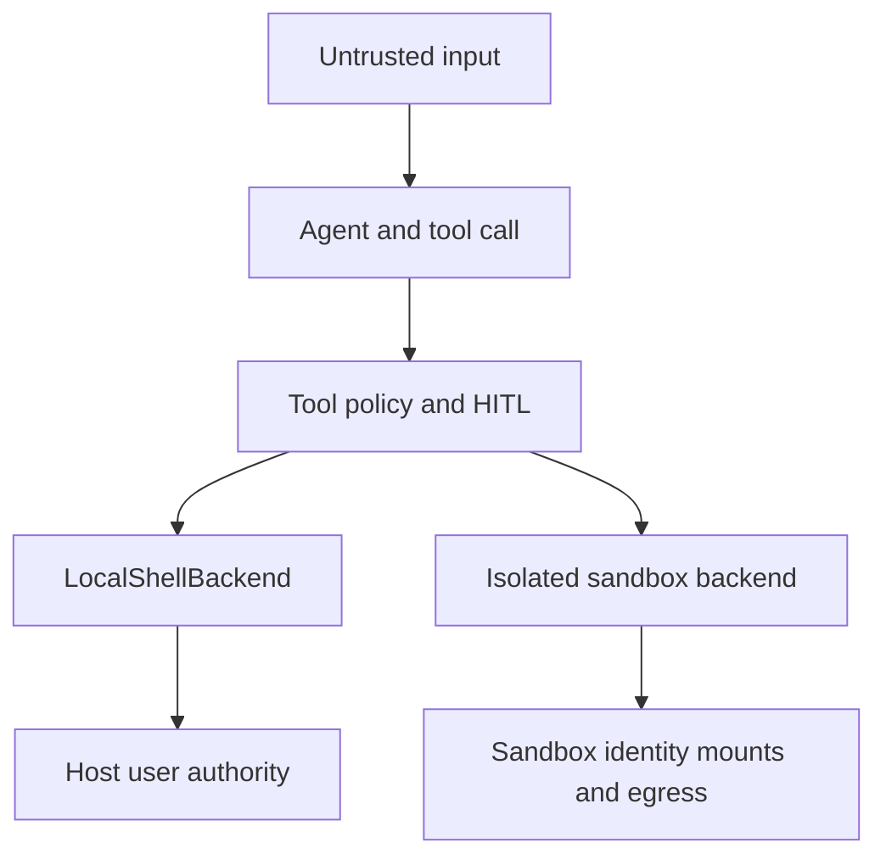
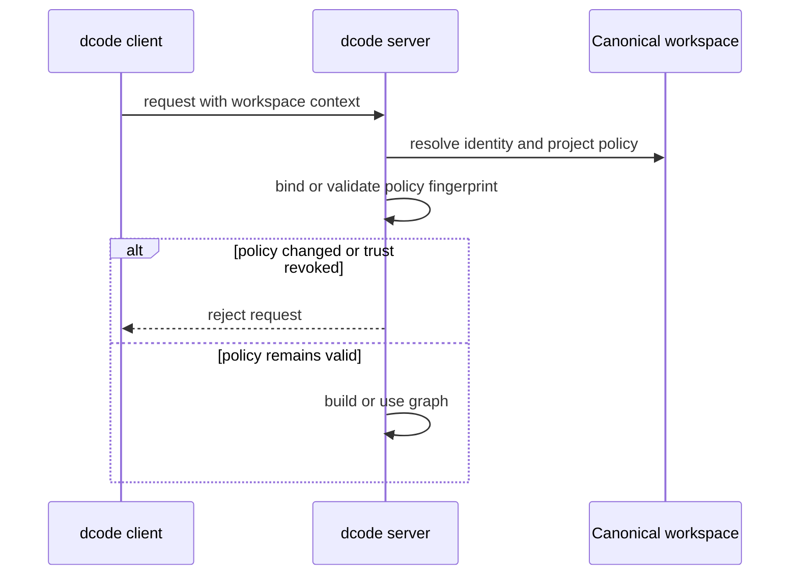

# Security and Trust Boundaries

Deep Agents has a **trust-the-LLM** security model: an agent can exercise every authority exposed by its tools and backend. Prompts, repository files, tool output, MCP responses, and messages received through a channel can all be hostile instructions or data. Do not use model behavior as a security control; put confidentiality, execution, network, and filesystem limits at the tool, backend/sandbox, operating-system identity, and credential boundaries.

## Start with execution authority

`LocalShellBackend` is not a sandbox. It runs commands on the local host with `shell=True`, the launching user's authority, and the configured working directory. Its `virtual_mode` constrains filesystem-tool path interpretation only; it does not constrain shell access to absolute paths, network connections, child processes, or inherited environment. Its default is a fresh environment unless `inherit_env=True`, so operators should pass only the required environment variables rather than inherit secrets wholesale.

Use `LocalShellBackend` only for trusted local-development contexts. For untrusted input, shared hosts, or production execution, use a genuinely isolated `BaseSandbox` implementation or a backend without host execution, and separately constrain mounts, process identity, egress, resource quotas, and credentials. HITL can review a mediated `execute` call, but it does not turn host execution into confinement.

*Tool approval is an authorization decision; only the selected backend establishes the execution boundary.*

### Filesystem policy is mediated, ordered policy

`FilesystemPermission` classifies built-in filesystem tools as read or write and applies the **first matching** glob rule for that operation; no match currently allows the call. `allow`, `deny`, and `interrupt` respectively proceed, return an error, or become an approval interrupt. Permission patterns must be absolute and may not contain `..` or `~`.

For `FilesystemBackend`, including one reached through `CompositeBackend`, the middleware checks both the requested path and its symlink-resolved target; a deny on either blocks the operation, and a failure to resolve under a nonempty policy becomes an error. Deletion is stricter: recursive or descendant deletion is rejected when it overlaps a denied pattern. These controls apply to filesystem tools, not direct backend calls or arbitrary shell commands.

The coding agent's read-only repository inspection boundary is separate from general filesystem policy. `RepositoryBounds` permits only `ls`, `read_file`, `glob`, and `grep`; rejects traversal and non-contained absolute paths; canonicalizes containment for local filesystem and sandbox backends to stop symlink escape; and caps listing, read, and rendered-result volume. Backend errors produce bounded unavailable errors rather than granting access or crashing the subagent. This is appropriate for repository-reading subagents, not a general authorization layer for a shell.

## dcode: a checkout does not authorize its configuration

Treat project configuration as code supplied by the checkout. In server mode, dcode explicitly identifies project-scoped MCP configuration, sandbox setup commands, project Python extensions, and extension paths as execution-granting policy that the server must resolve for the workspace rather than accept as a client assertion. A thread is bound to canonical workspace identity and policy. On each request the server re-resolves policy, rejects drift, and refuses a bound thread if an extension-trust grant has disappeared rather than silently rebuilding with altered authority.

When a session switches to a different project, dcode drops launch-project MCP configuration, sandbox setup, explicit extension paths, and project-MCP trust rather than carrying them into the new checkout. Extension trust is re-read for the target. This prevents one trusted checkout from lending its startup authority to another directory.

*The server, not a client-provided path or prior session, owns project-scoped authority resolution.*

### Hooks, dotenv, extensions, sandbox setup, and MCP

Project hooks require workspace trust. The trust store keys entries by canonical workspace root, serializes mutation with thread and file locks, writes atomically with restrictive permissions where supported, and refuses to overwrite malformed or unreadable stores. Session grants are content-bound to the hook-file fingerprint and are re-evaluated when the working directory changes. Headless use can require an explicit grant rather than reuse persisted interactive trust.

Project `.env` files are untrusted. dcode prevents dotenv files from injecting profile relocation, dynamic-linker, interpreter/path, shell-startup, askpass, and Git configuration/command variables. `startup.read_project_dotenv` is itself protected from dotenv injection, so a project cannot decide whether its own dotenv file is read. Keep secrets in operator-controlled profile/configuration locations, not in a repository `.env`; the denylist reduces known startup attacks but does not make repository configuration trustworthy.

Project Python extensions execute arbitrary Python and load only when experimental extensions and extension loading are enabled, the project policy is not `never`, and a one-run grant, `always` policy, or persisted project trust authorizes the project extension directory. User-configured paths, CLI paths, and discovered installed plugins are separate sources; operators must treat every enabled source as executable code. Extension failures are isolated and reported, but successful registrations can add tools, middleware, and backend routes.

Project MCP servers are skipped until project trust is granted and may still be disabled by user policy. An approved stdio server can execute a local command and an approved remote server can receive sensitive requests, so validation or interpolation is not a reduction in authority. Review commands, URLs, arguments, environment/header values, OAuth settings, tool scopes, and data egress before granting trust. Sandbox setup is likewise deployment code, not repository metadata to run by default.

Operator-installed plugin manifests may contribute MCP definitions, hooks, and—when experimental support is enabled—Python extension files. Manifest path components are resolved inside the plugin root and Python entries must be existing `.py` files; a Python extension also needs a nonempty plugin version. Those checks constrain declaration shape and path escape, but installation remains the trust event: only install plugins from sources that the operator is prepared to execute with dcode's authority.

## Credentials: persist carefully and do not confuse storage hardening with isolation

MCP OAuth access and refresh tokens are secrets. In dcode, token storage uses a profile state directory and validates server names before using them in filenames; token identity incorporates the server URL and optional client ID. Token writes use restrictive file modes and atomic replacement, while refresh locking coordinates concurrent processes. Do not log `OAuthToken` objects: their representation can expose bearer and refresh tokens.

Talon persists MCP credentials in `~/.deepagents/mcp-tokens` with owner-only directory/file modes, locking, and atomic replace. It retains an old refresh token when a refresh response omits one, as OAuth permits. This is persistence hardening—not a confidentiality boundary against Talon's default shell backend, which can read accessible absolute paths. Store credentials outside agent workspaces, run under a dedicated account, and do not expose that account's shell to untrusted senders.

Talon also protects OAuth metadata discovery as a network boundary: discovery uses HTTPS-only, proxy-ignoring, redirect-disabled SSRF-safe transport with bounded DNS/HTTP work and a 64 KiB response limit. Operators should still authorize the MCP server itself and its scopes; safe discovery does not make the remote service trusted.

## ACP approval scope

The ACP server translates graph interrupts into a client permission request. `Approve` and `Reject` apply once. Its “always” choice is intentionally narrower for `execute`: the server stores a canonical JSON representation of the **complete arguments** together with the session context—working directory, mode, model, and session identity. A changed command, arguments, context, or session requires another review; reordered JSON object keys do not. Invalid/non-serializable requests cannot receive reusable permission, and forgetting a session discards its grants.

For non-`execute` tool calls, ACP's session “always” allowance is by tool name. Review the graph's `interrupt_on` configuration as well as client behavior: permissions only cover calls that actually interrupt, and auto-approved plan updates are a separate special case.

## Talon: admitting a sender grants powerful access

A Talon channel message is an external input boundary. Pairing is available for Discord, Slack, and Telegram. An unknown direct-message sender receives an eight-character, one-hour pairing code tied to its provider, sender ID, and conversation. Only operator surfaces—`/pair approve <code>` or the pairing CLI—can consume that code; paired senders cannot operate `/pair` or alter approval policy. The pairing store uses locking and atomic replacement, rejects symlinks and oversized/non-regular data, and fails closed on unreadable or invalid records.

Pairing is high impact: a paired sender is admitted in chats the bot can see, with the Talon operator's configured credentials and host access. Use it only after out-of-band identity verification, scope channel exposure narrowly, revoke promptly, and treat a pairing-store failure as an access incident to repair—not a reason to bypass admission checks.

Talon approval policy is an operator-owned, exact-name map. Enabled names produce approve/reject interrupts; unspecified tools do not prompt. The policy file is bounded, read without following symlinks, hashes its exact bytes as a revision, and is updated through compare-and-swap. `update_tool_approvals` requires the operator context and saves a change for the **next invocation**; the current invocation retains its immutable snapshot. Setting an entry to `false` disables prompting for that tool, so it is not an authorization grant and must be reviewed as a reduction in oversight.

## Operating checklist and focused tests

1. **Classify the authority before enabling a feature.** Is it a host shell, sandbox, filesystem tool, extension, hook, MCP server, channel sender, or credential? Apply controls at that component, not in the prompt.
2. **Default to isolated execution.** Do not put untrusted repository or channel input in reach of `LocalShellBackend`, inherited secrets, unrestricted egress, or a privileged OS user.
3. **Require explicit project trust.** Review and grant hooks, MCP, sandbox setup, and project extensions per canonical workspace. Re-bind/restart when policy or trust changes; do not preserve authority across project switches.
4. **Make approval scope visible.** Use HITL for sensitive calls, know whether “always” means exact command or tool type, and remember that approval neither confines a shell nor delegates authority to a child or remote service.
5. **Protect state and revoke safely.** Restrict state directories, protect OAuth and pairing stores, avoid secret logging, verify paired senders out of band, and use policy revisions/CAS instead of blind writes.
6. **Exercise the boundary tests.** Run `libs/code/tests/unit_tests/hooks/test_trust.py` for canonical and fail-closed hook trust, `libs/acp/tests/unit_tests/test_execute_permissions.py` for exact ACP execution approvals, and Talon pairing/approval unit tests under `libs/talon/tests/unit_tests/` when changing those paths.

See [Backends](/openwiki/concepts/backends.md), [permissions and HITL](/openwiki/concepts/permissions-hitl.md), [filesystem tools](/openwiki/concepts/tools-filesystem.md), [MCP integration](/openwiki/integrations/mcp.md), [sandbox partners](/openwiki/integrations/sandbox-partners.md), [Talon](/openwiki/integrations/talon.md), and [running a dcode session](/openwiki/workflows/run-dcode-session.md).
