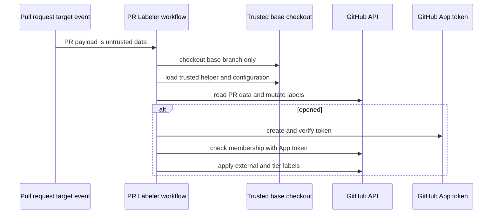
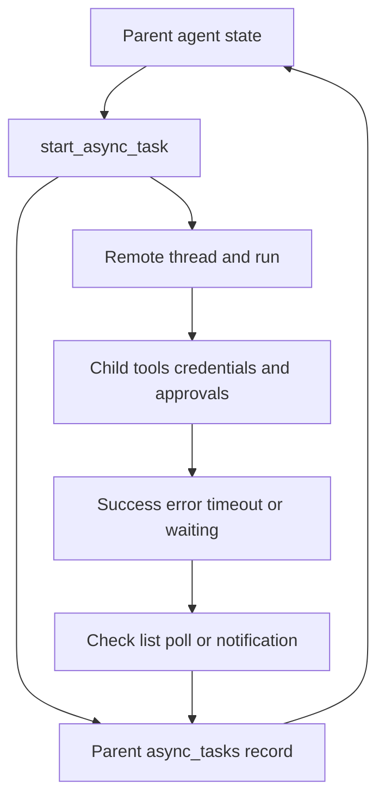
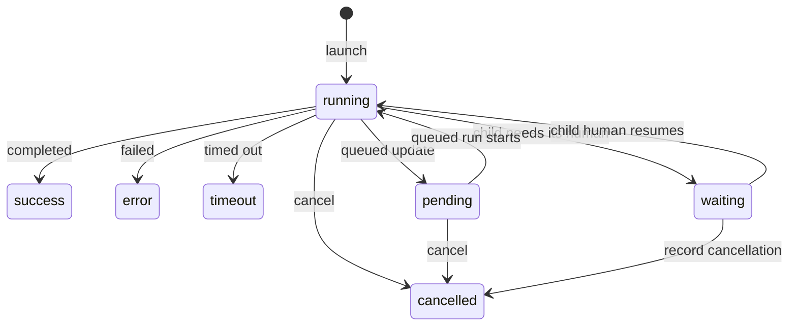

# Security Boundaries and Operational Safety

Security controls in this repository are boundaries around authority, not instructions to a model. Deep Agents follows a trust-the-LLM model: an agent can use every capability its configured tools and backend make available. Treat prompts, repository text, tool results, MCP results, and child results as untrusted input; enforce confidentiality, integrity, execution, and egress limits with the tool policy, backend or sandbox, network policy, operating-system identity, and narrowly scoped credentials.

## Privileged PR labeling: data may be untrusted, code may not

`PR Labeler` handles `opened`, `synchronize`, `reopened`, and `edited` through `pull_request_target`. That event has base-repository authority for fork pull requests, so the non-negotiable rule is: **checkout only the trusted base branch and execute only the base branch's labeling code**. The workflow then loads `.github/scripts/labeling/pr-labeler.js` and its configuration from that checkout. It must never checkout, require, run, or interpolate shell from a PR head in this job.

PR titles, bodies, branch names, changed paths, patches, event fields, and authors remain input data for that trusted code. The job runs in the `labeling` environment with deployment disabled and needs `contents: read`, `pull-requests: write`, and `issues: write`; workflow-level permissions are only `contents: read`. Keep action pins immutable full SHAs, minimize secrets, and treat any change to the workflow or loaded labeling helper as a privileged-code change.

*`pull_request_target` authority is confined to code from the trusted base checkout; PR-controlled content is data passed to that code.*

### Tokens, provenance, and failure behavior

For an opened PR, the job generates and verifies a GitHub App token before using it to look up private organization membership. The helper classifies bots and active members as internal, a 404 as external, and rethrows other membership errors rather than silently guessing. External opened PRs receive contributor-tier and `org:external` labels through the App token; the workflow comments that this token is needed because events created by the default `GITHUB_TOKEN` do not trigger downstream workflows. That event-propagation behavior is **notification linkage**, not cross-deployment authorization: it does not grant a downstream workflow permission to trust PR code, remote agent input, or a child deployment.

The labeler also chooses safe degradation for uncertain classification. Title-renaming API failure warns and continues with the original title. A failed topic comparison or classifier preserves a human-removed topic label rather than reapplying it. Membership failures other than 404 stop the classification step; they must not become an internal classification. Configuration loading fails if required groups are absent or malformed. These choices avoid converting an unavailable dependency into an assertion of trust.

Concurrency separates non-cancelled `opened` work from cancellable update work for the same PR. This preserves opening-time provenance work while allowing a newer synchronization, reopen, or edit run to replace an obsolete update run. Keep label mutations in the unified workflow rather than adding another concurrent writer.

## Delegation creates a new authority domain

An async subagent is a remote Agent Protocol run, not a continuation of the parent process. `start_async_task` creates a remote thread and run, returns its thread ID immediately as `task_id`, and records that identity, current run, status, and timestamps in the parent `async_tasks` state. The parent owns this observation record; the remote graph owns its own tools, backend, credentials, network access, prompt, approval workflow, checkpointer, and policy. A child configured with a remote `url` may receive caller-provided headers, while managed deployments can obtain SDK authentication from environment variables. Treat both as credentials for the child deployment, not as implicit parent permissions.

*The parent tracks lifecycle state, while the child deployment remains responsible for execution authority and approval decisions.*

The default async launch is isolated and sends only the delegated description. Experimental `mode="fork"` sends a snapshot of reconstructed conversation history, but it does not copy the parent's system prompt, tools, filesystem permissions, credentials, or HITL configuration. Forked text and media are therefore information flow, not authorization flow. Before forwarding, the middleware removes local artifacts and local eviction metadata, restores blob-backed tool content for the snapshot, and serializes portable messages. Design remote child prompts and retention policies on the assumption that forked content can contain untrusted user, repository, tool, or model text.

The middleware exposes `start_async_task`, `check_async_task`, `update_async_task`, `cancel_async_task`, and `list_async_tasks`. It validates configured agent names and duplicate names; a bad task ID or unknown type is an error without changing tracked state. Client instances are cached by URL and resolved headers. URL-less local ASGI transport requires an async parent entrypoint such as `ainvoke`; synchronous invocation requires a reachable URL.

### Lifecycle is not approval delegation

A successful child run whose thread is interrupted is represented as `waiting`, not `success`: the child is paused for its own human's input or approval. The parent can inspect the pending interrupt and continue other work, but cannot answer or approve it. A remote child's filesystem rules and `interrupt_on` configuration must be installed in that child graph. Sharing a parent conversation, trace relationship, or task ID does not share approval authority.

`update_async_task` starts a new run on the same child thread. The default `interrupt` strategy replaces active work; if the child is waiting, it drops the human request rather than resolving it. The `enqueue` strategy queues behind current work and can report `pending`; it retains earlier run IDs so an earlier completion cannot be mistaken for the latest request. Only one queued update per task is accepted per model turn, preventing parallel calls from losing tracking. If earlier work pauses for a human, a queued follow-up still starts and the pause is dropped. Cancellation marks a waiting task cancelled without cancelling a completed paused run; otherwise it cancels the latest run and attempts earlier pending or running queued runs newest-first.

*`waiting` belongs to the child thread's human workflow; an update or cancellation is lifecycle management, not a parent approval.*

On asynchronous execution, status pulls occur at agent start, before model calls, and after a final answer. Checks are time-bounded; failed observation is logged and skipped until later, rather than inventing a terminal outcome. `list_async_tasks` filters cached state before refreshing selected nonterminal work and retains cached status on refresh failure. Completion notifications mark child text as a system notification, escape text that could close its framing tags, clip long results, and keep only text and supported media blocks; reasoning and tool-call blocks are excluded. A notification from a superseded run is rewritten so it cannot be treated as the latest result.

Same-deployment children may wake an idle or errored parent only when their launch reference contains both parent thread and assistant identity; a reject-on-conflict strategy avoids replacing a newly busy parent run. A parent waiting for a human is not awakened because that could cancel its approval. A remote child, or one with `notify_parent=False`, keeps at most parent-thread provenance and cannot wake the parent. A `webhook` is an Agent Server callback to the configured application endpoint, not an authorization channel and not a replacement for durable parent-side checking. Set `notify_parent=False` when the application owns delivery, and authenticate, authorize, and replay-protect that webhook endpoint independently.

## Filesystem permissions and HITL are mediated controls

`FilesystemPermission` applies ordered `allow`, `deny`, and `interrupt` rules to built-in filesystem tools. Absolute non-traversing patterns are required; the first matching leaf rule wins and no matching rule allows the call. Direct backend access is outside this policy. Denied paths are removed from bulk read results, and recursive or potentially recursive deletion uses conservative all-or-nothing overlap checks so an allowed parent cannot delete a denied descendant. On `FilesystemBackend` and routed filesystem paths, both the requested path and a symlink-resolved target are checked; resolution failures deny or produce errors, and listings filter aliases into denied trees.

Interrupt rules become HITL predicates, with separate exact and bulk scopes. Missing or current-directory bulk paths are treated conservatively, symlink targets are checked where a backend is available, and `glob` patterns cannot redirect a reviewed path outside its scope without review. Approval controls that particular mediated graph call; it is neither a sandbox nor a credential grant.

A nonempty filesystem permission policy is rejected for an execution-capable backend because `execute` has no equivalent permission enforcement, except when every rule is scoped to a `CompositeBackend` route prefix. `LocalShellBackend` executes with `shell=True` under the launching user's host authority; virtual filesystem mode changes filesystem methods but does not restrict command execution. Use an isolated execution backend, least-privileged identity, restricted mounts and egress, and credentials unavailable to the shell whenever untrusted input can influence commands.

## Repository configuration, extensions, and sandbox setup

A checkout is input, not a trust source. Deep Agents Code blocks high-risk process-execution variables from project dotenv files and prevents them from injecting MCP trust, auto-review, subagent, or recursion controls. If trusted global dotenv configuration cannot be read, project dotenv loading is skipped rather than assumed enabled.

Project MCP server trust is resolved from managed or user configuration and selected process environment, not repository files. Approvals bind a definition fingerprint to a repository or worktree as appropriate; denies accumulate, and malformed trust configuration is surfaced for fail-closed handling. MCP interpolation accepts only supported braced environment references in command, URL, arguments, environment, headers, and OAuth fields, rejecting malformed references and missing required values. Syntax validation does not reduce the authority of an approved command or remote service.

Project Python extensions execute only when experimental extensions are enabled and trust comes from an explicit run grant, always-trust policy, or stored trust. Switching projects deliberately drops launch-project MCP, sandbox-setup, and explicit extension-path policy instead of carrying it forward. A configured sandbox setup script is trusted deployment input: the sandbox factory validates provider snapshot capability and executes the configured script after expansion in the workspace environment. It cleans up sandboxes it created, not attached sandboxes.

## Credentials, persistence, and secondary processing

MCP OAuth state is secret-bearing JSON. Deep Agents Code uses safe server-derived paths, in-process mutation locks, atomic replacement, and owner-only permission hardening where supported, but operators must still protect the profile/state location. Talon uses analogous derived credential storage and preserves a refresh token omitted in a refresh response, but warns that workspace placement and file permissions do not provide confidentiality against its default shell backend. Talon OAuth metadata fetching accepts safe public HTTPS endpoints through an HTTPS-only, proxy-ignoring, redirect-disabled SSRF-safe transport with bounded DNS/HTTP work and a 64 KiB JSON limit; it rejects mixed public/private DNS resolution.

In server mode, dcode binds each thread to a canonical server-resolved workspace and policy in SQLite. Later runs reject unbound, substituted, fingerprint-mismatched, unsupported-schema, or identity-changed context; persisted workspace policy intentionally excludes secret model credentials and prompts. Thread-title generation similarly treats conversation content as untrusted: it uses bounded visible human/AI content, excludes system/internal/control and user-shell messages, makes a tool-free, callback-free secondary call with a timeout, and normalizes output.

## Operational checklist and focused tests

1. **Protect CI privilege.** Preserve the base-only checkout invariant in every `pull_request_target` job. Pass PR-controlled values only as data to trusted code; do not execute PR paths, actions, or shell fragments alongside secrets or write tokens.
2. **Install controls where execution occurs.** Configure each remote child graph's tools, filesystem policy, sandbox, network, credentials, and HITL independently. Do not infer authorization from a parent link, notification, webhook, or forked context.
3. **Fail safe under uncertainty.** Stop privileged membership classification on unexpected API failure; retain human removals; report unavailable child status as cached/unknown rather than completed; make application callbacks independently authenticated.
4. **Use durable task observation.** Test launch, check, waiting, resume, interrupt and enqueue updates, cancellation of latest and superseded work, polling timeout/failure, notification escaping, and webhook ownership separately.
5. **Treat local execution and configuration as code.** Keep project dotenv, MCP definitions, extensions, and sandbox setup from self-authorizing. Keep secrets out of repository and shell-visible environments.
6. **Run focused regression tests.** `python .github/scripts/tests/labeling/test_pr_labeler.py` exercises labeler contracts. `libs/deepagents/tests/unit_tests/test_async_subagents.py` covers task validation, isolated/fork payloads, status lifecycle, waiting, updates, cancellation, and notification behavior.

See [CI labeling](/openwiki/operations/ci-labeling.md), [permissions and HITL](/openwiki/concepts/permissions-hitl.md), [subagents and skills](/openwiki/concepts/subagents-skills.md), and [runtime behavior](/openwiki/architecture/runtime-behavior.md).
