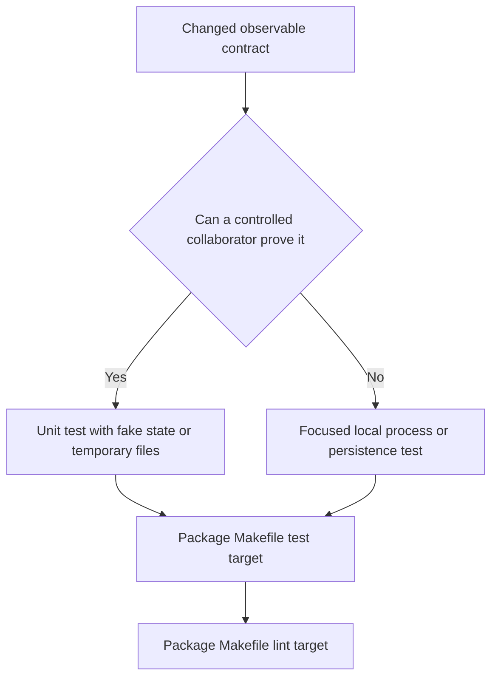
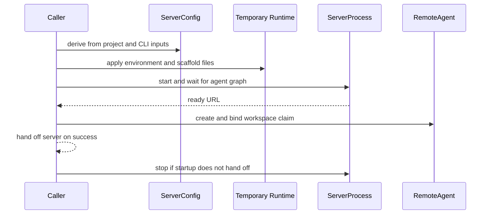
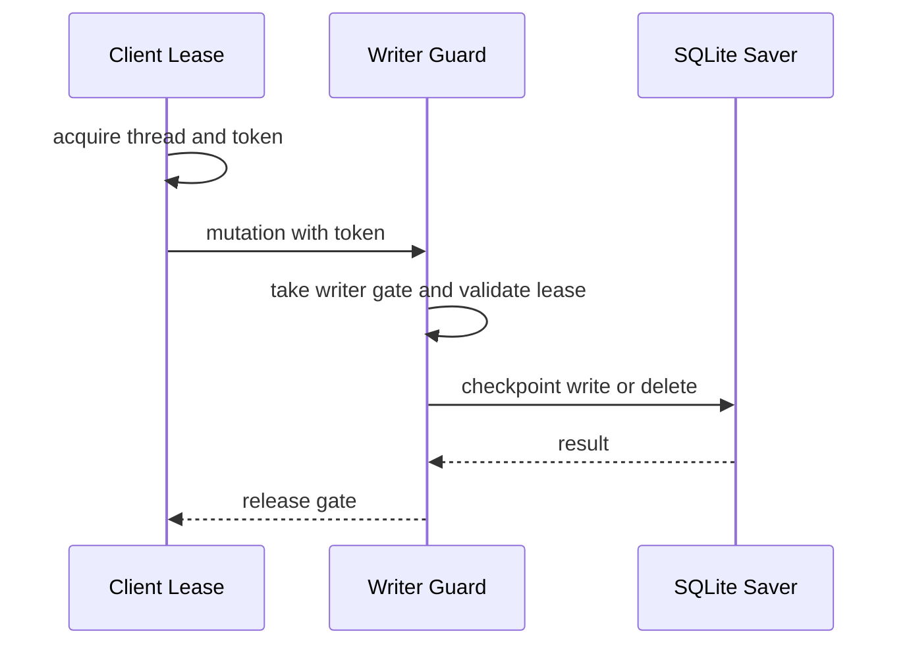
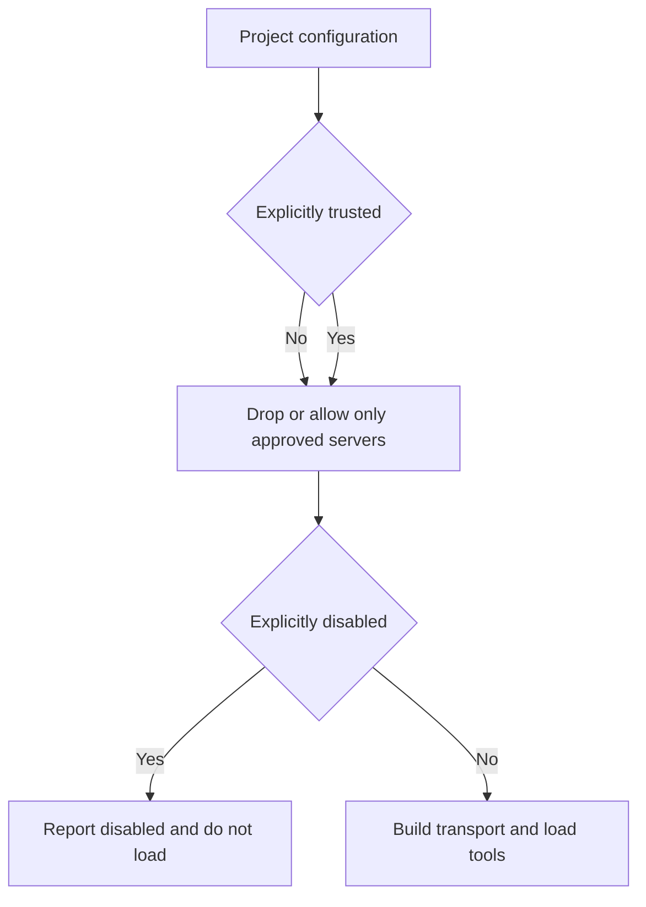

# Testing Guide

For dcode changes, test the observable contract at the narrowest deterministic seam. Use a fake backend, temporary SQLite database, controlled environment, patched collaborator, or Textual `run_test` pilot before adding a subprocess test. Reserve process coverage for a boundary that cannot be represented faithfully—such as CLI/server startup or import-time profile state—and reserve model-backed evaluation for an explicit evaluation run. This complements [Development](../operations/development.md), [Run a dcode session](../workflows/run-dcode-session.md), and the architectural [code-agent](../architecture/code-agent.md) and [source map](../architecture/source-map.md) pages.

## Run the package authority

Run commands through `libs/code/Makefile`; do not replace its socket, parallelism, timeout, or coverage policy with ad-hoc pytest invocations. `make test` defaults `TEST_FILE` to `tests/unit_tests/`, runs with xdist, disables network sockets except Unix sockets, and accepts extra pytest arguments through `PYTEST_EXTRA`. `integration_tests` switches the target to `tests/integration_tests/` and applies its 30-second timeout.

```bash
make -C libs/code test TEST_FILE=tests/unit_tests/test_server_manager.py
make -C libs/code test TEST_FILE=tests/unit_tests/test_thread_ownership.py
make -C libs/code test TEST_FILE=tests/unit_tests/test_transcript_virtualization.py
make -C libs/code test TEST_FILE=tests/unit_tests/tui/widgets/test_message_store.py
make -C libs/code test PYTEST_EXTRA='-k wakeup' TEST_FILE=tests/unit_tests/test_run_queue_wakeup.py
make -C libs/code integration_tests TEST_FILE=tests/integration_tests/<focused_test>.py
make -C libs/code lint
```

`coverage` is the dedicated XML-report target; `update-snapshots` is limited to smoke snapshots. The dcode lint target also validates the generated command catalog and process working-directory rules. Unit-test collection establishes a synthetic `DEEPAGENTS_HOME` before imports, snapshots and restores `os.environ`, and clears global dotenv, tracing, and related runtime state so tests do not inherit a developer profile, credentials, or daemon discovery.

The same package-local rule applies outside dcode. For example, `libs/evals` uses its `test` target with sockets disabled, while `make -C libs/evals evals MODEL=<id>` deliberately runs model-backed evals. `libs/partners/modal` separates socket-disabled unit tests from 30-second integration tests. Do not copy dcode's parallelism or coverage flags into those packages: inspect that package's Makefile and pass a focused `TEST_FILE`/`PYTEST_EXTRA` only where it supports them.

```bash
make -C libs/evals test TEST_FILE=tests/unit_tests/test_harbor_langgraph_agent.py
make -C libs/partners/modal test TEST_FILE=tests/unit_tests/test_sandbox.py
make -C libs/evals evals MODEL=<id>
```

## Select the seam



*Start at the controlled unit seam; cross a process boundary only when it is the behavior under test.*

- **Server lifecycle and configuration:** patch `ServerProcess`, runtime scaffolding, and `RemoteAgent`; assert configuration transfer, readiness, workspace binding, and cleanup rather than spawning a server.
- **Private upstream compatibility:** seed real lightweight upstream state, install the patch, then assert both the optimized path and the safe fallback when the upstream shape does not qualify.
- **Concurrency and durable state:** use a temporary sessions database and real locks; coordinate with events instead of sleeps. A small helper subprocess is appropriate when the invariant is explicitly cross-process.
- **Middleware:** invoke the sync and async hook with fake tool handlers or backends. Verify the protected output and failure response, not the middleware's incidental helper calls.
- **Textual UI:** use `App.run_test` and its pilot only for actual mount, scroll, focus, or interaction behavior. Keep store arithmetic and autocomplete ranking as ordinary unit tests.

## Server startup, handoff, and cleanup

`start_server_and_get_agent` captures the project context, validates MCP configuration, derives one `ServerConfig`, transfers it to the server environment, creates and scaffolds a temporary runtime, and waits for the `agent` graph. Only after readiness does it construct a `RemoteAgent` and bind the user workspace plus a session-workspace claim and fingerprint. The returned server is then owned by the successful caller; `server_session` is the higher-level lifecycle owner.



*Startup hands a server to its caller only after graph readiness and workspace binding; every earlier failure path reaps it.*

Use `test_server_manager.py` for these contracts:

- Round-trip a `ServerConfig` through the environment and test the filesystem allowlist as a fail-closed boundary. An explicit allowlist must include `read_file`; empty, malformed, non-list, and non-string serialized values are invalid.
- Capture configuration passed into the process seam. Relative explicit MCP paths must be normalized from the captured project context, while server-owned MCP/trust policy is absent from a managed workspace claim.
- Test generated runtime contents directly: source checkouts use a local package dependency, the generated graph map exposes only `agent`, and the HTTP app uses custom route authentication.
- Block `wait_for_graph_ready`, cancel the startup task, and schedule a loop callback. Assert that `stop()` runs outside the event loop. On a readiness failure, assert abandoned startup gets a short grace period except when sandbox cleanup requires the full graceful window.

For the real CLI/server/persistence boundary, keep a separate integration test such as headless resume. Give helper and CLI subprocesses a temporary `HOME` and `DEEPAGENTS_HOME` before importing dcode, because profile paths and the sessions database are captured at import time. This prevents a resume test from touching a developer profile.

## Runtime compatibility patches

dcode carries narrowly scoped patches over private upstream APIs. Their tests should be contract tests, not broad mocks: pin the expected upstream shape, show the improvement with realistic state, and prove that version drift degrades safely.

### Checkpointer delta history

The LangGraph API custom checkpointer adapter inherits the base delta-history method, which prevents normal attribute forwarding to an inner saver. `install_delta_history_forwarding()` patches only adapters that still expose the base methods. The replacement delegates to an inner saver only if that saver overrides the base operation; otherwise it preserves the base ancestor walk.

In `test_checkpointer_adapter.py`, seed a `StateGraph` with a `DeltaChannel` into a temporary `AsyncSqliteSaver`. Compare the adapter's original result to the patched result and spy on the SQLite fast path. A companion saver deliberately lacking an override proves the fallback still returns the normal history. Keep the server-only import environment minimal (`REDIS_URI`) rather than starting a server.

### LangSmith and run scheduling

`install_untraced_inline_override()` is process-global and belongs only in the server process. It runs the two known traceable bookkeeping callbacks inline when tracing is off; any other call still uses LangSmith's default thread hop because it may perform I/O. Test a traced and untraced decorated coroutine: untraced success and failure must avoid `run_in_executor`, while tracing still preserves nested run relationships and the executor path.

`install_run_queue_wakeup()` replaces the in-memory runtime's fixed scheduler poll with an event signaled after `Runs.put`, while leaving the upstream claim operation and fallback polling interval intact. It installs idempotently only when `Runs.next` and `Runs.put` have the pinned static-method signatures; an unexpected shape must leave the runtime unmodified. Reset both methods and the wakeup object per test, then use an event barrier to show a pending insert wakes a waiting `Runs.next` without a timing sleep.

## Workspace ownership and checkpoint writers

Thread ownership protects a locally persisted thread from independent clients and stale server processes. Acquiring a thread produces a lease token; mutations carry that token in `x-dcode-thread-owner`. Before a checkpoint write, `writer_guard` serializes writers through local and filesystem gates and verifies both the recorded token and the client reservation. A released, crashed, or superseded client therefore fences its old server from writing.



*The writer gate makes ownership validation and the database mutation one fenced operation.*

Use `test_thread_ownership.py` with a temporary database to cover failure ordering that a mock cannot establish:

- A helper subprocess cannot acquire an already leased thread, but another thread remains available; releasing the lease permits a replacement owner.
- A client crash, ownership rotation, or failed restart invalidates an old token. The old server must reject writes, while the successor token can write.
- The ownership-fenced saver rejects tokenless or stale `aput` and `aput_writes`, and forbids deletion while another client owns the thread. Reads remain possible and deletion succeeds once the lease is released.
- Cancellation is safety-critical: cancellation during acquisition or deletion must wait for the blocking operation, release reservation/gates afterward, and never expose a half-finished database mutation. Concurrent local writers queue through the local async gate rather than polling each other.

## Local context and managed memory

`LocalContextMiddleware` gathers project context through the active backend, so the same detection runs in a local shell or remote sandbox. Its local-context snapshot, fingerprint, and refresh cutoff are private graph state: they do not become public output or trace state. When summarization reaches a valid cutoff, a changed snapshot is appended as a tagged message rather than replacing the saved initial snapshot. A forked subagent on the same thread reuses the parent snapshot; a different thread detects its own context.

Test both `before_agent` and `abefore_agent` with concrete sync or async fake backends. Cover malformed/out-of-range summarization cutoffs, deduplication by snapshot fingerprint, and escaping of context embedded in message content. A dotenv test must demonstrate that project credentials can load while `BASH_ENV` cannot influence backend startup detection.

`ManagedMemoryGuardMiddleware` protects marker-delimited onboarding-name blocks in configured memory files. It allows unrelated edits, but if `edit_file` or `write_file` changes or removes a managed block, it restores that block while retaining unrelated edits and returns a tool error. Deletes of a guarded file or a parent directory are rejected before the tool runs when a managed block exists; an existing unreadable file also fails closed. Test the synchronous and asynchronous wrappers, partial-marker removal, preserving unrelated edits, and the no-follow symlink restore hardening where `os.O_NOFOLLOW` is available.

## Virtualized transcripts and completion

The message store retains lightweight `MessageData` for the full transcript while mounting only a visible window of Textual widgets. Archived rows are represented by spacers whose height comes from measured or default height hints. Streaming and live-tool rows are protected against pruning, with independent protection reasons so releasing one reason cannot accidentally unprotect another. On resume, `bulk_load` mounts a bounded tail rather than all historic widgets.

Transcript virtualization must be tested at two seams:

1. In `tui/widgets/test_message_store.py`, test store ranges, hydration thresholds, edge hydration, height-hint clamping and scaling, bounded tail loading, and protection invariants with `MessageData` only.
2. In `test_transcript_virtualization.py`, run a real `DeepAgentsApp` pilot. Assert wheel/trackpad, keyboard, and scrollbar movement produce `_ChatScroll.Scrolled` when the vertical offset changes; then prune a small window and prove scrolling toward either spacer remounts the archived boundary widgets. Also assert spacers occupy the archived row height, so the view can reach a history edge instead of stalling.

For autocomplete, keep fuzzy ranking and controller behavior outside a Textual pilot. Compare optimized fuzzy search against a simple reference scorer over a fixed corpus, and test controller handling with a mocked completion view. Treat project filenames as untrusted display/input data: unsafe control or deceptive names must not enter suggestions or the chat input. Thread completion is a separate `@@` grammar that searches durable thread metadata and inserts the canonical `@@(thread:<uuid>)` token.

## Completion checklist

1. Identify the observable contract and choose a controlled unit seam first.
2. Run the focused `libs/code` Makefile target; use `PYTEST_EXTRA` only to add pytest selection or diagnostics.
3. Own environment, temporary files, database rows, global patch state, and cleanup in the test fixture.
4. For private-API patches, assert both the qualifying fast path and an upstream-drift fallback.
5. For cancellation or ownership behavior, coordinate with events and assert cleanup/fencing after cancellation rather than relying on sleeps.
6. Escalate to an integration test only for a real process, import-time configuration, durable persistence, or CLI/server contract.
7. Run `make -C libs/code lint` before completion.

## Headless, configuration, and MCP security seams

Headless tests should exercise the decision that is specific to non-interactive execution, not a full terminal session. `run_non_interactive` starts the server with `interactive=False`; initial skills are passed as pinned metadata for the server to read rather than loaded by the client. An unanswerable skill-trust interrupt is resumed with an explicit denial. Project hooks are also deny-by-default in headless mode: only `--trust-project-hooks` enables them, and an interactive persisted grant is intentionally insufficient.

For command approval, unit-test `_make_hitl_decision` with a resolved shell allowlist. No allowlist rejects `execute`; every pipeline segment must be allowed and dangerous shell syntax remains rejected. `SHELL_ALLOW_ALL` is the explicit exception. For lifecycle hooks, use a controllable coroutine to verify that a slow `SessionEnd` is cancelled after its bound and is fired at most once.

Configuration tests must distinguish trusted user input from repository input. Test dotenv precedence with temporary global and project files: shell values win, project values precede global values, but project variables must not interpolate into the trusted global file. A project `.env` may set ordinary values but must not set trust, extension, plugin-cache, shell-allowlist, or similar user-security decisions; test the global-file counterpart separately. Keep `conftest.py` isolation in place when exercising reload paths, because a refresh otherwise rereads a developer's global dotenv or managed policy.

MCP has two complementary seams:

- Use the in-memory `FastMCP` registry when testing transport construction, schema/session behavior, and per-server failure isolation; it routes a real adapter without a subprocess or socket.
- Use mocked discovery and loader boundaries for trust filtering. An untrusted project `.mcp.json` must not reach the loader (especially a remote URL with interpolated headers); explicit whole-project trust can admit it, but an explicit disabled server still wins. Include symlink or path-identity failures: an uncertain user/profile identity is demoted to project scope rather than promoted to trusted input.



*Project MCP configuration crosses a trust filter before transport construction, and an explicit disable overrides a trust grant.*

## Plugin state and final Markdown

Plugin update tests should build a temporary marketplace, install a versioned plugin, and replace only marketplace materialization. `check_plugin_updates()` refreshes remote enabled plugins under the mutation lock; manifests opting into `autoUpdate` are installed, while other version changes are persisted as available updates and announced only when newly observed. A failed refresh retains the previously saved availability so recovery does not re-notify. Test the CLI's check/install transition and the plugin-manager row from the persisted state; an uninstalled explicit target must fail rather than silently creating state.

For completed assistant replies, use a Textual pilot because rendering and selection are observable UI contracts. Stream each representative Markdown corpus into `AssistantMessage`, capture rendered rows, stop the stream, and assert its single `FinalMarkdown` widget renders identical rows across widths and themes. Separate pilots cover encoded URLs reaching the checked URL opener unchanged, wide-character code staying within cell width while selection preserves source text, and copy behavior rejoining layout wraps without padding. These tests prevent transcript jumps and unsafe link transformations at the streaming-to-final-renderer handoff.

## Harbor adapters, partner sandboxes, and workflow contracts

Harbor adapter tests are local graph-construction contracts, not Harbor job runs. Assert that `langgraph.json` maps the dcode, bare, and tau3 graph factories; fake model and agent factories to inspect the dcode graph's headless, auto-approved local configuration. The adapter must generate a bounded, ASCII-safe assistant id from a session id and hash normalized collisions, scrub provider and tracing credentials from the shell backend's temporary environment, then restore the process environment. For optional web search, test key-gated tool creation, result and response-size bounds, and failure-as-tool-output. Tau3 should translate only forwarded streamable HTTP MCP servers and reject dataset-provided stdio commands.

`ModalSandbox` batch file operations are deliberately per-file: absolute paths are required, errors are encoded in each `FileDownloadResponse` or `FileUploadResponse`, and a failure must not prevent a later file from transferring. Use a mocked `modal.Sandbox` with a failing first open and a real `BytesIO`/temporary destination second open; assert both ordered results and handle closure.

Workflow tests are static contracts. Parse YAML rather than executing GitHub Actions, normalize PyYAML's boolean interpretation of `on`, and assert exact environment mappings. The integration workflow scopes each secret expression to the package that needs it; the disabled release integration step retains its package-scoped wiring. OpenWiki uses read-only workflow permissions, a dedicated environment, credential-free checkout, and creates its write-capable app token only after the update command. The experiment-name helper is similarly tested as a compatibility contract: names retain the historical derivation, sanitize slash/colon characters, hash the raw branch for a stable slug, and omit optional empty category or reasoning segments.

## Focused-file map

Use these focused files when the change matches their contract; this is routing, not a requirement to run every file.

| Change boundary | Focused test |
| --- | --- |
| Headless startup, HITL, hooks, and skill trust | `libs/code/tests/unit_tests/test_non_interactive.py` |
| Dotenv precedence and project configuration trust | `libs/code/tests/unit_tests/test_config.py` |
| MCP discovery, trust filtering, and transport behavior | `libs/code/tests/unit_tests/test_mcp_tools.py` |
| Marketplace update persistence and UI state | `libs/code/tests/unit_tests/plugins/test_plugin_updates.py` |
| Finished reply layout, selection, and URL handoff | `libs/code/tests/unit_tests/tui/widgets/test_final_markdown.py` |
| Harbor LangGraph adapter configuration | `libs/evals/tests/unit_tests/test_harbor_langgraph_agent.py` |
| Modal batch file error isolation | `libs/partners/modal/tests/unit_tests/test_sandbox.py` |
| Experiment-name compatibility | `.github/scripts/tests/evals/test_experiment_name.py` |
| Workflow credential boundaries | `.github/scripts/tests/workflows/test_workflow_secret_scoping.py` |
