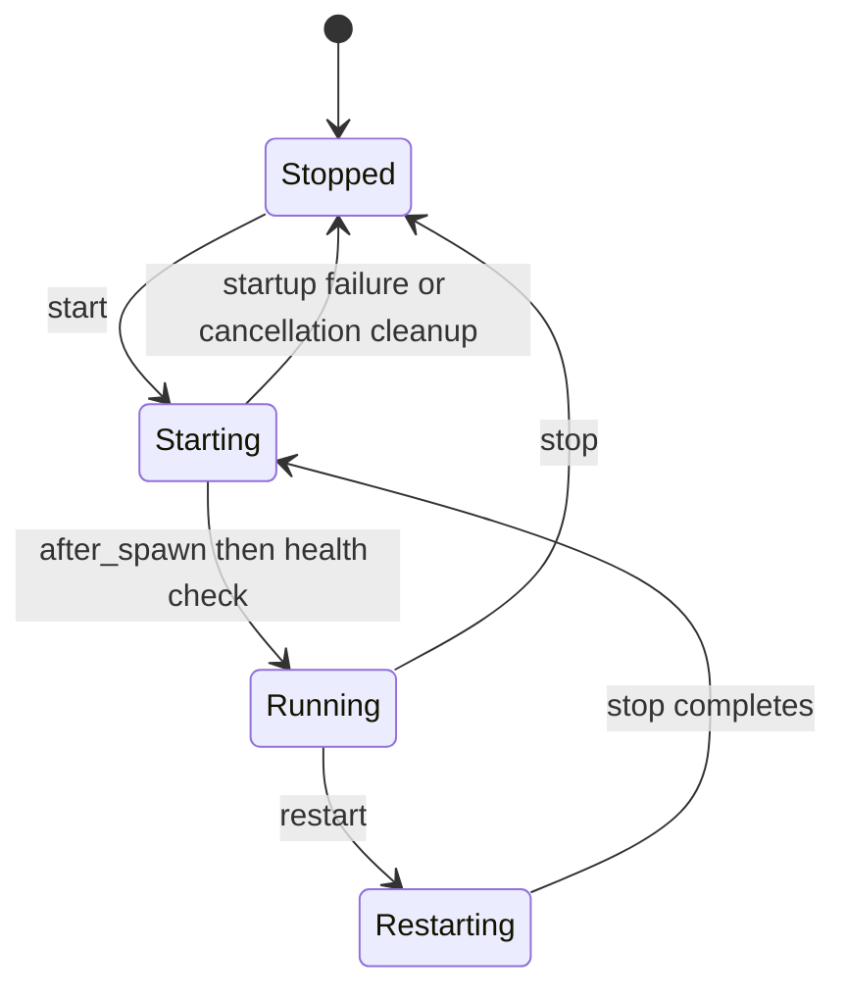
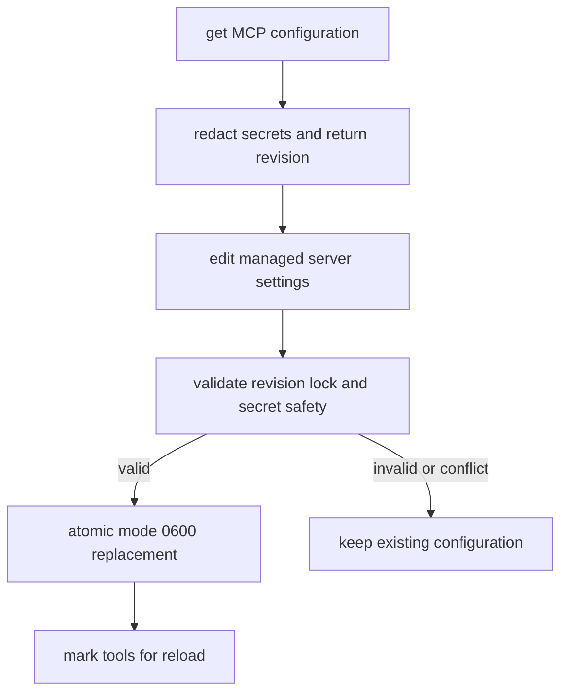

# Testing Guide

Start with the package that owns the changed boundary and run its focused file through that package's Makefile. These routes deliberately use fake models, in-process transports, temporary files, and Textual's test pilot so a regression expresses an observable contract without requiring a provider, a real server, or a live channel. See [Code Agent](../architecture/code-agent.md), [Talon](../integrations/talon.md), [Talon Scheduling](../concepts/talon-scheduling.md), and [Development](../operations/development.md) for the runtime and contributor context.

## Run the owning target

```bash
make -C libs/code test TEST_FILE=tests/unit_tests/test_server.py
make -C libs/code test TEST_FILE=tests/unit_tests/test_model_metadata.py
make -C libs/code test TEST_FILE=tests/unit_tests/tui/widgets/test_messages.py
make -C libs/talon test TEST_FILE=tests/test_speech.py
make -C libs/talon test TEST_FILE=tests/unit_tests/test_mcp_config.py
make -C libs/talon test TEST_FILE=tests/unit_tests/test_background.py
make -C libs/talon lint
```

`libs/code` runs unit tests with xdist, coverage, and sockets disabled except Unix sockets; `TEST_FILE` defaults to `tests/unit_tests/`. Its integration target changes the selection to `tests/integration_tests/` and applies a 30-second timeout. `libs/talon` first runs the WhatsApp bridge's Node tests, then runs pytest with sockets disabled, a 10-second timeout, and coverage; its default `TEST_FILE` is `tests/`. Do not replace these invocations with an ad-hoc pytest command when checking a package-owned change: the targets encode the intended test group and execution constraints. Run the appropriate package `lint` target after the focused regression route.

## dcode server lifecycle and model metadata

### Server process lifecycle

Use `libs/code/tests/unit_tests/test_server.py` for launch, readiness, restart, and shutdown changes. The suite substitutes process, socket, and HTTP objects, allowing it to assert the state machine without binding a network port or spawning `langgraph dev`.



*This is the tested `ServerProcess` lifecycle: startup hooks precede readiness, and an unsuccessful start returns to a cleaned-up stopped state.*

Keep these cases focused and deterministic:

- Port `0` selects an ephemeral local port. A requested free port is retained, while a busy requested port falls back to an available one.
- Readiness targets the assistant graph endpoint, and startup markers in the child log must survive health, transport, timeout, and early-exit failures so credential or missing-package recovery guidance reaches the caller. Invalid structured details instead fall back to the original startup error.
- Startup cancellation and cancellation inside `after_spawn` must terminate the spawned process and clear process, log, and owned-config state. Cleanup failure is logged but must not mask the original startup failure.
- The `after_spawn` callback runs after process creation and before the health check. Missing runtime configuration can invoke the scaffold hook, but a hook that does not restore `langgraph.json` fails clearly. Restart must also recover a configuration purged after a successful boot.
- A restart shields and awaits process teardown when cancelled, serializes with terminal stop, and prevents competing restarts from overlapping. Add a direct test for the interleaving that motivated any concurrency change.

### Metadata is server-resolved and switch-safe

Use `test_model_metadata.py` when changing `/dcode/model`, thread model resolution, the remote client, or Textual model commands. The test client connects `RemoteAgent` to real ASGI handlers in-process, while workspace and model construction are mocked only at the external boundary.

The startup metadata endpoint is intentionally independent of a thread workspace: it can return the server runtime's metadata even if the workspace is conflicted, whereas a requested thread switch reports the conflict and must not create a model. A missing or failed server runtime produces `503`. For a valid metadata request, no explicit spec returns existing runtime metadata; an explicit spec is created using the bound workspace profile overrides, retry policy, and runtime environment rather than the terminal process environment. Malformed payloads are rejected before model creation, configuration errors are contained as client errors, and unexpected resolution exits are service failures.

On the client side, failed main-model or auxiliary-model resolution is transactional: active selections, metadata, persisted choices, and main-model state remain unchanged, and the UI receives an error. A successful bare model selection adopts the server-resolved provider. Auxiliary `/offload model`, `/auto model`, and rubric selections use server metadata without retargeting the main model; the catalog exposes only public profile fields and applies main-purpose overrides without leaking server-private profile extensions. Test both the HTTP status/payload and the retained client state.

## Textual startup and expansion behavior

`libs/code/tests/unit_tests/test_app.py` is the focused route for app startup, reconnect, queue ordering, model adoption, and modal command work. Treat `ServerReady` as repeatable: initial startup hydrates resumed history once, while later ready events drain queued input without duplicating history. A resumed thread loads history before hooks and the startup command, clears its resuming indication when restoration ends (including failures), and adopts its saved model before an initial prompt. If that adoption cannot be verified, the initial prompt must not run.

The test suite also protects a message-pump invariant: interactive modal continuations, such as the Auto-mode `/goal` criteria preference, must be scheduled off the pump. Drive this through `ChatInput.Submitted` and a real `Textual` pilot, then prove Escape resolves the modal. While the modal continuation is pending, a second goal command does not stack a screen and queued work cannot begin an overlapping agent turn.

Use `libs/code/tests/unit_tests/tui/widgets/test_messages.py` for chat rendering and expansion changes. A lazy tool group builds a large detail set in batches so UI work can run between batches; cancellation or builder failure clears partial widgets and transition state, while a completed group can collapse and rebuild in source order. For streamed assistant text, the first fragment is rendered immediately, later fragments are coalesced, and stopping a stream drains pending text and swaps to a final selectable markdown widget. A failed write retains its buffered text for retry rather than escaping through a Textual timer. Retain real-pilot tests for hover boundaries, markdown links, and rendering rather than asserting only handler internals.

## Talon speech transcription

Use both `libs/talon/tests/test_speech.py` and `libs/talon/tests/unit_tests/test_speech.py`. The lightweight route verifies configuration selection and message handling: transcription enabled without an explicit model chooses local Parakeet on CPU; legacy speech environment variables remain accepted; an explicit Parakeet model/device remains local, while an OpenAI model override chooses the OpenAI transcriber. Audio, voice, and video media are transcribed and appended to existing captions with `voice_transcribed` metadata; ordinary documents are left untouched.

The local-loader route is an optional-dependency integration regression. It builds a tiny local Parakeet repository and replaces Hub download, then proves the loader's JSON/safetensors allowlist is sufficient, duplicate `.nemo` weights are excluded, and the local pipeline can generate text. The cache-location assertion belongs in the lightweight suite: downloads use Talon's `cache/models/huggingface` directory and subsequent Transformers loading is local-only with remote code disabled.

## Talon MCP configuration and enablement

Use `test_mcp_config.py` for persistent configuration changes and `test_mcp_enabled.py` for provider loading and refresh. MCP configuration is a secret-preserving, revisioned editing boundary:

- Views redact secret values while preserving environment references. Updates merge only permitted fields, preserve unmanaged fields and real secrets by path, write atomically with mode `0600`, and request reload only after success.
- The caller supplies the observed revision. Stale revisions, lock contention, invalid input, malformed existing JSON, symlinks, and failed replacement report a safe error or conflict without changing the original file or revealing private content. Concurrent updates allow one winner rather than silently overwriting.
- In auto-approve mode, an execution-target change such as command, arguments, transport, or URL cannot reuse a restored secret, because that could redirect it. Tool-filter-only changes remain allowed; approval-required mode can make the reviewed change.
- Approval policy gates actual writes. Channel-triggered writes requiring approval only occur after approval, rejection or no handler blocks them, and cron does not request an interactive approval. Unprotected updates can proceed.



*The MCP tests verify that only a validated, current edit reaches the atomic write and reload boundary.*

A server with `enabled: false` is not merely hidden: Talon skips environment expansion, connection, and OAuth authentication, publishes no remote or authenticate tools, reports it as disabled, and refuses CLI login. Toggling the persisted boolean through the configuration tools makes `refresh_if_needed()` unload and later restore its prefixed tools; a second refresh with no configuration change is a no-op. Include invalid non-boolean values in parser coverage.

## Background subagents, local boundaries, and controls

`test_background.py` covers delivery, ownership, capacity, cancellation, and scheduled behavior. A chat delegation gets an isolated child thread and does not block later main turns. On completion, the host dispatches its result into the owning conversation; acknowledge only after the model consumes it, and requeue only the IDs associated with an undelivered reply. `/stop` and `/new` cancel only the requesting conversation's children, and cancellation discards that conversation's pending completed results.

The global background limit comes from `DEEPAGENTS_TALON_MAX_BACKGROUND_TASKS` (default four) and rejects zero, negative, fractional, and non-numeric values. Capacity is shared across conversations; inspection and cancellation are owner-scoped. Workers preserve caller context needed for history and cron origin but clear the authorization handler, report generic failure or timeout text without tool arguments, and retain a finished result when cancellation arrives too late.

Scheduled turns use a different contract. They execute delegated work inline rather than creating background jobs or consuming chat capacity, may fan out concurrently behind a separate inline ceiling, and return tool errors for timeout/failure rather than letting an exception restart the graph. Scheduled remote `start_async_task` streams the remote result inline because its task ID cannot be resolved by that turn.

Use `test_research_subagents.py` for least-privilege subagent topology. A local child receives only its task description and selected tools, not parent history or memory. It cannot invoke execution, delegation, configuration reload, or conversation-search tools unless explicitly made available; web access follows an explicit `web: true` capability rather than an agent name. There is no implicit `general-purpose` child, fork mode is rejected because each local task needs fresh context, and per-task tool selection must be valid, unique, and free of delegation tools. Reloading valid attachment changes replaces the effective graph; invalid edits leave the active graph in place and report saved changes as inactive.

`test_subagent_control.py` covers interactive control of local Talon-built workers. `inspect_subagent` exposes bounded lifecycle events and never exposes private tool output or messages; only the owning conversation can inspect or message its job. `message_subagent` accepts bounded nonblank text, queues it while a local worker is active, reports it consumed after the worker receives it, and rejects stale, opaque, foreign, or over-capacity requests. Retention may evict consumed messages but never queued messages.

## Channel approval behavior

Use `test_telegram_approvals.py` for identity and approval routing changes. A Telegram channel post without a sender may still reach the agent with `sender_id` set to `None`, but it must not create a pending tool approval in either allowlist or open exposure modes. The host returns the rejection decision instead. This is an authorization invariant, not a formatting case: add coverage for every new channel event shape that lacks a verified approving identity.

## Completion checklist

1. Run the focused package Make target, then the package lint target.
2. For server work, assert port selection, readiness ordering, diagnostic preservation, and cleanup under cancellation—not just successful spawn.
3. For model work, cover server response classification and transactionality of the caller's active state.
4. For Textual work, use a real pilot for message-pump, rendering, timer, and cancellation behavior.
5. For MCP work, test redaction, revision/lock failure, atomic persistence, policy gating, and tool reload together.
6. For Talon subagents, cover ownership, cancellation, delivery acknowledgement, capacity, scheduled inline execution, and secret-safe failure output.
7. For channel approvals, prove that unauthenticated or senderless events cannot become approvable actions.
