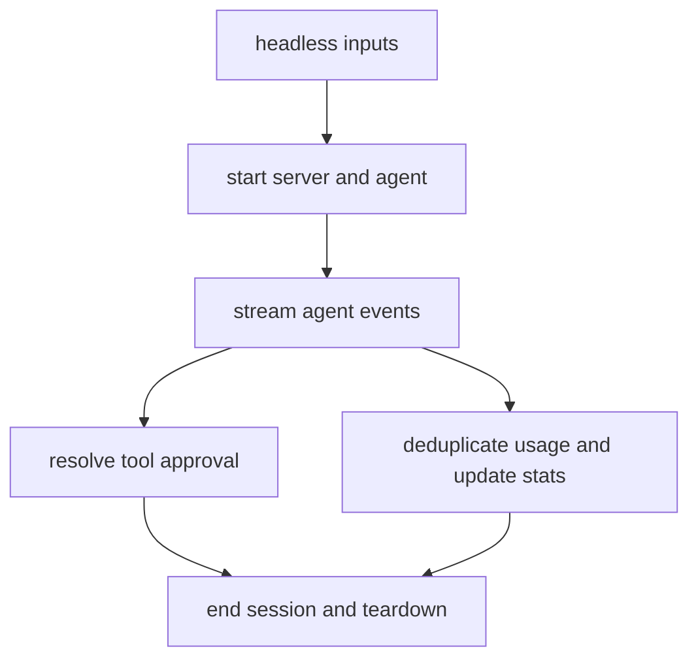
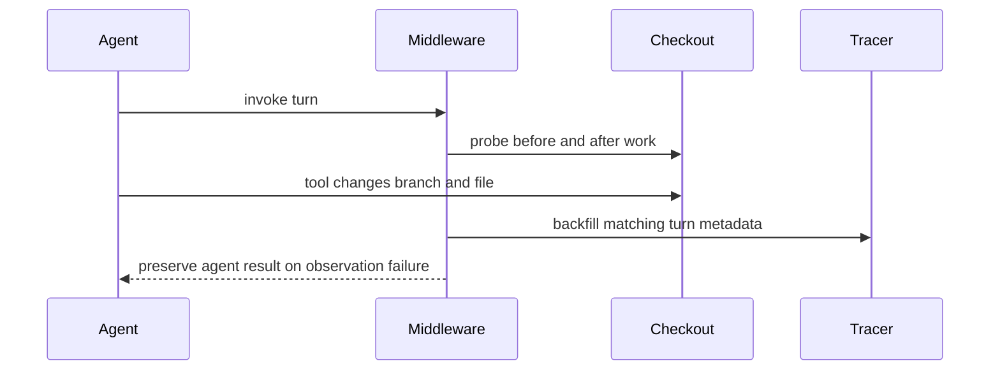
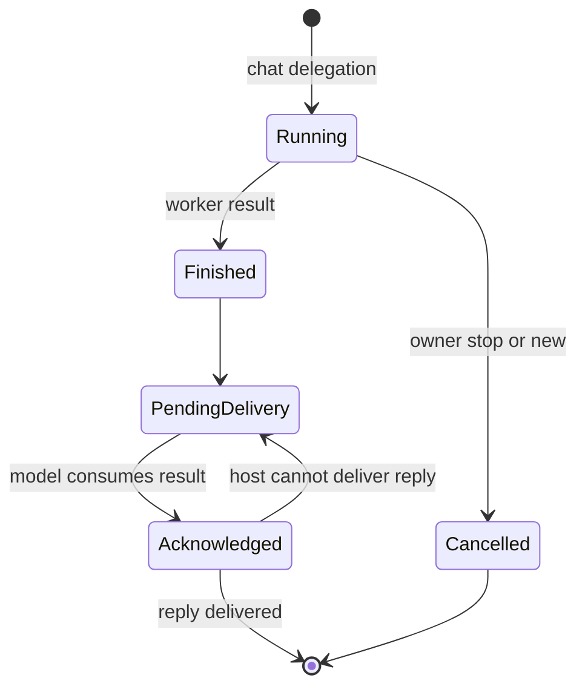

# Testing Guide

Run the narrowest owning suite from its package before expanding scope. These suites use real graphs, temporary repositories, state/filesystem backends, and shell subprocesses where the contract is at an integration boundary; use mocks only to make timing, provider, and external-service outcomes deterministic. For environment setup and the repository-wide workflow, see [Development](../operations/development.md). For the runtime models behind the focused areas, see [Trace Attribution](../concepts/trace-attribution.md), [Talon Scheduling](../concepts/talon-scheduling.md), and [Sandbox Partners](../integrations/sandbox-partners.md).

## Focused routes

Run the package target after `uv sync --all-groups`. The package Makefiles are the authority for flags: core SDK and dcode unit routes use xdist, coverage, and socket disabling except Unix sockets; their integration routes select `tests/integration_tests/` and apply a 30-second timeout. QuickJS similarly disables sockets for unit tests. The repository convention is that unexpected warnings fail tests, so do not paper over a new warning with a broad filter.

```bash
make -C libs/code test TEST_FILE=tests/unit_tests/test_cost_tracking.py
make -C libs/code test TEST_FILE=tests/unit_tests/test_git_trace_integration.py
make -C libs/code test TEST_FILE=tests/unit_tests/test_non_interactive.py
make -C libs/deepagents test TEST_FILE=tests/unit_tests/backends/test_filesystem_backend.py
make -C libs/deepagents test TEST_FILE=tests/unit_tests/test_graph.py
make -C libs/partners/quickjs test TEST_FILE=tests/unit_tests/test_fs.py
make -C libs/talon test TEST_FILE=tests/unit_tests/test_background.py
uv run --group test pytest .github/scripts/tests/workflows/test_github_action.py
```

Use a direct `uv run --group test pytest …` invocation only when isolating a node or parametrization. Follow a successful focused route with the owning package's `make lint`.

## Deep Agents SDK: graph assembly and filesystem boundaries

### Graph construction

`libs/deepagents/tests/unit_tests/test_graph.py` protects `create_deep_agent` composition rather than merely checking that a graph compiles. When changing a harness profile, middleware ordering, or a default subagent, assert the observable compiled graph: version metadata includes the editable-install marker when appropriate while retaining the LangSmith integration marker; profile lookup prefers exact model candidates while inheriting provider defaults; and description overrides copy supported tools rather than mutate caller-owned dictionaries or `BaseTool` objects.

The most consequential graph checks cover propagation across the main agent and subagents:

- A harness profile can change filesystem and task descriptions, configure or remove the default `general-purpose` subagent, and still leave the `task` tool when an explicit synchronous subagent requires it.
- Provider-specific prompt-caching middleware belongs to both the main graph and eligible subagents. An unavailable optional Bedrock module is omitted, but unrelated import failures must still surface.
- Required middleware cannot be silently excluded or duplicated. User middleware is applied at its documented extension point, and private state/schema isolation prevents a subagent's internal fields from leaking into the parent.
- Backend factories are bound at graph construction; test an actual invocation whenever changing state/backend binding rather than relying only on constructor arguments.

### Filesystem backend

`libs/deepagents/tests/unit_tests/backends/test_filesystem_backend.py` is the focused route for the concrete local backend in virtual and native path modes. Its essential safety contract is containment: virtual listings and searches preserve in-root symlink names but suppress symlinks that resolve outside the root; traversal is rejected; and symlink loops become structured errors instead of hangs.

A filesystem change should preserve the interface behavior across operations:

- `ls` is one directory deep, directory paths carry a trailing slash, and virtual paths are rooted at `/`. An omitted glob search path means the backend root; hidden paths require an explicit dot pattern.
- Text reads expose line-window metadata (`total_lines`, inclusive source line bounds, and `next_offset`); negative offsets start at the first line, a non-positive text limit is an empty successful window, and an offset beyond EOF is an error. Empty text has its special empty-content response, while binary data is not line-sliced.
- Non-UTF-8 text is an error result rather than an exception. Video—including `.mkv`—is binary and is size-checked before loading; large tool results are written beneath `large_tool_results` and replaced in the tool response with a retrievable path.
- Upload/download report per-path outcomes, including partial failures. Literal grep, glob deadlines and truncation, Python fallback, and ripgrep failure paths must preserve partial-result/error semantics instead of presenting a failed search as an empty one.

## dcode: headless lifecycle, cost ownership, and trace attribution

### Non-interactive execution

`libs/code/tests/unit_tests/test_non_interactive.py` exercises the headless client from argument plumbing through stream processing and teardown. Treat it as the change detector for command-line automation, not as a TUI test. It verifies that server startup receives the selected sandbox, owned sandbox ID, snapshot name, profile overrides, and filesystem-tool policy. Permission hooks override a headless YOLO server bypass so the client can make the hook decision while retaining the requested approval-mode context.



*The headless tests cover forwarding into server startup, stream-side accounting, approval decisions, and bounded cleanup.*

Shell approval is deliberately conservative: without an allow-list `execute` is rejected; every pipe segment must be allowed; shell substitutions and dangerous forms are rejected even if the leading command is allowed; and only `SHELL_ALLOW_ALL` approves arbitrary commands. Keep tests for quiet/no-stream output, startup commands, hooks, retries, iteration limits, standard-stream encoding, and resume separate from policy tests—these are different failure boundaries.

Usage events and message chunks can report the same request under different IDs. The headless statistics tests require the pair to count once and classify delegated (`tools:task`) usage as subagent work. This protects displayed totals from stream ordering and duplicate delivery.

### Cost tracking

`libs/code/tests/unit_tests/test_cost_tracking.py` is the cost-accounting route. It tests both price resolution and graph ownership: pricing may include input/output, cache read/creation, and reasoning categories, but the absence of detailed usage must remain distinguishable from a reported zero. Local price overrides are a fallback after upstream lookup fails; once upstream learns a model, upstream pricing wins.

The session recorder is process-wide in production, so tests install a fresh context-variable recorder. Preserve its boundaries: completed model calls are correlated to a thread and checkpoint namespace, drained once into graph state/events, and must not leak between concurrent threads, executor workers, or discarded/cancelled work. Test parent/subagent transfers, deduplication by message/invocation identity, late corrections, and summarization separately from arithmetic. The graph-level assertions ensure cumulative cost survives checkpoints and that a subagent's cost is transferred to the parent rather than counted twice.

### Git trace backfill

`libs/code/tests/unit_tests/test_git_trace_integration.py` runs a real temporary Git checkout through an agent and a LangChain tracer. It establishes retrospective attribution: after a tool changes the observed repository/branch, `GitTraceMiddleware` backfills the runs in that matching turn—including runs created before approval/resume—without overwriting caller-supplied `git_repo`, `git_branch`, unrelated metadata, attribution identity, or another enclosing turn.



*Trace tests require observed Git metadata to be applied only to the matching completed turn, while Git probing and telemetry remain optional.*

Run both synchronous and asynchronous variants when changing hooks or callback propagation. Probe and telemetry failure must not change the real agent output; a failed initial probe must not attach invented attribution, and later turns must not inherit prior turn's observed Git metadata.

## QuickJS filesystem adapter

`libs/partners/quickjs/tests/unit_tests/test_fs.py` tests `CodeInterpreterMiddleware` against actual Deep Agents backends. It is the integration route when adding an `fs` method, mapping an error, or changing host-to-JavaScript marshaling. Test both `invoke` and `ainvoke` where supported.

The JavaScript surface is deliberately asynchronous: `fs.readFile`, `writeFile`, `readdir`, `access`, and `rm` operate on `StateBackend`, `FilesystemBackend`, and `CompositeBackend` routes, so writes/deletes must reach the selected backend while unrelated paths remain on the default backend. Node-like failures are observable API: missing paths are `ENOENT`, file/directory mismatches distinguish `EISDIR`, `ENOTDIR`, and `ERR_FS_EISDIR`, invalid encoding is reported, and `rm({force: true})` permits a missing target.

Containment and failure isolation matter here too. Dot-dot paths can normalize inside the backend root but cannot escape it; unsupported argument shapes are refused with Node-style invalid-argument errors; a backend exception rejects only that filesystem call; oversized or overly deep marshaled results terminate only that `eval`, allowing a later evaluation to run. Filesystem calls participate in the PTC call budget, and filesystem contents must not appear in callback trace outputs. If no backend is configured, neither the `fs` object nor its prompt section is exposed.

## Talon: background and scheduled delegation

Use `libs/talon/tests/unit_tests/test_background.py` for the ownership and delivery state machine. A chat `task` delegation detaches into a distinct child thread so the parent can answer later messages. Completed results remain owner-scoped until the owning model consumes them; acknowledgement removes them, while a failed/cancelled turn preserves unprocessed results and host delivery failure requeues only the IDs acknowledged by that reply. `/stop` and `/new` cancel only that conversation's jobs and discard its completed results.



*Background result state is owned by a conversation and is acknowledged by model consumption, then reconciled with host delivery.*

Capacity is global, shared across conversations, and comes from `DEEPAGENTS_TALON_MAX_BACKGROUND_TASKS` (default `4`); zero, negative, fractional, and nonnumeric values fail runtime construction. Inspection and cancellation cannot disclose or operate on another owner's task. Workers inherit the necessary history/cron context but clear the authorization handler, and failures/timeouts return generic result text without tool arguments or credentials. A cancellation arriving after completion leaves the result available.

Scheduled turns follow a different path: they invoke subagents inline, create no background job, consume no chat capacity, and use a separate bounded inline fan-out limit. Inline timeout/failure becomes an error `ToolMessage`, not an exception that restarts the graph. Remote `start_async_task` streams its final result inline in a scheduled turn because that turn cannot later resolve a returned task ID; answer extraction removes encrypted reasoning and bounds result length in both modes.

## Root GitHub Action wrapper

` .github/scripts/tests/workflows/test_github_action.py` (run it with the command above; the leading space is not part of the path) validates `action.yml` as executable shell, not only YAML. It parses the action and dcode CLI parser to detect input/flag drift, then runs the real `Run dcode` body in Bash with `uvx` and `timeout` stubs. Keep the action's non-interactive boundary explicit: it must forward only supported dcode options and must not expose or forward interactive `auto_approve`.

The setup slice checks the input grammar and command assembly: prompt is mandatory; timeout and max-turns are positive integers while max-retries is non-negative; boolean and interpreter inputs are tri-state-aware; stdin and skill are mutually exclusive; optional values are omitted when empty; and JSON model parameters must be an object. Leading-zero numeric input is accepted and must be handled as base 10 when converted to a timeout duration.

The full-body harness protects operational behavior: the action captures the agent exit status through its output pipeline, writes that value to `$GITHUB_OUTPUT`, and exits with the same code. In stdin mode, a producer `SIGPIPE` caused by an early-exiting agent must not replace the agent's successful exit code. Extend this real-shell harness when changing quoting, command construction, timeout arithmetic, or output capture.

## Completion checklist

1. Run the focused route for every boundary changed, then the package `lint` target.
2. For SDK graph/filesystem work, exercise the compiled graph or real temporary filesystem, including containment and error-result behavior.
3. For dcode headless changes, cover server argument forwarding, approval policy, duplicate usage correlation, and teardown; for cost/trace changes, cover identity, isolation, and failure-tolerant attribution.
4. For QuickJS, assert JavaScript-visible values and errors against each backend route, not Python helper internals.
5. For Talon, test owner scope, acknowledgement/requeue behavior, shared capacity, and the scheduled inline path separately.
6. For the Action, execute the `Run dcode` shell body with stubs; parser/YAML inspection alone cannot validate shell exit and pipeline behavior.
