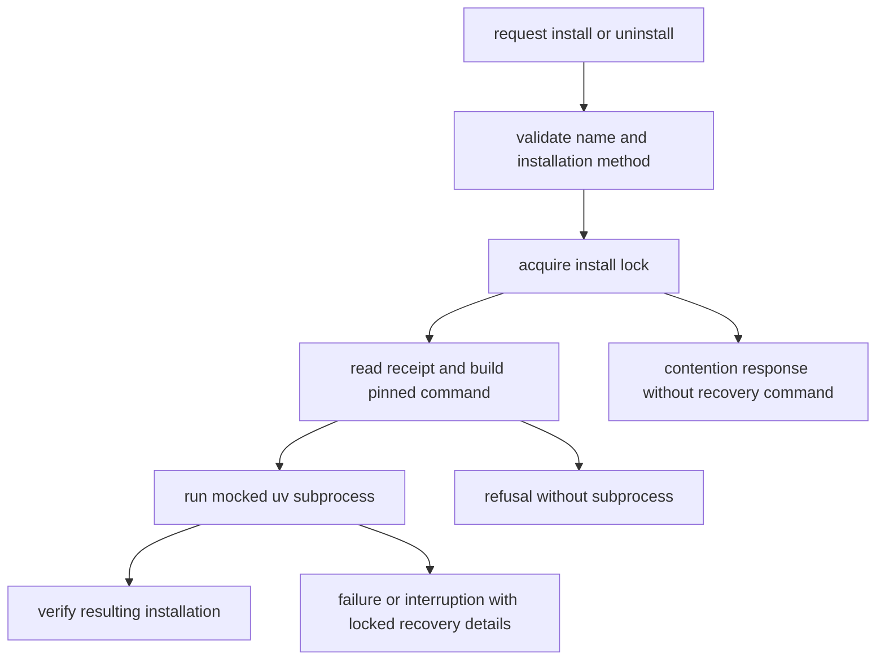
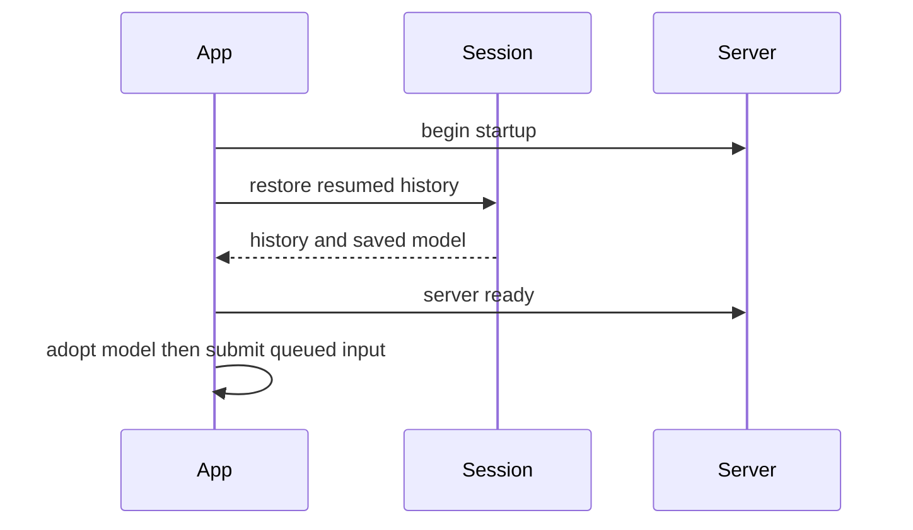
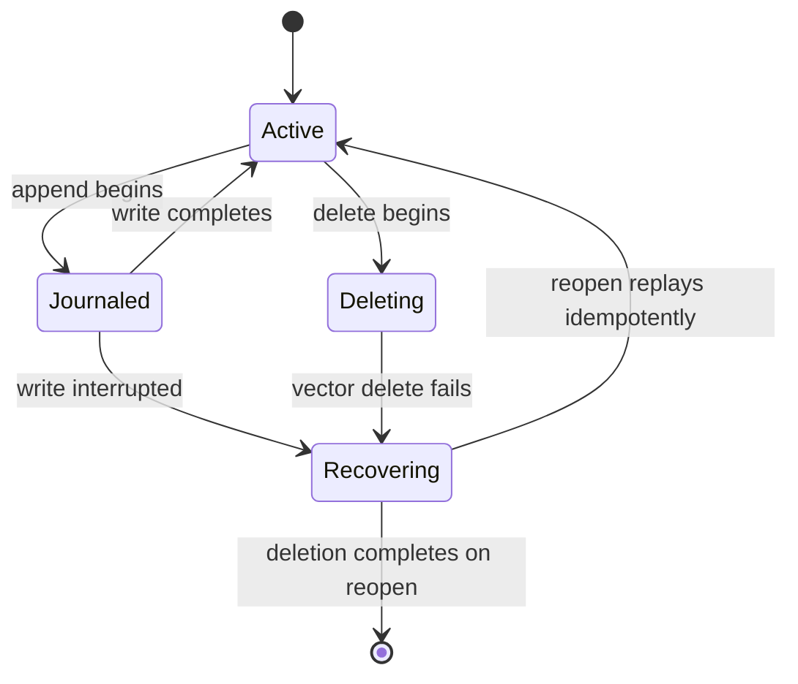

# Testing Guide

Put a network-free regression in the owning package's `tests/unit_tests/` tree; reserve `tests/integration_tests/` for a real network boundary. Test an observable contract—persisted state, visible message, wire payload, filesystem result, or safe failure—not helper ordering. Packages use automatic asyncio handling, so do not add `@pytest.mark.asyncio`; unaccepted pytest warnings fail the suite. See [Development](../operations/development.md), [dcode installation and updates](../operations/dcode-install-and-update.md), [Talon history storage](../concepts/talon-history-storage.md), and [Talon scheduling](../concepts/talon-scheduling.md).

## Run the narrow package target

Use the owning Makefile so the dependency group, coverage, socket policy, timeout, and package hooks match CI.

```bash
make -C libs/code test TEST_FILE=tests/unit_tests/test_install_command.py
make -C libs/code test TEST_FILE=tests/unit_tests/test_python_migration_bridge.py
make -C libs/code test TEST_FILE=tests/unit_tests/test_uninstall_command.py
make -C libs/code test TEST_FILE=tests/unit_tests/test_update_check.py
make -C libs/code test TEST_FILE=tests/unit_tests/test_app.py
make -C libs/code test TEST_FILE=tests/unit_tests/test_config.py
make -C libs/code test TEST_FILE=tests/unit_tests/test_headless_resume.py
make -C libs/code test TEST_FILE=tests/unit_tests/test_mcp_auth.py
make -C libs/code test TEST_FILE=tests/unit_tests/plugins/test_plugin_updates.py
make -C libs/code test TEST_FILE=tests/unit_tests/hooks/test_engine.py
make -C libs/code test TEST_FILE=tests/unit_tests/test_git_trace_integration.py
make -C libs/code test TEST_FILE=tests/unit_tests/test_turn_trace.py
make -C libs/partners/quickjs test TEST_FILE=tests/unit_tests/smoke_tests/test_system_prompt.py
make -C libs/partners/quickjs update_snapshots
make -C libs/talon test TEST_FILE=tests/test_host.py
make -C libs/talon test TEST_FILE=tests/test_observability.py
make -C libs/talon test TEST_FILE=tests/test_runtime.py
make -C libs/talon test TEST_FILE=tests/unit_tests/test_history_backends.py
make -C libs/talon test TEST_FILE=tests/unit_tests/test_store_archive.py
make -C libs/talon test_bridge
```

`libs/code` defaults to `tests/unit_tests/`, uses xdist, and disables sockets except Unix sockets; its integration target selects `tests/integration_tests/` with a 30-second timeout. QuickJS also defaults to unit tests with sockets disabled, while Talon's target runs its WhatsApp bridge tests before socket-disabled pytest with a 10-second timeout. Do not replace `make -C libs/talon test` with a raw Python-only run when changing the bridge: its prerequisite is how the Node tests remain part of the package contract. Run `make lint` in the changed package after focused tests pass.

## dcode install, uninstall, and update: preserve the repair path

These tests exercise a self-modifying tool installation. Keep them hermetic: redirect `sys.prefix`, managed configuration and logs to `tmp_path`; write a minimal `uv-receipt.toml`; mock `requests.get`, `shutil.which`, and `_run_install_subprocess`; and use Textual's `run_test()` only where the user-facing command path matters. No test should invoke PyPI, `uv`, or an actual installation.

The receipt is the source of truth for a uv-tool rebuild. Test command generation with extras, the selected interpreter, and `--with` packages, not with packages discovered incidentally in site-packages. Removal must retain selected extras and package context, normalize a requested extra name, and rebuild the last-extra case as the pinned plain package. It must refuse malformed receipts, unsupported custom package sources, protected base extras, absent extras, and an extra still supplied by a composite selection. A successful removal must stay removed on a later upgrade or extra install.

At the performer boundary, assert the no-spawn contracts first: invalid names, editable/non-uv installs, absent extras, an unknown installed version, missing `uv`, and a contended install lock must not run a subprocess. Lock contention is specifically not a manual-recovery situation: the response must not encourage a concurrent `--reinstall` while the holder may be rewriting the environment. For a real failed or interrupted rebuild, assert the result carries the command captured while holding the lock; the CLI writes a log, truncates displayed resolver output, returns a nonzero (or `130` for interruption), and only prints a recovery command when it is safe.

Test both CLI forms and their exit semantics: `dcode uninstall NAME` and `dcode --uninstall NAME` share the request handler, while invalid input is a usage error. A missing extra is an idempotent shell-success no-op; a protected or composite-conflicted removal is a refusal. This separation makes automation safe while retaining helpful interactive output.

The TUI `/install` seam needs controlled `ExtraInstallOutcome`/`InstallOutcome` doubles. Failed extra installation is an `ErrorMessage` containing the reason, log path, and manual command; Windows-style deferral is guidance rather than an error. If recovery-command formatting fails after the operation began, keep the previously resolved command. Confirm/cancel/timeout/mount-failure paths for `/install NAME --package` must not accidentally install. Post-install prompts are detached from Textual's message pump: submit through `ChatInput.Submitted` and press Enter in the real modal to prove the UI remains responsive. When an install lock is contended, assert the displayed error withholds the manual command.



*The update/install tests distinguish a safe refusal or repair instruction from an environment mutation.*

For a Python compatibility migration, mock release metadata and subprocess readback independently. A compatible interpreter retains the receipt interpreter; an incompatible one selects only the supported forward bridge and reconstructs a pinned `uv tool install -U` command from the receipt, including extras, additional packages, and targeted pre-release constraints. Announce the migration before the install. Test cancellation, failed migration, unavailable/malformed receipts, metadata failure, and Windows/live-session deferral as observable recovery paths: no environment mutation must occur when migration is deferred or preflight cannot safely reconstruct it. Finally, verify the target version using the rebuilt interpreter after a migration (or the local distribution in place), and treat an ambiguous or absent readback as unverified rather than success.

The broader `test_update_check.py` covers the same boundaries at cache and locking scale. Use a temporary cache and mock HTTP: a fresh cache can answer without HTTP, whereas corrupt or stale data is not authoritative. Exercise process and thread lock contention without racing the real tool installation, temporary prerequisite-constraint cleanup even on error, and post-update PATH-shadow detection with fake directories and symlinks.

## Startup, reload, and resume: test ordering at the UI boundary

`DeepAgentsApp` has asynchronous startup, history restoration, model adoption, and queue draining. A regression test should use Textual's local test harness and controlled server/session doubles, then assert what the user can observe: an initial prompt remains queued until `ServerReady`; restored history arrives before a startup command; a resumed model is adopted before the first submission; and failure to adopt it blocks that submission. On reconnect, ensure history is not loaded again and queued work drains only when the session is usable.



*The startup tests protect user-visible ordering rather than implementation task scheduling.*

Use `test_config.py` for configuration transitions that cross process and environment boundaries. In particular, a project-directory switch must refresh managed `.env` values while retaining shell-supplied values, and reloading must restore the user's LangSmith environment over an in-process agent override. Exercise malformed carrier data as a safe refusal: report it without replacing it with a newly trusted value.

For `dcode -r`, isolate the session store in `test_headless_resume.py`. A valid target supplies its saved agent and cwd; missing IDs offer similar IDs, policy-blocked threads fail, and a different or missing original cwd reports a conflict. The launch model prefers the checkpoint's valid stored model, then the configured default, and raises when neither exists. This is the focused seam for [running a dcode session](../workflows/run-dcode-session.md), not the TUI.

## Plugins, MCP, hooks, and trace boundaries

Use a temporary marketplace and state/config directories in `test_plugin_updates.py`. A discovered remote version is recorded as available and announced once, but it must not change the installed version. A refresh failure preserves that saved update and does not re-notify it; an opt-in manifest can install the update. Test the command/UI boundary too: `plugin update --check` reports availability, the actual update requests `/reload`, and the manager exposes the update action.

`FileTokenStorage` is a security boundary. Test tokens and OAuth client metadata together through its async API using a fake home, never a real credential file. The intended invariants are server isolation—including same server names at different URLs—private `0600` files on POSIX, absolute expiry recorded when tokens are accepted, and per-file synchronization that preserves independent concurrent mutations without serializing unrelated servers. Reject path-like or otherwise unsafe server names; a corrupt file must fail with remediation guidance rather than silently becoming empty. Use local `httpx`/`httpx2` fixtures for challenge, metadata, refresh, and login failures; do not use a real OAuth endpoint.

A hook snapshot selects handlers by event and supported matcher. `test_engine.py` projects domain events into the command-hook wire input: it carries a session ID and event-specific fields such as prompts, tool IDs, notification type, failure details, compact trigger, or subagent identity. Cover exit/error and timeout behavior with local commands, then assert the reduced permission or block result. The reducer applies results in configuration order even when commands finish in another order; permission precedence is deny, then ask, then allow. A captured snapshot must remain the one used for an in-flight invocation.

For Git attribution, use temporary Git repositories, fake models, `InMemorySaver`, and a recording `LangChainTracer`. Assert retrospective metadata updates on completed runs without replacing supplied metadata or contaminating a later turn. Optional Git probing or telemetry failure must not make agent work fail. At the lower trace seam, a captured trace spans interrupted/resumed graph roots, updates only completed runs without resending their payload, preserves destination and timing, and requires both tracing and a turn scope.

## Talon history storage: test persistence as a recoverable boundary

Use temporary archives and `InMemoryStore`/SQLite test doubles rather than remote databases for unit coverage. A URI may select SQLite, MongoDB, PostgreSQL, or an installed backend plugin, but configuration errors and startup exceptions must redact a credential-bearing URI. A custom backend must be unambiguous and close its resource; unsupported or missing optional backends fail closed instead of silently falling back to a different store. For SQLite, preserve URI connection options and wait for a failed connection's worker shutdown before reporting startup failure.

Archive tests should model interrupted metadata and vector operations explicitly. A failed multi-chunk append leaves a journal and succeeds idempotently after reopen without duplicate content. Cancellation while writing waits until the write reaches a durable state before release. When vector deletion fails, metadata content becomes unavailable immediately, appends to that deleting session are rejected, and reopening completes deletion without resurrecting entries or vectors. A partial metadata deletion is likewise retryable. Keep vector indexing asynchronous: a blocked embedding/vector write must not block the next durable archive append.



*The archive tests protect durable content and deletion safety across interruption, rather than a particular storage implementation.*

## Talon host and runtime: assert lifecycle and authority contracts

Use `RecordingChannel`, scheduler, and agent fakes plus events—not live providers—to test `TalonHost`. Startup starts the agent, scheduler, and channels and shutdown releases them. If a channel acquires a bridge resource then fails during `start()`, the host must stop that channel and the agent, leave later channels unstarted, and remain not running. Finished conversations must discard their task, lock, and generation bookkeeping.

Channel turns are keyed by provider plus conversation ID, while the original provider conversation ID remains metadata for replies and cron origins. A new incoming message interrupts/recoveries the current turn before beginning its successor; `/new` creates a fresh durable thread. If interruption recovery itself fails, the replacement request is explicitly marked degraded rather than silently treated as clean. A scheduled timeout repairs its thread and the following fire uses a new thread; two executions of one job do not overlap.

History reset is a two-step failure-sensitive operation: persist the reset counter before clearing the archive, and do not clear or change the active conversation if that counter cannot be saved. If archive clearing fails, leave the in-memory and persisted conversation mapping unchanged, explain that some history may already be deleted, and make a retry possible. Only a successful retry advances the reset counter and announces completion.

At runtime, replace `create_deep_agent` with a recording graph to assert assembled inputs and runtime-visible behavior: backend/checkpointer ownership, assistant instructions, skills and memory paths, built-in and custom tools, and local plus declarative async subagents. Refreshing tools affects a subsequent graph; MCP reload is transactional, so a failed replacement leaves the prior graph and tool set in service. Bind an authorization handler only for the active invocation and verify it is cleared afterward. Recovery must repair a dangling tool call before appending the interruption marker, and the graph used for an approval must remain stable until that approval resolves. If background workers refuse to stop, runtime shutdown must retain the graph and checkpointer rather than closing resources they may still write.

Authorization tests must keep secrets observable only through their absence. Feed callback URLs through a recording channel and verify that only the originating provider, conversation, operator, and matching redirect endpoint can satisfy a pending authorization; unsolicited or cross-channel callbacks do not reach the model. Error replies to users are generic while logs may record a safe diagnostic.

## Talon observability and WhatsApp bridge seams

Test observability by inspecting structured captured logs and the `langsmith.tracing_context` arguments, not an external tracing service. LangSmith tracing requires both explicit `LANGSMITH_TRACING` opt-in and an API key. A host turn supplies project/tags and channel, normalized conversation, origin conversation, sender, message, and approval metadata. JSON events must redact conversation IDs, authorization/header values, URL credentials and query secrets. Agent activity logging is separately opt-in; previews must redact credential-like values, remain bounded, and stop traversing deeply nested data rather than exhausting the event loop.

The WhatsApp bridge is a Node seam. Run its `node:test` files through `make -C libs/talon test_bridge`, with fake browser-page/module APIs and no WhatsApp connection. Cover compatibility across legacy, renamed, and component IDs without mutating frozen message objects; install message-key compatibility before upstream listeners. Self-chat messages and approval reactions must resolve the paired phone/LID identity consistently. Reaction conversion filters malformed, broadcast, and inappropriate self reactions, while diagnostics expose only a reason—not private IDs or payload text. `AckTracker` must reconcile an acknowledgement arriving before registration, complete registered terminal acknowledgements, and time out pending sends; duplicate-body reservations persist only while sends remain in flight.

For media, fake the page cache, lookup, and download manager. Voice download must pass the actual MIME type into decryption and preserve returned base64, filename, MIME type, and size. Missing, unresolved, reuploading, or 404 media is unavailable rather than fatal; other download and resolution failures propagate so the caller can handle a genuine bridge failure.

## QuickJS prompt snapshots

QuickJS smoke tests render a real `create_deep_agent` graph with `CodeInterpreterMiddleware` and a deterministic fake model, then snapshot the first system message. Keep the matrix representative: no tools, mixed PTC tools, each `thread`, `turn`, and `call` persistence mode, no timeout, and nested tool schemas. The no-timeout case also has a semantic assertion that timeout language is absent; retain such assertions because snapshots are drift detectors, not the behavioral specification.

When prompt text intentionally changes, review the captured text and semantic expectations first, then update only this suite:

```bash
make -C libs/partners/quickjs update_snapshots
```

## Completion checklist

1. Select the package and narrowest test file; isolate paths with `tmp_path` and replace HTTP, subprocess, provider, graph, and browser boundaries with fakes.
2. Assert durable receipts/archive state, user-visible failure and recovery messages, or emitted structured payloads—not private helper-call order.
3. Preserve failure semantics: lock contention gives no bypass command; an unverified migration does not launch; failed graph replacement retains the working graph; failed archive deletion cannot resurrect data.
4. Run the Talon Makefile target when bridge behavior changes so Node tests run first; do not open a real provider socket.
5. Keep telemetry and logs redacted and bounded, review QuickJS semantics before snapshot regeneration, and finish with the owning `make lint`.
