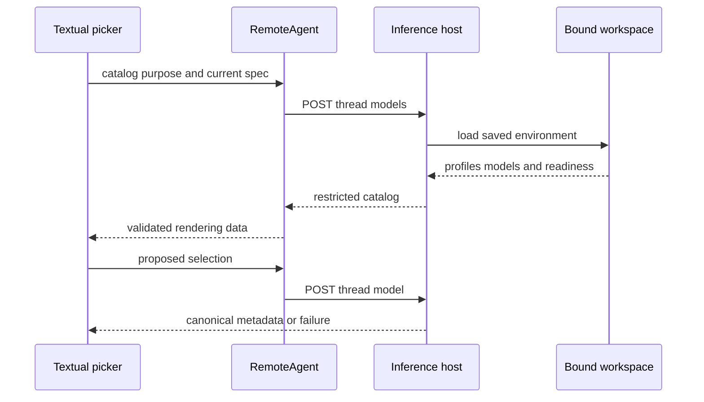
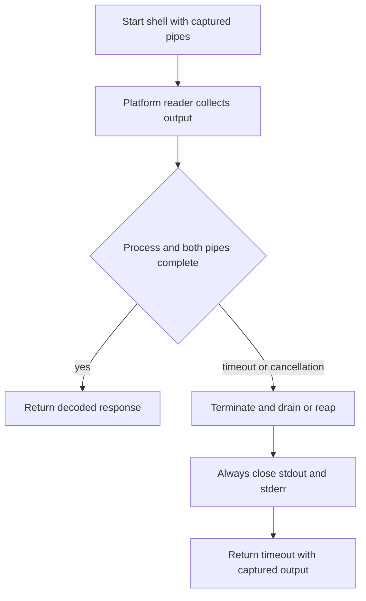
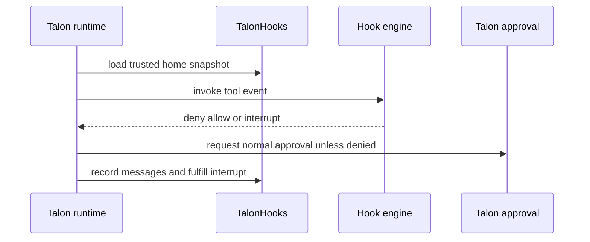

# Testing Guide

Use focused unit tests to protect observable contracts at integration boundaries without requiring provider accounts, a network, developer configuration, or live GitHub. This guide retains the dcode model-catalog route and adds owning routes for local shell processes, Talon hook/subagent isolation, extras metadata, and release-note automation. See [Backends](../concepts/backends.md), [Profiles and models](../concepts/profiles-models.md), [Talon scheduling](../concepts/talon-scheduling.md), [Talon integration](../integrations/talon.md), [Development and release operations](../operations/development.md), and [Quickstart](../quickstart.md) for the surrounding behavior.

## Choose the owning package and command

The monorepo packages are independently versioned. Work in the package being changed, synchronize explicitly with `uv`, and use its `Makefile` as the command contract. Unit targets disable network sockets except Unix sockets; integration targets are the separate route when network access is genuinely part of the behavior. Warnings are errors unless specifically allowlisted.

```bash
# dcode catalog, metadata, selector, and extras status
cd libs/code
uv sync --all-groups
make test TEST_FILE=tests/unit_tests/test_model_catalog.py
make test TEST_FILE=tests/unit_tests/test_model_metadata.py
make test TEST_FILE=tests/unit_tests/tui/widgets/test_model_selector.py
make test TEST_FILE=tests/unit_tests/test_extras_info.py
make lint

# SDK local-shell and platform reader behavior
cd ../deepagents
uv sync --all-groups
make test TEST_FILE=tests/unit_tests/backends/test_local_shell_backend.py
make test TEST_FILE=tests/unit_tests/backends/test_posix_process.py
make test TEST_FILE=tests/unit_tests/backends/test_windows_process.py
make lint

# Talon hooks and research-subagent boundaries
cd ../talon
uv sync --all-groups
make test TEST_FILE=tests/unit_tests/test_hooks.py
make test TEST_FILE=tests/unit_tests/test_research_subagents.py
make lint

# Release-note automation is Node's built-in test runner
cd ../..
node --test .github/scripts/tests/release/release-notes.test.js
```

The `libs/code` focused test target runs pytest with xdist, coverage, benchmark suppression, and sockets disabled except Unix sockets; package guidance requires deterministic network-free tests under `tests/unit_tests/`, automatic asyncio mode, and warnings treated as errors. The SDK target has the same hermetic socket policy and adds verbose output; Talon runs its Python tests with a ten-second timeout and also runs its WhatsApp bridge Node tests as a prerequisite. Prefer these targets over a bare pytest command so local execution matches package policy.

## Route by changed contract

| Change | Focused route | Test observable invariants, not implementation call order |
| --- | --- | --- |
| Catalog payload, metadata endpoint, selector/default flow | `libs/code/tests/unit_tests/test_model_catalog.py`, `test_model_metadata.py`, `tui/widgets/test_model_selector.py` | Host authority, presentation-only payloads, policy/setup ordering, state after async success or failure |
| Extras taxonomy or version diagnostics | `libs/code/tests/unit_tests/test_extras_info.py` | Complete installed extras only, declared taxonomy is exact and disjoint, editable installs are correctly attributed |
| `LocalShellBackend`, timeout/cancellation, output capture | `libs/deepagents/tests/unit_tests/backends/test_local_shell_backend.py` | Descendant cleanup, response semantics, pipe closure, byte-safe output, interrupt preservation |
| POSIX selector or Windows pipe reader | `test_posix_process.py`, `test_windows_process.py` | Retained partial output across polls, EOF plus process exit, no writer-induced hang, platform-specific error handling |
| Talon hooks, approvals, transcript isolation | `libs/talon/tests/unit_tests/test_hooks.py` | Trusted-home loading, deny versus approval behavior, reload/snapshot rules, independent sessions |
| Talon delegated research agents | `libs/talon/tests/unit_tests/test_research_subagents.py` | Fresh context, explicit capabilities, no inherited private context, approval/MCP protection |
| Curated release-note bot | `.github/scripts/tests/release/release-notes.test.js` | Trusted trigger and comment identity, exact section parsing, stale/TOCTOU rejection, registry-scoped writes |

When a change crosses one of these boundaries, run both sides. For example, a hook change that affects a child graph needs hook and subagent routes; a timeout change needs both the backend route and the relevant POSIX or Windows reader route. Keep these unit tests hermetic: fake processes, pipes, models, hook commands, temporary paths, and in-memory GitHub clients exercise lifecycle behavior without live providers or external services.

## dcode model catalog and selector

A connected picker must obtain its catalog from the inference host. `RemoteAgent.aget_model_catalog()` binds catalog discovery to a thread workspace, posts purpose, recommendations, and current spec to the thread models endpoint, validates the response as `ModelCatalog`, and applies a 60-second timeout. The endpoint rejects an invalid request shape before workspace/model work, discovers in the bound workspace's saved model environment on a worker thread, applies profile overrides only for the main purpose, and distinguishes workspace conflict (409), invalid configuration/input (422), and unavailable/unexpected discovery failure (503).



*Catalog discovery and proposed-model validation happen in the workspace that will run inference; the picker receives presentation data only.*

Build an in-process host fixture instead of consulting installed integrations, credentials, local config, or the network. At the UI boundary, inject `AsyncMock` catalog/resolution functions and make local `ModelConfig.load`, provider discovery, and catalog loading fail if a remote picker reaches them.

### Catalog boundary invariants

Host-side catalog loading assembles available models and provider readiness, retains allowed enabled recommended/current specs, reports enabled known providers even when they have no discovered rows, omits disabled/disallowed entries, and isolates individual provider failures. The strict catalog boundary carries only presentation data: profiles are filtered to an allowlisted scalar set with override provenance, while providers expose readiness and display/setup metadata without credential values or arbitrary configuration. A configured custom provider with no discovered models must still be represented so a typed custom spec can route to setup.

A server-backed selector uses the supplied catalog rather than local provider/config data, including for highlighting, label-based search, and selection; configured custom providers with no discovered models still route a typed spec to installation or authentication setup. The selector focuses its filter before asynchronous loading, reapplies text entered during loading, abandons late data after dismissal, searches the full unfiltered list for a nonempty query, and keeps recent/current choices in the recommended view.

For a typed custom model, a selector checks `models.allowed` before provider installation or authentication; in a catalog-backed selector, bare or ambiguous/unrecognized provider prefixes are deferred to inference-host resolution instead of using local provider inference. Selection routes missing provider packages to an install confirmation, missing regular credentials to an API-key prompt, and missing Codex credentials through a confirmation-gated OAuth flow; cancelled setup keeps the selector open and refreshes it.

### Defaults and metadata failure routes

`Ctrl+S` uses an explicit default scope and runs default validation/persistence asynchronously; it prevents overlapping requests, stores a canonical resolved spec only after validation, permits clearing an already stored unavailable selection, and guards against stale results after dismissal. Block the resolver or persistence writer with events, then prove keyboard responsiveness, scope isolation, failure non-mutation, and that a late result cannot save into a dismissed screen.

Metadata endpoint tests require malformed requests to fail before model construction, failed switches to preserve existing active model state, a bare switch to adopt the server-returned provider, and auxiliary selections to resolve in server context without changing the main model. When dcode has a remote agent, the app loads catalogs and resolves proposed choices through that host; otherwise it uses a threaded bootstrap loader and disconnected resolution only for local identity/policy checking.

## SDK local shell: test lifecycle and pipes

`LocalShellBackend` executes directly on the host; its filesystem virtual-root restrictions do not sandbox shell commands. Lifecycle tests therefore validate cleanup and reporting, not a claim of isolation. Exercise both `execute()` and `aexecute()` where a regression could diverge them.



*The timeout/cancellation path has one cleanup responsibility: stop what it can, retain useful output, close descriptors, and communicate incomplete cleanup to the caller.*

On POSIX, timeout or interrupt targets the shell process group, then drains and reaps under one shared cleanup deadline; pipe closure happens even if termination or reaping fails. Use a heartbeat-writing background child to prove descendants stop after a timeout, including when the shell itself exits first. Mocked cleanup tests should assert that drain and reap consume a single deadline, cleanup errors do not replace `KeyboardInterrupt`, and the timeout response warns when a process may still be alive.

The platform readers own incremental capture. `PosixProcessReader` retains bytes across polling attempts and waits for both pipe EOF and direct-process exit; closed pipes alone are not completion. `WindowsProcessReader` polls rather than creates pipe-reader threads, incrementally decodes text, treats its documented broken-pipe codes as EOF, and likewise preserves output from descendants after the shell exits. Test partial UTF-8 and newline sequences across retries, output snapshots without copying megabytes into polling timeout exceptions, and an inherited pipe writer that must not block cancellation or executor shutdown.

Keep platform tests narrow: POSIX behavior can use real `os.pipe()` and subprocess probes guarded off Windows; Windows-specific handle integration is skip-guarded while most reader state machines use mocks on every platform. Include output byte-budget cases for multibyte text and undefined locale bytes, because a decoding error must not abort a command before its side effects finish.

## Talon hooks: trusted configuration and turn isolation

Talon loads `hooks.json` from the assistant home once per turn, not from the workspace. It opens the file with no-follow semantics, accepts only a regular file, and turns unreadable, malformed, or invalid content into diagnostic snapshots so the agent turn can proceed. Test symlink substitution before and after open, nonregular files, invalid JSON/UTF-8/schema, no-config behavior, and legacy migration diagnostics.

A loaded hook snapshot is bound to a turn's thread ID and prompt ID. A child subagent receives the same configuration snapshot but a fresh agent identity, thread, prompt, response cache, and transcript. Hook fulfillment rejects a request whose snapshot or invocation context does not belong to that turn, and repeated fulfillment of an invocation uses the cached response. This makes concurrent turns and concurrent children testable as isolation properties rather than timing assumptions.



*Hook denial stops the affected call before approval; hook allowance never bypasses Talon's normal approval boundary.*

Use a temporary Python hook command that appends its JSON input to a file. Assert wire payloads for `PreToolUse`, `PostToolUse`, failure, and stop events; denial has no side effect and does not request approval; unrelated calls remain approval-eligible. Reload behavior belongs in the route too: a configuration edit between turns changes a later turn, while already-created concurrent child sessions retain their own snapshot and transcript. Do not let workspace `.deepagents` hooks execute in these tests.

## Talon research subagents: capabilities stay explicit

Talon fresh subagents receive only the delegated description and their attached tools: they do not inherit parent history, memory, or skills. `task` can add exact, unique names from the parent capability inventory to a named local subagent for that task; delegation tools are excluded, and selecting `execute` is explicit shell access. Use fake parent/child chat models and recording tools to prove the child sees the question but not a parent-private marker, configured/selected tools work, and forbidden tools return errors rather than running.

Fresh subagents compile Talon MCP, subagent-control, and applicable human-in-the-loop middleware, then create child hooks from the active parent hooks with `Stop` suppressed. Test foreground and background delegation, dynamic and configured attachment, allow/deny/approval policy, and per-child transcript/session identities. MCP tests should also prove authorization context is scoped to the child call and protocol failures are sanitized rather than exposing private error data.

Precompiled or opaque child graphs cannot expose a trustworthy tool inventory. When tool approvals are active, Talon refuses a precompiled child instead of running an unenforceable policy; fork mode is rejected because Talon subagents use fresh context. Retain those refusal tests—silently allowing a graph with unknown capabilities changes the approval boundary.

## Optional-dependency and editable-install metadata

`test_extras_info.py` is a metadata route, not an installation test. Patch `importlib.metadata` and package-version lookups to model complete, partial, absent, and composite extras. An extra appears in status only when every declared requirement is installed; composite extras are intentionally omitted because build metadata flattens them.

The taxonomy tests make `pyproject.toml` and `extras_info` a bidirectional contract: every non-composite declared extra is in exactly one of model-provider, sandbox, or standalone categories, and rendered category lists contain exactly the known extras in sorted groups. Add or remove an extra with its taxonomy and presentation update in the same change.

Editable SDK diagnostics are another ownership boundary. Use temporary sibling `libs/code` and `libs/deepagents` layouts plus synthetic `direct_url.json` records to prove source versions are credited only when the imported package actually resides under the editable source root; an unrelated checkout, unusable path, unknown package location, or source-tree egg-info record must not steal attribution. Test Windows drive-path normalization without requiring Windows.

## Release-note automation: trust and freshness gates

The release-note tests use Node's built-in test runner and a fake GitHub client that records REST and Git-data calls. This keeps trigger, comment, and TOCTOU behavior deterministic while exercising the real automation functions.

The release target comes from `release-please-config.json`: a PR is eligible only when its internal head/base repository, open/main branch, registered component branch, and `release(component): version` title agree. The component registry supplies the package changelog path and release branch; unsafe components or paths fail before a write target is derived.

Test parsing as a fail-closed trust boundary: exactly one version heading and, for the PR preview, exactly one terminator are required. Trusted override/applied comments require both the configured bot login and numeric ID, exact allowed metadata fields, correct state, and a valid single-section payload. Manual `@release-bot draft` or `apply` commands require an unambiguous command, a ready release PR, and admin/maintain/write permission; bot comments do not self-trigger and insider-only feedback does not replace the permission check.

For drafting, verify the expected head before preparing and posting, sanitize maintainer guidance before it crosses into the drafting helper, and reject output that contains release-note markers or a version heading. For application, verify the trusted draft, its heading and fingerprint, the package-scoped main delta, and exact prepared-file/PR-body snapshots before creating and moving a non-force Git ref; verify again immediately before the ref mutation. Ambiguous, malformed, truncated, or package-touching comparisons require a re-draft rather than declaring a draft fresh.

## Completion checklist

1. Synchronize the owning package, run its narrowest focused test file, then run `make lint` where the package provides it.
2. Add a test for a changed observable invariant—cleanup outcome, authorization/approval boundary, payload contract, persistence state, or trusted automation state—not merely a private helper path.
3. Use temporary files, fake processes/models/GitHub clients, in-process endpoints, and explicit synchronization events. Do not prescribe live provider tests for hermetic unit behavior.
4. Test both sides of a cross-boundary change and retain platform guards: the point is repeatable regression coverage, not accidental dependence on the developer machine.
