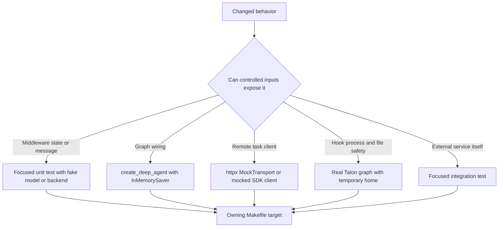
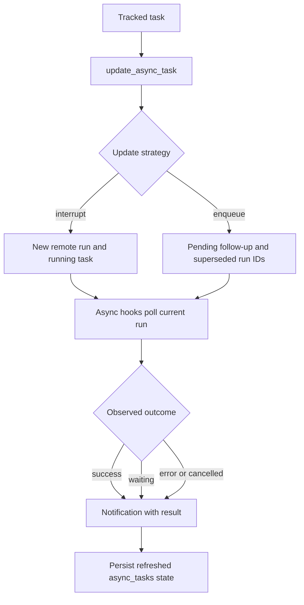

# Testing Guide

Put a network-free regression in the owning package's `tests/unit_tests/` tree and make it prove an observable contract: returned or persisted state, model-visible messages, a safe side effect, emitted notification, or cleanup result. Put a test that genuinely crosses a network boundary in `tests/integration_tests/`. Do not add `@pytest.mark.asyncio`: package configuration enables automatic asyncio handling. Warnings not explicitly accepted by the repository fail the suite. See [Development](../operations/development.md), [runtime behavior](../architecture/runtime-behavior.md), [middleware catalog](../concepts/middleware-catalog.md), and [Talon](../integrations/talon.md).

## Run the owning package command

Use the package Makefile rather than an ad hoc pytest command. It preserves the package's dependency group, coverage settings, socket policy, parallelism, and timeout.

```bash
make -C libs/deepagents test TEST_FILE=tests/unit_tests/middleware/test_rubric_middleware.py
make -C libs/deepagents test TEST_FILE=tests/unit_tests/middleware/test_pinned_skills.py
make -C libs/deepagents test TEST_FILE=tests/unit_tests/middleware/test_summarization_middleware.py
make -C libs/deepagents test TEST_FILE=tests/unit_tests/test_async_subagents.py
make -C libs/deepagents test TEST_FILE=tests/unit_tests/test_end_to_end.py PYTEST_EXTRA='-k RubricMiddleware'
make -C libs/talon test TEST_FILE=tests/test_runtime.py
make -C libs/talon test TEST_FILE=tests/unit_tests/test_hooks.py
make -C libs/talon test TEST_FILE=tests/unit_tests/test_hook_transcripts.py
```

`libs/deepagents` defaults `TEST_FILE` to `tests/unit_tests/`, runs pytest with xdist, and disables sockets except Unix sockets; its integration aliases select `tests/integration_tests/` and set a 30-second timeout. Talon's `test` target first runs its WhatsApp bridge tests, then runs socket-disabled pytest with a 10-second timeout; it accepts the same `TEST_FILE` and `PYTEST_EXTRA` narrowing. Follow a behavior change with the owning package's `make lint`.

## Choose the seam that exposes the contract



*Use controlled local seams until the external boundary is the behavior being changed; assertions should survive an implementation refactor that preserves the contract.*

## Rubric revisions: hook semantics and graph wiring

`RubricMiddleware` does nothing without a rubric. A new rubric, or reuse after a terminal attempt, resets its private attempt bookkeeping. At a natural agent stop, the after-agent hook grades the transcript: a revision verdict injects feedback and returns the graph to `model`; a terminal evaluation is recorded and allowed to finish. `GraphBubbleUp` is control flow, not a grader error, and propagates.

The rubric grader freezes the first nonempty criterion list for an attempt. If a later response under-covers it, the middleware requests one correction. A `satisfied` response that remains under-covered is downgraded so it cannot falsely end the revision loop.

Test at two levels:

- In `tests/unit_tests/middleware/test_rubric_middleware.py`, stub the grading boundary for constructor validation, state reset or stickiness, feedback, cap behavior, callbacks/events, sync/async parity, and exception propagation. Stub the grader invocation—not a sequence of incidental helper calls—when testing the coverage retry.
- In `tests/unit_tests/test_end_to_end.py`, combine `create_deep_agent`, scripted fake chat models, and `InMemorySaver`. Assert visible revision turns and the persisted rubric state with `get_state`; cover immediate success, loop-and-revise, cap termination, and recovery after a corrected full criterion response.

## Pinned skills: assert the conversation boundary

`SkillsMiddleware` loads skill metadata once per thread; resetting `skills_metadata` to `None` requests a reload. `pinned_skills` is different from metadata discovery: before the next model call, each named readable skill is added as a separate `HumanMessage` marked `lc_source="pinned_skill"`, so the model sees its instructions. Skill tools listed by a pinned skill remain available only while the pin remains in context.

`tests/unit_tests/middleware/test_pinned_skills.py` is the focused graph-level contract suite. Build an agent over a temporary skills directory with `InMemorySaver` and a fake model, then inspect model call history and checkpointed messages. Cover these observables:

- pins follow the user message in supplied order and duplicate names are emitted once;
- a pin is a stored snapshot, survives later turns, and is omitted from the immediate result payload;
- unknown, deleted, empty, oversized, or non-UTF-8 skills are skipped without preventing readable pins;
- parallel tool calls that request pins produce both pinned messages; a subagent result cannot pin a parent; and compaction removes the pin's tool disclosure.

Exercise both `invoke` and `ainvoke` where behavior is shared. Do not assert that a private pinning helper was called; assert the model-visible messages, metadata, bound tools, and persisted transcript.

## Summarization: preserve recoverability and media references

The summarization middleware turns a threshold-crossing message history into a summary plus retained recent messages, offloading evicted history to the backend. The resulting summary is marked `lc_source="summarization"`, refers to the history file only when persistence succeeded, and retains a session identifier in state so later summaries append to the same file. Independent states sharing a backend receive distinct session files.

Inline media is a key safety boundary. Tests use the local `MockBackend` and mock summarizer to verify that data URLs become content-addressed backend files and archive references, identical data is uploaded once, and image URLs survive. A per-item decode or upload failure must be represented by a placeholder and warning rather than silently preserving raw data or losing the fact that media existed. History-write failure still permits a summary, but its event has no nonexistent file path.

Use `tests/unit_tests/middleware/test_summarization_middleware.py` for threshold/no-op, message and notification shape, archive/session identity, media rewrite and failure behavior, token counting, truncation, and sync/async parity. Prefer a fake backend that records writes over assertions about internal formatting calls. The tests use `pytest.mark.anyio` where needed; do not introduce `pytest.mark.asyncio`.

## Async subagent follow-ups: task state is the contract

`AsyncSubAgentMiddleware` supplies tools to start, check, update, cancel, and list remote Agent Protocol tasks. Task identifiers and status live in `async_tasks`, allowing them to survive compaction. An update creates a run on the same remote thread and retains the task ID. The default `interrupt` strategy replaces the current run; `enqueue` leaves the follow-up pending behind it and records the superseded run IDs. Only one follow-up to a task may be sent in a parent turn.



*The tracked task follows the newest run; an older completion must not be treated as completion of an enqueued follow-up.*

In `tests/unit_tests/test_async_subagents.py`, mock the SDK client or use `httpx.MockTransport`; no server is necessary. Assert the outgoing remote payload and resulting `Command` state/message, not client call order. Include both sync and async tool entrypoints for update strategy behavior, status polling, queued task listing, cancellation of queued and earlier active runs, and rejection of parallel follow-ups. Parent-pull tests should show that completion is injected before a model call or causes one additional turn after a final answer, while timeouts and unreadable remote state do not block or fabricate a result.

## Talon runtime, hooks, and transcript erasure

`DeepAgentRuntime` owns the Talon graph wiring: it supplies the backend, checkpointer, tools, skills, memory, subagents, middleware, and per-conversation graph configuration. `tests/test_runtime.py` uses recording graphs and local temporary workspaces to test those observable wiring and lifecycle contracts: replacement tools are transactional, the active graph remains stable while an approval is outstanding, repeated conversation IDs retain the thread, and interrupted work is repaired with a matching tool result before its interruption marker.

For hook behavior, run a real local Talon graph with a fake chat model and a temporary `hooks.json`, as `tests/unit_tests/test_hooks.py` does. Assert wire payloads and effects:

- `PreToolUse` can deny execution before the side effect, but hook allow does not bypass Talon's separate approval decision;
- post-failure hooks receive failed execution, configuration reloads on later turns, and workspace hook files are not trusted as home configuration;
- concurrent conversations and subagents keep session IDs, hook snapshots, and transcript paths isolated.

Hook transcripts have an erasure boundary per durable parent conversation. Erasure writes a revocation marker before deleting child projections, legacy projections, and backups; existing writers compare the marker and reject later writes. The transcript store refuses symlinked directories, markers, and paths. `tests/unit_tests/test_hook_transcripts.py` should use actual temporary files and the saver/runtime helpers to verify restart and retry behavior, in-flight materialization serialization, isolation from other owners, removal of backups, and symlink safety. These are security and data-deletion contracts—test filesystem outcomes and rejected writes, not the order of private cleanup calls.

## Completion checklist

1. Identify the observable behavior and route it to the narrowest network-free test under `tests/unit_tests/`.
2. Use fake models, fake backends, a mock transport, or a temporary Talon home to control inputs and failures.
3. For rubric and pinning, inspect model-visible messages and checkpoint state; use an end-to-end fake-model graph only for graph wiring.
4. For summarization, prove archive references, session isolation, warnings, and no-data-loss failure behavior.
5. For async subagents, assert persisted task state, notification content, and remote payload semantics for both update strategies.
6. For Talon hooks, prove deny/approval precedence, concurrent isolation, and transcript erasure safety with real local side effects.
7. Avoid `pytest.mark.asyncio`, sleeps, provider calls, and internal-call-order assertions; run the owning `make lint` after the focused tests pass.
